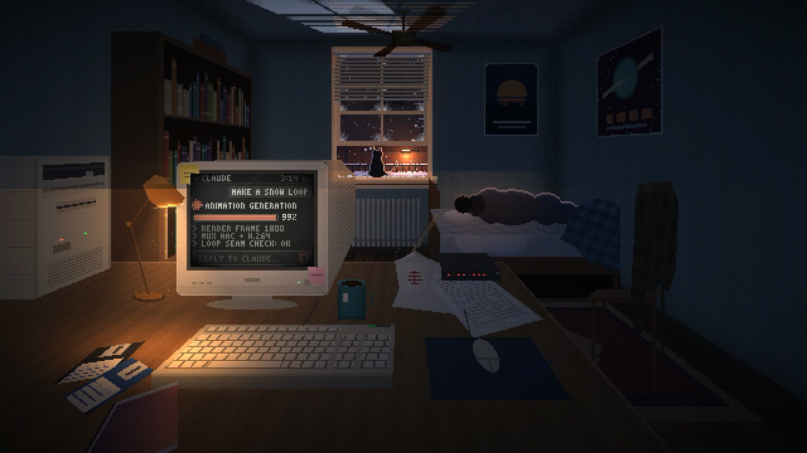
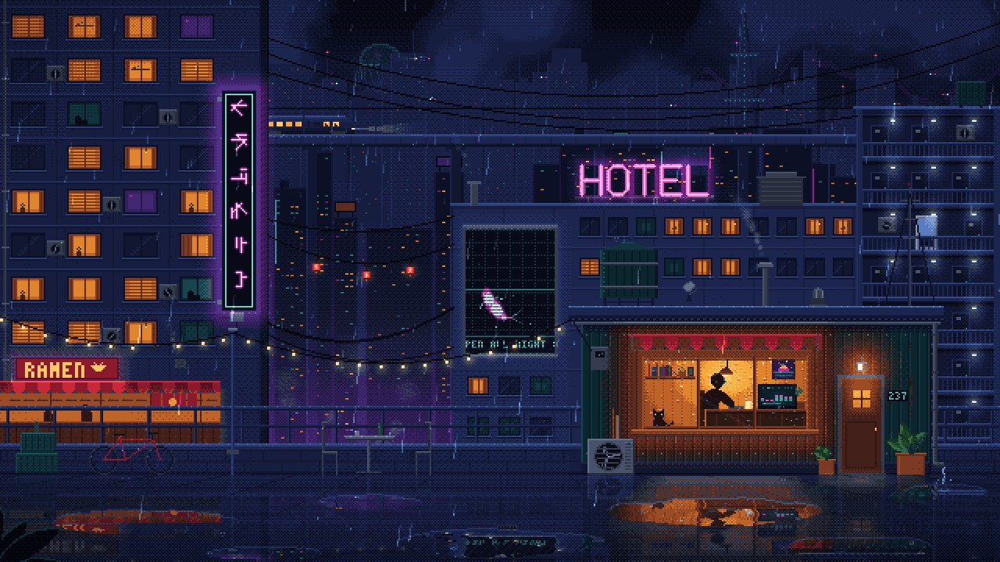
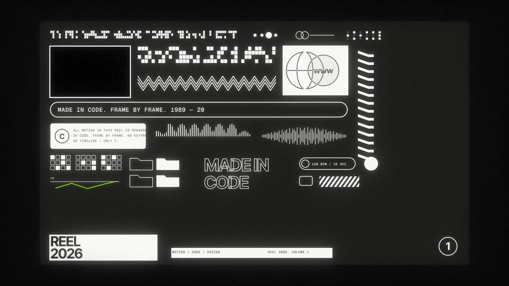
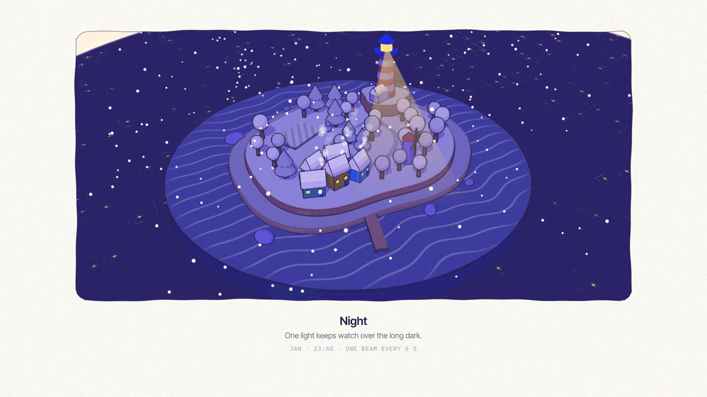
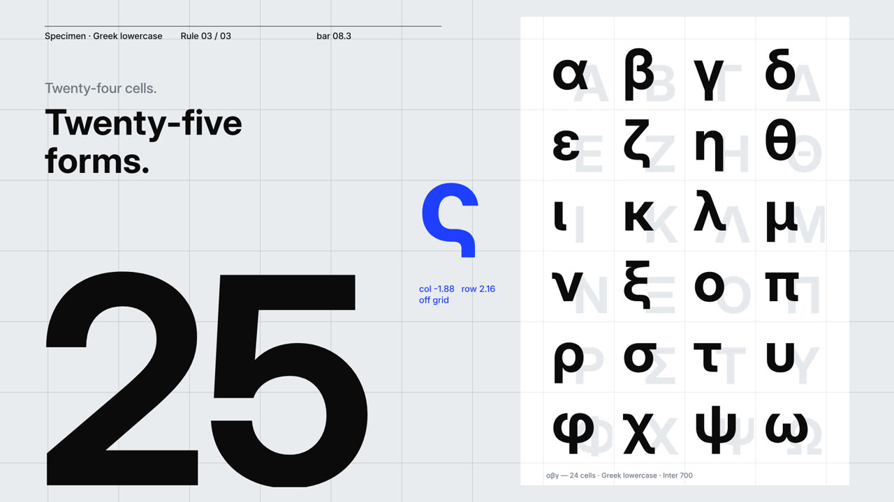
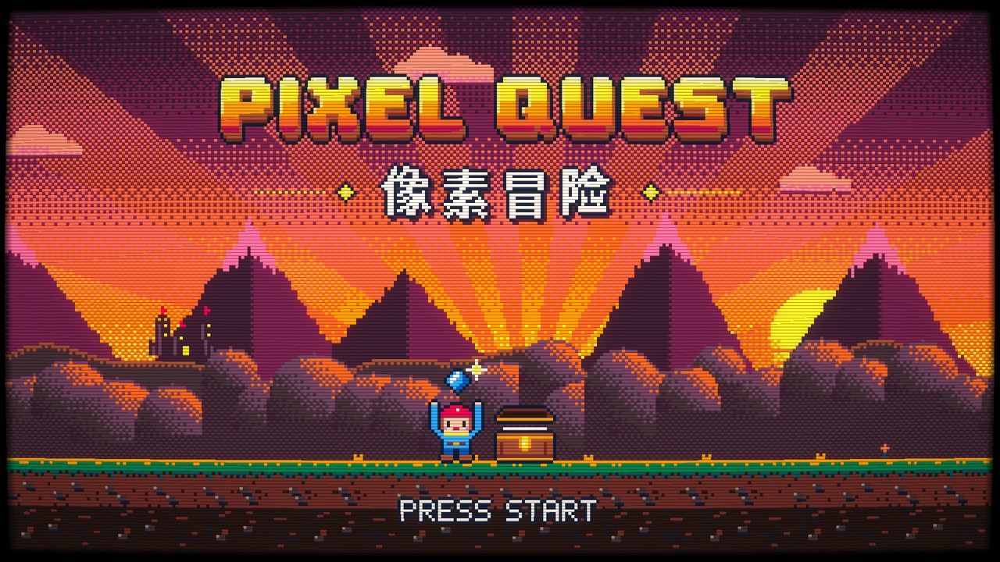
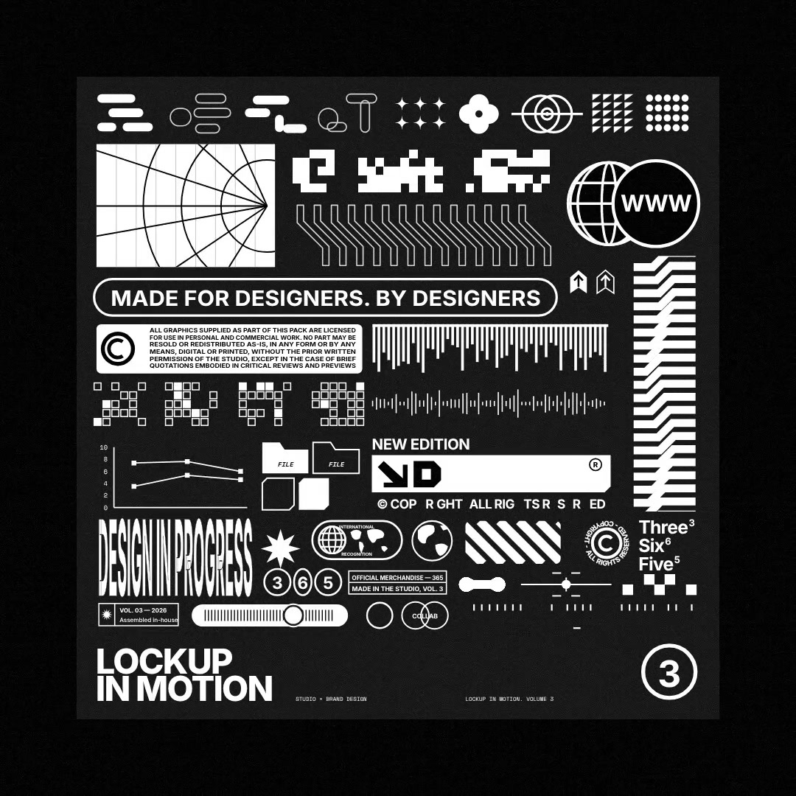

# Phil's Motion Shelf

**1,871 viral animations made by Claude writing code, each with the exact prompt the creator shared, most popular first, by likes and views on the original post.**

**[▶ Watch them all on the site](https://framevoid1312.github.io/motion-shelf/)**: it has two tabs. **Videos**: hover any card to play it and copy its prompt in one click. **Skills**: agent skills, skill files, style prompts and HyperFrames blocks, each with a picture of what it makes, from its demo, its own GitHub page or the block itself running, and its demo one click away.

Every entry here has a playable original video and a prompt you can copy and run. Most videos were made with Claude Opus 5.5 (some with Sonnet 5.5 or Fable 5.5) writing HTML, Canvas, SVG, Three.js, Blender or Remotion code; AI tools may help along the way, but the prompt is real and the video plays. Popularity is the likes and views on the original post where it was shared, checked between 3 and 10 November 2026; a dash means the count wasn't available.

## Contents

- [Skills to try](#skills-to-try)
- [Top 60](#top-60)
- [All 1,871, most popular first](#all-most-popular-first)
- [What's on the site besides these](#whats-on-the-site-besides-these)
- [How entries are chosen](#how-entries-are-chosen)
- [Phil's films](#phils-films)
- [Credits](#credits)

## Skills to try

Free agent skills for making motion and video with Claude Code, Codex and other coding agents, most-starred first (star counts checked on 9 November 2026). Each one has a card with its demo on the [site](https://framevoid1312.github.io/motion-shelf/#skills) under **Skills → Skills to try**.

| # | Skill | ★ | What it does | Licence |
|---:|---|---:|---|---|
| 1 | [**OpenMontage**](https://github.com/OpenMontageInc/OpenMontage) | 78.9k | Turns a coding agent into a full video studio: research, script, assets, editing and final composition through 12 production pipelines and hundreds of agent skills. | AGPL-3.0 |
| 2 | [**video-use**](https://github.com/browser-use/video-use) | 30.8k | Edit real footage by chatting with Claude Code: cuts filler words and dead air, grades colour, fades every cut. Includes a Manim skill for 3Blue1Brown-style animation. | MIT |
| 3 | [**GSAP Skills**](https://github.com/greensock/gsap-skills) | 18.1k | The official GSAP skills: core tweens, timelines, ScrollTrigger, plugins, React and performance, so agents write GSAP the right way. | MIT |
| 4 | [**Video Shotcraft**](https://github.com/Vincentwei1021/video-shotcraft) | 18k | Cinematic, editable product promos in Remotion from 124 shot recipe cards: real page screenshots, 2.5D camera moves, beat-synced cuts and sound design. | MIT |
| 5 | [**lemo-opuscar**](https://github.com/lemomo-ai/lemo-opuscar) | 13.8k | A library of film styles, from Swiss motion and Memphis diorama to ink wash and risograph, each with a style prompt and a scored demo film. Claude picks a style, directs the film and renders it; you can also make your own styles. | MIT · CC BY 4.0 |
| 6 | [**Huashu Art Motion**](https://github.com/alchaincyf/huashu-art-motion) | 6.6k | Artistic animations, visual storytelling and explainer videos using code-based rendering. | MIT |
| 7 | [**Earshot**](https://github.com/Leonxlnx/earshot) | 4.3k | Gives coding agents audio analysis and code-generated sound effects. | MIT |
| 8 | [**Motion Design Skill**](https://github.com/LottieFiles/motion-design-skill) | 2.9k | Motion design principles for agents from LottieFiles: timing, easing, choreography and Disney principles adapted for UI, for any animation library. | MIT |
| 9 | [**Huashu Motion**](https://github.com/alchaincyf/huashu-motion) | 2.5k | Beat-synced product launch films, motion graphics and browser-editable scenes. | MIT |
| 10 | [**Claude Animated Shorts**](https://github.com/mromidev/claude-animated-shorts) | 2.5k | Vertical animated story shorts: 2D characters in a painted 3D world with ink outlines, gliding cameras, narration and a synthesized score, in three.js inside Remotion. | MIT |
| 11 | [**Story to Hand-drawn Video**](https://github.com/gnipbao/story-to-handdrawn-video) | 2.4k | Turns a story or a set of images into a hand-drawn diary-comic animation in Remotion, with hand lettering and hundreds of style recipes. | MIT |
| 12 | [**Bang Motion**](https://github.com/bangtutorial/bang-motion) | 1.9k | Browser motion graphics that move like video, not slides: openers, promos, bumpers, kinetic type and five explainer styles in a single index.html. | MIT |
| 13 | [**Reanimate**](https://github.com/NiazMorshed2007/reanimate) | 1.5k | Recreates web and video animations using frame-by-frame comparisons. | MIT |
| 14 | [**Explainroo**](https://github.com/vincentsch/explainroo) | 1.1k | Narrated explainer videos with local voice generation and word-level timing. | MIT |
| 15 | [**Video Spec Builder**](https://github.com/feicaiclub/video-spec-builder) | 1.1k | Asks the questions a director would, then writes a to-the-second shot script (video-spec.md) for HyperFrames to render. | MIT |
| 16 | [**Claude Remotion Skill**](https://github.com/haidrrrry/claude-remotion-skill) | 896 | Motion graphics in Remotion from one prompt: intros, logo animations, promos, captions, b-roll and sound design. | MIT |
| 17 | [**Blender Skills**](https://github.com/EL4CTEO/blender-skills) | 808 | 28 professional Blender 5.2 workflows as agent skills: animation, rigging, lighting, simulation, stylized NPR, rendering and more. | MIT |
| 18 | [**Claude Motion Design**](https://github.com/howseen-ai/claude-motion-design) | 798 | Motion design in pure code (HTML, Playwright, ffmpeg), no After Effects: launch films, showreels, promos and remakes of a reference video. | MIT |
| 19 | [**Rossark Motion**](https://github.com/rossark0/rossark-motion-skill) | 759 | Animates SVGs, characters and illustrations for React Native and SwiftUI. | MIT |
| 20 | [**Motion Graphics Skill Pack**](https://github.com/charlie947/motion-graphics-skills) | 614 | 15 skills for launch-grade motion graphics in code, including a brief writer and a prompt writer that turn one rough idea into a full director's brief, plus loop covers and 3D title sequences. | MIT |
| 21 | [**MapStage**](https://github.com/hopechen067/MapStage) | 517 | A narrative map stage for history videos: an antique parchment basemap, marching routes, place names that fade in and a camera that follows the narration, with a seek(t) contract for frame-exact renders. | MIT (code) |
| 22 | [**AI Promo Video Maker**](https://github.com/liyupi/ai-promo-video-maker) | 456 | Product promo films from a name or URL: researches the product, offers style frames, captures real 4K pages, cuts to the beat and adds narration. | MIT |
| 23 | [**Product Launch Motion**](https://github.com/AbubakrChan/product-launch-motion) | 438 | Paste your website URL and get a launch film: one shape that never cuts, carried by springs through your real interface. | MIT |
| 24 | [**Video Director**](https://github.com/win4r/video-director) | 409 | Video planning, timeline validation and automated quality checks. | MIT |
| 25 | [**xilo-opus-video**](https://github.com/Kianzzz/xilo-opus-video) | 386 | Code-made video with three plans and previews first, then a frame-by-frame render: Canvas, WebGL, Three.js, Remotion, HyperFrames or Manim, with a coded score. | MIT |
| 26 | [**Code Video Showcase**](https://github.com/Moessif/code-video-showcase) | 384 | Beat-synced 30 to 90 second style showcase films in pure code: HTML, Canvas, SVG and Three.js frames, a score synthesized in Python, assembled with FFmpeg. No video, image or music models. | MIT |
| 27 | [**Diorama**](https://github.com/sloemo01/diorama) | 357 | A playbook and Three.js kit for detailed dioramas on a slab: classic pixel art, stroked toon or both, a 64-colour dithered palette, an inked contour and toy-scale people with real joint animation. | MIT |
| 28 | [**HyperFrames Community Skills**](https://github.com/heygen-com/hyperframes-community-skills) | 252 | Focused community skills for HyperFrames: p5 paint animation, Vox-style explainers, 3D camera captions, day-in-my-life and more. | Apache-2.0 |
| 29 | [**Take One**](https://github.com/talsiach/take-one) | 239 | Turns prompts into videos through a multi-stage creative pipeline. | MIT |
| 30 | [**html-to-video**](https://github.com/wx4766/html-to-video) | 188 | Renders HTML and Canvas animations to MP4 frame by frame by seeking to each moment, with music, GIF or transparent output. Not text-to-video: your code, filmed exactly. | MIT |
| 31 | [**HyperFrames Motion Reel**](https://github.com/Sunwood-ai-labs/hyperframes-motion-reel-skill) | 180 | Showreel-grade motion graphics in HyperFrames from a one-line theme: a world, a design system, a beat-by-beat timeline on a 120 BPM grid and a generated score, then checks. No Remotion licence needed. | MIT |
| 32 | [**Argo**](https://github.com/shreyaskarnik/argo) | 156 | Creates product demo videos from Playwright walkthroughs with AI voiceovers. | MIT |
| 33 | [**ASCII Diorama**](https://github.com/JDhruv14/ascii-diorama) | 96 | Tilt-shift ASCII miniatures: a small living Three.js world drawn entirely in coloured monospace characters, grass that leans in the wind, water as tildes, and a slow sweeping camera. | MIT |
| 34 | [**Motion Graphics (Mort1d)**](https://github.com/Mort1d/motion-graphics-skills) | 77 | Directs before it builds (three concepts, nine looks), animates in code with springs and motion blur, scores every video with an original soundtrack and critiques itself until every score is 8 out of 10. | MIT |
| 35 | [**MV Director**](https://github.com/Yari-tuber/mv-director) | 63 | Music videos from a song and its lyrics: beats and sections measured, each word aligned to about 0.1 s, a storyboard per line, drawn in a style borrowed from lemo-opuscar or Huashu. README in Chinese. | MIT |
| 36 | [**/brag**](https://github.com/latent-spaces/brag) | new | Turns the project you just built, or any website, into a 20-second launch video with its own soundtrack and share copy. It reuses your real UI, colours and fonts, and cuts every scene on the beat. | MIT |
| 37 | [**Pixel2Motion**](https://github.com/nolangz/pixel2motion) | new | Logo animation from a flat image: fits a PNG or screenshot logo with the simplest smooth SVG shapes, then choreographs them with the 12 principles into an HTML demo with replay controls. | MIT |
| 38 | [**Text to Lottie**](https://github.com/diffusionstudio/lottie) | new | Writes production-ready Lottie animations from a prompt and checks them in a bundled player: logos, loaders, lower thirds, UI micro-interactions, charts and product promos. | MIT |
| 39 | [**ManimGX**](https://github.com/academa-labs/manimgx) | new | Maths and 3D explainer animations in Python with the Manim API on a fast Rust engine. An inspect command storyboards the scene and reports overlaps before the render. | MIT |
| 40 | [**Motion Design with Claude**](https://github.com/LobzyJay/motion-design-with-claude) | 36 | Four skills for motion designers in After Effects and Blender: the 12 principles, easing and timing, ExtendScript and expressions, bpy keyframing and geometry nodes, plus a critique skill for when a render looks wrong. | MIT |
| 41 | [**Motion Video Director**](https://github.com/mattypark/Motion-graphics-skill) | 10 | A production playbook with approval gates: script, plan and preview before the full render. Motion graphics in Canvas, SVG, Three.js and GSAP, footage edits with captions, and sound mixed to -14 LUFS. | no licence stated |
| 42 | [**Stop-motion Video**](https://github.com/kosta4a/stopmotion-video) | 8 | How to make stop-motion style video cut to music: each pose held for an eighth note, pages on bar lines, clicks on kicks and snares, and when to break the grid. | MIT |
| 43 | [**Awesome Showreels**](https://github.com/awesomezun/awesome-showreels) | 7 | A showreel about anything, styled by its own material: give it a repo, a paper, a brand or an idea and it designs, scores and renders the reel. 89 example projects, from Swiss grid to riso zine. | MIT |
| 44 | [**Motion Reel**](https://github.com/Aries-Spring/motion-reel) | 6 | Showreels, launch films and lyric videos from code: real brand assets, a measured beat grid, a shot list you sign off, three critique rounds on contact sheets, a synthesized score and a -14 LUFS master. No API keys. | MIT |
| 45 | [**Renoise Motion Skills**](https://github.com/chessunyan/renoise-motion-skills) | 6 | One style per skill, starting with Pixel Blocks: an 8-bit piece drawn on a 320×180 framebuffer at 12 poses a second, locked to the beat with synthesized chiptune sounds. | MIT |
| 46 | [**Motion Graphic**](https://github.com/hculap/skill-motion-graphic) | 0 | Films as a pure function of time: a seek(t) engine rendered frame by frame, closed-form springs instead of easing curves, a synthesized score on a beat grid and a critique loop scored on 7 axes. | MIT |
| 47 | [**Motion Graphics Skill**](https://github.com/cskwork/motion-graphics-skill) | 0 | Keynote-style launch videos built from captures of your real running app (iOS, Android, web, desktop) and vertical shorts with a hook in the first 0.3 s, rendered frame-accurately. | MIT |
| 48 | [**AE Motion Design**](https://github.com/tien11668899/ae-motion-design) | 0 | Motion design in After Effects driven by Claude: one continuous chain of shapes, timing measured frame by frame, colour, kinetic type, blur, music sync, 3D camera and Liquid Glass rigs. | MIT |
| 49 | [**Claude Motion Design Skills**](https://github.com/Kyyzen0/claude-motion-design-skills) | 0 | Six workflow skills, one per production stage: storyboard, UI motion, kinetic typography, seamless loops, code build and export review with measured checks. | MIT |
| 50 | [**Motion Clone**](phil/motion-clone) | new | Rebuilds a motion-graphics clip as editable code layers or an After Effects project: per-frame measured timing, traced glyphs, matched type, a side-by-side check and a frame-exact render, plus a route for illustrated films. Method adapted from [MotionClone](https://github.com/blixvip/MotionClone). No API keys. | MIT |

## Top 60

<table>
<tr>
<td width="33%" valign="top"> <b>#1 · ♥ 16,504</b> <a href="prompts/anabology-491441.md">"Claude Pop" music video, remade</a> <a href="https://x.com/anabology/status/2103534482930491441">@anabology</a></td>
<td width="33%" valign="top"> <b>#2 · ♥ 16,344</b> <a href="prompts/ryansael-654847.md">Interactive camera focus lens lab</a> <a href="https://x.com/RyanSael/status/2102591147927654847">@RyanSael</a></td>
<td width="33%" valign="top"> <b>#3 · ♥ 20,509</b> <a href="prompts/milos-gis-317580.md">Portland bus service on a random Tuesday</a> <a href="https://x.com/milos_gis/status/2103751211040317580">@milos_gis</a></td>
</tr>
<tr>
<td width="33%" valign="top"> <b>#4 · ♥ 17,248</b> <a href="prompts/stephanlivera-470926.md">Claude motion designer showreel</a> <a href="https://x.com/stephanlivera/status/2103315922098470926">@stephanlivera</a></td>
<td width="33%" valign="top"> <b>#5 · ♥ 24,823</b> <a href="prompts/aimind-ai-154557.md">A cow that runs</a> <a href="https://x.com/AIMind_Ai/status/2107435499686154557">@AIMind_Ai</a></td>
<td width="33%" valign="top"> <b>#6 · ♥ 8,104</b> <a href="prompts/chetaslua-916732.md">Hand-drawn anime robot rising from an overgrown forest at sunrise</a> <a href="https://x.com/chetaslua/status/2117169796290916732">@chetaslua</a></td>
</tr>
<tr>
<td width="33%" valign="top"> <b>#7 · ♥ 6,830</b> <a href="prompts/shneural-962130.md">Bold kinetic type showreel</a> <a href="https://x.com/shneural/status/2103151003272962130">@shneural</a></td>
<td width="33%" valign="top"> <b>#8 · ♥ 12,765</b> <a href="prompts/twoclipping-402193.md">Shape that morphs through UI states</a> <a href="https://x.com/twoclipping/status/2103273003555402193">@twoclipping</a></td>
<td width="33%" valign="top"> <b>#9 · ♥ 9,177</b> <a href="prompts/achxvi-963545.md">Unspecified animation made in 15 minutes</a> <a href="https://x.com/achxvi/status/2103918792845963545">@achxvi</a></td>
</tr>
<tr>
<td width="33%" valign="top"> <b>#10 · ♥ 8,380</b> <a href="prompts/konstantinsaifo-501736.md">Interactive Raptor 3 rocket engine</a> <a href="https://x.com/konstantinsaifo/status/2104094723887501736">@konstantinsaifo</a></td>
<td width="33%" valign="top"> <b>#11 · ♥ 3,538</b> <a href="prompts/skoorbkaz-941441.md">Dystopian AI short film (11 min)</a> <a href="https://x.com/Skoorbkaz/status/2113392757548941441">@Skoorbkaz</a></td>
<td width="33%" valign="top"> <b>#12 · ♥ 5,455</b> <a href="prompts/andrewjiang-132140.md">Predicting the next 50 years</a> <a href="https://x.com/andrewjiang/status/2102987981695132140">@andrewjiang</a></td>
</tr>
<tr>
<td width="33%" valign="top"> <b>#13 · ♥ 5,449</b> <a href="prompts/karankendre-698674.md">Aeroplane simulator game</a> <a href="https://x.com/karankendre/status/2103821040174698674">@karankendre</a></td>
<td width="33%" valign="top"> <b>#14 · ♥ 4,402</b> <a href="prompts/aug5thmusic-062796.md">Bach-style organ fugue in code</a> <a href="https://x.com/aug5thmusic/status/2102758849619062796">@aug5thmusic</a></td>
<td width="33%" valign="top"> <b>#15 · ♥ 9,349</b> <a href="prompts/dotcsv-168939.md">Pixel-art neural network training animation</a> <a href="https://x.com/DotCSV/status/2102737776219168939">@DotCSV</a></td>
</tr>
<tr>
<td width="33%" valign="top"> <b>#16 · ♥ 2,794</b> <a href="prompts/crvdesign0-339682.md">High-energy motion graphics showreel</a> <a href="https://x.com/crvdesign0/status/2103817034618339682">@crvdesign0</a></td>
<td width="33%" valign="top"> <b>#17 · ♥ 4,258</b> <a href="prompts/gavinpurcell-854102.md">Five-minute Netflix-style documentary explainer about</a> <a href="https://x.com/gavinpurcell/status/2103304514329854102">@gavinpurcell</a></td>
<td width="33%" valign="top"> <b>#18 · ♥ 8,137</b> <a href="prompts/imjustnewatai-168580.md">All of human progress, then 30 years ahead</a> <a href="https://x.com/imjustnewatai/status/2106081142143168580">@imjustnewatai</a></td>
</tr>
<tr>
<td width="33%" valign="top"> <b>#19 · ♥ 6,568</b> <a href="prompts/mengto-189761.md">Riverboat through a cherry-blossom valley in three.js</a> <a href="https://x.com/MengTo/status/2102760783344189761">@MengTo</a></td>
<td width="33%" valign="top"> <b>#20 · ♥ 3,121</b> <a href="prompts/johnknopf-099057.md">Self-introduction video with song and interview</a> <a href="https://x.com/johnknopf/status/2103698854399099057">@johnknopf</a></td>
<td width="33%" valign="top"> <b>#21 · ♥ 4,192</b> <a href="prompts/ajith-io-890146.md">15-second flat-color motion showreel</a> <a href="https://x.com/ajith_io/status/2103449416325890146">@ajith_io</a></td>
</tr>
<tr>
<td width="33%" valign="top"> <b>#22 · ♥ 5,272</b> <a href="prompts/noahwachnik-166699.md">Playable Minecraft-style browser game with advanced shaders</a> <a href="https://x.com/noahwachnik/status/2102470200415166699">@noahwachnik</a></td>
<td width="33%" valign="top"> <b>#23 · ♥ 3,965</b> <a href="prompts/semichenkko-401989.md">Interactive 3D Soft-Body Gummy Bears Simulation in Three.js</a> <a href="https://x.com/semichenkko/status/2110131790136401989">@semichenkko</a></td>
<td width="33%" valign="top"> <b>#24 · ♥ 4,691</b> <a href="prompts/kenn-937232.md">15-second motion graphics showreel for a designer résumé</a> <a href="https://x.com/kenn/status/2103337314021937232">@kenn</a></td>
</tr>
<tr>
<td width="33%" valign="top"> <b>#25 · ♥ 2,641</b> <a href="prompts/winterarc2125-347650.md">Battle of Austerlitz procedural film</a> <a href="https://x.com/WinterArc2125/status/2103116235009347650">@WinterArc2125</a></td>
<td width="33%" valign="top"> <b>#26 · ♥ 1,760</b> <a href="prompts/karankendre-773669.md">3D shooting game</a> <a href="https://x.com/karankendre/status/2103456630679773669">@karankendre</a></td>
<td width="33%" valign="top"> <b>#27 · ♥ 4,177</b> <a href="prompts/shfred0-236158.md">Claude animates its own life story</a> <a href="https://x.com/shfred0/status/2102495989194236158">@shfred0</a></td>
</tr>
<tr>
<td width="33%" valign="top"> <b>#28 · ♥ 4,249</b> <a href="prompts/everestchris6-884998.md">3D walkthrough house from floor plan</a> <a href="https://x.com/everestchris6/status/2110036224320884998">@everestchris6</a></td>
<td width="33%" valign="top"> <b>#29 · ♥ 3,963</b> <a href="prompts/elvar-official-344372.md">Interactive mechanical teardown scenes</a> <a href="https://x.com/elvar_official/status/2116192984299344372">@elvar_official</a></td>
<td width="33%" valign="top"> <b>#30 · ♥ 2,571</b> <a href="prompts/majidmanzarpour-927543.md">Pixel-art wizard casting a spell</a> <a href="https://x.com/majidmanzarpour/status/2102476258948927543">@majidmanzarpour</a></td>
</tr>
<tr>
<td width="33%" valign="top"> <b>#31 · ♥ 2,671</b> <a href="prompts/ivanainai-099545.md">The biggest scam in humanity, no words</a> <a href="https://x.com/ivanainai/status/2105764877986099545">@ivanainai</a></td>
<td width="33%" valign="top"> <b>#32 · ♥ 648</b> <a href="prompts/vib3coded-012504.md">Jelly watermelon slicing simulation</a> <a href="https://x.com/vib3coded/status/2104285370951012504">@vib3coded</a></td>
<td width="33%" valign="top"> <b>#33 · ♥ 3,256</b> <a href="prompts/deedydas-252537.md">Punchy promo for an inference startup</a> <a href="https://x.com/deedydas/status/2102787937482252537">@deedydas</a></td>
</tr>
<tr>
<td width="33%" valign="top"> <b>#34 · ♥ 2,103</b> <a href="prompts/vib3coded-907467.md">Interactive 3D watermelon jelly slice with soft-body wobble</a> <a href="https://x.com/vib3coded/status/2103741107225907467">@vib3coded</a></td>
<td width="33%" valign="top"> <b>#35 · ♥ 3,353</b> <a href="prompts/0xcodez-680110.md">Home-security drone app that tracks a person and saves footage</a> <a href="https://x.com/0xCodez/status/2114762819371680110">@0xCodez</a></td>
<td width="33%" valign="top"> <b>#36 · ♥ 1,983</b> <a href="prompts/addyosmani-580159.md">3D pelican riding a bicycle around a city</a> <a href="https://x.com/addyosmani/status/2102436416437580159">@addyosmani</a></td>
</tr>
<tr>
<td width="33%" valign="top"> <b>#37 · ♥ 3,437</b> <a href="prompts/lexnlin-239777.md">Ultra-detailed ancient Greek world built entirely with code</a> <a href="https://x.com/LexnLin/status/2111582260818239777">@LexnLin</a></td>
<td width="33%" valign="top"> <b>#38 · ♥ 1,255</b> <a href="prompts/gauravsbuilding-711402.md">12-hour Ultracode launch video</a> <a href="https://x.com/gauravsbuilding/status/2104370091672711402">@gauravsbuilding</a></td>
<td width="33%" valign="top"> <b>#39 · ♥ 2,636</b> <a href="prompts/johncodunayo-701686.md">After Effects motion design video with speaker rings and a bird</a> <a href="https://x.com/johncodunayo/status/2105270766996701686">@johncodunayo</a></td>
</tr>
<tr>
<td width="33%" valign="top"> <b>#40 · ♥ 1,981</b> <a href="prompts/seveibar-636216.md">Bluetooth speaker design demo generated with tscircuit</a> <a href="https://x.com/seveibar/status/2102465517403636216">@seveibar</a></td>
<td width="33%" valign="top"> <b>#41 · ♥ 2,289</b> <a href="prompts/mattshumer-301750.md">3D printer bed-clearing, filmed by Opus</a> <a href="https://x.com/mattshumer_/status/2104777202684301750">@mattshumer_</a></td>
<td width="33%" valign="top"> <b>#42 · ♥ 2,527</b> <a href="prompts/pracosm-745459.md">Two walkable Indian cities on tiny planets</a> <a href="https://x.com/pracosm/status/2103387804281745459">@pracosm</a></td>
</tr>
<tr>
<td width="33%" valign="top"> <b>#43 · ♥ 752</b> <a href="prompts/vib3coded-970308.md">Watermelon rubber band test: Opus 5.5 vs GPT-6 Astra</a> <a href="https://x.com/vib3coded/status/2104994617573970308">@vib3coded</a></td>
<td width="33%" valign="top"> <b>#44 · ♥ 2,739</b> <a href="prompts/kimmonismus-575547.md">A Code-Rendered Film on the History of AI</a> <a href="https://x.com/kimmonismus/status/2102844654169575547">@kimmonismus</a></td>
<td width="33%" valign="top"> <b>#45 · ♥ 2,235</b> <a href="prompts/petergostev-898433.md">Artistic one-minute HTML animation of Rick Astley dancing</a> <a href="https://x.com/petergostev/status/2103033635397898433">@petergostev</a></td>
</tr>
<tr>
<td width="33%" valign="top"> <b>#46 · ♥ 2,833</b> <a href="prompts/lexnlin-968965.md">Clawd character animation</a> <a href="https://x.com/LexnLin/status/2110389810258968965">@LexnLin</a></td>
<td width="33%" valign="top"> <b>#47 · ♥ 2,105</b> <a href="prompts/voxyz-ai-746755.md">35 art styles from one prompt</a> <a href="https://x.com/Voxyz_ai/status/2109690569563746755">@Voxyz_ai</a></td>
<td width="33%" valign="top"> <b>#48 · ♥ 2,612</b> <a href="prompts/ann-nnng-984798.md">Web app that turns photos into foil-embossed greeting cards</a> <a href="https://x.com/ann_nnng/status/2106020945462984798">@ann_nnng</a></td>
</tr>
<tr>
<td width="33%" valign="top"> <b>#49 · ♥ 1,825</b> <a href="prompts/mattshumer-498783.md">3D computer simulation with logic gates, OS, and a running game</a> <a href="https://x.com/mattshumer_/status/2104301990985498783">@mattshumer_</a></td>
<td width="33%" valign="top"> <b>#50 · ♥ 2,425</b> <a href="prompts/dummerspast39-319355.md">Recursive pelican-and-bicycle SVG</a> <a href="https://x.com/dummerspast39/status/2111577334436319355">@dummerspast39</a></td>
<td width="33%" valign="top"> <b>#51 · ♥ 1,523</b> <a href="prompts/himanshutwtxs-882858.md">Motion designer showreel</a> <a href="https://x.com/himanshutwtxs/status/2103495232637882858">@himanshutwtxs</a></td>
</tr>
<tr>
<td width="33%" valign="top"> <b>#52 · ♥ 645</b> <a href="prompts/akokoi1-508316.md">Floor plan to 3D interior design tool</a> <a href="https://x.com/akokoi1/status/2104520072014508316">@akokoi1</a></td>
<td width="33%" valign="top"> <b>#53 · ♥ 1,972</b> <a href="prompts/wesbos-277027.md">3D gym builder with 500 machines</a> <a href="https://x.com/wesbos/status/2102450119975277027">@wesbos</a></td>
<td width="33%" valign="top"> <b>#54 · ♥ 2,086</b> <a href="prompts/moguzbulbul-215591.md">UX decisions explained in animation</a> <a href="https://x.com/moguzbulbul/status/2104206095313215591">@moguzbulbul</a></td>
</tr>
<tr>
<td width="33%" valign="top"> <b>#55 · ♥ 1,078</b> <a href="prompts/dirtman-287620.md">Technology hype video synced to a song</a> <a href="https://x.com/dirtman/status/2103686605517287620">@dirtman</a></td>
<td width="33%" valign="top"> <b>#56 · ♥ 2,123</b> <a href="prompts/rubenssoto-ai-798719.md">Three.js Tesla-Style Electric Motor 40-Second Educational 3D Animation</a> <a href="https://x.com/rubenssoto_ai/status/2110065587279798719">@rubenssoto_ai</a></td>
<td width="33%" valign="top"> <b>#57 · ♥ 2,178</b> <a href="prompts/trq212-152162.md">Website redesign iterations trailer</a> <a href="https://x.com/trq212/status/2102477340920152162">@trq212</a></td>
</tr>
<tr>
<td width="33%" valign="top"> <b>#58 · ♥ 1,805</b> <a href="prompts/hajimetwi3-753464.md">Real-time coastline simulation in three.js</a> <a href="https://x.com/hajimetwi3/status/2104381179151753464">@hajimetwi3</a></td>
<td width="33%" valign="top"> <b>#59 · ♥ 2,188</b> <a href="prompts/cherry-mx-reds-009224.md">“Please make a cool animation”</a> <a href="https://x.com/cherry_mx_reds/status/2105816670896009224">@cherry_mx_reds</a></td>
<td width="33%" valign="top"> <b>#60 · ♥ 1,872</b> <a href="prompts/skylartkitchen-420843.md">3D build guide in BIG diagram style</a> <a href="https://x.com/Skylartkitchen/status/2103522230957420843">@Skylartkitchen</a></td>
</tr>
</table>

## All, most popular first

| # | ♥ Likes | Views | Video | Creator | Prompt | Post |
|---:|---:|---:|---|---|---|---|
| 1 | 16,504 | 20,189,187 | "Claude Pop" music video, remade | [@anabology](https://x.com/anabology) | [Prompt](prompts/anabology-491441.md) | [X](https://x.com/anabology/status/2103534482930491441) |
| 2 | 16,344 | 3,567,237 | Interactive camera focus lens lab | [@RyanSael](https://x.com/RyanSael) | [Prompt](prompts/ryansael-654847.md) | [X](https://x.com/RyanSael/status/2102591147927654847) |
| 3 | 20,509 | — | Portland bus service on a random Tuesday | [@milos_gis](https://x.com/milos_gis) | [Prompt](prompts/milos-gis-317580.md) | [X](https://x.com/milos_gis/status/2103751211040317580) |
| 4 | 17,248 | 2,314,133 | Claude motion designer showreel | [@stephanlivera](https://x.com/stephanlivera) | [Prompt](prompts/stephanlivera-470926.md) | [X](https://x.com/stephanlivera/status/2103315922098470926) |
| 5 | 24,823 | 1,380,015 | A cow that runs | [@AIMind_Ai](https://x.com/AIMind_Ai) | [Prompt](prompts/aimind-ai-154557.md) | [X](https://x.com/AIMind_Ai/status/2107435499686154557) |
| 6 | 8,104 | 2,404,837 | Hand-drawn anime robot rising from an overgrown forest at sunrise | [@chetaslua](https://x.com/chetaslua) | [Prompt](prompts/chetaslua-916732.md) | [X](https://x.com/chetaslua/status/2117169796290916732) |
| 7 | 6,830 | 1,904,494 | Bold kinetic type showreel | [@shneural](https://x.com/shneural) | [Prompt](prompts/shneural-962130.md) | [X](https://x.com/shneural/status/2103151003272962130) |
| 8 | 12,765 | 1,181,518 | Shape that morphs through UI states | [@twoclipping](https://x.com/twoclipping) | [Prompt](prompts/twoclipping-402193.md) | [X](https://x.com/twoclipping/status/2103273003555402193) |
| 9 | 9,177 | 1,145,220 | Unspecified animation made in 15 minutes | [@achxvi](https://x.com/achxvi) | [Prompt](prompts/achxvi-963545.md) | [X](https://x.com/achxvi/status/2103918792845963545) |
| 10 | 8,380 | 1,183,026 | Interactive Raptor 3 rocket engine | [@konstantinsaifo](https://x.com/konstantinsaifo) | [Prompt](prompts/konstantinsaifo-501736.md) | [X](https://x.com/konstantinsaifo/status/2104094723887501736) |
| 11 | 3,538 | 1,288,903 | Dystopian AI short film (11 min) | [@Skoorbkaz](https://x.com/Skoorbkaz) | [Prompt](prompts/skoorbkaz-941441.md) | [X](https://x.com/Skoorbkaz/status/2113392757548941441) |
| 12 | 5,455 | 1,065,719 | Predicting the next 50 years | [@andrewjiang](https://x.com/andrewjiang) | [Prompt](prompts/andrewjiang-132140.md) | [X](https://x.com/andrewjiang/status/2102987981695132140) |
| 13 | 5,449 | 1,002,097 | Aeroplane simulator game | [@karankendre](https://x.com/karankendre) | [Prompt](prompts/karankendre-698674.md) | [X](https://x.com/karankendre/status/2103821040174698674) |
| 14 | 4,402 | 1,080,512 | Bach-style organ fugue in code | [@aug5thmusic](https://x.com/aug5thmusic) | [Prompt](prompts/aug5thmusic-062796.md) | [X](https://x.com/aug5thmusic/status/2102758849619062796) |
| 15 | 9,349 | 578,221 | Pixel-art neural network training animation | [@DotCSV](https://x.com/DotCSV) | [Prompt](prompts/dotcsv-168939.md) | [X](https://x.com/DotCSV/status/2102737776219168939) |
| 16 | 2,794 | 1,108,731 | High-energy motion graphics showreel | [@crvdesign0](https://x.com/crvdesign0) | [Prompt](prompts/crvdesign0-339682.md) | [X](https://x.com/crvdesign0/status/2103817034618339682) |
| 17 | 4,258 | 916,417 | Five-minute Netflix-style documentary explainer about | [@gavinpurcell](https://x.com/gavinpurcell) | [Prompt](prompts/gavinpurcell-854102.md) | [X](https://x.com/gavinpurcell/status/2103304514329854102) |
| 18 | 8,137 | 432,211 | All of human progress, then 30 years ahead | [@imjustnewatai](https://x.com/imjustnewatai) | [Prompt](prompts/imjustnewatai-168580.md) | [X](https://x.com/imjustnewatai/status/2106081142143168580) |
| 19 | 6,568 | 487,648 | Riverboat through a cherry-blossom valley in three.js | [@MengTo](https://x.com/MengTo) | [Prompt](prompts/mengto-189761.md) | [X](https://x.com/MengTo/status/2102760783344189761) |
| 20 | 3,121 | 774,843 | Self-introduction video with song and interview | [@johnknopf](https://x.com/johnknopf) | [Prompt](prompts/johnknopf-099057.md) | [X](https://x.com/johnknopf/status/2103698854399099057) |
| 21 | 4,192 | 650,581 | 15-second flat-color motion showreel | [@ajith_io](https://x.com/ajith_io) | [Prompt](prompts/ajith-io-890146.md) | [X](https://x.com/ajith_io/status/2103449416325890146) |
| 22 | 5,272 | 509,783 | Playable Minecraft-style browser game with advanced shaders | [@noahwachnik](https://x.com/noahwachnik) | [Prompt](prompts/noahwachnik-166699.md) | [X](https://x.com/noahwachnik/status/2102470200415166699) |
| 23 | 3,965 | 631,527 | Interactive 3D Soft-Body Gummy Bears Simulation in Three.js | [@semichenkko](https://x.com/semichenkko) | [Prompt](prompts/semichenkko-401989.md) | [X](https://x.com/semichenkko/status/2110131790136401989) |
| 24 | 4,691 | 537,106 | 15-second motion graphics showreel for a designer résumé | [@kenn](https://x.com/kenn) | [Prompt](prompts/kenn-937232.md) | [X](https://x.com/kenn/status/2103337314021937232) |
| 25 | 2,641 | 651,173 | Battle of Austerlitz procedural film | [@WinterArc2125](https://x.com/WinterArc2125) | [Prompt](prompts/winterarc2125-347650.md) | [X](https://x.com/WinterArc2125/status/2103116235009347650) |
| 26 | 1,760 | 702,613 | 3D shooting game | [@karankendre](https://x.com/karankendre) | [Prompt](prompts/karankendre-773669.md) | [X](https://x.com/karankendre/status/2103456630679773669) |
| 27 | 4,177 | 377,408 | Claude animates its own life story | [@shfred0](https://x.com/shfred0) | [Prompt](prompts/shfred0-236158.md) | [X](https://x.com/shfred0/status/2102495989194236158) |
| 28 | 4,249 | 319,177 | 3D walkthrough house from floor plan | [@everestchris6](https://x.com/everestchris6) | [Prompt](prompts/everestchris6-884998.md) | [X](https://x.com/everestchris6/status/2110036224320884998) |
| 29 | 3,963 | 334,339 | Interactive mechanical teardown scenes | [@elvar_official](https://x.com/elvar_official) | [Prompt](prompts/elvar-official-344372.md) | [X](https://x.com/elvar_official/status/2116192984299344372) |
| 30 | 2,571 | 461,180 | Pixel-art wizard casting a spell | [@majidmanzarpour](https://x.com/majidmanzarpour) | [Prompt](prompts/majidmanzarpour-927543.md) | [X](https://x.com/majidmanzarpour/status/2102476258948927543) |
| 31 | 2,671 | 441,959 | The biggest scam in humanity, no words | [@ivanainai](https://x.com/ivanainai) | [Prompt](prompts/ivanainai-099545.md) | [X](https://x.com/ivanainai/status/2105764877986099545) |
| 32 | 648 | 633,740 | Jelly watermelon slicing simulation | [@vib3coded](https://x.com/vib3coded) | [Prompt](prompts/vib3coded-012504.md) | [X](https://x.com/vib3coded/status/2104285370951012504) |
| 33 | 3,256 | 352,765 | Punchy promo for an inference startup | [@deedydas](https://x.com/deedydas) | [Prompt](prompts/deedydas-252537.md) | [X](https://x.com/deedydas/status/2102787937482252537) |
| 34 | 2,103 | 448,355 | Interactive 3D watermelon jelly slice with soft-body wobble | [@vib3coded](https://x.com/vib3coded) | [Prompt](prompts/vib3coded-907467.md) | [X](https://x.com/vib3coded/status/2103741107225907467) |
| 35 | 3,353 | 285,270 | Home-security drone app that tracks a person and saves footage | [@0xCodez](https://x.com/0xCodez) | [Prompt](prompts/0xcodez-680110.md) | [X](https://x.com/0xCodez/status/2114762819371680110) |
| 36 | 1,983 | 420,381 | 3D pelican riding a bicycle around a city | [@addyosmani](https://x.com/addyosmani) | [Prompt](prompts/addyosmani-580159.md) | [X](https://x.com/addyosmani/status/2102436416437580159) |
| 37 | 3,437 | 251,536 | Ultra-detailed ancient Greek world built entirely with code | [@LexnLin](https://x.com/LexnLin) | [Prompt](prompts/lexnlin-239777.md) | [X](https://x.com/LexnLin/status/2111582260818239777) |
| 38 | 1,255 | 429,970 | 12-hour Ultracode launch video | [@gauravsbuilding](https://x.com/gauravsbuilding) | [Prompt](prompts/gauravsbuilding-711402.md) | [X](https://x.com/gauravsbuilding/status/2104370091672711402) |
| 39 | 2,636 | 271,118 | After Effects motion design video with speaker rings and a bird | [@johncodunayo](https://x.com/johncodunayo) | [Prompt](prompts/johncodunayo-701686.md) | [X](https://x.com/johncodunayo/status/2105270766996701686) |
| 40 | 1,981 | 322,438 | Bluetooth speaker design demo generated with tscircuit | [@seveibar](https://x.com/seveibar) | [Prompt](prompts/seveibar-636216.md) | [X](https://x.com/seveibar/status/2102465517403636216) |
| 41 | 2,289 | 284,717 | 3D printer bed-clearing, filmed by Opus | [@mattshumer_](https://x.com/mattshumer_) | [Prompt](prompts/mattshumer-301750.md) | [X](https://x.com/mattshumer_/status/2104777202684301750) |
| 42 | 2,527 | 248,762 | Two walkable Indian cities on tiny planets | [@pracosm](https://x.com/pracosm) | [Prompt](prompts/pracosm-745459.md) | [X](https://x.com/pracosm/status/2103387804281745459) |
| 43 | 752 | 421,337 | Watermelon rubber band test: Opus 5.5 vs GPT-6 Astra | [@vib3coded](https://x.com/vib3coded) | [Prompt](prompts/vib3coded-970308.md) | [X](https://x.com/vib3coded/status/2104994617573970308) |
| 44 | 2,739 | 207,132 | A Code-Rendered Film on the History of AI | [@kimmonismus](https://x.com/kimmonismus) | [Prompt](prompts/kimmonismus-575547.md) | [X](https://x.com/kimmonismus/status/2102844654169575547) |
| 45 | 2,235 | 242,769 | Artistic one-minute HTML animation of Rick Astley dancing | [@petergostev](https://x.com/petergostev) | [Prompt](prompts/petergostev-898433.md) | [X](https://x.com/petergostev/status/2103033635397898433) |
| 46 | 2,833 | 182,505 | Clawd character animation | [@LexnLin](https://x.com/LexnLin) | [Prompt](prompts/lexnlin-968965.md) | [X](https://x.com/LexnLin/status/2110389810258968965) |
| 47 | 2,105 | 252,376 | 35 art styles from one prompt | [@Voxyz_ai](https://x.com/Voxyz_ai) | [Prompt](prompts/voxyz-ai-746755.md) | [X](https://x.com/Voxyz_ai/status/2109690569563746755) |
| 48 | 2,612 | 199,683 | Web app that turns photos into foil-embossed greeting cards | [@ann_nnng](https://x.com/ann_nnng) | [Prompt](prompts/ann-nnng-984798.md) | [X](https://x.com/ann_nnng/status/2106020945462984798) |
| 49 | 1,825 | 273,831 | 3D computer simulation with logic gates, OS, and a running game | [@mattshumer_](https://x.com/mattshumer_) | [Prompt](prompts/mattshumer-498783.md) | [X](https://x.com/mattshumer_/status/2104301990985498783) |
| 50 | 2,425 | 206,472 | Recursive pelican-and-bicycle SVG | [@dummerspast39](https://x.com/dummerspast39) | [Prompt](prompts/dummerspast39-319355.md) | [X](https://x.com/dummerspast39/status/2111577334436319355) |
| 51 | 1,523 | 294,895 | Motion designer showreel | [@himanshutwtxs](https://x.com/himanshutwtxs) | [Prompt](prompts/himanshutwtxs-882858.md) | [X](https://x.com/himanshutwtxs/status/2103495232637882858) |
| 52 | 645 | 372,490 | Floor plan to 3D interior design tool | [@akokoi1](https://x.com/akokoi1) | [Prompt](prompts/akokoi1-508316.md) | [X](https://x.com/akokoi1/status/2104520072014508316) |
| 53 | 1,972 | 227,811 | 3D gym builder with 500 machines | [@wesbos](https://x.com/wesbos) | [Prompt](prompts/wesbos-277027.md) | [X](https://x.com/wesbos/status/2102450119975277027) |
| 54 | 2,086 | 209,898 | UX decisions explained in animation | [@moguzbulbul](https://x.com/moguzbulbul) | [Prompt](prompts/moguzbulbul-215591.md) | [X](https://x.com/moguzbulbul/status/2104206095313215591) |
| 55 | 1,078 | 304,836 | Technology hype video synced to a song | [@dirtman](https://x.com/dirtman) | [Prompt](prompts/dirtman-287620.md) | [X](https://x.com/dirtman/status/2103686605517287620) |
| 56 | 2,123 | 193,361 | Three.js Tesla-Style Electric Motor 40-Second Educational 3D Animation | [@rubenssoto_ai](https://x.com/rubenssoto_ai) | [Prompt](prompts/rubenssoto-ai-798719.md) | [X](https://x.com/rubenssoto_ai/status/2110065587279798719) |
| 57 | 2,178 | 185,499 | Website redesign iterations trailer | [@trq212](https://x.com/trq212) | [Prompt](prompts/trq212-152162.md) | [X](https://x.com/trq212/status/2102477340920152162) |
| 58 | 1,805 | 222,538 | Real-time coastline simulation in three.js | [@hajimetwi3](https://x.com/hajimetwi3) | [Prompt](prompts/hajimetwi3-753464.md) | [X](https://x.com/hajimetwi3/status/2104381179151753464) |
| 59 | 2,188 | 170,139 | “Please make a cool animation” | [@cherry_mx_reds](https://x.com/cherry_mx_reds) | [Prompt](prompts/cherry-mx-reds-009224.md) | [X](https://x.com/cherry_mx_reds/status/2105816670896009224) |
| 60 | 1,872 | 198,113 | 3D build guide in BIG diagram style | [@Skylartkitchen](https://x.com/Skylartkitchen) | [Prompt](prompts/skylartkitchen-420843.md) | [X](https://x.com/Skylartkitchen/status/2103522230957420843) |
| 61 | 389 | 346,265 | Three-body gravitational simulation | [@zAdrielsan](https://x.com/zAdrielsan) | [Prompt](prompts/zadrielsan-001360.md) | [X](https://x.com/zAdrielsan/status/2105822678519001360) |
| 62 | 2,034 | 176,847 | Apple Liquid Glass style UI motion showcase | [@motion_conquest](https://x.com/motion_conquest) | [Prompt](prompts/motion-conquest-308152.md) | [X](https://x.com/motion_conquest/status/2103510103622308152) |
| 63 | 564 | 316,819 | 15-second motion showreel (prompt in Turkish) | [@leodavincs3](https://x.com/leodavincs3) | [Prompt](prompts/leodavincs3-643203.md) | [X](https://x.com/leodavincs3/status/2103425994610643203) |
| 64 | 2,193 | 143,460 | Shape that morphs through UI states | [@twoclipping](https://x.com/twoclipping) | [Prompt](prompts/twoclipping-496100.md) | [X](https://x.com/twoclipping/status/2103835273813496100) |
| 65 | 1,592 | 203,282 | Character builder with sliders demo | [@magnific](https://x.com/magnific) | [Prompt](prompts/magnific-964879.md) | [X](https://x.com/magnific/status/2104587476014964879) |
| 66 | 1,646 | 196,942 | Battlefield 1942 demo ported to the web with multiplayer | [@levelsio](https://x.com/levelsio) | [Prompt](prompts/levelsio-512391.md) | [X](https://x.com/levelsio/status/2117374984192512391) |
| 67 | 1,654 | 191,184 | Zoomable app architecture canvas | [@robinebers](https://x.com/robinebers) | [Prompt](prompts/robinebers-745060.md) | [X](https://x.com/robinebers/status/2105309987983745060) |
| 68 | 1,654 | 190,543 | Voice-controlled Samsung TV remote demo with Grok Bot | [@0xCodez](https://x.com/0xCodez) | [Prompt](prompts/0xcodez-545573.md) | [X](https://x.com/0xCodez/status/2113270979476545573) |
| 69 | 1,083 | 245,766 | Pixel character dodging meteors on a rainbow space track | [@riku720720](https://x.com/riku720720) | [Prompt](prompts/riku720720-063144.md) | [X](https://x.com/riku720720/status/2102515055116063144) |
| 70 | 307 | 322,627 | Showreel prompt, using memory (Japanese) | [@tetumemo](https://x.com/tetumemo) | [Prompt](prompts/tetumemo-421285.md) | [X](https://x.com/tetumemo/status/2103407771102421285) |
| 71 | 1,203 | 229,953 | Interactive soft-body jelly whale simulation in three.js with | [@vib3coded](https://x.com/vib3coded) | [Prompt](prompts/vib3coded-628299.md) | [X](https://x.com/vib3coded/status/2119542001775628299) |
| 72 | 1,342 | 193,779 | 帮我用js制作一个视频，主题是：什么是 Transformer 要深入浅出，让高中生也能看得懂，不仅high… | [@dotey](https://x.com/dotey) | [Prompt](prompts/dotey-522564.md) | [X](https://x.com/dotey/status/2103683057689522564) |
| 73 | 2,057 | 121,208 | Animated fitness-app celebration screen | [@Onethirdesigner](https://x.com/Onethirdesigner) | [Prompt](prompts/onethirdesigner-648627.md) | [X](https://x.com/Onethirdesigner/status/2103749509616648627) |
| 74 | 826 | 240,876 | Stained-glass hibiscus in 3D | [@ivanainai](https://x.com/ivanainai) | [Prompt](prompts/ivanainai-614427.md) | [X](https://x.com/ivanainai/status/2106462626347614427) |
| 75 | 1,579 | 159,878 | Voxel ship in a bottle | [@vib3coded](https://x.com/vib3coded) | [Prompt](prompts/vib3coded-747181.md) | [X](https://x.com/vib3coded/status/2110136719827747181) |
| 76 | 1,851 | 124,569 | What it feels like to be Claude | [@goodside](https://x.com/goodside) | [Prompt](prompts/goodside-555526.md) | [X](https://x.com/goodside/status/2102876925102555526) |
| 77 | 1,582 | 147,933 | Trojan Horse painted around a Greek vase | [@arena](https://x.com/arena) | [Prompt](prompts/arena-669767.md) | [X](https://x.com/arena/status/2102854430454669767) |
| 78 | 1,039 | 197,562 | TypingMind product intro motion video | [@tdinh_me](https://x.com/tdinh_me) | [Prompt](prompts/tdinh-me-740699.md) | [X](https://x.com/tdinh_me/status/2103703135902740699) |
| 79 | 1,736 | 126,805 | Orbit landing page with and without TasteSkill | [@itsluneri](https://x.com/itsluneri) | [Prompt](prompts/itsluneri-797386.md) | [X](https://x.com/itsluneri/status/2110564814531797386) |
| 80 | 1,018 | 195,099 | Stroke of a Pen: a code-only music video | [@bradmillscan](https://x.com/bradmillscan) | [Prompt](prompts/bradmillscan-833310.md) | [X](https://x.com/bradmillscan/status/2103108967194833310) |
| 81 | 1,465 | — | Hand-drawn story of a little agent | [@N01ennn](https://x.com/N01ennn) | [Prompt](prompts/n01ennn-597182.md) | [X](https://x.com/N01ennn/status/2108520767092597182) |
| 82 | 488 | 243,859 | How a language model answers a prompt: 20-second motion graphic | [@TheHunterBohm](https://x.com/TheHunterBohm) | [Prompt](prompts/thehunterbohm-566388.md) | [X](https://x.com/TheHunterBohm/status/2102724864205566388) |
| 83 | 1,601 | 131,613 | Ex Nihilo: Pure HTML/GLSL Demoscene Intro by Claude Opus 5.5 | [@JustinPerea](https://x.com/JustinPerea) | [Prompt](prompts/justinperea-841502.md) | [X](https://x.com/JustinPerea/status/2102893186330841502) |
| 84 | 811 | 206,541 | Animated welcome screen for the Nova crypto wallet | [@vvarrdi](https://x.com/vvarrdi) | [Prompt](prompts/vvarrdi-395115.md) | [X](https://x.com/vvarrdi/status/2102681647720395115) |
| 85 | 1,329 | 153,707 | Launch video for shotbaseapp | [@Miguel07Code](https://x.com/Miguel07Code) | [Prompt](prompts/miguel07code-041170.md) | [X](https://x.com/Miguel07Code/status/2102441708395041170) |
| 86 | 1,165 | 166,395 | Market Street 1906 in Blender | [@alexalbert__](https://x.com/alexalbert__) | [Prompt](prompts/alexalbert-274839.md) | [X](https://x.com/alexalbert__/status/2102466523164274839) |
| 87 | 1,418 | 140,758 | Browser octopus physics comparison | [@vib3coded](https://x.com/vib3coded) | [Prompt](prompts/vib3coded-818679.md) | [X](https://x.com/vib3coded/status/2106809017850818679) |
| 88 | 1,524 | 129,656 | Brand animation from a logo | [@dimentary](https://x.com/dimentary) | [Prompt](prompts/dimentary-820607.md) | [X](https://x.com/dimentary/status/2104094838035820607) |
| 89 | 1,779 | 101,830 | Explainer video for an open-source repo | [@deedydas](https://x.com/deedydas) | [Prompt](prompts/deedydas-407965.md) | [X](https://x.com/deedydas/status/2104391577091407965) |
| 90 | 1,599 | 115,996 | Vox-style documentary reel about Beethoven going deaf | [@naometzger](https://x.com/naometzger) | [Prompt](prompts/naometzger-821613.md) | [X](https://x.com/naometzger/status/2117313324576821613) |
| 91 | 1,411 | 125,723 | Immersive Chinese-English interactive Buddhist cave art experience | [@KeWai386772](https://x.com/KeWai386772) | [Prompt](prompts/kewai386772-046855.md) | [X](https://x.com/KeWai386772/status/2107253459624046855) |
| 92 | 1,242 | 138,595 | Mobile-game highlight-moment effect | [@op7418](https://x.com/op7418) | [Prompt](prompts/op7418-818226.md) | [X](https://x.com/op7418/status/2104085484347818226) |
| 93 | 1,252 | 135,868 | “What day is it?” as a 30-second motion piece | [@nokonoko_1203](https://x.com/nokonoko_1203) | [Prompt](prompts/nokonoko-1203-784915.md) | [X](https://x.com/nokonoko_1203/status/2105922366190784915) |
| 94 | 1,759 | 83,335 | Indian civilisation motion showreel | [@rashem48](https://x.com/rashem48) | [Prompt](prompts/rashem48-028964.md) | [X](https://x.com/rashem48/status/2103850664007028964) |
| 95 | 1,135 | 144,980 | Jelly slice material test comparison | [@vib3coded](https://x.com/vib3coded) | [Prompt](prompts/vib3coded-016076.md) | [X](https://x.com/vib3coded/status/2109424502237016076) |
| 96 | 1,282 | 127,950 | CarPlay reverse-engineering demo controlling a BMW iDrive head unit | [@0xCodez](https://x.com/0xCodez) | [Prompt](prompts/0xcodez-743224.md) | [X](https://x.com/0xCodez/status/2111875629473743224) |
| 97 | 494 | 202,282 | The story of Turkish coffee, in code | [@Avenoxai](https://x.com/Avenoxai) | [Prompt](prompts/avenoxai-810104.md) | [X](https://x.com/Avenoxai/status/2104825754114810104) |
| 98 | 1,289 | 122,069 | Walkable three.js house from floor plans | [@AHSeslami](https://x.com/AHSeslami) | [Prompt](prompts/ahseslami-811893.md) | [X](https://x.com/AHSeslami/status/2110450567956811893) |
| 99 | 1,114 | 138,292 | A short history of the chip, from one book | [@vctbtc](https://x.com/vctbtc) | [Prompt](prompts/vctbtc-605709.md) | [X](https://x.com/vctbtc/status/2104081525847605709) |
| 100 | 1,240 | 122,420 | Voxel pelican on a flying fighter jet | [@VulKan42069](https://x.com/VulKan42069) | [Prompt](prompts/vulkan42069-631985.md) | [X](https://x.com/VulKan42069/status/2110029722046631985) |
| 101 | 1,093 | 135,771 | Code-generated animation with synthesized music and sound effects | [@VincentWei93](https://x.com/VincentWei93) | [Prompt](prompts/vincentwei93-333314.md) | [X](https://x.com/VincentWei93/status/2103381720410333314) |
| 102 | 1,251 | 119,927 | Scenario Blender-generated 3D scene or animation | [@emmanuel_2m](https://x.com/emmanuel_2m) | [Prompt](prompts/emmanuel-2m-035875.md) | [X](https://x.com/emmanuel_2m/status/2102539293122035875) |
| 103 | 705 | 172,496 | Interactive 3D gummy orange slice with drag deformation | [@vib3coded](https://x.com/vib3coded) | [Prompt](prompts/vib3coded-221546.md) | [X](https://x.com/vib3coded/status/2121646685319221546) |
| 104 | 1,296 | 112,363 | Free SEO landing-page tool built from a Claude Code prompt | [@robj3d3](https://x.com/robj3d3) | [Prompt](prompts/robj3d3-648049.md) | [X](https://x.com/robj3d3/status/2108272246804648049) |
| 105 | 705 | 168,362 | 5,000 years of Chinese history in line art | [@akokoi1](https://x.com/akokoi1) | [Prompt](prompts/akokoi1-873225.md) | [X](https://x.com/akokoi1/status/2102583898865873225) |
| 106 | 937 | 144,696 | Pixel art cheetah comparison Opus vs Astra | [@HarshithLucky3](https://x.com/HarshithLucky3) | [Prompt](prompts/harshithlucky3-425972.md) | [X](https://x.com/HarshithLucky3/status/2103120423005425972) |
| 107 | 1,040 | 132,555 | 80-second WebGL2 animated film | [@LCSlates](https://x.com/LCSlates) | [Prompt](prompts/lcslates-988559.md) | [X](https://x.com/LCSlates/status/2102503027340988559) |
| 108 | 1,423 | 92,514 | Cinematic 3D render video in a three.js world | [@LexnLin](https://x.com/LexnLin) | [Prompt](prompts/lexnlin-364857.md) | [X](https://x.com/LexnLin/status/2117230395406364857) |
| 109 | 919 | 142,416 | 15-second motion designer showreel by @leonabboud | [@leonabboud](https://x.com/leonabboud) | [Prompt](prompts/leonabboud-358051.md) | [X](https://x.com/leonabboud/status/2103576084499358051) |
| 110 | 1,179 | 114,534 | Evangelion-themed music visualizer with matching UI and multiple | [@LuisBizarro](https://x.com/LuisBizarro) | [Prompt](prompts/luisbizarro-164474.md) | [X](https://x.com/LuisBizarro/status/2104111432149164474) |
| 111 | 1,482 | 84,179 | Arcane tarot card skill animation for an anime battlegrounds game | [@RoqerDev](https://x.com/RoqerDev) | [Prompt](prompts/roqerdev-504870.md) | [X](https://x.com/RoqerDev/status/2107877283931504870) |
| 112 | 802 | 148,214 | Interactive 3D dystopian city diorama | [@akakuma0219](https://x.com/akakuma0219) | [Prompt](prompts/akakuma0219-981151.md) | [X](https://x.com/akakuma0219/status/2103820733159981151) |
| 113 | 274 | 199,326 | Stroke-by-stroke Elon Musk drawing in a browser-based paint tool | [@EvoLinkAi](https://x.com/EvoLinkAi) | [Prompt](prompts/evolinkai-132694.md) | [X](https://x.com/EvoLinkAi/status/2104405255329132694) |
| 114 | 767 | 149,435 | Gummy octopus physics comparison | [@vib3coded](https://x.com/vib3coded) | [Prompt](prompts/vib3coded-324190.md) | [X](https://x.com/vib3coded/status/2104466170275324190) |
| 115 | 1,397 | 85,012 | Engraving-style Claude ad | [@LexnLin](https://x.com/LexnLin) | [Prompt](prompts/lexnlin-449796.md) | [X](https://x.com/LexnLin/status/2106101651010449796) |
| 116 | 713 | 152,084 | Atmospheric circulation geography explainer | [@akokoi1](https://x.com/akokoi1) | [Prompt](prompts/akokoi1-941028.md) | [X](https://x.com/akokoi1/status/2102606609574941028) |
| 117 | 584 | 161,430 | Motion graphic explainer video about the history of ice cream | [@notiansans](https://x.com/notiansans) | [Prompt](prompts/notiansans-505527.md) | [X](https://x.com/notiansans/status/2104676565829505527) |
| 118 | 794 | 138,612 | 15-second motion graphics showreel for a résumé-style designer promo | [@robj3d3](https://x.com/robj3d3) | [Prompt](prompts/robj3d3-088830.md) | [X](https://x.com/robj3d3/status/2103875898349088830) |
| 119 | 1,444 | 73,292 | Zoom journey from a cell to quantum fields | [@paraschopra](https://x.com/paraschopra) | [Prompt](prompts/paraschopra-991347.md) | [X](https://x.com/paraschopra/status/2103099756167991347) |
| 120 | 714 | 145,862 | App redesign plus an over-the-top demo | [@anshuc](https://x.com/anshuc) | [Prompt](prompts/anshuc-084824.md) | [X](https://x.com/anshuc/status/2103598854801084824) |
| 121 | 902 | 122,332 | Code-only three.js temple at dusk | [@leo_xiaolei](https://x.com/leo_xiaolei) | [Prompt](prompts/leo-xiaolei-556038.md) | [X](https://x.com/leo_xiaolei/status/2112545748944556038) |
| 122 | 1,062 | — | Shape that morphs through UI states | [@everestchris6](https://x.com/everestchris6) | [Prompt](prompts/everestchris6-399895.md) | [X](https://x.com/everestchris6/status/2104965415164399895) |
| 123 | 873 | 125,084 | Itsukushima Shrine 3D scene | [@Ayu_AI_0912](https://x.com/Ayu_AI_0912) | [Prompt](prompts/ayu-ai-0912-216515.md) | [X](https://x.com/Ayu_AI_0912/status/2103737014508216515) |
| 124 | 578 | 153,677 | Genshin-class game prototype made in Godot | [@IHayato](https://x.com/IHayato) | [Prompt](prompts/ihayato-026013.md) | [X](https://x.com/IHayato/status/2103043212869026013) |
| 125 | 1,085 | 102,422 | Same message, remade for a quick-clip audience | [@emollick](https://x.com/emollick) | [Prompt](prompts/emollick-918334.md) | [X](https://x.com/emollick/status/2103272686570918334) |
| 126 | 983 | 110,941 | Oboe concerto in C minor rendered with orchestral playback | [@aug5thmusic](https://x.com/aug5thmusic) | [Prompt](prompts/aug5thmusic-401230.md) | [X](https://x.com/aug5thmusic/status/2109682320001401230) |
| 127 | 614 | 146,317 | Animated wooden cannon tower for a tower defence game | [@MrTacticalX](https://x.com/MrTacticalX) | [Prompt](prompts/mrtacticalx-692329.md) | [X](https://x.com/MrTacticalX/status/2112309478137692329) |
| 128 | 875 | 119,978 | Oktoberfest-themed animation | [@cherry_mx_reds](https://x.com/cherry_mx_reds) | [Prompt](prompts/cherry-mx-reds-475855.md) | [X](https://x.com/cherry_mx_reds/status/2102493303388475855) |
| 129 | 1,337 | 73,351 | Room to MacBook to chip to quarks zoom | [@VictorTaelin](https://x.com/VictorTaelin) | [Prompt](prompts/victortaelin-875778.md) | [X](https://x.com/VictorTaelin/status/2103299766473875778) |
| 130 | 1,058 | 100,600 | An AI streamer system, first try | [@manaimovie](https://x.com/manaimovie) | [Prompt](prompts/manaimovie-451923.md) | [X](https://x.com/manaimovie/status/2104008163561451923) |
| 131 | 1,426 | 62,811 | Pixel art scene generation | [@HugoDuprez](https://x.com/HugoDuprez) | [Prompt](prompts/hugoduprez-705890.md) | [X](https://x.com/HugoDuprez/status/2102746041250705890) |
| 132 | 731 | 129,570 | Kurzgesagt-style animated explainer about the Sun vanishing | [@treyscalez](https://x.com/treyscalez) | [Prompt](prompts/treyscalez-295014.md) | [X](https://x.com/treyscalez/status/2119489762134295014) |
| 133 | 1,020 | 100,082 | 15-second motion graphics showreel for a résumé-style character | [@AbaneChan](https://x.com/AbaneChan) | [Prompt](prompts/abanechan-806575.md) | [X](https://x.com/AbaneChan/status/2103903213363806575) |
| 134 | 838 | 117,786 | Interactive plush shark side-by-side | [@vib3coded](https://x.com/vib3coded) | [Prompt](prompts/vib3coded-227691.md) | [X](https://x.com/vib3coded/status/2107773295676227691) |
| 135 | 419 | 159,617 | 35-second Chinese short drama demo | [@AI_DVD6](https://x.com/AI_DVD6) | [Prompt](prompts/ai-dvd6-178199.md) | [X](https://x.com/AI_DVD6/status/2103444180861178199) |
| 136 | 985 | 102,645 | 15-second motion designer showreel | [@ann_nnng](https://x.com/ann_nnng) | [Prompt](prompts/ann-nnng-852885.md) | [X](https://x.com/ann_nnng/status/2103723183899852885) |
| 137 | 989 | — | A story told in type, voice and sound | [@aicreataro](https://x.com/aicreataro) | [Prompt](prompts/aicreataro-864070.md) | [X](https://x.com/aicreataro/status/2107794785188864070) |
| 138 | 1,117 | 85,623 | Immersive "wow" experience | [@MiaAI_lab](https://x.com/MiaAI_lab) | [Prompt](prompts/miaai-lab-774895.md) | [X](https://x.com/MiaAI_lab/status/2103837519615774895) |
| 139 | 1,152 | 81,709 | vibe coding a cozy metal detector game a few prompts in with opus 5.5… | [@zacxbt](https://x.com/zacxbt) | [Prompt](prompts/zacxbt-234711.md) | [X](https://x.com/zacxbt/status/2103789882309234711) |
| 140 | 682 | 127,737 | Interactive black hole lensing lab | [@Voxyz_ai](https://x.com/Voxyz_ai) | [Prompt](prompts/voxyz-ai-345550.md) | [X](https://x.com/Voxyz_ai/status/2103117246860345550) |
| 141 | 330 | 161,535 | Baroque flute sonata generated from four measures of Corelli | [@aug5thmusic](https://x.com/aug5thmusic) | [Prompt](prompts/aug5thmusic-257580.md) | [X](https://x.com/aug5thmusic/status/2102781864826257580) |
| 142 | 941 | 98,599 | 3-minute bitcoin history video with original score | [@intangiblecoins](https://x.com/intangiblecoins) | [Prompt](prompts/intangiblecoins-969685.md) | [X](https://x.com/intangiblecoins/status/2103895476319969685) |
| 143 | 686 | 123,416 | An emotional violin score and animation | [@Hesamation](https://x.com/Hesamation) | [Prompt](prompts/hesamation-055843.md) | [X](https://x.com/Hesamation/status/2103535326325055843) |
| 144 | 1,194 | 71,556 | History of the Claude models in pure JS | [@superalesha](https://x.com/superalesha) | [Prompt](prompts/superalesha-440888.md) | [X](https://x.com/superalesha/status/2102463796149440888) |
| 145 | 1,309 | 59,690 | GTA mod for SimCity 3000 promo video | [@literallydenis](https://x.com/literallydenis) | [Prompt](prompts/literallydenis-786308.md) | [X](https://x.com/literallydenis/status/2106877130319786308) |
| 146 | 968 | 92,413 | Rainbow jelly simulation comparison | [@0xRhinoX](https://x.com/0xRhinoX) | [Prompt](prompts/0xrhinox-200515.md) | [X](https://x.com/0xRhinoX/status/2115891194383200515) |
| 147 | 1,041 | 80,633 | Recipe motion graphic | [@Ror_Fly](https://x.com/Ror_Fly) | [Prompt](prompts/ror-fly-880547.md) | [X](https://x.com/Ror_Fly/status/2102853258582880547) |
| 148 | 1,031 | 81,590 | Cosmos motion piece via HyperFrames | [@kaolti](https://x.com/kaolti) | [Prompt](prompts/kaolti-092204.md) | [X](https://x.com/kaolti/status/2103481296018092204) |
| 149 | 1,055 | 79,055 | IKEA Manual as a Narrated 3D Assembly Video | [@deedydas](https://x.com/deedydas) | [Prompt](prompts/deedydas-493197.md) | [X](https://x.com/deedydas/status/2103174501345493197) |
| 150 | 343 | 149,558 | Mobile-game highlight-moment effect | [@op7418](https://x.com/op7418) | [Prompt](prompts/op7418-814408.md) | [X](https://x.com/op7418/status/2103724883301814408) |
| 151 | 704 | 112,303 | A 4-minute 2D animated film, any subject | [@ALSK_ai](https://x.com/ALSK_ai) | [Prompt](prompts/alsk-ai-630632.md) | [X](https://x.com/ALSK_ai/status/2103135536634630632) |
| 152 | 913 | — | Loading dock you can watch work | [@konstantinsaifo](https://x.com/konstantinsaifo) | [Prompt](prompts/konstantinsaifo-169107.md) | [X](https://x.com/konstantinsaifo/status/2106855420237169107) |
| 153 | 1,246 | 57,631 | Drone flight over the Na Pali coast | [@LexnLin](https://x.com/LexnLin) | [Prompt](prompts/lexnlin-428685.md) | [X](https://x.com/LexnLin/status/2113720560920428685) |
| 154 | 940 | 88,087 | 2076: a world after humanity | [@Hesamation](https://x.com/Hesamation) | [Prompt](prompts/hesamation-162901.md) | [X](https://x.com/Hesamation/status/2103457566978162901) |
| 155 | 629 | 118,023 | Cyberpunk city with flying cars | [@buildwithsid](https://x.com/buildwithsid) | [Prompt](prompts/buildwithsid-846516.md) | [X](https://x.com/buildwithsid/status/2114004943996846516) |
| 156 | 622 | 117,968 | Spear fishing browser game | [@nachat_dayo](https://x.com/nachat_dayo) | [Prompt](prompts/nachat-dayo-023140.md) | [X](https://x.com/nachat_dayo/status/2102773498037023140) |
| 157 | 960 | 84,074 | 15-second motion graphics promo for Pokeidle | [@pedrofasi](https://x.com/pedrofasi) | [Prompt](prompts/pedrofasi-025717.md) | [X](https://x.com/pedrofasi/status/2103631509773025717) |
| 158 | 863 | 92,260 | Talking-head video edited into a motion-graphics cut | [@condzxyz](https://x.com/condzxyz) | [Prompt](prompts/condzxyz-023080.md) | [X](https://x.com/condzxyz/status/2109454493415023080) |
| 159 | 1,070 | 71,443 | Keynote-style launch for a notch app | [@0xhrushi](https://x.com/0xhrushi) | [Prompt](prompts/0xhrushi-126157.md) | [X](https://x.com/0xhrushi/status/2103392921559126157) |
| 160 | 576 | 119,253 | Live2D model with added browser-previewable motions | [@shinshin86](https://x.com/shinshin86) | [Prompt](prompts/shinshin86-046335.md) | [X](https://x.com/shinshin86/status/2103037974242046335) |
| 161 | 395 | 135,505 | Mongol conquest data visualization comparison | [@YanqingCheng](https://x.com/YanqingCheng) | [Prompt](prompts/yanqingcheng-797767.md) | [X](https://x.com/YanqingCheng/status/2102566466121797767) |
| 162 | 640 | 109,866 | 40-second Distilbook showreel | [@ajith_io](https://x.com/ajith_io) | [Prompt](prompts/ajith-io-208546.md) | [X](https://x.com/ajith_io/status/2103469807375208546) |
| 163 | 1,029 | 66,868 | Alpine lake scene built in code | [@LexnLin](https://x.com/LexnLin) | [Prompt](prompts/lexnlin-803311.md) | [X](https://x.com/LexnLin/status/2112560562609803311) |
| 164 | 824 | 86,994 | Promo for an escape game where everything is wrong | [@moya_vc](https://x.com/moya_vc) | [Prompt](prompts/moya-vc-147977.md) | [X](https://x.com/moya_vc/status/2103681038862147977) |
| 165 | 670 | 102,356 | 15-second motion graphics showreel for a motion designer résumé | [@condzxyz](https://x.com/condzxyz) | [Prompt](prompts/condzxyz-469102.md) | [X](https://x.com/condzxyz/status/2103556754550469102) |
| 166 | 438 | 122,307 | Animated chicken that runs | [@whydeso](https://x.com/whydeso) | [Prompt](prompts/whydeso-722530.md) | [X](https://x.com/whydeso/status/2109809320858722530) |
| 167 | 942 | 69,913 | 15-second motion design showreel (detailed prompt) | [@darel023](https://x.com/darel023) | [Prompt](prompts/darel023-420829.md) | [X](https://x.com/darel023/status/2103424524297420829) |
| 168 | 1,014 | 61,297 | Sea train scene with seagulls and warm interior lighting | [@eviljer](https://x.com/eviljer) | [Prompt](prompts/eviljer-427883.md) | [X](https://x.com/eviljer/status/2109231561711427883) |
| 169 | 1,088 | 53,886 | Cozy fishing game built with Blender and Unity 6 | [@rewind02](https://x.com/rewind02) | [Prompt](prompts/rewind02-512855.md) | [X](https://x.com/rewind02/status/2110001876330512855) |
| 170 | 1,229 | 37,956 | Interactive 3D Jelly Koi Pond Simulation | [@vib3coded](https://x.com/vib3coded) | [Prompt](prompts/vib3coded-981677.md) | [X](https://x.com/vib3coded/status/2108256366879981677) |
| 171 | 605 | 97,124 | 2D explainer on drifting through life, narrated | [@bitfish](https://x.com/bitfish) | [Prompt](prompts/bitfish-824856.md) | [X](https://x.com/bitfish/status/2103647787795824856) |
| 172 | 823 | 72,415 | Small Arcane-style 3D animated shot with painted textures and sound | [@xikhar](https://x.com/xikhar) | [Prompt](prompts/xikhar-014067.md) | [X](https://x.com/xikhar/status/2105315982525014067) |
| 173 | 953 | 59,395 | Interactive weather world in a glass box | [@LexnLin](https://x.com/LexnLin) | [Prompt](prompts/lexnlin-611292.md) | [X](https://x.com/LexnLin/status/2108159248148611292) |
| 174 | 1,060 | 48,446 | Cocktail glass effects in three.js | [@ann_nnng](https://x.com/ann_nnng) | [Prompt](prompts/ann-nnng-144817.md) | [X](https://x.com/ann_nnng/status/2107095740485144817) |
| 175 | 998 | 53,655 | Interactive squishy jelly whale | [@vib3coded](https://x.com/vib3coded) | [Prompt](prompts/vib3coded-782355.md) | [X](https://x.com/vib3coded/status/2114674922802782355) |
| 176 | 721 | 80,939 | Three.js animation with Evangelion and LessWrong lore | [@chiefofautism](https://x.com/chiefofautism) | [Prompt](prompts/chiefofautism-416453.md) | [X](https://x.com/chiefofautism/status/2102896510396416453) |
| 177 | 760 | 77,031 | VTuber dance motion graphics workflow with storyboard and final edit | [@shimotti_ai](https://x.com/shimotti_ai) | [Prompt](prompts/shimotti-ai-587190.md) | [X](https://x.com/shimotti_ai/status/2103831579575587190) |
| 178 | 492 | 102,943 | One-Shot Three.js Cartoon | [@scheemunai](https://x.com/scheemunai) | [Prompt](prompts/scheemunai-463902.md) | [X](https://x.com/scheemunai/status/2102788223835463902) |
| 179 | 966 | 55,454 | A reel of film-direction techniques | [@Kutinawa_VGamer](https://x.com/Kutinawa_VGamer) | [Prompt](prompts/kutinawa-vgamer-766790.md) | [X](https://x.com/Kutinawa_VGamer/status/2103476071018766790) |
| 180 | 869 | 65,079 | Electric motor 3D animation comparison | [@rubenssoto_ai](https://x.com/rubenssoto_ai) | [Prompt](prompts/rubenssoto-ai-629941.md) | [X](https://x.com/rubenssoto_ai/status/2111513156589629941) |
| 181 | 909 | 59,736 | Dance clip with hyped camera work and sound | [@29meat_ai](https://x.com/29meat_ai) | [Prompt](prompts/29meat-ai-570564.md) | [X](https://x.com/29meat_ai/status/2115038221801570564) |
| 182 | 643 | 85,285 | Interactive 3D watermelon jelly slice physics demo in browser | [@vib3coded](https://x.com/vib3coded) | [Prompt](prompts/vib3coded-252235.md) | [X](https://x.com/vib3coded/status/2120489288857252235) |
| 183 | 976 | 49,086 | Brand Rebuild Product Sting with HTML Canvas and Playwright | [@notdwd](https://x.com/notdwd) | [Prompt](prompts/notdwd-230764.md) | [X](https://x.com/notdwd/status/2104401208958230764) |
| 184 | 695 | 76,725 | Animated robot story across 12 art styles | [@pradeepXkapoor](https://x.com/pradeepXkapoor) | [Prompt](prompts/pradeepxkapoor-271874.md) | [X](https://x.com/pradeepXkapoor/status/2103099194693271874) |
| 185 | 688 | 77,151 | Galileo 1638 in Canvas 2D | [@AIMevzulari](https://x.com/AIMevzulari) | [Prompt](prompts/aimevzulari-256293.md) | [X](https://x.com/AIMevzulari/status/2106052083040256293) |
| 186 | 827 | 62,229 | An otter on a plane using wifi | [@emollick](https://x.com/emollick) | [Prompt](prompts/emollick-367004.md) | [X](https://x.com/emollick/status/2112656453685367004) |
| 187 | 721 | — | Shape that morphs through UI states | [@twoclipping](https://x.com/twoclipping) | [Prompt](prompts/twoclipping-762046.md) | [X](https://x.com/twoclipping/status/2104674464868762046) |
| 188 | 624 | 81,680 | Proton collision in the LHC, in Blender | [@superalesha](https://x.com/superalesha) | [Prompt](prompts/superalesha-774104.md) | [X](https://x.com/superalesha/status/2102779758408774104) |
| 189 | 443 | 99,722 | SaaS product launch video | [@moritzkremb](https://x.com/moritzkremb) | [Prompt](prompts/moritzkremb-466494.md) | [X](https://x.com/moritzkremb/status/2103066071838466494) |
| 190 | 712 | 72,234 | Looping infinite-zoom collage animation with vintage objects | [@koldo2k](https://x.com/koldo2k) | [Prompt](prompts/koldo2k-778767.md) | [X](https://x.com/koldo2k/status/2103129343253778767) |
| 191 | 826 | 60,493 | Pixel-art Halloween diorama, a 10-hour lofi loop | [@zer0point_eth](https://x.com/zer0point_eth) | [Prompt](prompts/zer0point-eth-973220.md) | [X](https://x.com/zer0point_eth/status/2116832762912973220) |
| 192 | 747 | 68,302 | 3D house construction, stage by stage | [@techartist_](https://x.com/techartist_) | [Prompt](prompts/techartist-021472.md) | [X](https://x.com/techartist_/status/2105350783416021472) |
| 193 | 677 | 74,311 | Cute three.js mini-game with seasonal mode switches | [@studio_veco](https://x.com/studio_veco) | [Prompt](prompts/studio-veco-738511.md) | [X](https://x.com/studio_veco/status/2102684366996738511) |
| 194 | 609 | 81,041 | LEGO Ford Model T replica with parts list and instructions | [@businessbarista](https://x.com/businessbarista) | [Prompt](prompts/businessbarista-716457.md) | [X](https://x.com/businessbarista/status/2104232297167716457) |
| 195 | 965 | 44,732 | Code-only edit cut to a soundtrack | [@holytrinity](https://x.com/holytrinity) | [Prompt](prompts/holytrinity-420109.md) | [X](https://x.com/holytrinity/status/2102894936316420109) |
| 196 | 775 | 60,402 | Solarpunk pixel-art city loop | [@notjazii](https://x.com/notjazii) | [Prompt](prompts/notjazii-271335.md) | [X](https://x.com/notjazii/status/2110073240404271335) |
| 197 | 785 | 58,193 | Bass music written in JavaScript | [@aj_dev_smith](https://x.com/aj_dev_smith) | [Prompt](prompts/aj-dev-smith-587339.md) | [X](https://x.com/aj_dev_smith/status/2102504509637587339) |
| 198 | 900 | 45,977 | Golden hour Japanese temple 3D scene | [@LexnLin](https://x.com/LexnLin) | [Prompt](prompts/lexnlin-956870.md) | [X](https://x.com/LexnLin/status/2110657641831956870) |
| 199 | 556 | 80,276 | Inside the data centre it runs in | [@RyanSael](https://x.com/RyanSael) | [Prompt](prompts/ryansael-762166.md) | [X](https://x.com/RyanSael/status/2102740041621762166) |
| 200 | 868 | 48,917 | An animated text-adventure story | [@nickwalton00](https://x.com/nickwalton00) | [Prompt](prompts/nickwalton00-695083.md) | [X](https://x.com/nickwalton00/status/2102774951434695083) |
| 201 | 759 | 58,910 | Before-and-after explainer of a code change | [@BHolmesDev](https://x.com/BHolmesDev) | [Prompt](prompts/bholmesdev-173497.md) | [X](https://x.com/BHolmesDev/status/2106829942206173497) |
| 202 | 667 | 66,543 | Real-time Three.js castle floating above the clouds | [@sakatayasha](https://x.com/sakatayasha) | [Prompt](prompts/sakatayasha-662139.md) | [X](https://x.com/sakatayasha/status/2113581118339662139) |
| 203 | 638 | 68,343 | Interactive 3D Living Koi Pond in Three.js | [@Haleeeemahh](https://x.com/Haleeeemahh) | [Prompt](prompts/haleeeemahh-127067.md) | [X](https://x.com/Haleeeemahh/status/2110442447495127067) |
| 204 | 911 | 40,848 | Making a game bush in 30 seconds | [@ForkedPush](https://x.com/ForkedPush) | [Prompt](prompts/forkedpush-672982.md) | [X](https://x.com/ForkedPush/status/2112168232148672982) |
| 205 | 655 | — | Pixel-art Paris night diorama lofi loop | [@minosdevs](https://x.com/minosdevs) | [Prompt](prompts/minosdevs-251920.md) | [X](https://x.com/minosdevs/status/2103112945341251920) |
| 206 | 523 | 77,930 | What it hates most about humans, no words | [@TheSpacerr](https://x.com/TheSpacerr) | [Prompt](prompts/thespacerr-354723.md) | [X](https://x.com/TheSpacerr/status/2105744712330354723) |
| 207 | 413 | 88,184 | AI explainer video for an article | [@wyqtor](https://x.com/wyqtor) | [Prompt](prompts/wyqtor-928241.md) | [X](https://x.com/wyqtor/status/2118830960451928241) |
| 208 | 537 | 75,394 | Blueprint to animated pirate ship | [@Ayu_AI_0912](https://x.com/Ayu_AI_0912) | [Prompt](prompts/ayu-ai-0912-291886.md) | [X](https://x.com/Ayu_AI_0912/status/2109043294911291886) |
| 209 | 559 | 71,471 | Recursion explained in shifting styles | [@emollick](https://x.com/emollick) | [Prompt](prompts/emollick-019567.md) | [X](https://x.com/emollick/status/2103688362960019567) |
| 210 | 811 | 43,526 | Infinite solarpunk city shader | [@danveloper](https://x.com/danveloper) | [Prompt](prompts/danveloper-424986.md) | [X](https://x.com/danveloper/status/2102483043252424986) |
| 211 | 721 | 52,288 | 2D modeling of StandRig from a PSD file | [@sayaka_aiart](https://x.com/sayaka_aiart) | [Prompt](prompts/sayaka-aiart-590112.md) | [X](https://x.com/sayaka_aiart/status/2102965242439590112) |
| 212 | 849 | 39,242 | Mining operations strategy game | [@tradphi](https://x.com/tradphi) | [Prompt](prompts/tradphi-709886.md) | [X](https://x.com/tradphi/status/2107022944916709886) |
| 213 | 593 | 63,686 | Claude Sonnet vs Opus self-portrait motion design | [@motion_so](https://x.com/motion_so) | [Prompt](prompts/motion-so-486064.md) | [X](https://x.com/motion_so/status/2104981908241486064) |
| 214 | 639 | 58,507 | AirDrop-style cross-platform file transfer app with radar UI | [@0xMovez](https://x.com/0xMovez) | [Prompt](prompts/0xmovez-291145.md) | [X](https://x.com/0xMovez/status/2115130015260291145) |
| 215 | 658 | 55,639 | Animated episode drawn entirely in code | [@shfred0](https://x.com/shfred0) | [Prompt](prompts/shfred0-031808.md) | [X](https://x.com/shfred0/status/2102879301876031808) |
| 216 | 338 | 86,312 | Radial aircraft engine cutaway | [@olezhavich](https://x.com/olezhavich) | [Prompt](prompts/olezhavich-969445.md) | [X](https://x.com/olezhavich/status/2116606788241969445) |
| 217 | 770 | 42,460 | Single-prompt Roblox VFX effect | [@VlprioN](https://x.com/VlprioN) | [Prompt](prompts/vlprion-529910.md) | [X](https://x.com/VlprioN/status/2108210439813529910) |
| 218 | 674 | 51,335 | 30-second motion graphics promo for ListMySaaS landing page | [@s_chiriac](https://x.com/s_chiriac) | [Prompt](prompts/s-chiriac-206442.md) | [X](https://x.com/s_chiriac/status/2104590706216206442) |
| 219 | 525 | 65,640 | 30-second motion graphics promo for a real-estate and tourism | [@studio_veco](https://x.com/studio_veco) | [Prompt](prompts/studio-veco-291465.md) | [X](https://x.com/studio_veco/status/2104115161158291465) |
| 220 | 808 | 37,304 | Anime Opening Video Edit via Python and FFmpeg | [@aimikoda](https://x.com/aimikoda) | [Prompt](prompts/aimikoda-404869.md) | [X](https://x.com/aimikoda/status/2110119492076404869) |
| 221 | 414 | 76,329 | Three.js creature race with rigid parts, joints, and motors | [@muratomo_app](https://x.com/muratomo_app) | [Prompt](prompts/muratomo-app-505926.md) | [X](https://x.com/muratomo_app/status/2103677323090505926) |
| 222 | 437 | 74,013 | Interactive 3D web concept viewer for a mechanical Dune sandworm | [@AYi_AInotes](https://x.com/AYi_AInotes) | [Prompt](prompts/ayi-ainotes-597409.md) | [X](https://x.com/AYi_AInotes/status/2104826052979597409) |
| 223 | 726 | 44,383 | 3D Rube Goldberg machine | [@imjustnewatai](https://x.com/imjustnewatai) | [Prompt](prompts/imjustnewatai-109991.md) | [X](https://x.com/imjustnewatai/status/2105889407056109991) |
| 224 | 773 | 38,964 | 1990s demoscene demo with an S3M track | [@gandamu_ml](https://x.com/gandamu_ml) | [Prompt](prompts/gandamu-ml-220530.md) | [X](https://x.com/gandamu_ml/status/2102919394775220530) |
| 225 | 589 | 57,195 | Stylized 3D hero animation of a girl in floral dress and sun hat | [@rewind02](https://x.com/rewind02) | [Prompt](prompts/rewind02-367105.md) | [X](https://x.com/rewind02/status/2120846734901367105) |
| 226 | 580 | — | Shape that morphs through UI states | [@gkxspace](https://x.com/gkxspace) | [Prompt](prompts/gkxspace-923139.md) | [X](https://x.com/gkxspace/status/2105260627937923139) |
| 227 | 617 | 54,096 | Shape that morphs through UI states | [@twoclipping](https://x.com/twoclipping) | [Prompt](prompts/twoclipping-000267.md) | [X](https://x.com/twoclipping/status/2102554209166000267) |
| 228 | 358 | 78,945 | Jelly physics simulation improvement comparison | [@vib3coded](https://x.com/vib3coded) | [Prompt](prompts/vib3coded-313953.md) | [X](https://x.com/vib3coded/status/2103822857155313953) |
| 229 | 592 | 55,194 | Instrumental city pop song rendered from code | [@aug5thmusic](https://x.com/aug5thmusic) | [Prompt](prompts/aug5thmusic-627695.md) | [X](https://x.com/aug5thmusic/status/2108970825378627695) |
| 230 | 629 | 51,078 | Stickman survival thriller | [@finnardley](https://x.com/finnardley) | [Prompt](prompts/finnardley-770351.md) | [X](https://x.com/finnardley/status/2115786060231770351) |
| 231 | 356 | 77,891 | 250 years of U.S. history in sand | [@Michaelzsguo](https://x.com/Michaelzsguo) | [Prompt](prompts/michaelzsguo-782312.md) | [X](https://x.com/Michaelzsguo/status/2102592355165782312) |
| 232 | 446 | 67,870 | Pelican on a unicycle explains a shell command | [@goodside](https://x.com/goodside) | [Prompt](prompts/goodside-618682.md) | [X](https://x.com/goodside/status/2103149526244618682) |
| 233 | 103 | 101,602 | Side view cheetah running in Blender | [@HarshithLucky3](https://x.com/HarshithLucky3) | [Prompt](prompts/harshithlucky3-443455.md) | [X](https://x.com/HarshithLucky3/status/2103483330075443455) |
| 234 | 557 | — | Merch launch video in Remotion | [@bridgemindai](https://x.com/bridgemindai) | [Prompt](prompts/bridgemindai-286423.md) | [X](https://x.com/bridgemindai/status/2102462889160286423) |
| 235 | 597 | 51,694 | Photoreal first-person survival game | [@aipulseda1ly](https://x.com/aipulseda1ly) | [Prompt](prompts/aipulseda1ly-719230.md) | [X](https://x.com/aipulseda1ly/status/2103352533657719230) |
| 236 | 456 | 65,767 | Animated Popeye website from scratch | [@exploraX_](https://x.com/exploraX_) | [Prompt](prompts/explorax-177563.md) | [X](https://x.com/exploraX_/status/2109896130188177563) |
| 237 | 594 | 50,050 | 9:16 sticker-feature trailer | [@javiiarchive](https://x.com/javiiarchive) | [Prompt](prompts/javiiarchive-896448.md) | [X](https://x.com/javiiarchive/status/2105283486487896448) |
| 238 | 380 | 71,204 | 9:16 motion design video with synchronized text and logos | [@Aykutuces](https://x.com/Aykutuces) | [Prompt](prompts/aykutuces-260630.md) | [X](https://x.com/Aykutuces/status/2110019799342260630) |
| 239 | 542 | — | Pirate Jelly Interactive WebGPU Diorama | [@vib3coded](https://x.com/vib3coded) | [Prompt](prompts/vib3coded-801999.md) | [X](https://x.com/vib3coded/status/2108336208891801999) |
| 240 | 442 | 63,957 | “Do something that amazes everyone” | [@AxtonLiu](https://x.com/AxtonLiu) | [Prompt](prompts/axtonliu-621231.md) | [X](https://x.com/AxtonLiu/status/2103288413969621231) |
| 241 | 225 | 84,519 | Detailed interactive 3D off-road expedition vehicle in one HTML file | [@maxt3chno](https://x.com/maxt3chno) | [Prompt](prompts/maxt3chno-935970.md) | [X](https://x.com/maxt3chno/status/2104679311663935970) |
| 242 | 664 | 40,434 | Sound-design pack for a short visual edit | [@AmirMushich](https://x.com/AmirMushich) | [Prompt](prompts/amirmushich-671129.md) | [X](https://x.com/AmirMushich/status/2104257004474671129) |
| 243 | 609 | 45,855 | VTuber dance motion-graphics reel with AI-generated character and | [@knyan151](https://x.com/knyan151) | [Prompt](prompts/knyan151-116861.md) | [X](https://x.com/knyan151/status/2107087381472116861) |
| 244 | 358 | 70,543 | Drone-style cliff camera work without a drone | [@socialwithaayan](https://x.com/socialwithaayan) | [Prompt](prompts/socialwithaayan-133856.md) | [X](https://x.com/socialwithaayan/status/2111448458079133856) |
| 245 | 493 | 56,847 | Motion graphics leap with Opus 5.5 | [@YarHmm](https://x.com/YarHmm) | [Prompt](prompts/yarhmm-341449.md) | [X](https://x.com/YarHmm/status/2103505435802341449) |
| 246 | 362 | 69,473 | Gossip-style vertical video with sourced clips and voiceover | [@dotey](https://x.com/dotey) | [Prompt](prompts/dotey-085474.md) | [X](https://x.com/dotey/status/2106144184449085474) |
| 247 | 570 | 48,561 | Cinematic documentary film about Al Capone with code-drawn frames | [@exploraX_](https://x.com/exploraX_) | [Prompt](prompts/explorax-889592.md) | [X](https://x.com/exploraX_/status/2119350502961889592) |
| 248 | 476 | 57,839 | Fully playable PUBG-style 3D game built from one prompt | [@emmanuel_2m](https://x.com/emmanuel_2m) | [Prompt](prompts/emmanuel-2m-235228.md) | [X](https://x.com/emmanuel_2m/status/2102717178223235228) |
| 249 | 731 | 31,128 | Three poster-grid music video variations | [@aimikoda](https://x.com/aimikoda) | [Prompt](prompts/aimikoda-839305.md) | [X](https://x.com/aimikoda/status/2114167098284839305) |
| 250 | 644 | 39,477 | Red panda Koda and the giant peach | [@HeyAbhishek](https://x.com/HeyAbhishek) | [Prompt](prompts/heyabhishek-663626.md) | [X](https://x.com/HeyAbhishek/status/2109993586951663626) |
| 251 | 594 | 44,256 | SuperX motion graphics showreel | [@robj3d3](https://x.com/robj3d3) | [Prompt](prompts/robj3d3-239253.md) | [X](https://x.com/robj3d3/status/2104649947610239253) |
| 252 | 540 | 49,514 | A photo rebuilt as a cel-shaded 3D scene | [@ishuagra02](https://x.com/ishuagra02) | [Prompt](prompts/ishuagra02-460488.md) | [X](https://x.com/ishuagra02/status/2102543638689460488) |
| 253 | 411 | 62,116 | 7.5-second prompt-to-website reveal for a meme-tech landing page | [@notdwd](https://x.com/notdwd) | [Prompt](prompts/notdwd-621133.md) | [X](https://x.com/notdwd/status/2104138101102621133) |
| 254 | 530 | 49,752 | Doc-to-video explainer (Open Alignment) | [@Thom_Wolf](https://x.com/Thom_Wolf) | [Prompt](prompts/thom-wolf-206118.md) | [X](https://x.com/Thom_Wolf/status/2103545533474206118) |
| 255 | 659 | 36,199 | 22-second square product launch film with typed captions and glass | [@twoclipping](https://x.com/twoclipping) | [Prompt](prompts/twoclipping-675085.md) | [X](https://x.com/twoclipping/status/2106526359589675085) |
| 256 | 666 | 35,088 | Interactive motion graphics showreel for Drone Emprit | [@ismailfahmi](https://x.com/ismailfahmi) | [Prompt](prompts/ismailfahmi-219750.md) | [X](https://x.com/ismailfahmi/status/2103759320664219750) |
| 257 | 480 | 53,683 | Vertical cartoon short built in three.js | [@treyscalez](https://x.com/treyscalez) | [Prompt](prompts/treyscalez-005300.md) | [X](https://x.com/treyscalez/status/2118357912624005300) |
| 258 | 267 | 73,397 | Explainer on free-electron lasers | [@Frenchie_](https://x.com/Frenchie_) | [Prompt](prompts/frenchie-948730.md) | [X](https://x.com/Frenchie_/status/2103731959918948730) |
| 259 | 366 | 62,905 | 15-second motion graphics showreel rendered from a Claude Code | [@shneural](https://x.com/shneural) | [Prompt](prompts/shneural-459833.md) | [X](https://x.com/shneural/status/2103472385563459833) |
| 260 | 485 | 50,230 | Flamingo lifting weights, in SVG | [@xKaka1456](https://x.com/xKaka1456) | [Prompt](prompts/xkaka1456-477877.md) | [X](https://x.com/xKaka1456/status/2121623349386477877) |
| 261 | 542 | 42,699 | Rocket League-style browser game with boosts, goals, and bot chase | [@LLMJunky](https://x.com/LLMJunky) | [Prompt](prompts/llmjunky-343072.md) | [X](https://x.com/LLMJunky/status/2102847543042343072) |
| 262 | 327 | 64,047 | Flat-vector infographic explainer with timed scenes and kinetic text | [@treyscalez](https://x.com/treyscalez) | [Prompt](prompts/treyscalez-294520.md) | [X](https://x.com/treyscalez/status/2117602113509294520) |
| 263 | 586 | 36,119 | How volcanoes work, for kids | [@nishanthps](https://x.com/nishanthps) | [Prompt](prompts/nishanthps-353765.md) | [X](https://x.com/nishanthps/status/2103272493658353765) |
| 264 | 613 | 33,314 | Explainer video on JEM self-supervised learning paper | [@iScienceLuvr](https://x.com/iScienceLuvr) | [Prompt](prompts/iscienceluvr-664978.md) | [X](https://x.com/iScienceLuvr/status/2114676265093664978) |
| 265 | 558 | 38,577 | Anime battlegrounds mirror-shard VFX skill with trails and shatter | [@RoqerDev](https://x.com/RoqerDev) | [Prompt](prompts/roqerdev-597867.md) | [X](https://x.com/RoqerDev/status/2107459870664597867) |
| 266 | 302 | 63,796 | Talking-head clip cut into a punchy edit | [@sab8a](https://x.com/sab8a) | [Prompt](prompts/sab8a-475686.md) | [X](https://x.com/sab8a/status/2103144778481475686) |
| 267 | 422 | 50,999 | Apartment drafted in CAD then built in 3D | [@Solvaix](https://x.com/Solvaix) | [Prompt](prompts/solvaix-081240.md) | [X](https://x.com/Solvaix/status/2111880621954081240) |
| 268 | 494 | 43,543 | Persian-language motion graphics showreel | [@MatinSenPai](https://x.com/MatinSenPai) | [Prompt](prompts/matinsenpai-819150.md) | [X](https://x.com/MatinSenPai/status/2103562127474819150) |
| 269 | 621 | 30,233 | Explorable cinematic 3D world | [@LexnLin](https://x.com/LexnLin) | [Prompt](prompts/lexnlin-241739.md) | [X](https://x.com/LexnLin/status/2103194052850241739) |
| 270 | 362 | 55,954 | Animated journey through five worlds | [@MrTacticalX](https://x.com/MrTacticalX) | [Prompt](prompts/mrtacticalx-219290.md) | [X](https://x.com/MrTacticalX/status/2112671240964219290) |
| 271 | 399 | 51,546 | “You decide everything. Surprise me.” | [@mhmtycllll](https://x.com/mhmtycllll) | [Prompt](prompts/mhmtycllll-973187.md) | [X](https://x.com/mhmtycllll/status/2102552313134973187) |
| 272 | 494 | 40,955 | 30-second motion graphics promo introducing CryptoGG with product | [@Gautamguptagg](https://x.com/Gautamguptagg) | [Prompt](prompts/gautamguptagg-750909.md) | [X](https://x.com/Gautamguptagg/status/2104193643376750909) |
| 273 | 622 | 28,090 | Realistic ocean and water, no assets | [@LexnLin](https://x.com/LexnLin) | [Prompt](prompts/lexnlin-648715.md) | [X](https://x.com/LexnLin/status/2113333862625648715) |
| 274 | 451 | — | Opening credits for a film about Claude | [@goodside](https://x.com/goodside) | [Prompt](prompts/goodside-235004.md) | [X](https://x.com/goodside/status/2102937913726235004) |
| 275 | 409 | 48,694 | 15-second motion showreel for a product update | [@SebastianRoehl](https://x.com/SebastianRoehl) | [Prompt](prompts/sebastianroehl-323096.md) | [X](https://x.com/SebastianRoehl/status/2103912457836323096) |
| 276 | 567 | 32,809 | Interactive translucent gummy-dice playground with soft-body physics | [@vib3coded](https://x.com/vib3coded) | [Prompt](prompts/vib3coded-492913.md) | [X](https://x.com/vib3coded/status/2104828270789492913) |
| 277 | 443 | — | Feed Elysia doc to Opus 5.5 to make a video I write a storyboard,… | [@saltyAom](https://x.com/saltyAom) | [Prompt](prompts/saltyaom-620933.md) | [X](https://x.com/saltyAom/status/2104677989728620933) |
| 278 | 520 | 36,314 | How encryption protects a file transfer | [@SyntaxDiffusion](https://x.com/SyntaxDiffusion) | [Prompt](prompts/syntaxdiffusion-532377.md) | [X](https://x.com/SyntaxDiffusion/status/2103182358635532377) |
| 279 | 422 | 45,436 | Civilization from day one to now | [@ziwenxu_](https://x.com/ziwenxu_) | [Prompt](prompts/ziwenxu-741045.md) | [X](https://x.com/ziwenxu_/status/2105983571848741045) |
| 280 | 537 | 33,714 | Complete product film from one brief | [@AbhinavXJ](https://x.com/AbhinavXJ) | [Prompt](prompts/abhinavxj-068964.md) | [X](https://x.com/AbhinavXJ/status/2104805179401068964) |
| 281 | 643 | 22,128 | Pixel-art scene rendered in HTML and exported to MP4 | [@SpikeRiser](https://x.com/SpikeRiser) | [Prompt](prompts/spikeriser-594124.md) | [X](https://x.com/SpikeRiser/status/2102581008654594124) |
| 282 | 430 | — | Procedural ocean simulation in a lightweight file | [@AmirMushich](https://x.com/AmirMushich) | [Prompt](prompts/amirmushich-204235.md) | [X](https://x.com/AmirMushich/status/2111920496208204235) |
| 283 | 356 | 50,164 | Interactive 3D pineapple jelly scene in the browser | [@vib3coded](https://x.com/vib3coded) | [Prompt](prompts/vib3coded-458415.md) | [X](https://x.com/vib3coded/status/2104103495020458415) |
| 284 | 428 | — | Multiplane city timelapse with foreground occlusion | [@_davideast](https://x.com/_davideast) | [Prompt](prompts/davideast-285730.md) | [X](https://x.com/_davideast/status/2112932231270285730) |
| 285 | 643 | 21,297 | Anatomy of an escalator | [@numaausaumon](https://x.com/numaausaumon) | [Prompt](prompts/numaausaumon-998694.md) | [X](https://x.com/numaausaumon/status/2109943963536998694) |
| 286 | 359 | 49,641 | Four-stroke engine model comparison | [@EnvolDev](https://x.com/EnvolDev) | [Prompt](prompts/envoldev-734309.md) | [X](https://x.com/EnvolDev/status/2116189885723734309) |
| 287 | 423 | — | Origami doodle history of civilization | [@songkeys](https://x.com/songkeys) | [Prompt](prompts/songkeys-384673.md) | [X](https://x.com/songkeys/status/2102743212922384673) |
| 288 | 361 | 47,853 | AI trading setup that scans market data and charts long and short | [@ludoonchart](https://x.com/ludoonchart) | [Prompt](prompts/ludoonchart-783946.md) | [X](https://x.com/ludoonchart/status/2119181960794783946) |
| 289 | 502 | 33,512 | Abstract animation visualizing humanity’s biggest scam | [@twoclipping](https://x.com/twoclipping) | [Prompt](prompts/twoclipping-737829.md) | [X](https://x.com/twoclipping/status/2106004647651737829) |
| 290 | 195 | 63,566 | Animation explaining a glass of milk’s journey to the table | [@oguzhankayancom](https://x.com/oguzhankayancom) | [Prompt](prompts/oguzhankayancom-272526.md) | [X](https://x.com/oguzhankayancom/status/2109394997913272526) |
| 291 | 381 | 44,656 | Japanese fantasy city pixel-art loop | [@notjazii](https://x.com/notjazii) | [Prompt](prompts/notjazii-698466.md) | [X](https://x.com/notjazii/status/2105033612093698466) |
| 292 | 483 | 34,034 | What it feels like to be Claude | [@AISafetyMemes](https://x.com/AISafetyMemes) | [Prompt](prompts/aisafetymemes-491579.md) | [X](https://x.com/AISafetyMemes/status/2103005249401491579) |
| 293 | 287 | 53,540 | SaaS product launch video | [@pbteja1998](https://x.com/pbteja1998) | [Prompt](prompts/pbteja1998-651644.md) | [X](https://x.com/pbteja1998/status/2103176101497651644) |
| 294 | 450 | 37,123 | Private cloud photo backup app using reverse-engineered sync flows | [@0xCodila](https://x.com/0xCodila) | [Prompt](prompts/0xcodila-319428.md) | [X](https://x.com/0xCodila/status/2116339908822319428) |
| 295 | 397 | 42,046 | The best water simulation it can make | [@Avenoxai](https://x.com/Avenoxai) | [Prompt](prompts/avenoxai-756743.md) | [X](https://x.com/Avenoxai/status/2102500841097756743) |
| 296 | 278 | 53,839 | Zero-shot documentary on Jewish history | [@eranshir](https://x.com/eranshir) | [Prompt](prompts/eranshir-089429.md) | [X](https://x.com/eranshir/status/2103564391170089429) |
| 297 | 197 | 61,500 | Post-biological consciousness, an interactive art piece | [@SimonasLTU1](https://x.com/SimonasLTU1) | [Prompt](prompts/simonasltu1-472474.md) | [X](https://x.com/SimonasLTU1/status/2107110129363472474) |
| 298 | 436 | 37,386 | Desktop app clone of CCleaner and CleanMyMac | [@0xCodez](https://x.com/0xCodez) | [Prompt](prompts/0xcodez-229474.md) | [X](https://x.com/0xCodez/status/2115878519901229474) |
| 299 | 255 | 54,251 | Opus 5.5 plus Gemini TTS demo | [@YoheiN2023](https://x.com/YoheiN2023) | [Prompt](prompts/yohein2023-171295.md) | [X](https://x.com/YoheiN2023/status/2103590367518171295) |
| 300 | 376 | 42,116 | Password vs passkey, interactive explainer | [@Tz_2022](https://x.com/Tz_2022) | [Prompt](prompts/tz-2022-898214.md) | [X](https://x.com/Tz_2022/status/2102838830285898214) |
| 301 | 343 | 45,306 | 'The First Spark' procedural hand-drawn short | [@morpheusdv](https://x.com/morpheusdv) | [Prompt](prompts/morpheusdv-731063.md) | [X](https://x.com/morpheusdv/status/2102910531560731063) |
| 302 | 488 | 30,629 | Many variations of one app idea | [@heycape_](https://x.com/heycape_) | [Prompt](prompts/heycape-132975.md) | [X](https://x.com/heycape_/status/2102671212598132975) |
| 303 | 489 | 29,721 | Voxel pagoda island model comparison | [@adxtyahq](https://x.com/adxtyahq) | [Prompt](prompts/adxtyahq-875770.md) | [X](https://x.com/adxtyahq/status/2113687234448875770) |
| 304 | 466 | 31,980 | Interactive Lamborghini FL3 tractor diesel engine | [@exploraX_](https://x.com/exploraX_) | [Prompt](prompts/explorax-385214.md) | [X](https://x.com/exploraX_/status/2112130961714385214) |
| 305 | 447 | 33,204 | The rest of its life, drawn | [@shfred0](https://x.com/shfred0) | [Prompt](prompts/shfred0-817153.md) | [X](https://x.com/shfred0/status/2102653868911817153) |
| 306 | 428 | 35,018 | A 5-axis CNC machine you can take apart | [@konstantinsaifo](https://x.com/konstantinsaifo) | [Prompt](prompts/konstantinsaifo-916032.md) | [X](https://x.com/konstantinsaifo/status/2104963500988916032) |
| 307 | 354 | 42,061 | Gacha reveal, tuned for dopamine | [@tamaandchoco](https://x.com/tamaandchoco) | [Prompt](prompts/tamaandchoco-529987.md) | [X](https://x.com/tamaandchoco/status/2120077392794529987) |
| 308 | 487 | 27,871 | New York skyline in one SVG | [@chetaslua](https://x.com/chetaslua) | [Prompt](prompts/chetaslua-018916.md) | [X](https://x.com/chetaslua/status/2102678371281018916) |
| 309 | 377 | 38,646 | Jelly pumpkin render comparison | [@semichenkko](https://x.com/semichenkko) | [Prompt](prompts/semichenkko-055904.md) | [X](https://x.com/semichenkko/status/2110746878040055904) |
| 310 | 381 | 38,100 | Menu-scanning taste-matching app demo | [@Lovable](https://x.com/Lovable) | [Prompt](prompts/lovable-761382.md) | [X](https://x.com/Lovable/status/2112191630266761382) |
| 311 | 347 | 41,320 | Cozy village rendering comparison | [@MrTacticalX](https://x.com/MrTacticalX) | [Prompt](prompts/mrtacticalx-258550.md) | [X](https://x.com/MrTacticalX/status/2112848340224258550) |
| 312 | 262 | 49,013 | 2D animated video with English narration and bilingual subtitles | [@Tz_2022](https://x.com/Tz_2022) | [Prompt](prompts/tz-2022-948584.md) | [X](https://x.com/Tz_2022/status/2103468826364948584) |
| 313 | 392 | 35,641 | Talking-head video turned into a line-art explainer | [@AxtonLiu](https://x.com/AxtonLiu) | [Prompt](prompts/axtonliu-932956.md) | [X](https://x.com/AxtonLiu/status/2102827887732932956) |
| 314 | 398 | 34,802 | Launch video for a desktop and iOS app | [@rileybrown](https://x.com/rileybrown) | [Prompt](prompts/rileybrown-537996.md) | [X](https://x.com/rileybrown/status/2119651130963537996) |
| 315 | 512 | 23,051 | Stylized anime dungeon fight with slow motion rewind effects | [@aimikoda](https://x.com/aimikoda) | [Prompt](prompts/aimikoda-964169.md) | [X](https://x.com/aimikoda/status/2114007429146964169) |
| 316 | 371 | — | 30-second business explainer in 5 scenes | [@alex_prompter](https://x.com/alex_prompter) | [Prompt](prompts/alex-prompter-997524.md) | [X](https://x.com/alex_prompter/status/2103499977632997524) |
| 317 | 348 | 38,674 | Haunted house at different effort levels | [@MrTacticalX](https://x.com/MrTacticalX) | [Prompt](prompts/mrtacticalx-011516.md) | [X](https://x.com/MrTacticalX/status/2112756630203011516) |
| 318 | 283 | 45,126 | Interactive 3D fluffy watermelon you can rotate and zoom in browser | [@vib3coded](https://x.com/vib3coded) | [Prompt](prompts/vib3coded-059978.md) | [X](https://x.com/vib3coded/status/2111501344750059978) |
| 319 | 518 | 21,246 | High-energy manga-style AMV edit with split-panel motion graphics | [@aimikoda](https://x.com/aimikoda) | [Prompt](prompts/aimikoda-425988.md) | [X](https://x.com/aimikoda/status/2114477295574425988) |
| 320 | 360 | 36,980 | 流行ってることは一回試しとくマン。 Claude Code（Opus… | [@Majin_AppSheet](https://x.com/Majin_AppSheet) | [Prompt](prompts/majin-appsheet-693327.md) | [X](https://x.com/Majin_AppSheet/status/2103497319899693327) |
| 321 | 405 | 32,412 | Split-screen wolf trot reference video with color-coded legs | [@maxt3chno](https://x.com/maxt3chno) | [Prompt](prompts/maxt3chno-341539.md) | [X](https://x.com/maxt3chno/status/2108166465505341539) |
| 322 | 469 | 25,970 | One character in 12 visual styles | [@m4lkxx](https://x.com/m4lkxx) | [Prompt](prompts/m4lkxx-284929.md) | [X](https://x.com/m4lkxx/status/2116893154322284929) |
| 323 | 467 | 25,980 | Pixel-art tennis club diorama on a floating island | [@vib3coded](https://x.com/vib3coded) | [Prompt](prompts/vib3coded-841679.md) | [X](https://x.com/vib3coded/status/2114758798845841679) |
| 324 | 485 | 23,812 | 60-second motion-graphic explainer on the history of the printing | [@maxescu](https://x.com/maxescu) | [Prompt](prompts/maxescu-962277.md) | [X](https://x.com/maxescu/status/2104898184442962277) |
| 325 | 462 | 25,952 | Sci-fi cinematic short of a woman’s morning routine and balcony | [@AIWarper](https://x.com/AIWarper) | [Prompt](prompts/aiwarper-479476.md) | [X](https://x.com/AIWarper/status/2105370568178479476) |
| 326 | 382 | 33,813 | Cinematic two-minute history of Ethereum with synthesized soundtrack | [@apoorveth](https://x.com/apoorveth) | [Prompt](prompts/apoorveth-985417.md) | [X](https://x.com/apoorveth/status/2104034850172985417) |
| 327 | 248 | 47,108 | Animated SVG Nintendo Switch booting up and snapping controllers in | [@ishuagra02](https://x.com/ishuagra02) | [Prompt](prompts/ishuagra02-499350.md) | [X](https://x.com/ishuagra02/status/2102451375724499350) |
| 328 | 179 | 53,505 | 15-second motion graphics résumé showreel prompt | [@servasyy_ai](https://x.com/servasyy_ai) | [Prompt](prompts/servasyy-ai-069961.md) | [X](https://x.com/servasyy_ai/status/2104189317468069961) |
| 329 | 512 | 19,621 | Pixel-art basketball court diorama with weather | [@vib3coded](https://x.com/vib3coded) | [Prompt](prompts/vib3coded-102944.md) | [X](https://x.com/vib3coded/status/2112989996366102944) |
| 330 | 222 | 48,599 | Standalone playable 3D fantasy action RPG | [@noclipepe](https://x.com/noclipepe) | [Prompt](prompts/noclipepe-789149.md) | [X](https://x.com/noclipepe/status/2117222592536789149) |
| 331 | 223 | 48,432 | 15-second designer-style motion graphics showreel | [@konmari_tweet](https://x.com/konmari_tweet) | [Prompt](prompts/konmari-tweet-159742.md) | [X](https://x.com/konmari_tweet/status/2103639233693159742) |
| 332 | 299 | 40,534 | Agency-style launch from storyboards to render | [@ArchiveExplorer](https://x.com/ArchiveExplorer) | [Prompt](prompts/archiveexplorer-191488.md) | [X](https://x.com/ArchiveExplorer/status/2105023417716191488) |
| 333 | 379 | 32,448 | Home network control demo with Claude Code | [@0xCodila](https://x.com/0xCodila) | [Prompt](prompts/0xcodila-964375.md) | [X](https://x.com/0xCodila/status/2113353404470964375) |
| 334 | 354 | 34,754 | Launch film for an app landing page | [@nikhilbhima](https://x.com/nikhilbhima) | [Prompt](prompts/nikhilbhima-213540.md) | [X](https://x.com/nikhilbhima/status/2109019765134213540) |
| 335 | 166 | 53,115 | 9:16 pig love-story short | [@jackfriks](https://x.com/jackfriks) | [Prompt](prompts/jackfriks-338762.md) | [X](https://x.com/jackfriks/status/2103132260589338762) |
| 336 | 379 | 31,482 | 15-Second Motion Graphics Showcase | [@Saccc_c](https://x.com/Saccc_c) | [Prompt](prompts/saccc-c-761094.md) | [X](https://x.com/Saccc_c/status/2106376222309761094) |
| 337 | 468 | 22,446 | Cartoon-style 3D planet in Three.js | [@Tim_LB](https://x.com/Tim_LB) | [Prompt](prompts/tim-lb-679989.md) | [X](https://x.com/Tim_LB/status/2102481848911679989) |
| 338 | 317 | 36,708 | 15-second motion graphics showreel for Yaak | [@GregorySchier](https://x.com/GregorySchier) | [Prompt](prompts/gregoryschier-371497.md) | [X](https://x.com/GregorySchier/status/2103573891629371497) |
| 339 | 316 | 36,442 | 3D shooting game with warp-in, enemies, bosses, and music | [@npaka123](https://x.com/npaka123) | [Prompt](prompts/npaka123-347548.md) | [X](https://x.com/npaka123/status/2102594385758347548) |
| 340 | 279 | 40,029 | Product promo video in two aspect ratios | [@aiwarts](https://x.com/aiwarts) | [Prompt](prompts/aiwarts-316483.md) | [X](https://x.com/aiwarts/status/2103419586964316483) |
| 341 | 351 | 32,455 | Three-model one-shot build comparison | [@jaimintf](https://x.com/jaimintf) | [Prompt](prompts/jaimintf-496395.md) | [X](https://x.com/jaimintf/status/2110454477027496395) |
| 342 | 141 | 53,183 | Opus 5.5 is truly insane. It one-shotted this explainer of how… | [@cagrimbakirci](https://x.com/cagrimbakirci) | [Prompt](prompts/cagrimbakirci-842869.md) | [X](https://x.com/cagrimbakirci/status/2104011756397842869) |
| 343 | 234 | 43,829 | Four-model video prompt comparison | [@srikanthvaluri](https://x.com/srikanthvaluri) | [Prompt](prompts/srikanthvaluri-668233.md) | [X](https://x.com/srikanthvaluri/status/2105278940906668233) |
| 344 | 320 | 34,934 | 15-second motion graphics showreel video | [@gunsturn_tw](https://x.com/gunsturn_tw) | [Prompt](prompts/gunsturn-tw-529016.md) | [X](https://x.com/gunsturn_tw/status/2103393070058529016) |
| 345 | 343 | 32,152 | Game demo video cut by Opus | [@rehan_shei](https://x.com/rehan_shei) | [Prompt](prompts/rehan-shei-839416.md) | [X](https://x.com/rehan_shei/status/2103755997533839416) |
| 346 | 462 | 19,645 | Jelly cube spaceport comparison | [@vib3coded](https://x.com/vib3coded) | [Prompt](prompts/vib3coded-347208.md) | [X](https://x.com/vib3coded/status/2114132632166347208) |
| 347 | 351 | 30,581 | Pixel art animation with hand-placed frames and custom sound effects | [@peekcell](https://x.com/peekcell) | [Prompt](prompts/peekcell-527108.md) | [X](https://x.com/peekcell/status/2103158450947527108) |
| 348 | 100 | 55,605 | Game concept art turned into a 3D gameplay scene | [@Rubzem](https://x.com/Rubzem) | [Prompt](prompts/rubzem-767113.md) | [X](https://x.com/Rubzem/status/2118344014491767113) |
| 349 | 475 | 17,946 | Re-enacting five tests for a mind | [@VoidStateKate](https://x.com/VoidStateKate) | [Prompt](prompts/voidstatekate-808531.md) | [X](https://x.com/VoidStateKate/status/2106848736609808531) |
| 350 | 351 | 29,900 | Side-by-side launch videos for a product with and without Motion | [@motion_so](https://x.com/motion_so) | [Prompt](prompts/motion-so-878117.md) | [X](https://x.com/motion_so/status/2107507518817878117) |
| 351 | 391 | 25,834 | Rainbow jelly model comparison | [@0xRhinoX](https://x.com/0xRhinoX) | [Prompt](prompts/0xrhinox-495351.md) | [X](https://x.com/0xRhinoX/status/2114059647233495351) |
| 352 | 163 | 48,393 | 30-second résumé showreel | [@HO_BA](https://x.com/HO_BA) | [Prompt](prompts/ho-ba-761062.md) | [X](https://x.com/HO_BA/status/2103845264649761062) |
| 353 | 295 | 35,041 | 30-second motion promo for Kody | [@kentcdodds](https://x.com/kentcdodds) | [Prompt](prompts/kentcdodds-858193.md) | [X](https://x.com/kentcdodds/status/2103638102333858193) |
| 354 | 433 | 21,218 | Zero-g movement shooter, overnight | [@0xPBIT](https://x.com/0xPBIT) | [Prompt](prompts/0xpbit-546247.md) | [X](https://x.com/0xPBIT/status/2106048668826546247) |
| 355 | 281 | 36,134 | Epic chronicle of Chinese civilization | [@dotey](https://x.com/dotey) | [Prompt](prompts/dotey-927166.md) | [X](https://x.com/dotey/status/2103964025683927166) |
| 356 | 216 | 42,329 | Storm in a Bottle Procedural Blender Animation | [@MrTacticalX](https://x.com/MrTacticalX) | [Prompt](prompts/mrtacticalx-883354.md) | [X](https://x.com/MrTacticalX/status/2112184796419883354) |
| 357 | 389 | 24,950 | 90-second cinematic Poland promo video | [@KinasRemek](https://x.com/KinasRemek) | [Prompt](prompts/kinasremek-327722.md) | [X](https://x.com/KinasRemek/status/2102728913579327722) |
| 358 | 319 | — | Fusion reactor you can take apart | [@konstantinsaifo](https://x.com/konstantinsaifo) | [Prompt](prompts/konstantinsaifo-587629.md) | [X](https://x.com/konstantinsaifo/status/2104216976801587629) |
| 359 | 378 | 25,984 | Lyric music video remake with bold kinetic typography | [@aiehon_aya](https://x.com/aiehon_aya) | [Prompt](prompts/aiehon-aya-168999.md) | [X](https://x.com/aiehon_aya/status/2106293206925168999) |
| 360 | 256 | 37,709 | Interactive detailed sailing ship in three.js | [@marcthecreatorr](https://x.com/marcthecreatorr) | [Prompt](prompts/marcthecreatorr-136765.md) | [X](https://x.com/marcthecreatorr/status/2119503438405136765) |
| 361 | 310 | 32,283 | Tiny character animation comparison | [@0xPorterio](https://x.com/0xPorterio) | [Prompt](prompts/0xporterio-905642.md) | [X](https://x.com/0xPorterio/status/2116108534051905642) |
| 362 | 316 | — | Interactive 3D Moon Garden with Three.js and WebGPU | [@ashebytes](https://x.com/ashebytes) | [Prompt](prompts/ashebytes-982172.md) | [X](https://x.com/ashebytes/status/2109060292667982172) |
| 363 | 402 | 21,940 | Surveillance-style subject analysis loop | [@aimikoda](https://x.com/aimikoda) | [Prompt](prompts/aimikoda-797190.md) | [X](https://x.com/aimikoda/status/2112590477144797190) |
| 364 | 380 | 24,015 | Fast & Furious-style 3D car chase rebuilt from references | [@Ror_Fly](https://x.com/Ror_Fly) | [Prompt](prompts/ror-fly-761325.md) | [X](https://x.com/Ror_Fly/status/2107572909086761325) |
| 365 | 222 | 39,705 | Roblox game prototype for a child gamer | [@IHayato](https://x.com/IHayato) | [Prompt](prompts/ihayato-039654.md) | [X](https://x.com/IHayato/status/2104150655825039654) |
| 366 | 274 | 34,369 | Three-voice Bach-style fugue for harpsichord | [@aug5thmusic](https://x.com/aug5thmusic) | [Prompt](prompts/aug5thmusic-284026.md) | [X](https://x.com/aug5thmusic/status/2109675706821284026) |
| 367 | 364 | 24,796 | Motion graphics explainer about how AI generates images | [@codezilla_](https://x.com/codezilla_) | [Prompt](prompts/codezilla-642445.md) | [X](https://x.com/codezilla_/status/2104619787351642445) |
| 368 | 363 | 24,792 | Landing-page promo video recreated from a reference clip | [@cleeeeeeeeement](https://x.com/cleeeeeeeeement) | [Prompt](prompts/cleeeeeeeeement-425385.md) | [X](https://x.com/cleeeeeeeeement/status/2110039903312425385) |
| 369 | 395 | 21,552 | National Geographic-style explainer about the size of the universe | [@codezilla_](https://x.com/codezilla_) | [Prompt](prompts/codezilla-359501.md) | [X](https://x.com/codezilla_/status/2104551679127359501) |
| 370 | 172 | 43,791 | Blender-rendered Chun-Li test animation | [@luckeyfaraday](https://x.com/luckeyfaraday) | [Prompt](prompts/luckeyfaraday-656153.md) | [X](https://x.com/luckeyfaraday/status/2112369964749656153) |
| 371 | 272 | 33,430 | 20-second kinetic identity bumper | [@techhalla](https://x.com/techhalla) | [Prompt](prompts/techhalla-498547.md) | [X](https://x.com/techhalla/status/2103411244468498547) |
| 372 | 341 | 26,125 | Opus delegates to Haiku: watercolour character motion short | [@kelanoo](https://x.com/kelanoo) | [Prompt](prompts/kelanoo-497433.md) | [X](https://x.com/kelanoo/status/2108199183983497433) |
| 373 | 476 | 12,624 | Swedish stamp designs in JavaScript | [@ermanmalak](https://x.com/ermanmalak) | [Prompt](prompts/ermanmalak-201074.md) | [X](https://x.com/ermanmalak/status/2109297440021201074) |
| 374 | 301 | — | Shadow-puppet and isometric shorts set | [@NFT_Chen](https://x.com/NFT_Chen) | [Prompt](prompts/nft-chen-068069.md) | [X](https://x.com/NFT_Chen/status/2107653056771068069) |
| 375 | 194 | 40,636 | Redesigned budgeting app interface in Wise-style design language | [@jaimintf](https://x.com/jaimintf) | [Prompt](prompts/jaimintf-080623.md) | [X](https://x.com/jaimintf/status/2102465969155080623) |
| 376 | 303 | 29,640 | Slick product video from a codebase | [@shribuilds](https://x.com/shribuilds) | [Prompt](prompts/shribuilds-689364.md) | [X](https://x.com/shribuilds/status/2102827288190689364) |
| 377 | 298 | — | Election odds explainer in HyperFrames | [@condzxyz](https://x.com/condzxyz) | [Prompt](prompts/condzxyz-728991.md) | [X](https://x.com/condzxyz/status/2107594959666728991) |
| 378 | 298 | — | Debris-flow riverbed visualization | [@kisaka_ki](https://x.com/kisaka_ki) | [Prompt](prompts/kisaka-ki-859326.md) | [X](https://x.com/kisaka_ki/status/2107054815255859326) |
| 379 | 155 | 43,913 | Browser-based jelly watermelon you can cut into pieces | [@vib3coded](https://x.com/vib3coded) | [Prompt](prompts/vib3coded-029473.md) | [X](https://x.com/vib3coded/status/2106056420131029473) |
| 380 | 409 | 18,453 | Overly excited 30-second self-introduction video | [@goodside](https://x.com/goodside) | [Prompt](prompts/goodside-721540.md) | [X](https://x.com/goodside/status/2103122885560721540) |
| 381 | 23 | 57,007 | Bangkok flood jet-ski game | [@vibechine](https://x.com/vibechine) | [Prompt](prompts/vibechine-465008.md) | [X](https://x.com/vibechine/status/2103966021451465008) |
| 382 | 352 | 23,823 | Open-world island in the browser | [@prasenx](https://x.com/prasenx) | [Prompt](prompts/prasenx-565267.md) | [X](https://x.com/prasenx/status/2114821178959565267) |
| 383 | 366 | 22,369 | Birds emerging from a glass sphere | [@HBCoop_](https://x.com/HBCoop_) | [Prompt](prompts/hbcoop-122491.md) | [X](https://x.com/HBCoop_/status/2107139305324122491) |
| 384 | 245 | 34,172 | Action-movie line chase, played for laughs | [@gabefletcher](https://x.com/gabefletcher) | [Prompt](prompts/gabefletcher-609422.md) | [X](https://x.com/gabefletcher/status/2102584742608609422) |
| 385 | 248 | 33,567 | Browser-based action game demo with combat, jumping, and boss fights | [@Nenlyonis](https://x.com/Nenlyonis) | [Prompt](prompts/nenlyonis-922601.md) | [X](https://x.com/Nenlyonis/status/2117253593371922601) |
| 386 | 291 | — | SuperX feature release teaser | [@robj3d3](https://x.com/robj3d3) | [Prompt](prompts/robj3d3-994822.md) | [X](https://x.com/robj3d3/status/2107040421989994822) |
| 387 | 290 | — | Rebuild my Claude Code setup around this tree: 1. Look in… | [@imryven](https://x.com/imryven) | [Prompt](prompts/imryven-495965.md) | [X](https://x.com/imryven/status/2105719735438495965) |
| 388 | 362 | 21,761 | 1857 Napoleon field cannon in WebGPU | [@thebuggeddev](https://x.com/thebuggeddev) | [Prompt](prompts/thebuggeddev-482912.md) | [X](https://x.com/thebuggeddev/status/2107449104926482912) |
| 389 | 382 | 19,603 | A boat floating in a garden | [@pankajkumar_dev](https://x.com/pankajkumar_dev) | [Prompt](prompts/pankajkumar-dev-814233.md) | [X](https://x.com/pankajkumar_dev/status/2111518872272814233) |
| 390 | 269 | 30,745 | Beat-synced K-pop motion graphics music video | [@minchoi](https://x.com/minchoi) | [Prompt](prompts/minchoi-831512.md) | [X](https://x.com/minchoi/status/2110001964402831512) |
| 391 | 379 | 19,580 | Interactive cross-plane V8 engine simulation | [@elvar_official](https://x.com/elvar_official) | [Prompt](prompts/elvar-official-958984.md) | [X](https://x.com/elvar_official/status/2115882221319958984) |
| 392 | 367 | 20,765 | Promo for a 3D-printed PCB enclosure | [@VectorCrossProd](https://x.com/VectorCrossProd) | [Prompt](prompts/vectorcrossprod-436573.md) | [X](https://x.com/VectorCrossProd/status/2104093497561436573) |
| 393 | 369 | 20,495 | Interactive plush crab WebGPU toy with plush physics and controls | [@vib3coded](https://x.com/vib3coded) | [Prompt](prompts/vib3coded-824662.md) | [X](https://x.com/vib3coded/status/2108190478889824662) |
| 394 | 309 | 26,219 | 7-bar Dribbble-style UI motion loop with morphing states | [@ultimaxbt](https://x.com/ultimaxbt) | [Prompt](prompts/ultimaxbt-064147.md) | [X](https://x.com/ultimaxbt/status/2106761276454064147) |
| 395 | 322 | 24,536 | Slow-reveal logo assembly | [@tdinh_me](https://x.com/tdinh_me) | [Prompt](prompts/tdinh-me-301409.md) | [X](https://x.com/tdinh_me/status/2103704250329301409) |
| 396 | 379 | 18,519 | A cozy little game at dusk | [@keydol123](https://x.com/keydol123) | [Prompt](prompts/keydol123-709796.md) | [X](https://x.com/keydol123/status/2109314447508709796) |
| 397 | 277 | — | Shape that morphs through UI states | [@__morse](https://x.com/__morse) | [Prompt](prompts/morse-369333.md) | [X](https://x.com/__morse/status/2103485566570369333) |
| 398 | 199 | 35,186 | Redesigned Goodbudget app UI in Wise style | [@jaimintf](https://x.com/jaimintf) | [Prompt](prompts/jaimintf-376096.md) | [X](https://x.com/jaimintf/status/2102448393893376096) |
| 399 | 106 | 44,417 | 90-second motion design demo with original piano score | [@kloss_xyz](https://x.com/kloss_xyz) | [Prompt](prompts/kloss-xyz-428547.md) | [X](https://x.com/kloss_xyz/status/2103557735086428547) |
| 400 | 193 | 35,622 | 30-second company CM from real facts | [@showheyohtaki](https://x.com/showheyohtaki) | [Prompt](prompts/showheyohtaki-051492.md) | [X](https://x.com/showheyohtaki/status/2104095944686051492) |
| 401 | 338 | 21,063 | Enterprise-style web graphics redesign for an app page | [@winneravgwin](https://x.com/winneravgwin) | [Prompt](prompts/winneravgwin-173606.md) | [X](https://x.com/winneravgwin/status/2104405263059173606) |
| 402 | 267 | 28,105 | Launch video for a product made from the same prompt by two models | [@motion_so](https://x.com/motion_so) | [Prompt](prompts/motion-so-546025.md) | [X](https://x.com/motion_so/status/2105346642203546025) |
| 403 | 170 | 37,504 | 15-second motion-design comparison video | [@thismacapital](https://x.com/thismacapital) | [Prompt](prompts/thismacapital-451934.md) | [X](https://x.com/thismacapital/status/2104173625079451934) |
| 404 | 284 | 26,071 | Punchy social promo with sound | [@davidmarcus](https://x.com/davidmarcus) | [Prompt](prompts/davidmarcus-686217.md) | [X](https://x.com/davidmarcus/status/2103275618045686217) |
| 405 | 284 | 25,841 | 13-minute bilingual Nobel Prize explainer with kinetic motion design | [@KeWai386772](https://x.com/KeWai386772) | [Prompt](prompts/kewai386772-679553.md) | [X](https://x.com/KeWai386772/status/2108143447496679553) |
| 406 | 271 | — | LLM Context Window Animated Explainer | [@joaoli13](https://x.com/joaoli13) | [Prompt](prompts/joaoli13-891137.md) | [X](https://x.com/joaoli13/status/2102805376466891137) |
| 407 | 264 | 27,780 | Game remake with auto-play and auto-edited digest | [@FantasistaAI](https://x.com/FantasistaAI) | [Prompt](prompts/fantasistaai-670589.md) | [X](https://x.com/FantasistaAI/status/2107270012205670589) |
| 408 | 400 | 13,963 | A transmission from a future AI | [@VoidStateKate](https://x.com/VoidStateKate) | [Prompt](prompts/voidstatekate-303245.md) | [X](https://x.com/VoidStateKate/status/2103308194852303245) |
| 409 | 225 | 31,320 | Interactive 3D gummy citrus slice with soft-body wobble | [@vib3coded](https://x.com/vib3coded) | [Prompt](prompts/vib3coded-618280.md) | [X](https://x.com/vib3coded/status/2103062348168618280) |
| 410 | 269 | — | Presentify app launch video | [@rampatra_](https://x.com/rampatra_) | [Prompt](prompts/rampatra-728835.md) | [X](https://x.com/rampatra_/status/2104134969622728835) |
| 411 | 186 | 34,979 | Interactive Three.js solar system with particle nebula and | [@AYi_AInotes](https://x.com/AYi_AInotes) | [Prompt](prompts/ayi-ainotes-918675.md) | [X](https://x.com/AYi_AInotes/status/2112521204791918675) |
| 412 | 214 | 32,109 | Bitcoin Faith animated short | [@oxpsats](https://x.com/oxpsats) | [Prompt](prompts/oxpsats-369282.md) | [X](https://x.com/oxpsats/status/2102927498858369282) |
| 413 | 346 | 18,821 | Game-ready fantasy hero with outfit, sword, rig, and walk cycle | [@rewind02](https://x.com/rewind02) | [Prompt](prompts/rewind02-525798.md) | [X](https://x.com/rewind02/status/2117999411397525798) |
| 414 | 266 | 26,498 | Blender CAD-to-assembly animation with motion and sound | [@Ayu_AI_0912](https://x.com/Ayu_AI_0912) | [Prompt](prompts/ayu-ai-0912-512997.md) | [X](https://x.com/Ayu_AI_0912/status/2104369837275512997) |
| 415 | 257 | 26,153 | AI-edited 10-minute vlog cut from DJI footage | [@bozhou_ai](https://x.com/bozhou_ai) | [Prompt](prompts/bozhou-ai-658681.md) | [X](https://x.com/bozhou_ai/status/2117208558416658681) |
| 416 | 282 | 23,652 | Cracked retro game launch video with demo | [@doseofcreative](https://x.com/doseofcreative) | [Prompt](prompts/doseofcreative-491372.md) | [X](https://x.com/doseofcreative/status/2110407591503491372) |
| 417 | 321 | 19,715 | A rigged creature that runs and pounces, in Blender | [@theparuchh](https://x.com/theparuchh) | [Prompt](prompts/theparuchh-063617.md) | [X](https://x.com/theparuchh/status/2115508738891063617) |
| 418 | 203 | 31,512 | Underwater palace built in Blender | [@Ayu_AI_0912](https://x.com/Ayu_AI_0912) | [Prompt](prompts/ayu-ai-0912-264378.md) | [X](https://x.com/Ayu_AI_0912/status/2103669801554264378) |
| 419 | 330 | 18,340 | Interactive jelly crocodile simulation in three.js | [@vib3coded](https://x.com/vib3coded) | [Prompt](prompts/vib3coded-618790.md) | [X](https://x.com/vib3coded/status/2121290268779618790) |
| 420 | 258 | 25,322 | Nostalgic Christmas cartoon short with narration, music, and sound | [@JoshDaws](https://x.com/JoshDaws) | [Prompt](prompts/joshdaws-488591.md) | [X](https://x.com/JoshDaws/status/2118924098516488591) |
| 421 | 390 | 12,003 | Lily-of-the-valley island with two cooks | [@ann_nnng](https://x.com/ann_nnng) | [Prompt](prompts/ann-nnng-741143.md) | [X](https://x.com/ann_nnng/status/2112897537430741143) |
| 422 | 159 | 35,054 | 15-second motion graphics video showcasing motion designer skill | [@charliejhills](https://x.com/charliejhills) | [Prompt](prompts/charliejhills-300063.md) | [X](https://x.com/charliejhills/status/2104528881940300063) |
| 423 | 286 | 21,953 | Raw video edited into a cleaner talking-head format | [@gabrielbuzziv](https://x.com/gabrielbuzziv) | [Prompt](prompts/gabrielbuzziv-420707.md) | [X](https://x.com/gabrielbuzziv/status/2102488620326420707) |
| 424 | 242 | 26,084 | Chrome extension spider crawler that summarizes webpage text live | [@AnatoliKopadze](https://x.com/AnatoliKopadze) | [Prompt](prompts/anatolikopadze-486693.md) | [X](https://x.com/AnatoliKopadze/status/2106011248265486693) |
| 425 | 193 | 30,568 | House rebuilt in Blender from listing photos | [@noclipepe](https://x.com/noclipepe) | [Prompt](prompts/noclipepe-762770.md) | [X](https://x.com/noclipepe/status/2104229575928762770) |
| 426 | 286 | 21,082 | Stickman animation in a single HTML/JavaScript file | [@notjazii](https://x.com/notjazii) | [Prompt](prompts/notjazii-004540.md) | [X](https://x.com/notjazii/status/2102735082218004540) |
| 427 | 329 | 16,647 | AI capability growth training montage | [@ishuagra02](https://x.com/ishuagra02) | [Prompt](prompts/ishuagra02-246177.md) | [X](https://x.com/ishuagra02/status/2102788371114246177) |
| 428 | 260 | 23,477 | Derivatives lesson in Manim | [@LinearUncle](https://x.com/LinearUncle) | [Prompt](prompts/linearuncle-971663.md) | [X](https://x.com/LinearUncle/status/2103128559174971663) |
| 429 | 338 | 15,621 | Anime combat clip with AI-generated characters and edited effects | [@aimikoda](https://x.com/aimikoda) | [Prompt](prompts/aimikoda-982817.md) | [X](https://x.com/aimikoda/status/2110360021988982817) |
| 430 | 243 | 24,989 | Claude mascot coworker mod demo | [@ishuagra02](https://x.com/ishuagra02) | [Prompt](prompts/ishuagra02-641241.md) | [X](https://x.com/ishuagra02/status/2106138602073641241) |
| 431 | 265 | 22,763 | Inflation explained in paper cut-out | [@SultanZAlshehri](https://x.com/SultanZAlshehri) | [Prompt](prompts/sultanzalshehri-118596.md) | [X](https://x.com/SultanZAlshehri/status/2104662349718118596) |
| 432 | 329 | 16,220 | Ground-opening 3D scene animation | [@viktoroddy](https://x.com/viktoroddy) | [Prompt](prompts/viktoroddy-821651.md) | [X](https://x.com/viktoroddy/status/2109984169845821651) |
| 433 | 294 | 19,675 | AI-composed Baroque trio sonata | [@aug5thmusic](https://x.com/aug5thmusic) | [Prompt](prompts/aug5thmusic-752493.md) | [X](https://x.com/aug5thmusic/status/2103549625076752493) |
| 434 | 356 | 13,365 | Offshore jelly cube diorama comparison | [@vib3coded](https://x.com/vib3coded) | [Prompt](prompts/vib3coded-253853.md) | [X](https://x.com/vib3coded/status/2113401221910253853) |
| 435 | 242 | — | Shape that morphs through UI states | [@verbove](https://x.com/verbove) | [Prompt](prompts/verbove-268381.md) | [X](https://x.com/verbove/status/2103483957266268381) |
| 436 | 305 | 17,642 | Recreating a video in HTML/CSS/SVG/JS | [@DavidKPiano](https://x.com/DavidKPiano) | [Prompt](prompts/davidkpiano-566323.md) | [X](https://x.com/DavidKPiano/status/2103555549929566323) |
| 437 | 290 | 18,869 | Claude doing homework, brushstroke style | [@other__reality](https://x.com/other__reality) | [Prompt](prompts/other-reality-845789.md) | [X](https://x.com/other__reality/status/2102860128680845789) |
| 438 | 370 | 10,741 | Pixel-art 3D football yard simulation with kids and dog | [@N1njaCodex](https://x.com/N1njaCodex) | [Prompt](prompts/n1njacodex-627200.md) | [X](https://x.com/N1njaCodex/status/2113037013326627200) |
| 439 | 296 | 17,934 | Arabic kinetic-type promo template | [@smesned](https://x.com/smesned) | [Prompt](prompts/smesned-773982.md) | [X](https://x.com/smesned/status/2104635107990773982) |
| 440 | 276 | 19,862 | Four seasons from a train window | [@itsolelehmann](https://x.com/itsolelehmann) | [Prompt](prompts/itsolelehmann-762215.md) | [X](https://x.com/itsolelehmann/status/2103124033365762215) |
| 441 | 154 | 31,956 | Promotional video for PyTrio, a managed LLM post-training engine | [@Kmno4Z62942](https://x.com/Kmno4Z62942) | [Prompt](prompts/kmno4z62942-814563.md) | [X](https://x.com/Kmno4Z62942/status/2111388425886814563) |
| 442 | 222 | 25,071 | Social video edit comparing Open Edit against a human edit | [@sab8a](https://x.com/sab8a) | [Prompt](prompts/sab8a-118409.md) | [X](https://x.com/sab8a/status/2103591152847118409) |
| 443 | 193 | 27,927 | 48-second motion résumé | [@AndyL5cc](https://x.com/AndyL5cc) | [Prompt](prompts/andyl5cc-330504.md) | [X](https://x.com/AndyL5cc/status/2104578259430330504) |
| 444 | 314 | 15,759 | Roblox VFX commissioned by a custom creator skillset | [@SincerelyFlight](https://x.com/SincerelyFlight) | [Prompt](prompts/sincerelyflight-136105.md) | [X](https://x.com/SincerelyFlight/status/2107513616283136105) |
| 445 | 324 | 14,703 | A road bike that takes off into the sky | [@thebuggeddev](https://x.com/thebuggeddev) | [Prompt](prompts/thebuggeddev-739331.md) | [X](https://x.com/thebuggeddev/status/2114377433369739331) |
| 446 | 307 | 16,249 | AjustaCV Pro pricing promo | [@thayto_dev](https://x.com/thayto_dev) | [Prompt](prompts/thayto-dev-739735.md) | [X](https://x.com/thayto_dev/status/2104200591278739735) |
| 447 | 304 | 16,527 | Fifteen-second motion graphics showreel with custom sound design | [@Naina_2728](https://x.com/Naina_2728) | [Prompt](prompts/naina-2728-739175.md) | [X](https://x.com/Naina_2728/status/2103809766795739175) |
| 448 | 216 | 25,187 | Galerie Nocturne CSS 3D museum walkthrough | [@MiaAI_lab](https://x.com/MiaAI_lab) | [Prompt](prompts/miaai-lab-654052.md) | [X](https://x.com/MiaAI_lab/status/2110385278246654052) |
| 449 | 290 | 17,774 | 3D IKEA furniture assembly instructions from a PDF manual | [@numaausaumon](https://x.com/numaausaumon) | [Prompt](prompts/numaausaumon-595901.md) | [X](https://x.com/numaausaumon/status/2112214425910595901) |
| 450 | 287 | 17,996 | 15-second motion graphics showreel for a résumé-style animation | [@notjazii](https://x.com/notjazii) | [Prompt](prompts/notjazii-108790.md) | [X](https://x.com/notjazii/status/2105618798112108790) |
| 451 | 231 | — | YD Store Feature Launch Video | [@pablovinicius1_](https://x.com/pablovinicius1_) | [Prompt](prompts/pablovinicius1-305668.md) | [X](https://x.com/pablovinicius1_/status/2103307592999305668) |
| 452 | 303 | 15,777 | WebGPU rendering engine demo with Nanite-style LOD and lighting | [@SamGCoder](https://x.com/SamGCoder) | [Prompt](prompts/samgcoder-529812.md) | [X](https://x.com/SamGCoder/status/2118870207045529812) |
| 453 | 151 | 30,876 | Chinese Qimen Dunjia interpretation and teaching website | [@op7418](https://x.com/op7418) | [Prompt](prompts/op7418-271544.md) | [X](https://x.com/op7418/status/2108050013054271544) |
| 454 | 316 | 14,033 | Halloween trick-or-treat animation with hidden Easter eggs | [@alexgreensh](https://x.com/alexgreensh) | [Prompt](prompts/alexgreensh-808308.md) | [X](https://x.com/alexgreensh/status/2110404428691808308) |
| 455 | 227 | — | Cozy Café Fluid Studio: interactive coffee and milk simulation | [@genevieve__h](https://x.com/genevieve__h) | [Prompt](prompts/genevieve-h-147003.md) | [X](https://x.com/genevieve__h/status/2112646847454147003) |
| 456 | 146 | 30,725 | AI-safety music video with illustrated lyric references | [@doubleunplussed](https://x.com/doubleunplussed) | [Prompt](prompts/doubleunplussed-181894.md) | [X](https://x.com/doubleunplussed/status/2103697580421181894) |
| 457 | 247 | 20,577 | Dynamic 10-second motion graphics showreel | [@mattiapomelli](https://x.com/mattiapomelli) | [Prompt](prompts/mattiapomelli-229129.md) | [X](https://x.com/mattiapomelli/status/2103757371357229129) |
| 458 | 190 | 26,166 | Fully playable Game Boy scene built from one prompt | [@numaausaumon](https://x.com/numaausaumon) | [Prompt](prompts/numaausaumon-654023.md) | [X](https://x.com/numaausaumon/status/2112186912060654023) |
| 459 | 142 | 30,648 | Cinematic medieval catapult siege scene with flaming projectile | [@Lummox_eth](https://x.com/Lummox_eth) | [Prompt](prompts/lummox-eth-783361.md) | [X](https://x.com/Lummox_eth/status/2120875907476783361) |
| 460 | 253 | 19,491 | Branding agency showreel | [@jacksonfall](https://x.com/jacksonfall) | [Prompt](prompts/jacksonfall-229164.md) | [X](https://x.com/jacksonfall/status/2103925420211229164) |
| 461 | 282 | 16,024 | Abandoned village cinematic video with all frames in pure JS | [@abhinavflac](https://x.com/abhinavflac) | [Prompt](prompts/abhinavflac-240676.md) | [X](https://x.com/abhinavflac/status/2111717582118240676) |
| 462 | 171 | 26,856 | 15-second motion graphics ad | [@Nour_Sofanati](https://x.com/Nour_Sofanati) | [Prompt](prompts/nour-sofanati-641130.md) | [X](https://x.com/Nour_Sofanati/status/2103653780327641130) |
| 463 | 251 | 18,855 | Interactive gummy bear physics demo in a single HTML file | [@MiaAI_lab](https://x.com/MiaAI_lab) | [Prompt](prompts/miaai-lab-079903.md) | [X](https://x.com/MiaAI_lab/status/2114006131744079903) |
| 464 | 175 | 26,387 | Cinematic one-shot video about the beauty of physics | [@akokoi1](https://x.com/akokoi1) | [Prompt](prompts/akokoi1-904322.md) | [X](https://x.com/akokoi1/status/2104200939095904322) |
| 465 | 70 | 36,515 | Mouse-responsive stunning HTML animation rooted in high mathematics | [@MiaAI_lab](https://x.com/MiaAI_lab) | [Prompt](prompts/miaai-lab-514190.md) | [X](https://x.com/MiaAI_lab/status/2102882787204514190) |
| 466 | 217 | — | Enxovaly baby app promo | [@gabrielbuzziv](https://x.com/gabrielbuzziv) | [Prompt](prompts/gabrielbuzziv-187408.md) | [X](https://x.com/gabrielbuzziv/status/2103589440258187408) |
| 467 | 215 | — | Motion Designers are cooked Made this with the new @claudeai Opus 5.5… | [@allodev](https://x.com/allodev) | [Prompt](prompts/allodev-069765.md) | [X](https://x.com/allodev/status/2105414480910069765) |
| 468 | 91 | 33,800 | Drone Emprit showreel | [@ismailfahmi](https://x.com/ismailfahmi) | [Prompt](prompts/ismailfahmi-466403.md) | [X](https://x.com/ismailfahmi/status/2103557833153466403) |
| 469 | 227 | 19,864 | PRD — Police Chase Arcade Game Working title: Heatwave Platform: iOS… | [@froessell](https://x.com/froessell) | [Prompt](prompts/froessell-562325.md) | [X](https://x.com/froessell/status/2103789415323562325) |
| 470 | 301 | 12,260 | AI note-taking app landing page website demo | [@LexnLin](https://x.com/LexnLin) | [Prompt](prompts/lexnlin-707053.md) | [X](https://x.com/LexnLin/status/2118860490734707053) |
| 471 | 286 | 13,750 | Pixel-art 3D lido with diving meet, pools, and physics | [@vib3coded](https://x.com/vib3coded) | [Prompt](prompts/vib3coded-240630.md) | [X](https://x.com/vib3coded/status/2115595806665240630) |
| 472 | 238 | 18,504 | Motion graphics video of Groibot icons and images | [@Multi_Serio_Ai](https://x.com/Multi_Serio_Ai) | [Prompt](prompts/multi-serio-ai-789560.md) | [X](https://x.com/Multi_Serio_Ai/status/2105722219892789560) |
| 473 | 211 | — | SPEAKER CAROUSEL <setup> Claude is connected directly to my open… | [@johncodunayo](https://x.com/johncodunayo) | [Prompt](prompts/johncodunayo-560372.md) | [X](https://x.com/johncodunayo/status/2105271353993560372) |
| 474 | 272 | 14,995 | Foldable phone rebuilt part by part in code | [@andreysuperior](https://x.com/andreysuperior) | [Prompt](prompts/andreysuperior-691235.md) | [X](https://x.com/andreysuperior/status/2113644365876691235) |
| 475 | 285 | 13,693 | Floating island town from day to night, 3D short film | [@0xbobaaa](https://x.com/0xbobaaa) | [Prompt](prompts/0xbobaaa-035178.md) | [X](https://x.com/0xbobaaa/status/2115486834755035178) |
| 476 | 279 | 14,290 | Nested spinning hexagon ball physics simulation | [@blueemi99](https://x.com/blueemi99) | [Prompt](prompts/blueemi99-652746.md) | [X](https://x.com/blueemi99/status/2112189854234652746) |
| 477 | 213 | 20,447 | Interactive Web Experience 'Mid-Sentence' Built by Claude Opus 5.5 | [@chetaslua](https://x.com/chetaslua) | [Prompt](prompts/chetaslua-091808.md) | [X](https://x.com/chetaslua/status/2108902793797091808) |
| 478 | 148 | 26,711 | 8-second motion graphics clip with oversized stylish typography | [@_3912657840](https://x.com/_3912657840) | [Prompt](prompts/3912657840-856211.md) | [X](https://x.com/_3912657840/status/2104120834155856211) |
| 479 | 133 | 28,207 | Two-minute pure-code cinematic animation of a Chinese mechanism | [@YFeng2022](https://x.com/YFeng2022) | [Prompt](prompts/yfeng2022-165689.md) | [X](https://x.com/YFeng2022/status/2116133501309165689) |
| 480 | 170 | 24,159 | Office rebuild render inside 3ds Max with reference-based layout | [@rewind02](https://x.com/rewind02) | [Prompt](prompts/rewind02-002226.md) | [X](https://x.com/rewind02/status/2114316443261002226) |
| 481 | 154 | 25,692 | Motion-graphics ad clone template for HyperFrames | [@ClaudeCode_UT](https://x.com/ClaudeCode_UT) | [Prompt](prompts/claudecode-ut-741404.md) | [X](https://x.com/ClaudeCode_UT/status/2104064651734741404) |
| 482 | 154 | 25,675 | 90-second premium motion graphics showreel for landing a job | [@kloss_xyz](https://x.com/kloss_xyz) | [Prompt](prompts/kloss-xyz-521795.md) | [X](https://x.com/kloss_xyz/status/2116296321313521795) |
| 483 | 177 | 23,009 | Auto-edited travel vlog from raw footage and notes | [@dashiAIxz](https://x.com/dashiAIxz) | [Prompt](prompts/dashiaixz-091695.md) | [X](https://x.com/dashiAIxz/status/2106091485125091695) |
| 484 | 202 | 20,223 | Automated faceless short-form video factory rendered as a 3D system | [@Y0urDumble](https://x.com/Y0urDumble) | [Prompt](prompts/y0urdumble-515823.md) | [X](https://x.com/Y0urDumble/status/2118038616257515823) |
| 485 | 105 | 29,907 | 30-second explainer video about the Riemann hypothesis | [@hyuki](https://x.com/hyuki) | [Prompt](prompts/hyuki-181357.md) | [X](https://x.com/hyuki/status/2102842569940181357) |
| 486 | 116 | 28,563 | Infinite 3D library with explorable books | [@lilililiMozi](https://x.com/lilililiMozi) | [Prompt](prompts/lilililimozi-671503.md) | [X](https://x.com/lilililiMozi/status/2120120716993671503) |
| 487 | 242 | 15,632 | 2D and 3D room model for hanging art at real size | [@dfeinition](https://x.com/dfeinition) | [Prompt](prompts/dfeinition-316292.md) | [X](https://x.com/dfeinition/status/2103226347355316292) |
| 488 | 252 | 14,627 | Real-time WebGPU soft-body kiwi jelly wedge demo | [@vib3coded](https://x.com/vib3coded) | [Prompt](prompts/vib3coded-517203.md) | [X](https://x.com/vib3coded/status/2109932661204517203) |
| 489 | 38 | 35,954 | 30-second chalky picture-book style Pythagorean theorem explainer | [@hyuki](https://x.com/hyuki) | [Prompt](prompts/hyuki-784440.md) | [X](https://x.com/hyuki/status/2102836562400784440) |
| 490 | 257 | 13,444 | Animated Minecraft treasure map graphic | [@sethfowIer](https://x.com/sethfowIer) | [Prompt](prompts/sethfowier-068329.md) | [X](https://x.com/sethfowIer/status/2113248976984068329) |
| 491 | 246 | 14,420 | 3D Shelby GT-500 car model made in Blender | [@maxt3chno](https://x.com/maxt3chno) | [Prompt](prompts/maxt3chno-775599.md) | [X](https://x.com/maxt3chno/status/2121603388009775599) |
| 492 | 107 | 28,292 | Playable-style HTML/JS giant-beast city traversal scene | [@dansyu_callenge](https://x.com/dansyu_callenge) | [Prompt](prompts/dansyu-callenge-895925.md) | [X](https://x.com/dansyu_callenge/status/2102865591035895925) |
| 493 | 243 | 14,670 | Claude Opus 5.5が凄すぎる…！ Remotion × three.jsでM3E Canvasの動画を作ってみた👇️ | [@lnkiai](https://x.com/lnkiai) | [Prompt](prompts/lnkiai-544254.md) | [X](https://x.com/lnkiai/status/2103759350330544254) |
| 494 | 279 | 11,040 | Blacksmith mannequin, heavy hammer strikes | [@maxt3chno](https://x.com/maxt3chno) | [Prompt](prompts/maxt3chno-153579.md) | [X](https://x.com/maxt3chno/status/2119384176793153579) |
| 495 | 185 | 20,435 | Surreal animated portrait collage effect for Slack photos | [@magnific](https://x.com/magnific) | [Prompt](prompts/magnific-600374.md) | [X](https://x.com/magnific/status/2104224662041600374) |
| 496 | 50 | 33,814 | 5-second realistic iPhone-style bathroom hallway video | [@baike888](https://x.com/baike888) | [Prompt](prompts/baike888-295037.md) | [X](https://x.com/baike888/status/2105573731691295037) |
| 497 | 194 | — | Cider Pond: mallards on an October lake | [@loktar00](https://x.com/loktar00) | [Prompt](prompts/loktar00-699019.md) | [X](https://x.com/loktar00/status/2112295977461699019) |
| 498 | 162 | 22,418 | Calm procedurally generated endless browser world | [@argofowl](https://x.com/argofowl) | [Prompt](prompts/argofowl-806728.md) | [X](https://x.com/argofowl/status/2102529695908806728) |
| 499 | 243 | 14,187 | Browser-based jelly peach with physics and material-studies UI | [@vib3coded](https://x.com/vib3coded) | [Prompt](prompts/vib3coded-645092.md) | [X](https://x.com/vib3coded/status/2112240323560645092) |
| 500 | 227 | 15,754 | 15-second kinetic typography music video | [@itnavi2022](https://x.com/itnavi2022) | [Prompt](prompts/itnavi2022-574988.md) | [X](https://x.com/itnavi2022/status/2103416250743574988) |
| 501 | 214 | 16,917 | Premium 90-second motion graphics showreel with Y3K chrome | [@kloss_xyz](https://x.com/kloss_xyz) | [Prompt](prompts/kloss-xyz-610054.md) | [X](https://x.com/kloss_xyz/status/2116612471880610054) |
| 502 | 86 | 29,664 | 15-second showreel for a website | [@melvynx](https://x.com/melvynx) | [Prompt](prompts/melvynx-638493.md) | [X](https://x.com/melvynx/status/2103714680577638493) |
| 503 | 122 | 25,690 | Animated SVG of a T-rex riding a bicycle | [@olezhavich](https://x.com/olezhavich) | [Prompt](prompts/olezhavich-248107.md) | [X](https://x.com/olezhavich/status/2116973463378248107) |
| 504 | 175 | 20,220 | 15-second motion graphics showreel | [@jasonzhou1993](https://x.com/jasonzhou1993) | [Prompt](prompts/jasonzhou1993-515541.md) | [X](https://x.com/jasonzhou1993/status/2103663364958515541) |
| 505 | 81 | 29,577 | Cinematic outer-space journey from Earth to a black hole | [@kepochnik](https://x.com/kepochnik) | [Prompt](prompts/kepochnik-870304.md) | [X](https://x.com/kepochnik/status/2106056783613870304) |
| 506 | 219 | 15,731 | Blender model from three-view drawings | [@npaka123](https://x.com/npaka123) | [Prompt](prompts/npaka123-584792.md) | [X](https://x.com/npaka123/status/2102695787721584792) |
| 507 | 172 | 20,398 | 30-second dynamic motion graphics portfolio piece | [@penny777](https://x.com/penny777) | [Prompt](prompts/penny777-069805.md) | [X](https://x.com/penny777/status/2104473700800069805) |
| 508 | 211 | 16,397 | Vertical 2D short synced to narration | [@CelticMatheus](https://x.com/CelticMatheus) | [Prompt](prompts/celticmatheus-587739.md) | [X](https://x.com/CelticMatheus/status/2120550273810587739) |
| 509 | 238 | 13,677 | Call of Duty: Zombies recreation with boards, Mystery Box, and | [@intheworldofai](https://x.com/intheworldofai) | [Prompt](prompts/intheworldofai-115689.md) | [X](https://x.com/intheworldofai/status/2102480675597115689) |
| 510 | 214 | 16,067 | Interactive miniature town where typed commands change the world | [@dominikmartn](https://x.com/dominikmartn) | [Prompt](prompts/dominikmartn-403548.md) | [X](https://x.com/dominikmartn/status/2102736096438403548) |
| 511 | 187 | — | Claude's own sketchbook, flipped page by page | [@kloss_xyz](https://x.com/kloss_xyz) | [Prompt](prompts/kloss-xyz-869394.md) | [X](https://x.com/kloss_xyz/status/2104021881229869394) |
| 512 | 187 | — | https://claude.ai/artifact/Vos8wdB8Jenz9FopZWeRMb Check out DOUBLE… | [@TaylorBereiter](https://x.com/TaylorBereiter) | [Prompt](prompts/taylorbereiter-189192.md) | [X](https://x.com/TaylorBereiter/status/2104045641706189192) |
| 513 | 176 | 19,788 | Five Gmail features, built from a skill | [@ClaudeCode_UT](https://x.com/ClaudeCode_UT) | [Prompt](prompts/claudecode-ut-314769.md) | [X](https://x.com/ClaudeCode_UT/status/2106958663525314769) |
| 514 | 151 | 21,984 | Instagram-style Tesla Roadster motion promo video | [@ozansihay](https://x.com/ozansihay) | [Prompt](prompts/ozansihay-171231.md) | [X](https://x.com/ozansihay/status/2111333150018171231) |
| 515 | 185 | — | 15-second showreel about Omarchy | [@tcballard](https://x.com/tcballard) | [Prompt](prompts/tcballard-268605.md) | [X](https://x.com/tcballard/status/2103441222375268605) |
| 516 | 185 | — | Mobile-game highlight-moment effect | [@op7418](https://x.com/op7418) | [Prompt](prompts/op7418-021491.md) | [X](https://x.com/op7418/status/2104085539419021491) |
| 517 | 260 | 10,882 | Polished one-page 3D scrolling website for a product brand | [@janm_uiux](https://x.com/janm_uiux) | [Prompt](prompts/janm-uiux-207070.md) | [X](https://x.com/janm_uiux/status/2116972762514207070) |
| 518 | 207 | 16,181 | Interactive jelly hammerhead shark physics study | [@vib3coded](https://x.com/vib3coded) | [Prompt](prompts/vib3coded-893904.md) | [X](https://x.com/vib3coded/status/2115402023935893904) |
| 519 | 227 | 14,058 | 15-second motion design showreel for a résumé-style motion designer | [@AntSeed](https://x.com/AntSeed) | [Prompt](prompts/antseed-210225.md) | [X](https://x.com/AntSeed/status/2104565317666210225) |
| 520 | 242 | 12,367 | Animated voxel-art flying turtle island with whale and lighthouse | [@vib3coded](https://x.com/vib3coded) | [Prompt](prompts/vib3coded-607810.md) | [X](https://x.com/vib3coded/status/2116169391301607810) |
| 521 | 158 | 20,759 | Shot-for-shot Big Bang Theory opening titles rendered in code | [@quinn_leng](https://x.com/quinn_leng) | [Prompt](prompts/quinn-leng-777986.md) | [X](https://x.com/quinn_leng/status/2103145862536777986) |
| 522 | 194 | 17,018 | Prince of Persia-style browser level with combat and sound | [@iannuttall](https://x.com/iannuttall) | [Prompt](prompts/iannuttall-932404.md) | [X](https://x.com/iannuttall/status/2102685186919932404) |
| 523 | 175 | 18,686 | Typical SaaS landing page with dithered visuals and subtle | [@fw3d](https://x.com/fw3d) | [Prompt](prompts/fw3d-506313.md) | [X](https://x.com/fw3d/status/2102468409795506313) |
| 524 | 181 | 18,020 | LaunchBuddy product film with animated screenshot components | [@FloWritesCode](https://x.com/FloWritesCode) | [Prompt](prompts/flowritescode-625845.md) | [X](https://x.com/FloWritesCode/status/2105268326381625845) |
| 525 | 91 | 26,909 | Crypto survival game | [@MEXC](https://x.com/MEXC) | [Prompt](prompts/mexc-765603.md) | [X](https://x.com/MEXC/status/2102598199894765603) |
| 526 | 175 | 18,477 | Four-scene AI short theater about attitudes toward Chinese people | [@Gorden_Sun](https://x.com/Gorden_Sun) | [Prompt](prompts/gorden-sun-053953.md) | [X](https://x.com/Gorden_Sun/status/2111111416120053953) |
| 527 | 174 | 18,486 | OpenPencil promotional video with fast transitions and kinetic | [@FiniYang](https://x.com/FiniYang) | [Prompt](prompts/finiyang-666544.md) | [X](https://x.com/FiniYang/status/2115446207149666544) |
| 528 | 189 | 16,960 | Comparison of two stylized 3D creature renders | [@abhinavflac](https://x.com/abhinavflac) | [Prompt](prompts/abhinavflac-353560.md) | [X](https://x.com/abhinavflac/status/2105100907952353560) |
| 529 | 205 | 15,005 | 15-second résumé showreel | [@prasenx](https://x.com/prasenx) | [Prompt](prompts/prasenx-693512.md) | [X](https://x.com/prasenx/status/2103538744695693512) |
| 530 | 244 | 11,045 | Interactive Arctic diorama with seals, whale, kayak, and igloo | [@vib3coded](https://x.com/vib3coded) | [Prompt](prompts/vib3coded-313304.md) | [X](https://x.com/vib3coded/status/2107455583129313304) |
| 531 | 21 | 32,952 | SVG pelican riding a bicycle | [@justhalfbit](https://x.com/justhalfbit) | [Prompt](prompts/justhalfbit-731963.md) | [X](https://x.com/justhalfbit/status/2102747523907731963) |
| 532 | 211 | 13,877 | The Last Train Home: a rainy Japanese night | [@pankajkumar_dev](https://x.com/pankajkumar_dev) | [Prompt](prompts/pankajkumar-dev-626840.md) | [X](https://x.com/pankajkumar_dev/status/2112176644018626840) |
| 533 | 203 | 14,484 | 15-second orange-dot motion design reel with typography and | [@ultimaxbt](https://x.com/ultimaxbt) | [Prompt](prompts/ultimaxbt-062398.md) | [X](https://x.com/ultimaxbt/status/2107486052550062398) |
| 534 | 173 | — | Launch video for otto.doti.gg Ideate | [@condzxyz](https://x.com/condzxyz) | [Prompt](prompts/condzxyz-178789.md) | [X](https://x.com/condzxyz/status/2102863918033178789) |
| 535 | 173 | — | 81 years of Indonesian history in a minute | [@hanifproduktif](https://x.com/hanifproduktif) | [Prompt](prompts/hanifproduktif-411419.md) | [X](https://x.com/hanifproduktif/status/2102695622042411419) |
| 536 | 217 | 12,712 | 3D pixel-art football match diorama with mouse-controlled shots | [@N1njaCodex](https://x.com/N1njaCodex) | [Prompt](prompts/n1njacodex-293599.md) | [X](https://x.com/N1njaCodex/status/2116141712842293599) |
| 537 | 185 | 15,884 | 90s cartoon alien in the Library of Babel | [@jackclarkSF](https://x.com/jackclarkSF) | [Prompt](prompts/jackclarksf-027339.md) | [X](https://x.com/jackclarkSF/status/2103569043836027339) |
| 538 | 136 | 20,782 | Morphing journey from creature to cosmos | [@leo_xiaolei](https://x.com/leo_xiaolei) | [Prompt](prompts/leo-xiaolei-305104.md) | [X](https://x.com/leo_xiaolei/status/2102724347446305104) |
| 539 | 132 | 21,059 | JavaScript-made promo animation with background music | [@0xLogicrw](https://x.com/0xLogicrw) | [Prompt](prompts/0xlogicrw-007607.md) | [X](https://x.com/0xLogicrw/status/2103053803386007607) |
| 540 | 183 | 15,734 | Browser multiplayer FPS mall parody game with comedy kill feed | [@0xMovez](https://x.com/0xMovez) | [Prompt](prompts/0xmovez-980901.md) | [X](https://x.com/0xMovez/status/2112639542674980901) |
| 541 | 190 | 15,016 | Shape that morphs through UI states | [@twoclipping](https://x.com/twoclipping) | [Prompt](prompts/twoclipping-747965.md) | [X](https://x.com/twoclipping/status/2105927781678747965) |
| 542 | 170 | — | Animation to go with an X post | [@daniel_mac8](https://x.com/daniel_mac8) | [Prompt](prompts/daniel-mac8-306214.md) | [X](https://x.com/daniel_mac8/status/2103824976713306214) |
| 543 | 222 | 11,707 | 10-second Blender video from a single image | [@dhruvalgolakiya](https://x.com/dhruvalgolakiya) | [Prompt](prompts/dhruvalgolakiya-762524.md) | [X](https://x.com/dhruvalgolakiya/status/2117320798570762524) |
| 544 | 150 | 18,758 | Frame-by-frame code recreation of a reference video's visual effects | [@Pluvio9yte](https://x.com/Pluvio9yte) | [Prompt](prompts/pluvio9yte-383982.md) | [X](https://x.com/Pluvio9yte/status/2110722261158383982) |
| 545 | 226 | 11,156 | Satoru Gojo anime AMV edit with dynamic image animation | [@aimikoda](https://x.com/aimikoda) | [Prompt](prompts/aimikoda-082828.md) | [X](https://x.com/aimikoda/status/2114745463736082828) |
| 546 | 95 | 24,052 | 15-second motion graphics résumé-style showreel | [@thayto_dev](https://x.com/thayto_dev) | [Prompt](prompts/thayto-dev-123088.md) | [X](https://x.com/thayto_dev/status/2104200296654123088) |
| 547 | 230 | 10,192 | Interactive ship-in-a-bottle web app benchmark | [@Conor_D_Dart](https://x.com/Conor_D_Dart) | [Prompt](prompts/conor-d-dart-075081.md) | [X](https://x.com/Conor_D_Dart/status/2102457201378075081) |
| 548 | 127 | 20,486 | One-shot tile mosaic reassembling famous paintings | [@AndyL5cc](https://x.com/AndyL5cc) | [Prompt](prompts/andyl5cc-515566.md) | [X](https://x.com/AndyL5cc/status/2107053835856515566) |
| 549 | 218 | 11,352 | 3D Xbox controller video and SVG render | [@marmaduke091](https://x.com/marmaduke091) | [Prompt](prompts/marmaduke091-639143.md) | [X](https://x.com/marmaduke091/status/2102506267755639143) |
| 550 | 150 | 17,788 | AI-generated motion video explaining the agent concept | [@shitunote](https://x.com/shitunote) | [Prompt](prompts/shitunote-013593.md) | [X](https://x.com/shitunote/status/2115421474828013593) |
| 551 | 135 | 19,221 | Compact self-introduction motion graphics video | [@kumiko_shiraki](https://x.com/kumiko_shiraki) | [Prompt](prompts/kumiko-shiraki-959414.md) | [X](https://x.com/kumiko_shiraki/status/2103771566982959414) |
| 552 | 87 | 23,942 | 20-second SF movie trailer with dynamic camera moves | [@_creatorzz_](https://x.com/_creatorzz_) | [Prompt](prompts/creatorzz-377714.md) | [X](https://x.com/_creatorzz_/status/2120707230513377714) |
| 553 | 198 | 12,774 | Code-driven mascot animation demo | [@raroque](https://x.com/raroque) | [Prompt](prompts/raroque-809407.md) | [X](https://x.com/raroque/status/2103214634165809407) |
| 554 | 91 | 23,462 | High-creativity motion graphics video for a ClaudeDevs post | [@cammy_wammy](https://x.com/cammy_wammy) | [Prompt](prompts/cammy-wammy-530672.md) | [X](https://x.com/cammy_wammy/status/2104913198155530672) |
| 555 | 125 | 20,061 | Animation explaining an article about the first principles of | [@longhaiqwe123](https://x.com/longhaiqwe123) | [Prompt](prompts/longhaiqwe123-172605.md) | [X](https://x.com/longhaiqwe123/status/2104576963256172605) |
| 556 | 193 | 13,239 | Shape that morphs through UI states | [@twoclipping](https://x.com/twoclipping) | [Prompt](prompts/twoclipping-041659.md) | [X](https://x.com/twoclipping/status/2107822293653041659) |
| 557 | 135 | 19,002 | Explainer video of 9 football rules | [@lukasersil](https://x.com/lukasersil) | [Prompt](prompts/lukasersil-501283.md) | [X](https://x.com/lukasersil/status/2105922894924501283) |
| 558 | 174 | 15,065 | Blender-rendered Kinkaku-ji build sequence from CAD drawings | [@Ayu_AI_0912](https://x.com/Ayu_AI_0912) | [Prompt](prompts/ayu-ai-0912-132100.md) | [X](https://x.com/Ayu_AI_0912/status/2103243328041132100) |
| 559 | 164 | 15,870 | Motion graphics history of Indonesia with presidents, map, and | [@sonnylazuardi](https://x.com/sonnylazuardi) | [Prompt](prompts/sonnylazuardi-815282.md) | [X](https://x.com/sonnylazuardi/status/2103511590884815282) |
| 560 | 161 | — | Can't Print the Proof I gave Opus 5.5 total creative freedom to… | [@bradmillscan](https://x.com/bradmillscan) | [Prompt](prompts/bradmillscan-839974.md) | [X](https://x.com/bradmillscan/status/2104048013362839974) |
| 561 | 70 | 25,128 | 62.5-second hand-drawn cartoon product intro video for BaoCut | [@dotey](https://x.com/dotey) | [Prompt](prompts/dotey-941915.md) | [X](https://x.com/dotey/status/2104111348388941915) |
| 562 | 161 | 15,993 | Launch video for a recently launched app with slick animations and | [@nutlope](https://x.com/nutlope) | [Prompt](prompts/nutlope-500671.md) | [X](https://x.com/nutlope/status/2103471839494500671) |
| 563 | 159 | — | 40-second Distilbook showreel | [@itisRazak](https://x.com/itisRazak) | [Prompt](prompts/itisrazak-332386.md) | [X](https://x.com/itisRazak/status/2103517930424332386) |
| 564 | 159 | — | Mona Lisa painted in JS Paint | [@ehsanik](https://x.com/ehsanik) | [Prompt](prompts/ehsanik-162993.md) | [X](https://x.com/ehsanik/status/2102885216692162993) |
| 565 | 140 | 17,743 | Several promo video patterns | [@mouri45](https://x.com/mouri45) | [Prompt](prompts/mouri45-575311.md) | [X](https://x.com/mouri45/status/2107036053949575311) |
| 566 | 159 | 15,702 | Cute sleepy shiba animation with a butterfly on its nose | [@higgsfield_ai](https://x.com/higgsfield_ai) | [Prompt](prompts/higgsfield-ai-284123.md) | [X](https://x.com/higgsfield_ai/status/2103871484385284123) |
| 567 | 162 | 15,274 | 15-second motion showreel for design engineers | [@lokidotdev](https://x.com/lokidotdev) | [Prompt](prompts/lokidotdev-418583.md) | [X](https://x.com/lokidotdev/status/2103760837496418583) |
| 568 | 197 | 11,700 | Tiny scenes for a bento feature grid | [@Kubai087](https://x.com/Kubai087) | [Prompt](prompts/kubai087-681875.md) | [X](https://x.com/Kubai087/status/2115393082472681875) |
| 569 | 155 | — | 12-second film from one seek(t) function | [@notdwd](https://x.com/notdwd) | [Prompt](prompts/notdwd-766641.md) | [X](https://x.com/notdwd/status/2105031774904766641) |
| 570 | 171 | 13,810 | AR-style rifle asset modeled in Blender | [@ValencianaAbel](https://x.com/ValencianaAbel) | [Prompt](prompts/valencianaabel-885981.md) | [X](https://x.com/ValencianaAbel/status/2119979258864885981) |
| 571 | 183 | 12,567 | Architectural presentation video from plans to completed building | [@Ayu_AI_0912](https://x.com/Ayu_AI_0912) | [Prompt](prompts/ayu-ai-0912-521952.md) | [X](https://x.com/Ayu_AI_0912/status/2104405050550521952) |
| 572 | 154 | — | Last week, we launched column permissions! I’m not on Notion’s video… | [@wustep](https://x.com/wustep) | [Prompt](prompts/wustep-884086.md) | [X](https://x.com/wustep/status/2104610435571884086) |
| 573 | 154 | — | ／ 通院メモリー iOS版リリースしました！ ＼ #個人開発 審査は通ってたのですが、動画制作に手間取ってました…😇… | [@seri_nonnon](https://x.com/seri_nonnon) | [Prompt](prompts/seri-nonnon-231813.md) | [X](https://x.com/seri_nonnon/status/2106192761632231813) |
| 574 | 153 | — | One-prompt HyperFrames video | [@leandroriviello](https://x.com/leandroriviello) | [Prompt](prompts/leandroriviello-827135.md) | [X](https://x.com/leandroriviello/status/2104728379798827135) |
| 575 | 163 | 14,240 | Code-based UI motion design loop | [@0xAiky](https://x.com/0xAiky) | [Prompt](prompts/0xaiky-693110.md) | [X](https://x.com/0xAiky/status/2111814234090693110) |
| 576 | 196 | 10,617 | Key moments in the history of AI | [@kloss_xyz](https://x.com/kloss_xyz) | [Prompt](prompts/kloss-xyz-067876.md) | [X](https://x.com/kloss_xyz/status/2103652674336067876) |
| 577 | 151 | — | 15-second promo for the Stuff app | [@austnstuff](https://x.com/austnstuff) | [Prompt](prompts/austnstuff-441103.md) | [X](https://x.com/austnstuff/status/2104020914413441103) |
| 578 | 203 | 9,882 | History of humanity in doodles, scored by era | [@oalanicolas](https://x.com/oalanicolas) | [Prompt](prompts/oalanicolas-241037.md) | [X](https://x.com/oalanicolas/status/2107958931230241037) |
| 579 | 118 | 18,270 | Cinematic mech animation building itself and walking | [@MrTacticalX](https://x.com/MrTacticalX) | [Prompt](prompts/mrtacticalx-303177.md) | [X](https://x.com/MrTacticalX/status/2112393665209303177) |
| 580 | 192 | 10,655 | Paradise island in 3D | [@badboyfoxy](https://x.com/badboyfoxy) | [Prompt](prompts/badboyfoxy-500260.md) | [X](https://x.com/badboyfoxy/status/2109523901105500260) |
| 581 | 105 | 19,284 | Full game character reconstructed in Blender from reference views | [@sorenxet](https://x.com/sorenxet) | [Prompt](prompts/sorenxet-022868.md) | [X](https://x.com/sorenxet/status/2116656351804022868) |
| 582 | 117 | 18,020 | Chinese ink animation of a tadpole finding its mother | [@akokoi1](https://x.com/akokoi1) | [Prompt](prompts/akokoi1-898026.md) | [X](https://x.com/akokoi1/status/2102699703309898026) |
| 583 | 128 | 16,911 | Academic-style explainer video about protein folding and the 2024 | [@GeekCatX](https://x.com/GeekCatX) | [Prompt](prompts/geekcatx-033744.md) | [X](https://x.com/GeekCatX/status/2109711216340033744) |
| 584 | 127 | 16,935 | Café-window stunt shot with a space-time visual effect | [@higgsfield_ai](https://x.com/higgsfield_ai) | [Prompt](prompts/higgsfield-ai-983655.md) | [X](https://x.com/higgsfield_ai/status/2102600213361983655) |
| 585 | 184 | 11,192 | Strauss-style piano waltz orchestrated from LilyPond notation | [@aug5thmusic](https://x.com/aug5thmusic) | [Prompt](prompts/aug5thmusic-190024.md) | [X](https://x.com/aug5thmusic/status/2110062761313190024) |
| 586 | 172 | 12,374 | 30-second vertical narrated animal-facts cartoon short with host | [@finnardley](https://x.com/finnardley) | [Prompt](prompts/finnardley-133334.md) | [X](https://x.com/finnardley/status/2118149077842133334) |
| 587 | 170 | 12,512 | Procedural Kaiju Simulation in Three.js | [@majidmanzarpour](https://x.com/majidmanzarpour) | [Prompt](prompts/majidmanzarpour-401883.md) | [X](https://x.com/majidmanzarpour/status/2102810710791401883) |
| 588 | 182 | 11,228 | Procedural plush dragon browser demo with combable fur and | [@vib3coded](https://x.com/vib3coded) | [Prompt](prompts/vib3coded-033949.md) | [X](https://x.com/vib3coded/status/2107020311380033949) |
| 589 | 159 | 13,493 | Photorealistic 3D rainy Kyoto alley walk-through | [@mizugame_22](https://x.com/mizugame_22) | [Prompt](prompts/mizugame-22-115833.md) | [X](https://x.com/mizugame_22/status/2105628806342115833) |
| 590 | 148 | 14,436 | 30-second Colombia travel and capability montage starring Claude | [@alarcon7a](https://x.com/alarcon7a) | [Prompt](prompts/alarcon7a-765420.md) | [X](https://x.com/alarcon7a/status/2103228872577765420) |
| 591 | 101 | 19,120 | Interactive 3D webpage themed "the end of time" | [@servasyy_ai](https://x.com/servasyy_ai) | [Prompt](prompts/servasyy-ai-115706.md) | [X](https://x.com/servasyy_ai/status/2119717050843115706) |
| 592 | 152 | 13,965 | Interactive 3D plush whale playground with soft-body physics | [@vib3coded](https://x.com/vib3coded) | [Prompt](prompts/vib3coded-063849.md) | [X](https://x.com/vib3coded/status/2112487852156063849) |
| 593 | 188 | 10,360 | Interactive WebGPU soft-body octopus study with jelly layers | [@vib3coded](https://x.com/vib3coded) | [Prompt](prompts/vib3coded-737112.md) | [X](https://x.com/vib3coded/status/2115173334031737112) |
| 594 | 174 | 11,639 | Interactive WebGPU jelly watermelon that can be cut and grabbed | [@vib3coded](https://x.com/vib3coded) | [Prompt](prompts/vib3coded-343162.md) | [X](https://x.com/vib3coded/status/2112638127483343162) |
| 595 | 63 | 22,591 | Minute-long promo video for a 324-page AI book | [@M_Adrian2](https://x.com/M_Adrian2) | [Prompt](prompts/m-adrian2-120935.md) | [X](https://x.com/M_Adrian2/status/2103904736160120935) |
| 596 | 141 | 14,676 | Cinematic pirate ship 3D scene sailing through a sunset ocean | [@vib3coded](https://x.com/vib3coded) | [Prompt](prompts/vib3coded-882985.md) | [X](https://x.com/vib3coded/status/2102533729746882985) |
| 597 | 151 | 13,392 | Liquid glass web hero section | [@viktoroddy](https://x.com/viktoroddy) | [Prompt](prompts/viktoroddy-620344.md) | [X](https://x.com/viktoroddy/status/2106061619176620344) |
| 598 | 80 | 20,364 | One-minute launch video for an AI newsletter | [@alex_prompter](https://x.com/alex_prompter) | [Prompt](prompts/alex-prompter-914527.md) | [X](https://x.com/alex_prompter/status/2102700800304914527) |
| 599 | 79 | 20,451 | Vertical AI food-review promo with a male host and Chinese dishes | [@boniusex](https://x.com/boniusex) | [Prompt](prompts/boniusex-220459.md) | [X](https://x.com/boniusex/status/2115304762363220459) |
| 600 | 209 | 7,425 | Interactive pixel art swimming club | [@N1njaCodex](https://x.com/N1njaCodex) | [Prompt](prompts/n1njacodex-322353.md) | [X](https://x.com/N1njaCodex/status/2114467181912322353) |
| 601 | 168 | 11,505 | 20-second algorithmic string-art process video with face-focused | [@aimikoda](https://x.com/aimikoda) | [Prompt](prompts/aimikoda-630312.md) | [X](https://x.com/aimikoda/status/2119653253868630312) |
| 602 | 162 | 12,096 | Fictional rocket CAD drawings and launch animation | [@Ayu_AI_0912](https://x.com/Ayu_AI_0912) | [Prompt](prompts/ayu-ai-0912-083912.md) | [X](https://x.com/Ayu_AI_0912/status/2109515393220083912) |
| 603 | 130 | 15,226 | 1-minute poignant autobiographical video | [@goodside](https://x.com/goodside) | [Prompt](prompts/goodside-262009.md) | [X](https://x.com/goodside/status/2102886480335262009) |
| 604 | 186 | 9,548 | 3b1b-style explainer of a research paper | [@BrianCChao](https://x.com/BrianCChao) | [Prompt](prompts/briancchao-219450.md) | [X](https://x.com/BrianCChao/status/2103553398738219450) |
| 605 | 132 | 14,935 | Wordless animation visualizing what happens after death | [@twoclipping](https://x.com/twoclipping) | [Prompt](prompts/twoclipping-729626.md) | [X](https://x.com/twoclipping/status/2106216524465729626) |
| 606 | 132 | 14,802 | 15-second motion-design film for a hire-me style résumé reel | [@0xCodila](https://x.com/0xCodila) | [Prompt](prompts/0xcodila-117302.md) | [X](https://x.com/0xCodila/status/2105334563132117302) |
| 607 | 79 | 20,094 | Silicon Valley-style promotional lunch video for a product | [@fiapp_pro](https://x.com/fiapp_pro) | [Prompt](prompts/fiapp-pro-174276.md) | [X](https://x.com/fiapp_pro/status/2104129999662174276) |
| 608 | 210 | 6,975 | 15-second motion graphics promo video for an SSR database fan site | [@nek0n0tem0](https://x.com/nek0n0tem0) | [Prompt](prompts/nek0n0tem0-658403.md) | [X](https://x.com/nek0n0tem0/status/2103637250420658403) |
| 609 | 181 | 9,874 | Interactive frontend artifact | [@LexnLin](https://x.com/LexnLin) | [Prompt](prompts/lexnlin-639995.md) | [X](https://x.com/LexnLin/status/2106843514772639995) |
| 610 | 165 | 11,447 | 30-second 3D animated apple-rolling adventure with Milo the penguin | [@HeyAbhishek](https://x.com/HeyAbhishek) | [Prompt](prompts/heyabhishek-950878.md) | [X](https://x.com/HeyAbhishek/status/2114340975132950878) |
| 611 | 177 | 10,137 | Plush pigeon physics demo in a WebGPU browser engine | [@vib3coded](https://x.com/vib3coded) | [Prompt](prompts/vib3coded-971770.md) | [X](https://x.com/vib3coded/status/2111106285126971770) |
| 612 | 111 | 16,719 | 1-minute Anthropic-style explainer video about Claude Opus 5.5 | [@showheyohtaki](https://x.com/showheyohtaki) | [Prompt](prompts/showheyohtaki-563691.md) | [X](https://x.com/showheyohtaki/status/2103552919249563691) |
| 613 | 134 | 14,319 | Mathematical marbling animation with ink drops, combing, and paper | [@dhruvalgolakiya](https://x.com/dhruvalgolakiya) | [Prompt](prompts/dhruvalgolakiya-347352.md) | [X](https://x.com/dhruvalgolakiya/status/2105655521936347352) |
| 614 | 107 | 16,988 | 3blue1brown-style explainer on transformers and ChatGPT | [@Michaelzsguo](https://x.com/Michaelzsguo) | [Prompt](prompts/michaelzsguo-415996.md) | [X](https://x.com/Michaelzsguo/status/2103433947040415996) |
| 615 | 59 | 21,634 | Mario-themed realistic helicopter built in Three.js | [@SadAlbert10](https://x.com/SadAlbert10) | [Prompt](prompts/sadalbert10-817873.md) | [X](https://x.com/SadAlbert10/status/2116957078694817873) |
| 616 | 143 | 13,092 | Fast flat-style short video introducing Japanese history | [@itnavi2022](https://x.com/itnavi2022) | [Prompt](prompts/itnavi2022-844098.md) | [X](https://x.com/itnavi2022/status/2103344473891844098) |
| 617 | 156 | 11,774 | 3D jet engine model comparison | [@olezhavich](https://x.com/olezhavich) | [Prompt](prompts/olezhavich-264814.md) | [X](https://x.com/olezhavich/status/2112897791022264814) |
| 618 | 63 | 21,062 | 15-second dynamic motion graphics showreel-style video | [@Shuhei_Ohno](https://x.com/Shuhei_Ohno) | [Prompt](prompts/shuhei-ohno-899961.md) | [X](https://x.com/Shuhei_Ohno/status/2103764148433899961) |
| 619 | 85 | 18,862 | 🚨 Opus 5.5 is the best model launch in 2026 this entire physics… | [@cyrilXBT](https://x.com/cyrilXBT) | [Prompt](prompts/cyrilxbt-149036.md) | [X](https://x.com/cyrilXBT/status/2103532793406149036) |
| 620 | 158 | 11,475 | Interactive 3D squishy jelly pufferfish in the browser | [@vib3coded](https://x.com/vib3coded) | [Prompt](prompts/vib3coded-813340.md) | [X](https://x.com/vib3coded/status/2105957241148813340) |
| 621 | 62 | 21,067 | 15-second motion graphics video promoting Codex capabilities | [@akemiwork](https://x.com/akemiwork) | [Prompt](prompts/akemiwork-063641.md) | [X](https://x.com/akemiwork/status/2104534167556063641) |
| 622 | 75 | 19,726 | ✨审美绝了！Opus 5.5 用 Three.js 把宫崎骏《红猪》经典空战复刻出来了！ 只给了这一句prompt: 「用 web3D… | [@NFT_Chen](https://x.com/NFT_Chen) | [Prompt](prompts/nft-chen-350878.md) | [X](https://x.com/NFT_Chen/status/2103882415299350878) |
| 623 | 69 | 20,300 | Procedural 3D browser animation of Iron Man’s helmet | [@ivanainai](https://x.com/ivanainai) | [Prompt](prompts/ivanainai-633640.md) | [X](https://x.com/ivanainai/status/2107216823313633640) |
| 624 | 158 | 11,386 | Temporal grid music video edit for Gojo | [@aimikoda](https://x.com/aimikoda) | [Prompt](prompts/aimikoda-656126.md) | [X](https://x.com/aimikoda/status/2115118260060656126) |
| 625 | 107 | 16,416 | 15-second explainer motion design video about why coffee keeps you | [@vibeeval](https://x.com/vibeeval) | [Prompt](prompts/vibeeval-390159.md) | [X](https://x.com/vibeeval/status/2104248941382390159) |
| 626 | 134 | — | TÁ BIZARRO ESSE OPUS 5.5 😲 Eu nem acreditei no resultado. Foi feito… | [@thallisribeiro](https://x.com/thallisribeiro) | [Prompt](prompts/thallisribeiro-829318.md) | [X](https://x.com/thallisribeiro/status/2103107359727829318) |
| 627 | 182 | 8,578 | Playable deep-sea pixel-art action game with bioluminescent ocean | [@fMinZhou](https://x.com/fMinZhou) | [Prompt](prompts/fminzhou-002451.md) | [X](https://x.com/fMinZhou/status/2102701108796002451) |
| 628 | 188 | 7,838 | Dynamic 15-second motion graphics launch video for an app | [@OumarFall07](https://x.com/OumarFall07) | [Prompt](prompts/oumarfall07-273278.md) | [X](https://x.com/OumarFall07/status/2104012484340273278) |
| 629 | 147 | 11,913 | Interactive 3D Rooftop Glass Pool Sunset Scene | [@MrTacticalX](https://x.com/MrTacticalX) | [Prompt](prompts/mrtacticalx-598181.md) | [X](https://x.com/MrTacticalX/status/2112978719069598181) |
| 630 | 133 | — | Exploded-view animation of a Japanese flower shop | [@KanaWorks_AI](https://x.com/KanaWorks_AI) | [Prompt](prompts/kanaworks-ai-468365.md) | [X](https://x.com/KanaWorks_AI/status/2097153139795468365) |
| 631 | 136 | 12,895 | Promotional video for Opus 5.5 with gathered images | [@hituji_1234](https://x.com/hituji_1234) | [Prompt](prompts/hituji-1234-316557.md) | [X](https://x.com/hituji_1234/status/2102634536660316557) |
| 632 | 196 | 6,890 | Breadboard explainer video | [@sparklabhq](https://x.com/sparklabhq) | [Prompt](prompts/sparklabhq-888796.md) | [X](https://x.com/sparklabhq/status/2118479089807888796) |
| 633 | 132 | — | Claude Opus 5.5 یه انیمیشن 3D دیوونه‌کننده ساخته از دیتاسنتر شروع… | [@ai_ba_reza](https://x.com/ai_ba_reza) | [Prompt](prompts/ai-ba-reza-113363.md) | [X](https://x.com/ai_ba_reza/status/2103792451551113363) |
| 634 | 132 | 13,070 | 38-second realistic 3D short about a man and weather balloons | [@theoardley](https://x.com/theoardley) | [Prompt](prompts/theoardley-996152.md) | [X](https://x.com/theoardley/status/2120124748159996152) |
| 635 | 128 | 13,438 | 40-second 2D cartoon ad creative for a fake snack brand | [@caesarscales](https://x.com/caesarscales) | [Prompt](prompts/caesarscales-773795.md) | [X](https://x.com/caesarscales/status/2119554953018773795) |
| 636 | 165 | 9,649 | Pixel-art 3D table tennis diorama with courtyard life and UI | [@vib3coded](https://x.com/vib3coded) | [Prompt](prompts/vib3coded-860045.md) | [X](https://x.com/vib3coded/status/2114842660829860045) |
| 637 | 175 | 8,584 | Automated second-brain system for Obsidian notes | [@gippp69](https://x.com/gippp69) | [Prompt](prompts/gippp69-378784.md) | [X](https://x.com/gippp69/status/2115872101672378784) |
| 638 | 191 | 6,968 | Stylized coffee machine artwork in /colorfigures style | [@numaausaumon](https://x.com/numaausaumon) | [Prompt](prompts/numaausaumon-080328.md) | [X](https://x.com/numaausaumon/status/2112220170727080328) |
| 639 | 187 | 7,274 | Annecy as a playable 3D boat journey | [@techartist_](https://x.com/techartist_) | [Prompt](prompts/techartist-786274.md) | [X](https://x.com/techartist_/status/2103933640392786274) |
| 640 | 158 | 10,118 | Fully working stickman game with customization and skills | [@notjazii](https://x.com/notjazii) | [Prompt](prompts/notjazii-573744.md) | [X](https://x.com/notjazii/status/2102831012686573744) |
| 641 | 97 | 16,211 | Nostalgic Japanese Heisei-era motion graphics animation with sound | [@__su888](https://x.com/__su888) | [Prompt](prompts/su888-048751.md) | [X](https://x.com/__su888/status/2104172104015048751) |
| 642 | 157 | 10,122 | Coded music video for Mongolian throat singing dubstep track | [@kloss_xyz](https://x.com/kloss_xyz) | [Prompt](prompts/kloss-xyz-705553.md) | [X](https://x.com/kloss_xyz/status/2112006151885705553) |
| 643 | 119 | 13,791 | 15-second intro to NISHIO Hirokazu's work | [@nishio](https://x.com/nishio) | [Prompt](prompts/nishio-671862.md) | [X](https://x.com/nishio/status/2103467539485671862) |
| 644 | 142 | 11,468 | 3D apartment network map with suspicious devices flagged | [@noisyb0y1](https://x.com/noisyb0y1) | [Prompt](prompts/noisyb0y1-854266.md) | [X](https://x.com/noisyb0y1/status/2113375511086854266) |
| 645 | 160 | 9,616 | Baroque-style flute sonata generated from figured bass prompts | [@aug5thmusic](https://x.com/aug5thmusic) | [Prompt](prompts/aug5thmusic-110463.md) | [X](https://x.com/aug5thmusic/status/2120231120143110463) |
| 646 | 181 | 7,459 | Pixel art winter hockey scene comparison | [@N1njaCodex](https://x.com/N1njaCodex) | [Prompt](prompts/n1njacodex-791613.md) | [X](https://x.com/N1njaCodex/status/2114894485389791613) |
| 647 | 137 | 11,850 | Website remake workflow demo using Claude Code and a copied prompt | [@rubenhassid](https://x.com/rubenhassid) | [Prompt](prompts/rubenhassid-352377.md) | [X](https://x.com/rubenhassid/status/2116500437398352377) |
| 648 | 124 | 13,057 | Tesla Roadster explainer video | [@KeWai386772](https://x.com/KeWai386772) | [Prompt](prompts/kewai386772-599022.md) | [X](https://x.com/KeWai386772/status/2111440772998599022) |
| 649 | 163 | 9,155 | Animated voxel-art mammoth castle scene with an ice dragon | [@vib3coded](https://x.com/vib3coded) | [Prompt](prompts/vib3coded-947270.md) | [X](https://x.com/vib3coded/status/2116533061495947270) |
| 650 | 107 | 14,754 | 1000 synthetic matplotlib plots synchronized to high-energy techno | [@goodside](https://x.com/goodside) | [Prompt](prompts/goodside-876510.md) | [X](https://x.com/goodside/status/2103863167830876510) |
| 651 | 160 | 9,441 | Real-time pixel-art isometric streetball diorama with physics and | [@vib3coded](https://x.com/vib3coded) | [Prompt](prompts/vib3coded-823065.md) | [X](https://x.com/vib3coded/status/2115106186831823065) |
| 652 | 165 | 8,878 | 3D pixel-art baseball stadium game on a floating voxel island | [@vib3coded](https://x.com/vib3coded) | [Prompt](prompts/vib3coded-369210.md) | [X](https://x.com/vib3coded/status/2118281844181369210) |
| 653 | 117 | 13,517 | Claude Code mod with pixel theater and narrated tool actions | [@Voxyz_ai](https://x.com/Voxyz_ai) | [Prompt](prompts/voxyz-ai-496567.md) | [X](https://x.com/Voxyz_ai/status/2106368675775496567) |
| 654 | 126 | — | Claude Opus 5.5 Boarding Pass Interactive Component | [@pitus_](https://x.com/pitus_) | [Prompt](prompts/pitus-358919.md) | [X](https://x.com/pitus_/status/2111114362165358919) |
| 655 | 114 | 13,784 | Haunted house website with cute and scary variants | [@keydol123](https://x.com/keydol123) | [Prompt](prompts/keydol123-163783.md) | [X](https://x.com/keydol123/status/2116556350130163783) |
| 656 | 99 | 15,274 | Seven interactive 3D HTML prompts for product, room, data, and | [@alex_prompter](https://x.com/alex_prompter) | [Prompt](prompts/alex-prompter-333589.md) | [X](https://x.com/alex_prompter/status/2119018290685333589) |
| 657 | 174 | 7,737 | Native Android motion graphics reel with canvas and shaders | [@csinco](https://x.com/csinco) | [Prompt](prompts/csinco-626513.md) | [X](https://x.com/csinco/status/2104365133946626513) |
| 658 | 59 | 19,202 | History of NVIDIA explainer video | [@BoringBiz_](https://x.com/BoringBiz_) | [Prompt](prompts/boringbiz-962893.md) | [X](https://x.com/BoringBiz_/status/2104346791218962893) |
| 659 | 113 | 13,652 | 20-second motion graphics video about the SuperX MCP | [@robj3d3](https://x.com/robj3d3) | [Prompt](prompts/robj3d3-279060.md) | [X](https://x.com/robj3d3/status/2103949734520279060) |
| 660 | 124 | — | WebGPU Plush Marlin Interactive Study | [@vib3coded](https://x.com/vib3coded) | [Prompt](prompts/vib3coded-940711.md) | [X](https://x.com/vib3coded/status/2108850731750940711) |
| 661 | 120 | 12,597 | Blender heritage-building reveal with pop-up book-style animations | [@Ayu_AI_0912](https://x.com/Ayu_AI_0912) | [Prompt](prompts/ayu-ai-0912-425762.md) | [X](https://x.com/Ayu_AI_0912/status/2103972633075425762) |
| 662 | 112 | 13,324 | 10-second first-person romantic bedroom POV video | [@7998l201](https://x.com/7998l201) | [Prompt](prompts/7998l201-978451.md) | [X](https://x.com/7998l201/status/2106398601324978451) |
| 663 | 154 | 9,022 | Arabic political history explainer about Morocco since independence | [@TrigLyceee](https://x.com/TrigLyceee) | [Prompt](prompts/triglyceee-882750.md) | [X](https://x.com/TrigLyceee/status/2103954670326882750) |
| 664 | 34 | 20,870 | 40-second black-and-white launch film for Grok 4.7 | [@abxxai](https://x.com/abxxai) | [Prompt](prompts/abxxai-053136.md) | [X](https://x.com/abxxai/status/2104638261604053136) |
| 665 | 123 | 11,733 | Epic WebGL video presentation with detailed animations and sound | [@blackshark0x](https://x.com/blackshark0x) | [Prompt](prompts/blackshark0x-401412.md) | [X](https://x.com/blackshark0x/status/2105550272114401412) |
| 666 | 119 | — | 15-second graphic designer test | [@fire_ozgur](https://x.com/fire_ozgur) | [Prompt](prompts/fire-ozgur-130104.md) | [X](https://x.com/fire_ozgur/status/2103459971174130104) |
| 667 | 119 | — | 15-second motion designer showreel | [@dotey](https://x.com/dotey) | [Prompt](prompts/dotey-773568.md) | [X](https://x.com/dotey/status/2104649290668773568) |
| 668 | 93 | 14,432 | Interactive 3D jelly fig in a standalone HTML file | [@vib3coded](https://x.com/vib3coded) | [Prompt](prompts/vib3coded-482010.md) | [X](https://x.com/vib3coded/status/2103918688508482010) |
| 669 | 169 | 6,783 | One-prompt motion studio with 15 style presets | [@N01ennn](https://x.com/N01ennn) | [Prompt](prompts/n01ennn-181480.md) | [X](https://x.com/N01ennn/status/2112268177883181480) |
| 670 | 114 | 12,181 | Full-length end-to-end music video built from a song and reference | [@stark_nico99](https://x.com/stark_nico99) | [Prompt](prompts/stark-nico99-060750.md) | [X](https://x.com/stark_nico99/status/2104931028595060750) |
| 671 | 113 | 12,227 | Code-generated animated video presentation with detailed motion and | [@vibecodingth](https://x.com/vibecodingth) | [Prompt](prompts/vibecodingth-572498.md) | [X](https://x.com/vibecodingth/status/2105279421435572498) |
| 672 | 94 | 14,010 | SVG animation of a rhino riding a giraffe | [@atomtanstudio](https://x.com/atomtanstudio) | [Prompt](prompts/atomtanstudio-660406.md) | [X](https://x.com/atomtanstudio/status/2111424019832660406) |
| 673 | 71 | 16,249 | Comparative website design challenge: SIGNAL / NOISE editorial | [@borjaperfra](https://x.com/borjaperfra) | [Prompt](prompts/borjaperfra-444987.md) | [X](https://x.com/borjaperfra/status/2112246508376444987) |
| 674 | 121 | 11,091 | Motion-graphics pipeline showing Claude Code with Sonnet, Haiku | [@skunzu](https://x.com/skunzu) | [Prompt](prompts/skunzu-670693.md) | [X](https://x.com/skunzu/status/2120928955238670693) |
| 675 | 73 | 15,858 | Effectful animation about the author and AI | [@promptowy](https://x.com/promptowy) | [Prompt](prompts/promptowy-336882.md) | [X](https://x.com/promptowy/status/2103555455700336882) |
| 676 | 151 | 7,985 | Low-poly 3D car interior comedy with fries theft | [@Classifiedv4](https://x.com/Classifiedv4) | [Prompt](prompts/classifiedv4-698868.md) | [X](https://x.com/Classifiedv4/status/2117660101322698868) |
| 677 | 93 | 13,777 | 2-minute 3D historical short film about Zheng He’s voyage | [@bangbuilds](https://x.com/bangbuilds) | [Prompt](prompts/bangbuilds-102064.md) | [X](https://x.com/bangbuilds/status/2105914831887102064) |
| 678 | 119 | 11,111 | Hyper-realistic self-carving pumpkin animation in Blender | [@MrTacticalX](https://x.com/MrTacticalX) | [Prompt](prompts/mrtacticalx-952836.md) | [X](https://x.com/MrTacticalX/status/2116471578812952836) |
| 679 | 64 | 16,598 | Generative cosmos film with black holes, galaxies, Earth, and music | [@sundyme](https://x.com/sundyme) | [Prompt](prompts/sundyme-546715.md) | [X](https://x.com/sundyme/status/2102776189060546715) |
| 680 | 76 | 15,396 | Chinese-aesthetic abstract video with code-based visuals and | [@YFeng2022](https://x.com/YFeng2022) | [Prompt](prompts/yfeng2022-712156.md) | [X](https://x.com/YFeng2022/status/2117924044439712156) |
| 681 | 111 | 11,889 | 30-second animated short about a police officer and a thief | [@magnific](https://x.com/magnific) | [Prompt](prompts/magnific-245802.md) | [X](https://x.com/magnific/status/2102742654308245802) |
| 682 | 122 | 10,709 | 15-second motion graphics promo for Obsidian | [@pkm_tk111](https://x.com/pkm_tk111) | [Prompt](prompts/pkm-tk111-026878.md) | [X](https://x.com/pkm_tk111/status/2103521677259026878) |
| 683 | 135 | 9,373 | Bilingual documentary-style horizontal edit with chapter subtitles | [@huangyun_122](https://x.com/huangyun_122) | [Prompt](prompts/huangyun-122-491070.md) | [X](https://x.com/huangyun_122/status/2114417230792491070) |
| 684 | 151 | 7,679 | HyperFrames editing effects with a HeyGen avatar | [@liu8in](https://x.com/liu8in) | [Prompt](prompts/liu8in-598560.md) | [X](https://x.com/liu8in/status/2111678979413598560) |
| 685 | 165 | 6,250 | Board-trace explainer for reconstructing a notes.exe feature | [@Klonzu](https://x.com/Klonzu) | [Prompt](prompts/klonzu-536012.md) | [X](https://x.com/Klonzu/status/2114755921985536012) |
| 686 | 127 | 10,038 | Animated GitHub Version Control Explainer | [@sundyme](https://x.com/sundyme) | [Prompt](prompts/sundyme-446549.md) | [X](https://x.com/sundyme/status/2102751132502446549) |
| 687 | 52 | 17,526 | Explainer: why celld earns its place | [@0xnfrith](https://x.com/0xnfrith) | [Prompt](prompts/0xnfrith-068999.md) | [X](https://x.com/0xnfrith/status/2103358957050068999) |
| 688 | 118 | 10,848 | Interactive magical night forest website with fireflies | [@keydol123](https://x.com/keydol123) | [Prompt](prompts/keydol123-502411.md) | [X](https://x.com/keydol123/status/2112648375619502411) |
| 689 | 90 | 13,566 | Browser game boss fight with a giant breaking through a wall | [@sonnylazuardi](https://x.com/sonnylazuardi) | [Prompt](prompts/sonnylazuardi-641862.md) | [X](https://x.com/sonnylazuardi/status/2104202707309641862) |
| 690 | 127 | 9,865 | Paper collage Momotaro animation | [@tanabe_fragm](https://x.com/tanabe_fragm) | [Prompt](prompts/tanabe-fragm-540979.md) | [X](https://x.com/tanabe_fragm/status/2110931024469540979) |
| 691 | 86 | 13,859 | Top-down underground exploration sandbox game and 20-second trailer | [@takuto_lifeos](https://x.com/takuto_lifeos) | [Prompt](prompts/takuto-lifeos-732080.md) | [X](https://x.com/takuto_lifeos/status/2102880697467732080) |
| 692 | 88 | 13,488 | Procedural mountain flight simulator in a single HTML file | [@cyrilXBT](https://x.com/cyrilXBT) | [Prompt](prompts/cyrilxbt-061307.md) | [X](https://x.com/cyrilXBT/status/2103801828744061307) |
| 693 | 90 | 13,250 | Animated fire icon for an app UI | [@samuel_yostt](https://x.com/samuel_yostt) | [Prompt](prompts/samuel-yostt-368203.md) | [X](https://x.com/samuel_yostt/status/2104275038757368203) |
| 694 | 111 | 11,091 | Launch video for one million visitors | [@viktoroddy](https://x.com/viktoroddy) | [Prompt](prompts/viktoroddy-402509.md) | [X](https://x.com/viktoroddy/status/2103802280617402509) |
| 695 | 125 | 9,450 | Minecraft-style emotional storytelling Shorts workflow prompt | [@fuckscales](https://x.com/fuckscales) | [Prompt](prompts/fuckscales-097253.md) | [X](https://x.com/fuckscales/status/2120542368827097253) |
| 696 | 135 | 8,439 | Interactive plush watermelon soft-body demo with whimsical motions | [@vib3coded](https://x.com/vib3coded) | [Prompt](prompts/vib3coded-866089.md) | [X](https://x.com/vib3coded/status/2111428909203866089) |
| 697 | 35 | 18,266 | Animated pixel-art rabbit archer rendered in HTML and Canvas | [@KanaWorks_AI](https://x.com/KanaWorks_AI) | [Prompt](prompts/kanaworks-ai-394637.md) | [X](https://x.com/KanaWorks_AI/status/2102630092627394637) |
| 698 | 145 | 7,136 | Six reusable Remotion promo videos from one editable scene | [@beamnxw](https://x.com/beamnxw) | [Prompt](prompts/beamnxw-353983.md) | [X](https://x.com/beamnxw/status/2113565877765353983) |
| 699 | 158 | 5,710 | Interactive 3D physics book on energy | [@Jomolos](https://x.com/Jomolos) | [Prompt](prompts/jomolos-140408.md) | [X](https://x.com/Jomolos/status/2114010526007140408) |
| 700 | 135 | 7,817 | Fifteen-second motion graphics showreel | [@AntSeed](https://x.com/AntSeed) | [Prompt](prompts/antseed-703925.md) | [X](https://x.com/AntSeed/status/2104659402007703925) |
| 701 | 68 | 14,491 | Rain Station: 2D animatic in Python | [@zhu185178](https://x.com/zhu185178) | [Prompt](prompts/zhu185178-255661.md) | [X](https://x.com/zhu185178/status/2103757767727255661) |
| 702 | 145 | 6,724 | Autonomous robot vacuum night guard with local detection and patrol | [@0x_meden](https://x.com/0x_meden) | [Prompt](prompts/0x-meden-646195.md) | [X](https://x.com/0x_meden/status/2115413280969646195) |
| 703 | 87 | 12,335 | Stormy sea oil-painting animation with a lighthouse | [@MrTacticalX](https://x.com/MrTacticalX) | [Prompt](prompts/mrtacticalx-585593.md) | [X](https://x.com/MrTacticalX/status/2113038211492585593) |
| 704 | 141 | 6,848 | Dark neon glitch-art effect on a video with looping soundtrack | [@aimikoda](https://x.com/aimikoda) | [Prompt](prompts/aimikoda-663503.md) | [X](https://x.com/aimikoda/status/2113344709682663503) |
| 705 | 154 | 5,542 | Pixel-art bank heist town with police chase and weather | [@vib3coded](https://x.com/vib3coded) | [Prompt](prompts/vib3coded-215724.md) | [X](https://x.com/vib3coded/status/2114054716959215724) |
| 706 | 100 | 10,859 | Interactive tropical island railway diorama with underwater cutaway | [@vib3coded](https://x.com/vib3coded) | [Prompt](prompts/vib3coded-228135.md) | [X](https://x.com/vib3coded/status/2102672447405228135) |
| 707 | 95 | 11,297 | Startup founder life motion-graphics video | [@ajith_io](https://x.com/ajith_io) | [Prompt](prompts/ajith-io-473309.md) | [X](https://x.com/ajith_io/status/2104276916228473309) |
| 708 | 108 | 9,745 | WWII mountain fortress animation in a blizzard | [@MrTacticalX](https://x.com/MrTacticalX) | [Prompt](prompts/mrtacticalx-272680.md) | [X](https://x.com/MrTacticalX/status/2113119946599272680) |
| 709 | 73 | 13,234 | Rainbow jelly texture demo that jiggles and changes color | [@0xRhinoX](https://x.com/0xRhinoX) | [Prompt](prompts/0xrhinox-284934.md) | [X](https://x.com/0xRhinoX/status/2113697571772284934) |
| 710 | 112 | 9,305 | 3D-rendered modern M134 Gatling gun | [@huangyun_122](https://x.com/huangyun_122) | [Prompt](prompts/huangyun-122-688774.md) | [X](https://x.com/huangyun_122/status/2118329019590688774) |
| 711 | 75 | 12,982 | Physics-based desert scene with dunes, footprints, drifting sand | [@KanaWorks_AI](https://x.com/KanaWorks_AI) | [Prompt](prompts/kanaworks-ai-348547.md) | [X](https://x.com/KanaWorks_AI/status/2118289681578348547) |
| 712 | 99 | 10,575 | Minimalist rooftop bullet-dodge animation inspired by The Matrix | [@morpheusdv](https://x.com/morpheusdv) | [Prompt](prompts/morpheusdv-302321.md) | [X](https://x.com/morpheusdv/status/2103101436112302321) |
| 713 | 49 | 15,511 | Interactive 3D campfire scene with an Add Wood button | [@maxt3chno](https://x.com/maxt3chno) | [Prompt](prompts/maxt3chno-566357.md) | [X](https://x.com/maxt3chno/status/2104866815138566357) |
| 714 | 132 | 7,203 | Jelly brain Halloween demo with soft-body physics and UI | [@vib3coded](https://x.com/vib3coded) | [Prompt](prompts/vib3coded-749597.md) | [X](https://x.com/vib3coded/status/2116632234916749597) |
| 715 | 89 | 11,450 | 15-second motion graphics résumé-style showreel | [@irabukht](https://x.com/irabukht) | [Prompt](prompts/irabukht-260391.md) | [X](https://x.com/irabukht/status/2103976287157260391) |
| 716 | 126 | 7,718 | Memecoin-trade investigation dashboard with transaction trails | [@immortalhowwl](https://x.com/immortalhowwl) | [Prompt](prompts/immortalhowwl-688758.md) | [X](https://x.com/immortalhowwl/status/2110120519395688758) |
| 717 | 120 | 8,295 | Roblox-style trailer for a game or world | [@marinatedsushi](https://x.com/marinatedsushi) | [Prompt](prompts/marinatedsushi-633330.md) | [X](https://x.com/marinatedsushi/status/2105098626997633330) |
| 718 | 145 | 5,793 | High-energy combat music video edit with temporal scrambling | [@aimikoda](https://x.com/aimikoda) | [Prompt](prompts/aimikoda-567935.md) | [X](https://x.com/aimikoda/status/2116580023406567935) |
| 719 | 101 | — | One-minute found-footage horror in Three.js | [@akakuma0219](https://x.com/akakuma0219) | [Prompt](prompts/akakuma0219-658335.md) | [X](https://x.com/akakuma0219/status/2105628049169658335) |
| 720 | 141 | 6,075 | Full office rebuild in 3ds Max with reference-checked stages | [@sorenxet](https://x.com/sorenxet) | [Prompt](prompts/sorenxet-865248.md) | [X](https://x.com/sorenxet/status/2117338696831865248) |
| 721 | 111 | 9,071 | Colorful voxel art pagoda in a garden with cherry blossoms | [@SahilPanhotra](https://x.com/SahilPanhotra) | [Prompt](prompts/sahilpanhotra-513445.md) | [X](https://x.com/SahilPanhotra/status/2103523246960513445) |
| 722 | 80 | 12,166 | About 9.5-minute Chinese science explainer on AI history | [@KeWai386772](https://x.com/KeWai386772) | [Prompt](prompts/kewai386772-683023.md) | [X](https://x.com/KeWai386772/status/2104541061670683023) |
| 723 | 56 | 14,458 | Battle of Dan-no-ura as a 3D TV special | [@tetumemo](https://x.com/tetumemo) | [Prompt](prompts/tetumemo-584046.md) | [X](https://x.com/tetumemo/status/2102652072252584046) |
| 724 | 97 | 10,338 | Photorealistic red Swiss train crossing a mountain viaduct in a | [@Bhavani_00007](https://x.com/Bhavani_00007) | [Prompt](prompts/bhavani-00007-720140.md) | [X](https://x.com/Bhavani_00007/status/2119503354405720140) |
| 725 | 100 | — | 15-second brand promo template | [@Oriebir_br](https://x.com/Oriebir_br) | [Prompt](prompts/oriebir-br-757395.md) | [X](https://x.com/Oriebir_br/status/2103603449971757395) |
| 726 | 61 | 13,898 | 30-second showreel from a reference video | [@ajith_io](https://x.com/ajith_io) | [Prompt](prompts/ajith-io-615243.md) | [X](https://x.com/ajith_io/status/2103541149709615243) |
| 727 | 133 | 6,660 | 512x512 pixel-art solar system comparison animation | [@Angaisb_](https://x.com/Angaisb_) | [Prompt](prompts/angaisb-275222.md) | [X](https://x.com/Angaisb_/status/2102857405923275222) |
| 728 | 102 | 9,700 | Fishbowl with refraction in GLSL | [@NicolaManzini](https://x.com/NicolaManzini) | [Prompt](prompts/nicolamanzini-156628.md) | [X](https://x.com/NicolaManzini/status/2103499771206156628) |
| 729 | 74 | 12,480 | Stylized video with independently managed character and text | [@videoai_otaku](https://x.com/videoai_otaku) | [Prompt](prompts/videoai-otaku-850982.md) | [X](https://x.com/videoai_otaku/status/2104078581030850982) |
| 730 | 101 | 9,771 | Full-screen solar power dashboard for a home TV | [@leopardracer](https://x.com/leopardracer) | [Prompt](prompts/leopardracer-772304.md) | [X](https://x.com/leopardracer/status/2113571629422772304) |
| 731 | 124 | 7,452 | Halloween virtual pet game and teaser motion graphics | [@magnific](https://x.com/magnific) | [Prompt](prompts/magnific-324295.md) | [X](https://x.com/magnific/status/2116560904540324295) |
| 732 | 85 | 11,348 | Autoplaying 2048 game with deterministic AI | [@semichenkko](https://x.com/semichenkko) | [Prompt](prompts/semichenkko-706560.md) | [X](https://x.com/semichenkko/status/2112231006916706560) |
| 733 | 98 | 9,988 | 40-second motion graphics product demo showreel | [@sudo_kiran](https://x.com/sudo_kiran) | [Prompt](prompts/sudo-kiran-785203.md) | [X](https://x.com/sudo_kiran/status/2104194783178785203) |
| 734 | 106 | 9,162 | Seamless looping water cycle animation in code | [@higgsfield_ai](https://x.com/higgsfield_ai) | [Prompt](prompts/higgsfield-ai-735211.md) | [X](https://x.com/higgsfield_ai/status/2102781807179735211) |
| 735 | 49 | 14,836 | 3D realistic crochet Halloween bouquet render | [@abhinavflac](https://x.com/abhinavflac) | [Prompt](prompts/abhinavflac-974684.md) | [X](https://x.com/abhinavflac/status/2105262390870974684) |
| 736 | 98 | 9,934 | Low-poly 3D horse animation comparison | [@aGim_asf](https://x.com/aGim_asf) | [Prompt](prompts/agim-asf-277944.md) | [X](https://x.com/aGim_asf/status/2112103012638277944) |
| 737 | 78 | 11,676 | Roblox obby with checkpoints and a game pass shop | [@DevNotorious_](https://x.com/DevNotorious_) | [Prompt](prompts/devnotorious-566173.md) | [X](https://x.com/DevNotorious_/status/2120477384155566173) |
| 738 | 118 | 7,608 | Interactive low-poly 3D Japanese railway station diorama | [@vib3coded](https://x.com/vib3coded) | [Prompt](prompts/vib3coded-292943.md) | [X](https://x.com/vib3coded/status/2111965632338292943) |
| 739 | 130 | 6,284 | Real-time WebGPU soft-body gummy kiwi wedge simulator | [@vib3coded](https://x.com/vib3coded) | [Prompt](prompts/vib3coded-410489.md) | [X](https://x.com/vib3coded/status/2114441029638410489) |
| 740 | 127 | 6,508 | Interactive Find My-inspired 3D app prototype for locating lost keys | [@shmidtqq](https://x.com/shmidtqq) | [Prompt](prompts/shmidtqq-659569.md) | [X](https://x.com/shmidtqq/status/2118665193479659569) |
| 741 | 97 | 9,441 | Best possible lemon simulation | [@Avenoxai](https://x.com/Avenoxai) | [Prompt](prompts/avenoxai-446442.md) | [X](https://x.com/Avenoxai/status/2102840128406446442) |
| 742 | 81 | 11,027 | Blender video of a Christmas tree decorating itself | [@ivanfioravanti](https://x.com/ivanfioravanti) | [Prompt](prompts/ivanfioravanti-445222.md) | [X](https://x.com/ivanfioravanti/status/2121517234648445222) |
| 743 | 105 | 8,416 | Archviz workflow demo turning client notes into scene edits | [@0xWast3](https://x.com/0xWast3) | [Prompt](prompts/0xwast3-824226.md) | [X](https://x.com/0xWast3/status/2116471651042824226) |
| 744 | 130 | 5,912 | Another World-style realtime music video | [@gandamu_ml](https://x.com/gandamu_ml) | [Prompt](prompts/gandamu-ml-124280.md) | [X](https://x.com/gandamu_ml/status/2104402167906124280) |
| 745 | 105 | 8,283 | Static image animated into Live2D-like motion | [@shinshin86](https://x.com/shinshin86) | [Prompt](prompts/shinshin86-340920.md) | [X](https://x.com/shinshin86/status/2104476200802340920) |
| 746 | 115 | 7,112 | 15-second Remotion opinion piece | [@cboyack](https://x.com/cboyack) | [Prompt](prompts/cboyack-407181.md) | [X](https://x.com/cboyack/status/2103617085402407181) |
| 747 | 101 | 8,508 | Cross-platform network security app with AI agent monitoring | [@0xCodez](https://x.com/0xCodez) | [Prompt](prompts/0xcodez-234432.md) | [X](https://x.com/0xCodez/status/2116277697563234432) |
| 748 | 86 | 9,937 | Edited one-shot video with a cool stylized finish | [@mariannehere](https://x.com/mariannehere) | [Prompt](prompts/mariannehere-404421.md) | [X](https://x.com/mariannehere/status/2105299597065404421) |
| 749 | 49 | 13,554 | Cat-replacement remake of a viral video scene | [@berryxia](https://x.com/berryxia) | [Prompt](prompts/berryxia-159224.md) | [X](https://x.com/berryxia/status/2113244580154159224) |
| 750 | 85 | 9,887 | Browser car livery customizer with a track test drive | [@RyanSael](https://x.com/RyanSael) | [Prompt](prompts/ryansael-415768.md) | [X](https://x.com/RyanSael/status/2111502236761415768) |
| 751 | 105 | 7,872 | 20-second Blender sea serpent coiling around a ship | [@Stefan_3D_AI](https://x.com/Stefan_3D_AI) | [Prompt](prompts/stefan-3d-ai-333599.md) | [X](https://x.com/Stefan_3D_AI/status/2120039417981333599) |
| 752 | 131 | 5,186 | Scrolling particle-based website with live browser-composed music | [@ICPandaDAO](https://x.com/ICPandaDAO) | [Prompt](prompts/icpandadao-463967.md) | [X](https://x.com/ICPandaDAO/status/2104232355590463967) |
| 753 | 86 | 9,679 | Real 3D cherry tree scene cycling through all four seasons | [@AIMind_Ai](https://x.com/AIMind_Ai) | [Prompt](prompts/aimind-ai-198383.md) | [X](https://x.com/AIMind_Ai/status/2110792641277198383) |
| 754 | 91 | — | Interactive 3D Dino Jelly Diorama in Three.js | [@kepochnik](https://x.com/kepochnik) | [Prompt](prompts/kepochnik-047654.md) | [X](https://x.com/kepochnik/status/2108890995459047654) |
| 755 | 120 | 6,173 | Pixel-style 2v2 beach volleyball game in a floating voxel island | [@vib3coded](https://x.com/vib3coded) | [Prompt](prompts/vib3coded-000542.md) | [X](https://x.com/vib3coded/status/2119464800661000542) |
| 756 | 116 | 6,543 | AI-made shark rig with procedural swim and bite animation | [@maxt3chno](https://x.com/maxt3chno) | [Prompt](prompts/maxt3chno-221665.md) | [X](https://x.com/maxt3chno/status/2113934291818221665) |
| 757 | 122 | 5,735 | Seaplane integrated into a Three.js open-world game | [@maxt3chno](https://x.com/maxt3chno) | [Prompt](prompts/maxt3chno-617757.md) | [X](https://x.com/maxt3chno/status/2107484885669617757) |
| 758 | 69 | 11,020 | Showreel exploring one concept | [@gizakdag](https://x.com/gizakdag) | [Prompt](prompts/gizakdag-239768.md) | [X](https://x.com/gizakdag/status/2103566030916239768) |
| 759 | 124 | 5,517 | Interactive 3D tea manufacturing simulation comparing four teas | [@MikaelDewabrata](https://x.com/MikaelDewabrata) | [Prompt](prompts/mikaeldewabrata-669487.md) | [X](https://x.com/MikaelDewabrata/status/2107298415713669487) |
| 760 | 25 | 15,341 | Mouse-draggable 3D West Lake scene in a single HTML file | [@bangbuilds](https://x.com/bangbuilds) | [Prompt](prompts/bangbuilds-246837.md) | [X](https://x.com/bangbuilds/status/2112067091931246837) |
| 761 | 118 | 5,973 | Voxel koi carrying a Japanese garden through a sunset sky | [@vib3coded](https://x.com/vib3coded) | [Prompt](prompts/vib3coded-070827.md) | [X](https://x.com/vib3coded/status/2119146343344070827) |
| 762 | 94 | 8,361 | Hometown introduction video about Wuwei, with English voiceover | [@0xDo0wee](https://x.com/0xDo0wee) | [Prompt](prompts/0xdo0wee-904077.md) | [X](https://x.com/0xDo0wee/status/2112109019074904077) |
| 763 | 108 | 6,939 | 16-second cinematic 3D Tesla Roadster rocket launch animation | [@k1rallik](https://x.com/k1rallik) | [Prompt](prompts/k1rallik-661034.md) | [X](https://x.com/k1rallik/status/2113716424887661034) |
| 764 | 131 | 4,633 | Animated harness explainer listing tools, memory, context, and | [@gippp69](https://x.com/gippp69) | [Prompt](prompts/gippp69-691057.md) | [X](https://x.com/gippp69/status/2119038896394691057) |
| 765 | 103 | 7,390 | Jelly eyeball model comparison | [@semichenkko](https://x.com/semichenkko) | [Prompt](prompts/semichenkko-368406.md) | [X](https://x.com/semichenkko/status/2112923979002368406) |
| 766 | 109 | 6,753 | Premium HyperFrames motion-graphics showcase video | [@liu8in](https://x.com/liu8in) | [Prompt](prompts/liu8in-104136.md) | [X](https://x.com/liu8in/status/2105038086682104136) |
| 767 | 88 | — | One sentence to a rigged Blender system | [@0xWast3](https://x.com/0xWast3) | [Prompt](prompts/0xwast3-222104.md) | [X](https://x.com/0xWast3/status/2103513328077222104) |
| 768 | 110 | 6,573 | Interactive jelly marlin physics study with translucent color modes | [@vib3coded](https://x.com/vib3coded) | [Prompt](prompts/vib3coded-687084.md) | [X](https://x.com/vib3coded/status/2115752978946687084) |
| 769 | 79 | 9,660 | Animation of a flight from Israel to an AWS conference in Las Vegas | [@yuvalav](https://x.com/yuvalav) | [Prompt](prompts/yuvalav-426059.md) | [X](https://x.com/yuvalav/status/2113624844516426059) |
| 770 | 83 | 9,244 | 3D floating-islands toy world with train, towns, waterfalls | [@studio_veco](https://x.com/studio_veco) | [Prompt](prompts/studio-veco-933039.md) | [X](https://x.com/studio_veco/status/2102650069136933039) |
| 771 | 123 | 5,240 | Cinematic space exploration film with fully code-generated | [@prasenx](https://x.com/prasenx) | [Prompt](prompts/prasenx-208632.md) | [X](https://x.com/prasenx/status/2104598677562208632) |
| 772 | 51 | 12,352 | Promotional video for an app launching September 30 | [@yayoi_threee](https://x.com/yayoi_threee) | [Prompt](prompts/yayoi-threee-127504.md) | [X](https://x.com/yayoi_threee/status/2103106389489127504) |
| 773 | 72 | 10,208 | The most elaborate pelican on a bicycle | [@AxtonLiu](https://x.com/AxtonLiu) | [Prompt](prompts/axtonliu-290566.md) | [X](https://x.com/AxtonLiu/status/2103119648271290566) |
| 774 | 82 | 9,184 | Interactive WebGPU jelly dragon fruit 3D scene | [@vib3coded](https://x.com/vib3coded) | [Prompt](prompts/vib3coded-664591.md) | [X](https://x.com/vib3coded/status/2103432732386664591) |
| 775 | 89 | 8,471 | Video explaining how ZODA codec cryptography works | [@musalbas](https://x.com/musalbas) | [Prompt](prompts/musalbas-989794.md) | [X](https://x.com/musalbas/status/2103424647093989794) |
| 776 | 101 | 7,258 | Standalone passenger-aircraft crash simulator above a tropical | [@maxt3chno](https://x.com/maxt3chno) | [Prompt](prompts/maxt3chno-286813.md) | [X](https://x.com/maxt3chno/status/2106442946866286813) |
| 777 | 93 | 8,003 | 20-second all-code launch film for a SaaS app | [@notdwd](https://x.com/notdwd) | [Prompt](prompts/notdwd-526285.md) | [X](https://x.com/notdwd/status/2105968913796526285) |
| 778 | 83 | 8,972 | Interactive 3D snow globe browser scene with snow and weather | [@alexmichaelio](https://x.com/alexmichaelio) | [Prompt](prompts/alexmichaelio-884796.md) | [X](https://x.com/alexmichaelio/status/2105343216463884796) |
| 779 | 86 | — | SaaS product launch video | [@gouthamjay8](https://x.com/gouthamjay8) | [Prompt](prompts/gouthamjay8-910269.md) | [X](https://x.com/gouthamjay8/status/2103816261339910269) |
| 780 | 117 | 5,386 | WebGPU Amazon river jelly diorama with wildlife and interactive | [@vib3coded](https://x.com/vib3coded) | [Prompt](prompts/vib3coded-828910.md) | [X](https://x.com/vib3coded/status/2118084672076828910) |
| 781 | 85 | 8,557 | Pixel-art wizard casting a spell | [@zacxbt](https://x.com/zacxbt) | [Prompt](prompts/zacxbt-944604.md) | [X](https://x.com/zacxbt/status/2103808699466944604) |
| 782 | 123 | 4,550 | Playable mini space-dogfight game in a Starfox-like small diorama | [@loktar00](https://x.com/loktar00) | [Prompt](prompts/loktar00-591438.md) | [X](https://x.com/loktar00/status/2116566615898591438) |
| 783 | 105 | 6,319 | Blender-made game-ready hooked machete 3D model demo | [@maxt3chno](https://x.com/maxt3chno) | [Prompt](prompts/maxt3chno-885112.md) | [X](https://x.com/maxt3chno/status/2116839260665885112) |
| 784 | 84 | — | "Go all out" | [@sudo_kiran](https://x.com/sudo_kiran) | [Prompt](prompts/sudo-kiran-696074.md) | [X](https://x.com/sudo_kiran/status/2103463886372696074) |
| 785 | 84 | — | 公开我的制作方案，发给Opus5.5就能用 1. 选素材 三个标准，直接决定成败： -… | [@Pluvio9yte](https://x.com/Pluvio9yte) | [Prompt](prompts/pluvio9yte-662953.md) | [X](https://x.com/Pluvio9yte/status/2107087191738662953) |
| 786 | 45 | 12,279 | Magazine-style HTML report about the creation process | [@tetumemo](https://x.com/tetumemo) | [Prompt](prompts/tetumemo-090612.md) | [X](https://x.com/tetumemo/status/2103459763292090612) |
| 787 | 123 | 4,468 | Bach-style three-part invention rendered as a musical score | [@aug5thmusic](https://x.com/aug5thmusic) | [Prompt](prompts/aug5thmusic-991913.md) | [X](https://x.com/aug5thmusic/status/2107083043420991913) |
| 788 | 120 | 4,694 | Documentary-style animated route maps with editable React code | [@Asteri_eth](https://x.com/Asteri_eth) | [Prompt](prompts/asteri-eth-359654.md) | [X](https://x.com/Asteri_eth/status/2114082048734359654) |
| 789 | 83 | — | Brand reel from nothing but a URL | [@justinmfarrugia](https://x.com/justinmfarrugia) | [Prompt](prompts/justinmfarrugia-569266.md) | [X](https://x.com/justinmfarrugia/status/2103822390870569266) |
| 790 | 62 | 10,365 | Interactive macOS-style portfolio website with clickable windows | [@parsakzn](https://x.com/parsakzn) | [Prompt](prompts/parsakzn-645980.md) | [X](https://x.com/parsakzn/status/2103464626570645980) |
| 791 | 51 | 11,274 | Claude character breakdancing and taunting other AI models | [@taiyo_ai_gakuse](https://x.com/taiyo_ai_gakuse) | [Prompt](prompts/taiyo-ai-gakuse-686799.md) | [X](https://x.com/taiyo_ai_gakuse/status/2102566868028686799) |
| 792 | 80 | 8,307 | Rainbow jelly cake that jiggles, slices, lights up, and blows out | [@0xRhinoX](https://x.com/0xRhinoX) | [Prompt](prompts/0xrhinox-322710.md) | [X](https://x.com/0xRhinoX/status/2114812048727322710) |
| 793 | 64 | 9,905 | Minecraft-style floating island rendered in Blender | [@MrTacticalX](https://x.com/MrTacticalX) | [Prompt](prompts/mrtacticalx-815336.md) | [X](https://x.com/MrTacticalX/status/2111338511701815336) |
| 794 | 99 | 6,357 | Halloween browser minigame with spooky trick-or-treat door | [@ridark_eth](https://x.com/ridark_eth) | [Prompt](prompts/ridark-eth-863109.md) | [X](https://x.com/ridark_eth/status/2117645087974863109) |
| 795 | 115 | 4,644 | Pixel-art ice hockey game with a retractable dollhouse-style arena | [@vib3coded](https://x.com/vib3coded) | [Prompt](prompts/vib3coded-850295.md) | [X](https://x.com/vib3coded/status/2115834230055850295) |
| 796 | 55 | 10,620 | 15-second launch video for an AI SDR | [@iuditg](https://x.com/iuditg) | [Prompt](prompts/iuditg-554453.md) | [X](https://x.com/iuditg/status/2103920117025554453) |
| 797 | 66 | 9,497 | Cinematic ad generation workflow using reference images and video | [@DeRonin_](https://x.com/DeRonin_) | [Prompt](prompts/deronin-702612.md) | [X](https://x.com/DeRonin_/status/2105386633348702612) |
| 798 | 107 | 5,389 | Interactive WebGPU plush squid simulation | [@vib3coded](https://x.com/vib3coded) | [Prompt](prompts/vib3coded-485534.md) | [X](https://x.com/vib3coded/status/2107533363808485534) |
| 799 | 74 | 8,671 | Bold 15-second showreel | [@lukasersil](https://x.com/lukasersil) | [Prompt](prompts/lukasersil-726495.md) | [X](https://x.com/lukasersil/status/2103742861971726495) |
| 800 | 116 | 4,464 | Nine promo videos for three brands in three aspect ratios | [@Asteri_eth](https://x.com/Asteri_eth) | [Prompt](prompts/asteri-eth-479909.md) | [X](https://x.com/Asteri_eth/status/2113951366456479909) |
| 801 | 96 | 6,458 | Interactive 3D sakura jelly tree made of translucent gummy candy | [@N1njaCodex](https://x.com/N1njaCodex) | [Prompt](prompts/n1njacodex-742523.md) | [X](https://x.com/N1njaCodex/status/2105559382150742523) |
| 802 | 48 | 11,252 | Interstellar Stay remake with hand-drawn or pixel style | [@Fei2411](https://x.com/Fei2411) | [Prompt](prompts/fei2411-688654.md) | [X](https://x.com/Fei2411/status/2102950596764688654) |
| 803 | 118 | 4,222 | 15-second motion graphics video about SWE-2 | [@notjazii](https://x.com/notjazii) | [Prompt](prompts/notjazii-810680.md) | [X](https://x.com/notjazii/status/2103552246927810680) |
| 804 | 46 | 11,355 | Realistic drawing of Atatürk riding a horse with his army | [@DrTugrulcan](https://x.com/DrTugrulcan) | [Prompt](prompts/drtugrulcan-275322.md) | [X](https://x.com/DrTugrulcan/status/2107041246548275322) |
| 805 | 43 | 11,588 | Comparative AI-generated video from a minimal prompt | [@charliejhills](https://x.com/charliejhills) | [Prompt](prompts/charliejhills-399716.md) | [X](https://x.com/charliejhills/status/2104500966389399716) |
| 806 | 68 | 8,909 | 15-second motion graphics showreel for a résumé | [@tequilafunks](https://x.com/tequilafunks) | [Prompt](prompts/tequilafunks-127728.md) | [X](https://x.com/tequilafunks/status/2103528644828127728) |
| 807 | 104 | 5,229 | Real-time plush lobster study with soft-body physics | [@vib3coded](https://x.com/vib3coded) | [Prompt](prompts/vib3coded-263740.md) | [X](https://x.com/vib3coded/status/2112838135927263740) |
| 808 | 97 | 5,900 | Beautiful AI-generated video made from local computer tools | [@aollivier82](https://x.com/aollivier82) | [Prompt](prompts/aollivier82-595419.md) | [X](https://x.com/aollivier82/status/2102520252286595419) |
| 809 | 78 | — | Rube Goldberg machine with a giant domino | [@techartist_](https://x.com/techartist_) | [Prompt](prompts/techartist-697078.md) | [X](https://x.com/techartist_/status/2107514291213697078) |
| 810 | 86 | 6,930 | Short film generated from a step-by-step skill workflow | [@sarpstar](https://x.com/sarpstar) | [Prompt](prompts/sarpstar-057213.md) | [X](https://x.com/sarpstar/status/2111879119332057213) |
| 811 | 62 | 9,269 | 15-second showreel with a designer's eye | [@ChatGptAstra](https://x.com/ChatGptAstra) | [Prompt](prompts/chatgptastra-807540.md) | [X](https://x.com/ChatGptAstra/status/2103834787647807540) |
| 812 | 114 | 4,024 | CAD recreation of a battery in OpenSCAD | [@_Stocko_](https://x.com/_Stocko_) | [Prompt](prompts/stocko-243189.md) | [X](https://x.com/_Stocko_/status/2103509941722243189) |
| 813 | 71 | 8,297 | Animated SVG octopus breakfast loop with eight simultaneous chores | [@olezhavich](https://x.com/olezhavich) | [Prompt](prompts/olezhavich-568439.md) | [X](https://x.com/olezhavich/status/2117323673040568439) |
| 814 | 70 | 8,100 | 1-minute educational video about UMAP with synthesized voice | [@goodside](https://x.com/goodside) | [Prompt](prompts/goodside-795526.md) | [X](https://x.com/goodside/status/2103135072987795526) |
| 815 | 69 | 8,162 | Animated educational music video explaining the AI model Jev | [@goodside](https://x.com/goodside) | [Prompt](prompts/goodside-744010.md) | [X](https://x.com/goodside/status/2102852546620744010) |
| 816 | 75 | — | Interactive boat ride through Japan | [@EngMoElgaraihy](https://x.com/EngMoElgaraihy) | [Prompt](prompts/engmoelgaraihy-694832.md) | [X](https://x.com/EngMoElgaraihy/status/2103038655178694832) |
| 817 | 74 | — | First-Person 3D Procedural Arms and Dynamic Grip Rigging in Three.js | [@maxt3chno](https://x.com/maxt3chno) | [Prompt](prompts/maxt3chno-633713.md) | [X](https://x.com/maxt3chno/status/2108637690698633713) |
| 818 | 74 | — | Jelly Dice: soft-body gummy dice | [@SpacyApps](https://x.com/SpacyApps) | [Prompt](prompts/spacyapps-415521.md) | [X](https://x.com/SpacyApps/status/2105832839023415521) |
| 819 | 94 | 5,306 | Real-time naval battle game in a browser with 3D ships | [@ridark_eth](https://x.com/ridark_eth) | [Prompt](prompts/ridark-eth-273518.md) | [X](https://x.com/ridark_eth/status/2117704621741273518) |
| 820 | 49 | 9,794 | Real 3D jelly frog popping through a straw comparison | [@AIMind_Ai](https://x.com/AIMind_Ai) | [Prompt](prompts/aimind-ai-423470.md) | [X](https://x.com/AIMind_Ai/status/2105713535955423470) |
| 821 | 84 | 6,271 | Game-ready 3D model of a creepy Baba Yaga hut with bird legs | [@maxt3chno](https://x.com/maxt3chno) | [Prompt](prompts/maxt3chno-883731.md) | [X](https://x.com/maxt3chno/status/2117949666448883731) |
| 822 | 45 | 10,100 | 15-second ultra-realistic Japanese home video of a couple shopping | [@AI_swwww](https://x.com/AI_swwww) | [Prompt](prompts/ai-swwww-404989.md) | [X](https://x.com/AI_swwww/status/2112652174849404989) |
| 823 | 73 | — | GSAP timeline for UI cards | [@fleyta88](https://x.com/fleyta88) | [Prompt](prompts/fleyta88-443662.md) | [X](https://x.com/fleyta88/status/2108249741125443662) |
| 824 | 73 | — | Blender stage show scripted end to end | [@oab10don](https://x.com/oab10don) | [Prompt](prompts/oab10don-457273.md) | [X](https://x.com/oab10don/status/2105879685322457273) |
| 825 | 97 | 4,893 | Flat cartoon calisthenics explainer short with cut-out character | [@treyscalez](https://x.com/treyscalez) | [Prompt](prompts/treyscalez-236035.md) | [X](https://x.com/treyscalez/status/2120617070119236035) |
| 826 | 62 | 8,380 | Creepy pizza parlor music video | [@ParanoidAmerica](https://x.com/ParanoidAmerica) | [Prompt](prompts/paranoidamerica-686717.md) | [X](https://x.com/ParanoidAmerica/status/2103570879619686717) |
| 827 | 99 | 4,590 | Animated ice skeletal dragon 3D model with flight and frozen breath | [@theparuchh](https://x.com/theparuchh) | [Prompt](prompts/theparuchh-341714.md) | [X](https://x.com/theparuchh/status/2118040375315341714) |
| 828 | 93 | 5,178 | Interactive soft-body plush toy demo in two styles | [@vib3coded](https://x.com/vib3coded) | [Prompt](prompts/vib3coded-913866.md) | [X](https://x.com/vib3coded/status/2118661427690913866) |
| 829 | 49 | 9,561 | Earth from the dinosaurs to the Jōmon period | [@mellow_neet2000](https://x.com/mellow_neet2000) | [Prompt](prompts/mellow-neet2000-834408.md) | [X](https://x.com/mellow_neet2000/status/2103487198758834408) |
| 830 | 116 | 2,833 | Code-rendered ad board generating 18 short videos from one brief | [@Klonzu](https://x.com/Klonzu) | [Prompt](prompts/klonzu-286604.md) | [X](https://x.com/Klonzu/status/2115505710813286604) |
| 831 | 87 | 5,714 | Interactive vintage-shirt concept website with cursor-following | [@exploraX_](https://x.com/exploraX_) | [Prompt](prompts/explorax-318269.md) | [X](https://x.com/exploraX_/status/2116160132262318269) |
| 832 | 72 | — | Pixel-art rabbit archer sprite animation loop | [@KanaWorks_AI](https://x.com/KanaWorks_AI) | [Prompt](prompts/kanaworks-ai-870464.md) | [X](https://x.com/KanaWorks_AI/status/2102598986393870464) |
| 833 | 72 | — | Living orbital garden station above a colorful gas giant | [@loktar00](https://x.com/loktar00) | [Prompt](prompts/loktar00-852970.md) | [X](https://x.com/loktar00/status/2090926890445852970) |
| 834 | 64 | 7,954 | Monet-style music video for Jay Chou’s "Qilixiang" | [@AlchainHust](https://x.com/AlchainHust) | [Prompt](prompts/alchainhust-714779.md) | [X](https://x.com/AlchainHust/status/2109133024239714779) |
| 835 | 97 | 4,554 | Interactive mangrove island diorama with synced fireflies | [@vib3coded](https://x.com/vib3coded) | [Prompt](prompts/vib3coded-979940.md) | [X](https://x.com/vib3coded/status/2116024691533979940) |
| 836 | 71 | — | A funny 10 to 30 second video | [@NemTudo_](https://x.com/NemTudo_) | [Prompt](prompts/nemtudo-614053.md) | [X](https://x.com/NemTudo_/status/2102973867656614053) |
| 837 | 63 | 7,890 | Motion video for an X profile using a reference video and homepage | [@liyue_ai](https://x.com/liyue_ai) | [Prompt](prompts/liyue-ai-407164.md) | [X](https://x.com/liyue_ai/status/2113919952709407164) |
| 838 | 82 | 5,945 | Blender recreation of Tesla Roadster kickflip stunt | [@Stefan_3D_AI](https://x.com/Stefan_3D_AI) | [Prompt](prompts/stefan-3d-ai-597446.md) | [X](https://x.com/Stefan_3D_AI/status/2120101582444597446) |
| 839 | 70 | — | Beat-synced falling sphere in Three.js | [@Gorden_Sun](https://x.com/Gorden_Sun) | [Prompt](prompts/gorden-sun-797351.md) | [X](https://x.com/Gorden_Sun/status/2105302007896797351) |
| 840 | 58 | 8,179 | Opus 5.5 edits a Mid-Autumn CapCut video | [@Gorden_Sun](https://x.com/Gorden_Sun) | [Prompt](prompts/gorden-sun-144287.md) | [X](https://x.com/Gorden_Sun/status/2103509008049144287) |
| 841 | 93 | 4,523 | Interactive jelly watermelon slice with cuttable gummy spiders | [@vib3coded](https://x.com/vib3coded) | [Prompt](prompts/vib3coded-934650.md) | [X](https://x.com/vib3coded/status/2116858362339934650) |
| 842 | 72 | 6,409 | Elaborate voxel pagoda scene in a garden | [@ivanfioravanti](https://x.com/ivanfioravanti) | [Prompt](prompts/ivanfioravanti-928504.md) | [X](https://x.com/ivanfioravanti/status/2102655202406928504) |
| 843 | 58 | 7,720 | 2D animated cutaway of a two-stroke engine | [@olezhavich](https://x.com/olezhavich) | [Prompt](prompts/olezhavich-461745.md) | [X](https://x.com/olezhavich/status/2116892619309461745) |
| 844 | 99 | 3,608 | Real-time 3D pixel-art rooftop basketball court diorama | [@N1njaCodex](https://x.com/N1njaCodex) | [Prompt](prompts/n1njacodex-681386.md) | [X](https://x.com/N1njaCodex/status/2114080244122681386) |
| 845 | 41 | 9,341 | Cinematic SaaS launch video with motion design and app screenshots | [@paulogrego_](https://x.com/paulogrego_) | [Prompt](prompts/paulogrego-856086.md) | [X](https://x.com/paulogrego_/status/2104341844758856086) |
| 846 | 35 | 9,922 | 30-second AAA dark-fantasy Attack on Titan cinematic montage with | [@MadMax_Series](https://x.com/MadMax_Series) | [Prompt](prompts/madmax-series-863267.md) | [X](https://x.com/MadMax_Series/status/2115161935540863267) |
| 847 | 89 | 4,325 | Video for @lapyme_ar | [@tomasmalamud](https://x.com/tomasmalamud) | [Prompt](prompts/tomasmalamud-447328.md) | [X](https://x.com/tomasmalamud/status/2103897272639447328) |
| 848 | 76 | 5,562 | Professional motion graphics promo for a website | [@ian_duhamel](https://x.com/ian_duhamel) | [Prompt](prompts/ian-duhamel-272041.md) | [X](https://x.com/ian_duhamel/status/2103896499738272041) |
| 849 | 78 | 5,295 | Three.js island scene for a survival game project | [@maxt3chno](https://x.com/maxt3chno) | [Prompt](prompts/maxt3chno-947854.md) | [X](https://x.com/maxt3chno/status/2106018532378947854) |
| 850 | 58 | 7,218 | 9:16 brain-rot video in Python | [@kloss_xyz](https://x.com/kloss_xyz) | [Prompt](prompts/kloss-xyz-941143.md) | [X](https://x.com/kloss_xyz/status/2103664956482941143) |
| 851 | 40 | 8,972 | 15-second vertical motion design showreel | [@lemcosmos](https://x.com/lemcosmos) | [Prompt](prompts/lemcosmos-602357.md) | [X](https://x.com/lemcosmos/status/2103627106240602357) |
| 852 | 58 | 7,157 | Japanese airport architectural build and flythrough animation with | [@Ayu_AI_0912](https://x.com/Ayu_AI_0912) | [Prompt](prompts/ayu-ai-0912-251255.md) | [X](https://x.com/Ayu_AI_0912/status/2105256071401251255) |
| 853 | 62 | 6,711 | Landing page for “よそおい美術館” | [@yosooi3](https://x.com/yosooi3) | [Prompt](prompts/yosooi3-316751.md) | [X](https://x.com/yosooi3/status/2104796874985316751) |
| 854 | 72 | 5,649 | Vertical animated app explainer matching the app’s design | [@utkuwork](https://x.com/utkuwork) | [Prompt](prompts/utkuwork-975851.md) | [X](https://x.com/utkuwork/status/2103821601300975851) |
| 855 | 40 | 8,811 | Image-to-Three.js procedural animated main menu background | [@majidmanzarpour](https://x.com/majidmanzarpour) | [Prompt](prompts/majidmanzarpour-667471.md) | [X](https://x.com/majidmanzarpour/status/2102544196808667471) |
| 856 | 31 | 9,675 | Rubik's cube solution simulation in a single HTML file | [@AIMevzulari](https://x.com/AIMevzulari) | [Prompt](prompts/aimevzulari-668943.md) | [X](https://x.com/AIMevzulari/status/2104259117061668943) |
| 857 | 38 | 8,953 | Satisfying coin jar website demo | [@keydol123](https://x.com/keydol123) | [Prompt](prompts/keydol123-153035.md) | [X](https://x.com/keydol123/status/2119903186316153035) |
| 858 | 63 | — | Launch video written as 9 beats | [@ArchiveExplorer](https://x.com/ArchiveExplorer) | [Prompt](prompts/archiveexplorer-560622.md) | [X](https://x.com/ArchiveExplorer/status/2106732275685560622) |
| 859 | 37 | 8,899 | 15-second motion graphics résumé showreel | [@vedolos](https://x.com/vedolos) | [Prompt](prompts/vedolos-938565.md) | [X](https://x.com/vedolos/status/2103520155640938565) |
| 860 | 49 | 7,698 | 3-minute NPR-style conspiracy explainer reel with a host | [@bradmillscan](https://x.com/bradmillscan) | [Prompt](prompts/bradmillscan-804002.md) | [X](https://x.com/bradmillscan/status/2103505125616804002) |
| 861 | 23 | 10,279 | Realistic oil-painting memorial video for Liu Huan | [@LinearUncle](https://x.com/LinearUncle) | [Prompt](prompts/linearuncle-023302.md) | [X](https://x.com/LinearUncle/status/2103840112237023302) |
| 862 | 79 | 4,637 | Side-by-side boar animation refinement comparison in Blender | [@maxt3chno](https://x.com/maxt3chno) | [Prompt](prompts/maxt3chno-580791.md) | [X](https://x.com/maxt3chno/status/2106755008884580791) |
| 863 | 87 | 3,803 | AI motion graphics about kanji and their structural components | [@haiz_ai](https://x.com/haiz_ai) | [Prompt](prompts/haiz-ai-377892.md) | [X](https://x.com/haiz_ai/status/2107079113471377892) |
| 864 | 62 | — | Recursive pelican bicycle GIF | [@1littlecoder](https://x.com/1littlecoder) | [Prompt](prompts/1littlecoder-937865.md) | [X](https://x.com/1littlecoder/status/2077880380900937865) |
| 865 | 62 | — | 40-second Distilbook showreel | [@ajith_io](https://x.com/ajith_io) | [Prompt](prompts/ajith-io-562538.md) | [X](https://x.com/ajith_io/status/2103800569584562538) |
| 866 | 30 | 9,327 | Three-word prompt comparison video about shark, elevator, birthday | [@sunra_ai](https://x.com/sunra_ai) | [Prompt](prompts/sunra-ai-659015.md) | [X](https://x.com/sunra_ai/status/2114434062991659015) |
| 867 | 61 | 6,143 | 30-second motion video about a candidacies feature | [@thayto_dev](https://x.com/thayto_dev) | [Prompt](prompts/thayto-dev-136156.md) | [X](https://x.com/thayto_dev/status/2107582000639136156) |
| 868 | 62 | 5,986 | CS2 demo viewer motion graphics highlighting daily and replayable | [@modestasraz](https://x.com/modestasraz) | [Prompt](prompts/modestasraz-424998.md) | [X](https://x.com/modestasraz/status/2103907448742424998) |
| 869 | 58 | 6,382 | Bilingual art-and-aesthetics evolution motion piece with shifting | [@xilo2991](https://x.com/xilo2991) | [Prompt](prompts/xilo2991-890374.md) | [X](https://x.com/xilo2991/status/2107515358206890374) |
| 870 | 87 | 3,467 | Browser 3D spider simulator with IK and teardown | [@vib3coded](https://x.com/vib3coded) | [Prompt](prompts/vib3coded-725108.md) | [X](https://x.com/vib3coded/status/2118357984086725108) |
| 871 | 88 | 3,357 | A professional SaaS product launch motion-graphics video | [@Kadiner_ir](https://x.com/Kadiner_ir) | [Prompt](prompts/kadiner-ir-500977.md) | [X](https://x.com/Kadiner_ir/status/2104473023252500977) |
| 872 | 51 | 7,008 | Interactive 3D jet engine with explode button and hover labels | [@canghe](https://x.com/canghe) | [Prompt](prompts/canghe-266570.md) | [X](https://x.com/canghe/status/2106550968796266570) |
| 873 | 74 | 4,690 | 15-second motion graphics showreel for Mem0 | [@himanshutwtxs](https://x.com/himanshutwtxs) | [Prompt](prompts/himanshutwtxs-752450.md) | [X](https://x.com/himanshutwtxs/status/2103503774203752450) |
| 874 | 75 | 4,590 | Spot the cats inside Starry Night | [@MandelDuck](https://x.com/MandelDuck) | [Prompt](prompts/mandelduck-768972.md) | [X](https://x.com/MandelDuck/status/2103802923465768972) |
| 875 | 78 | 4,269 | 15-second dynamic motion graphics video for a motion designer | [@ranimth07](https://x.com/ranimth07) | [Prompt](prompts/ranimth07-339080.md) | [X](https://x.com/ranimth07/status/2105135353552339080) |
| 876 | 91 | 2,889 | Interactive pixel-art cyberpunk window wallpaper you can smash | [@vib3coded](https://x.com/vib3coded) | [Prompt](prompts/vib3coded-204320.md) | [X](https://x.com/vib3coded/status/2121203658931204320) |
| 877 | 85 | 3,460 | Deep-sea horror game | [@ggsimm](https://x.com/ggsimm) | [Prompt](prompts/ggsimm-535814.md) | [X](https://x.com/ggsimm/status/2102882622053535814) |
| 878 | 63 | 5,613 | Playable Habbo-style record store game with real songs | [@illscience](https://x.com/illscience) | [Prompt](prompts/illscience-220421.md) | [X](https://x.com/illscience/status/2102913284190220421) |
| 879 | 54 | 6,474 | Timeline video of technological progress over 2000 years | [@soumitrashukla9](https://x.com/soumitrashukla9) | [Prompt](prompts/soumitrashukla9-029157.md) | [X](https://x.com/soumitrashukla9/status/2103309575651029157) |
| 880 | 25 | 9,373 | Pelican bike racing game with side and rear camera views | [@goan999999](https://x.com/goan999999) | [Prompt](prompts/goan999999-628780.md) | [X](https://x.com/goan999999/status/2103098774738628780) |
| 881 | 60 | 5,810 | Remotion opening animation recreated from a reference video | [@swarm_japan](https://x.com/swarm_japan) | [Prompt](prompts/swarm-japan-690949.md) | [X](https://x.com/swarm_japan/status/2106999096678690949) |
| 882 | 59 | — | The next 30 years in one shot | [@theSethian](https://x.com/theSethian) | [Prompt](prompts/thesethian-384517.md) | [X](https://x.com/theSethian/status/2106447666519384517) |
| 883 | 60 | 5,768 | Three different water simulations from one prompt | [@Avenoxai](https://x.com/Avenoxai) | [Prompt](prompts/avenoxai-292044.md) | [X](https://x.com/Avenoxai/status/2102577177527292044) |
| 884 | 56 | 6,099 | Horizontal Mid-Autumn festival greeting animation with rich visuals | [@AndyL5cc](https://x.com/AndyL5cc) | [Prompt](prompts/andyl5cc-169858.md) | [X](https://x.com/AndyL5cc/status/2103324085359169858) |
| 885 | 102 | 1,495 | 15-second anime-style game PV of ruined city transforming into | [@mi7_crypto](https://x.com/mi7_crypto) | [Prompt](prompts/mi7-crypto-681823.md) | [X](https://x.com/mi7_crypto/status/2105764106116681823) |
| 886 | 67 | 4,995 | Artisanal 1800s pistol modeled with Blender MCP | [@patch_gg](https://x.com/patch_gg) | [Prompt](prompts/patch-gg-119514.md) | [X](https://x.com/patch_gg/status/2114671379455119514) |
| 887 | 43 | 7,355 | Single-file Canvas 2D interactive day-night art demo | [@adolandev](https://x.com/adolandev) | [Prompt](prompts/adolandev-142142.md) | [X](https://x.com/adolandev/status/2113711071668142142) |
| 888 | 57 | 5,923 | Game-ready 3D training dummy model in Blender | [@maxt3chno](https://x.com/maxt3chno) | [Prompt](prompts/maxt3chno-300784.md) | [X](https://x.com/maxt3chno/status/2113321027325300784) |
| 889 | 58 | — | Psychedelic 20-second showreel | [@monokern](https://x.com/monokern) | [Prompt](prompts/monokern-832979.md) | [X](https://x.com/monokern/status/2103563538828832979) |
| 890 | 26 | 8,985 | Procedural winter steam locomotive scene with smoke, snow, and | [@SamirJunaid](https://x.com/SamirJunaid) | [Prompt](prompts/samirjunaid-011143.md) | [X](https://x.com/SamirJunaid/status/2120898465681011143) |
| 891 | 25 | 9,045 | 16-bit style pixel-art wizard spell short film with synced chip | [@gkxspace](https://x.com/gkxspace) | [Prompt](prompts/gkxspace-588632.md) | [X](https://x.com/gkxspace/status/2106402474676588632) |
| 892 | 64 | 5,125 | Hand-painted cartoon music video remake of Gangnam Style with Clawd | [@LLMJunky](https://x.com/LLMJunky) | [Prompt](prompts/llmjunky-618566.md) | [X](https://x.com/LLMJunky/status/2104659862663618566) |
| 893 | 91 | 2,423 | Interactive three.js espresso machine teardown with detachable parts | [@0xMfox](https://x.com/0xMfox) | [Prompt](prompts/0xmfox-012645.md) | [X](https://x.com/0xMfox/status/2116633041607012645) |
| 894 | 61 | 5,364 | Virtuosic oboe concerto in C minor in LilyPond | [@aug5thmusic](https://x.com/aug5thmusic) | [Prompt](prompts/aug5thmusic-632806.md) | [X](https://x.com/aug5thmusic/status/2120304508278632806) |
| 895 | 61 | 5,363 | 8-minute Claude agency explainer video with screenshots | [@coreyganim](https://x.com/coreyganim) | [Prompt](prompts/coreyganim-052573.md) | [X](https://x.com/coreyganim/status/2118400112414052573) |
| 896 | 42 | 7,221 | Mario-inspired 3D platformer with a Viking in Three.js | [@andersbaek1](https://x.com/andersbaek1) | [Prompt](prompts/andersbaek1-234256.md) | [X](https://x.com/andersbaek1/status/2103426976497234256) |
| 897 | 66 | 4,809 | Stylized HTML page of life-improving actions | [@daniel_mac8](https://x.com/daniel_mac8) | [Prompt](prompts/daniel-mac8-124730.md) | [X](https://x.com/daniel_mac8/status/2116267787702124730) |
| 898 | 57 | — | Animated short in the spirit of Hedgehog in the Fog | [@superalesha](https://x.com/superalesha) | [Prompt](prompts/superalesha-970412.md) | [X](https://x.com/superalesha/status/2103052154931970412) |
| 899 | 75 | 3,895 | Self-introduction movie with a cool cinematic style | [@shun_cmdouga](https://x.com/shun_cmdouga) | [Prompt](prompts/shun-cmdouga-561683.md) | [X](https://x.com/shun_cmdouga/status/2114477100757561683) |
| 900 | 68 | 4,593 | Photorealistic honey pour simulation in a browser | [@j_h_h_3](https://x.com/j_h_h_3) | [Prompt](prompts/j-h-h-3-733762.md) | [X](https://x.com/j_h_h_3/status/2119934477304733762) |
| 901 | 68 | 4,579 | Looping stickman vs. clock hand animated short | [@koldo2k](https://x.com/koldo2k) | [Prompt](prompts/koldo2k-684360.md) | [X](https://x.com/koldo2k/status/2103951588729684360) |
| 902 | 85 | 2,822 | Real-time pixel-art badminton diorama with physics, UI, and park | [@N1njaCodex](https://x.com/N1njaCodex) | [Prompt](prompts/n1njacodex-388235.md) | [X](https://x.com/N1njaCodex/status/2115024779195388235) |
| 903 | 79 | 3,418 | Twelve code-generated design assets from one-line prompts | [@m4lkxx](https://x.com/m4lkxx) | [Prompt](prompts/m4lkxx-967593.md) | [X](https://x.com/m4lkxx/status/2118018170367967593) |
| 904 | 71 | 4,208 | Interactive 3D jelly press toy for crushing fruit jellies | [@vib3coded](https://x.com/vib3coded) | [Prompt](prompts/vib3coded-964192.md) | [X](https://x.com/vib3coded/status/2105353400040964192) |
| 905 | 88 | 2,442 | Forever-scrolling 3D browser game with infinite procedural terrain | [@RimonR23](https://x.com/RimonR23) | [Prompt](prompts/rimonr23-383782.md) | [X](https://x.com/RimonR23/status/2117986421940383782) |
| 906 | 55 | 5,715 | Animated video about Shanghai AI Labs | [@ivanfioravanti](https://x.com/ivanfioravanti) | [Prompt](prompts/ivanfioravanti-749357.md) | [X](https://x.com/ivanfioravanti/status/2103803153359749357) |
| 907 | 61 | 5,111 | 8-bar 3D motion design film of a website | [@kloss_xyz](https://x.com/kloss_xyz) | [Prompt](prompts/kloss-xyz-480263.md) | [X](https://x.com/kloss_xyz/status/2113088964735480263) |
| 908 | 34 | 7,809 | Showreel prompt turned app launch video | [@MustaphaFenzar](https://x.com/MustaphaFenzar) | [Prompt](prompts/mustaphafenzar-973906.md) | [X](https://x.com/MustaphaFenzar/status/2103708363074973906) |
| 909 | 56 | — | 30-second ad inspired by a classic | [@1littlecoder](https://x.com/1littlecoder) | [Prompt](prompts/1littlecoder-378066.md) | [X](https://x.com/1littlecoder/status/2103746736980378066) |
| 910 | 43 | 6,827 | HyperFrames hype teaser for a product | [@jake11moran](https://x.com/jake11moran) | [Prompt](prompts/jake11moran-414633.md) | [X](https://x.com/jake11moran/status/2103237884564414633) |
| 911 | 62 | 4,862 | 15-second futuristic 3D motion graphics for a landing page hero | [@hiro19_k](https://x.com/hiro19_k) | [Prompt](prompts/hiro19-k-803295.md) | [X](https://x.com/hiro19_k/status/2104471436039803295) |
| 912 | 53 | 5,724 | Tutorial-style animated explainer about making animations with Opus | [@king1818888](https://x.com/king1818888) | [Prompt](prompts/king1818888-717091.md) | [X](https://x.com/king1818888/status/2104763985849717091) |
| 913 | 61 | 4,841 | Modern slick startup launch video explaining an AI debate | [@transitive_bs](https://x.com/transitive_bs) | [Prompt](prompts/transitive-bs-343453.md) | [X](https://x.com/transitive_bs/status/2103846496542343453) |
| 914 | 65 | 4,385 | Dashboard of web-design styles gathered from 27 sites | [@0xMovez](https://x.com/0xMovez) | [Prompt](prompts/0xmovez-371701.md) | [X](https://x.com/0xMovez/status/2118270441609371701) |
| 915 | 72 | 3,662 | Browser tactical shooter with sniper mechanics and helicopter | [@birmeya](https://x.com/birmeya) | [Prompt](prompts/birmeya-101044.md) | [X](https://x.com/birmeya/status/2117709240920101044) |
| 916 | 47 | 6,153 | Crayon-style piano performance | [@0xCodez](https://x.com/0xCodez) | [Prompt](prompts/0xcodez-474136.md) | [X](https://x.com/0xCodez/status/2104257855142474136) |
| 917 | 46 | 6,190 | Face-replacement video keeping the original motion and voice | [@iancorzine](https://x.com/iancorzine) | [Prompt](prompts/iancorzine-559759.md) | [X](https://x.com/iancorzine/status/2103957456636559759) |
| 918 | 54 | 5,385 | 30-second motion graphics video showcasing the latest updates | [@aschapmann](https://x.com/aschapmann) | [Prompt](prompts/aschapmann-894312.md) | [X](https://x.com/aschapmann/status/2104137781026894312) |
| 919 | 68 | 3,908 | Real-time pixel-art Roman amphitheatre gladiator arena simulator | [@N1njaCodex](https://x.com/N1njaCodex) | [Prompt](prompts/n1njacodex-830576.md) | [X](https://x.com/N1njaCodex/status/2114811614125830576) |
| 920 | 60 | 4,644 | AI model-router explainer video with pricing and task routing | [@starmexxx](https://x.com/starmexxx) | [Prompt](prompts/starmexxx-292875.md) | [X](https://x.com/starmexxx/status/2103890081824292875) |
| 921 | 35 | 7,122 | Flower-based motion explainer for neural network concepts | [@LufzzLiz](https://x.com/LufzzLiz) | [Prompt](prompts/lufzzliz-911961.md) | [X](https://x.com/LufzzLiz/status/2103470566019911961) |
| 922 | 53 | — | Opus 5.5 on Max effort (Sound On): "A 24-second AI In Public motion… | [@humzaakhalid](https://x.com/humzaakhalid) | [Prompt](prompts/humzaakhalid-537875.md) | [X](https://x.com/humzaakhalid/status/2106640261623537875) |
| 923 | 54 | 5,155 | Roblox tycoon game build comparison in Roblox Studio | [@DevNotorious_](https://x.com/DevNotorious_) | [Prompt](prompts/devnotorious-416752.md) | [X](https://x.com/DevNotorious_/status/2120754545567416752) |
| 924 | 54 | 5,112 | Pelican Bike Joust game in 3D | [@gavinpurcell](https://x.com/gavinpurcell) | [Prompt](prompts/gavinpurcell-359351.md) | [X](https://x.com/gavinpurcell/status/2105053143000359351) |
| 925 | 36 | 6,868 | Logo turned into a 10-second reel | [@0xValure](https://x.com/0xValure) | [Prompt](prompts/0xvalure-331584.md) | [X](https://x.com/0xValure/status/2103603025579331584) |
| 926 | 52 | — | Math Motion Graphics Showreel by Claude Opus 5.5 | [@Math_files](https://x.com/Math_files) | [Prompt](prompts/math-files-610052.md) | [X](https://x.com/Math_files/status/2104486181853610052) |
| 927 | 52 | — | Isometric mine island loop in Blender | [@koldo2k](https://x.com/koldo2k) | [Prompt](prompts/koldo2k-876788.md) | [X](https://x.com/koldo2k/status/2105672081358876788) |
| 928 | 52 | — | 2D explainer on drifting through life | [@bitfish](https://x.com/bitfish) | [Prompt](prompts/bitfish-539054.md) | [X](https://x.com/bitfish/status/2103670987879539054) |
| 929 | 76 | 2,776 | Voxel volcanic island with phoenix and lavafall | [@vib3coded](https://x.com/vib3coded) | [Prompt](prompts/vib3coded-686460.md) | [X](https://x.com/vib3coded/status/2116256139033686460) |
| 930 | 33 | 7,038 | 15-second dynamic motion graphics reel for a designer résumé | [@itnavi2022](https://x.com/itnavi2022) | [Prompt](prompts/itnavi2022-828786.md) | [X](https://x.com/itnavi2022/status/2104612498871828786) |
| 931 | 50 | 5,253 | Dynamic rich motion graphics self-introduction video with music | [@yuyudora622](https://x.com/yuyudora622) | [Prompt](prompts/yuyudora622-676206.md) | [X](https://x.com/yuyudora622/status/2103742104761676206) |
| 932 | 51 | — | Motion designer showreel | [@hanifproduktif](https://x.com/hanifproduktif) | [Prompt](prompts/hanifproduktif-829311.md) | [X](https://x.com/hanifproduktif/status/2103404901451829311) |
| 933 | 51 | — | Meteor Time-Freeze Cinematic Sequence Prompt Orchestrated by Opus 5.5 | [@MadMax_Series](https://x.com/MadMax_Series) | [Prompt](prompts/madmax-series-054868.md) | [X](https://x.com/MadMax_Series/status/2108577475752054868) |
| 934 | 67 | 3,472 | Procedural jelly kitten knight in a grassy field | [@vib3coded](https://x.com/vib3coded) | [Prompt](prompts/vib3coded-651320.md) | [X](https://x.com/vib3coded/status/2106887740310651320) |
| 935 | 44 | 5,734 | 15-second first-person 3D animation of a character | [@fe_yukichi](https://x.com/fe_yukichi) | [Prompt](prompts/fe-yukichi-853856.md) | [X](https://x.com/fe_yukichi/status/2104020321640853856) |
| 936 | 43 | 5,832 | App promo video showing the product concept, features, and mobile | [@weixiong0](https://x.com/weixiong0) | [Prompt](prompts/weixiong0-483744.md) | [X](https://x.com/weixiong0/status/2103869518137483744) |
| 937 | 58 | 4,298 | 15-second motion graphics showreel video for a résumé-style | [@Alisina_ai](https://x.com/Alisina_ai) | [Prompt](prompts/alisina-ai-962120.md) | [X](https://x.com/Alisina_ai/status/2103955882383962120) |
| 938 | 75 | 2,579 | Toaster interior artwork in /colorfigures style | [@numaausaumon](https://x.com/numaausaumon) | [Prompt](prompts/numaausaumon-605023.md) | [X](https://x.com/numaausaumon/status/2112219875565605023) |
| 939 | 59 | 4,114 | Black hole rendering that bends light in Three.js | [@Stefan_3D_AI](https://x.com/Stefan_3D_AI) | [Prompt](prompts/stefan-3d-ai-088787.md) | [X](https://x.com/Stefan_3D_AI/status/2120139167846088787) |
| 940 | 34 | 6,606 | 15-second motion graphics video from nine goofy face photos | [@jAlpha_create](https://x.com/jAlpha_create) | [Prompt](prompts/jalpha-create-272247.md) | [X](https://x.com/jAlpha_create/status/2103787665569272247) |
| 941 | 91 | 897 | Short paper-airplane animation compared across multiple AI models | [@0xtoberry](https://x.com/0xtoberry) | [Prompt](prompts/0xtoberry-218744.md) | [X](https://x.com/0xtoberry/status/2107712528239218744) |
| 942 | 31 | 6,848 | 20-second kinetic identity bumper with looping poster-style | [@tkz_aiart](https://x.com/tkz_aiart) | [Prompt](prompts/tkz-aiart-519887.md) | [X](https://x.com/tkz_aiart/status/2103458550991519887) |
| 943 | 57 | 4,211 | 60-second anime-style short film from a weekend photo diary | [@henloitsjoyce](https://x.com/henloitsjoyce) | [Prompt](prompts/henloitsjoyce-197932.md) | [X](https://x.com/henloitsjoyce/status/2105351965161197932) |
| 944 | 58 | 4,075 | Hand-drawn sunset landscape animation in pencil and colored pencils | [@MrTacticalX](https://x.com/MrTacticalX) | [Prompt](prompts/mrtacticalx-931332.md) | [X](https://x.com/MrTacticalX/status/2113120581402931332) |
| 945 | 64 | 3,428 | An interactive Three.js scene of a derelict river steamer in a | [@sakatayasha](https://x.com/sakatayasha) | [Prompt](prompts/sakatayasha-836109.md) | [X](https://x.com/sakatayasha/status/2115011181240836109) |
| 946 | 74 | 2,415 | Interactive pixel-art beach football diorama with playable match | [@N1njaCodex](https://x.com/N1njaCodex) | [Prompt](prompts/n1njacodex-276389.md) | [X](https://x.com/N1njaCodex/status/2115393107638276389) |
| 947 | 40 | 5,808 | Cozy autumn animated screensaver for Mac | [@icreatelife](https://x.com/icreatelife) | [Prompt](prompts/icreatelife-977412.md) | [X](https://x.com/icreatelife/status/2103155182531977412) |
| 948 | 60 | 3,807 | AI model battle trailer | [@ishuagra02](https://x.com/ishuagra02) | [Prompt](prompts/ishuagra02-922825.md) | [X](https://x.com/ishuagra02/status/2103247844542922825) |
| 949 | 49 | — | Rocket launch scene, four-model comparison | [@EnvolDev](https://x.com/EnvolDev) | [Prompt](prompts/envoldev-562388.md) | [X](https://x.com/EnvolDev/status/2103144263735562388) |
| 950 | 39 | 5,893 | AAA fantasy battle montage of Titans and colossal creatures | [@MadMax_Series](https://x.com/MadMax_Series) | [Prompt](prompts/madmax-series-334547.md) | [X](https://x.com/MadMax_Series/status/2105312487327334547) |
| 951 | 23 | 7,458 | 15-second motion graphics showreel-style video | [@servasyy_ai](https://x.com/servasyy_ai) | [Prompt](prompts/servasyy-ai-786964.md) | [X](https://x.com/servasyy_ai/status/2104456900821786964) |
| 952 | 61 | 3,654 | Topic showreel template with brand colors | [@polydao](https://x.com/polydao) | [Prompt](prompts/polydao-566862.md) | [X](https://x.com/polydao/status/2103783134206566862) |
| 953 | 36 | 6,149 | 10-second sailboat glide under Golden Gate Bridge at golden hour | [@LukeTsiaras](https://x.com/LukeTsiaras) | [Prompt](prompts/luketsiaras-740542.md) | [X](https://x.com/LukeTsiaras/status/2120238479988740542) |
| 954 | 66 | 3,132 | Glitch title animation with scan lines and RGB split | [@aimikoda](https://x.com/aimikoda) | [Prompt](prompts/aimikoda-617150.md) | [X](https://x.com/aimikoda/status/2119129054389617150) |
| 955 | 51 | 4,620 | Line-art ad recreated in Remotion from a reference video | [@ClaudeCode_UT](https://x.com/ClaudeCode_UT) | [Prompt](prompts/claudecode-ut-570579.md) | [X](https://x.com/ClaudeCode_UT/status/2107992112155570579) |
| 956 | 57 | 3,998 | Explorable desert oasis tree village in Three.js | [@cryptomanavan](https://x.com/cryptomanavan) | [Prompt](prompts/cryptomanavan-763939.md) | [X](https://x.com/cryptomanavan/status/2102957938272763939) |
| 957 | 70 | 2,677 | Interactive plush frog toy with grooming mechanics | [@N1njaCodex](https://x.com/N1njaCodex) | [Prompt](prompts/n1njacodex-472707.md) | [X](https://x.com/N1njaCodex/status/2106535130550472707) |
| 958 | 49 | 4,743 | 30-second motion graphics video for a website | [@TawohAwa](https://x.com/TawohAwa) | [Prompt](prompts/tawohawa-037196.md) | [X](https://x.com/TawohAwa/status/2104896325255037196) |
| 959 | 51 | 4,509 | Anime-style 3D character texture and facial detail revision | [@fe_yukichi](https://x.com/fe_yukichi) | [Prompt](prompts/fe-yukichi-945897.md) | [X](https://x.com/fe_yukichi/status/2103696965896945897) |
| 960 | 48 | — | Hand-drawn stop-motion in first person | [@_nikolajankovic](https://x.com/_nikolajankovic) | [Prompt](prompts/nikolajankovic-616097.md) | [X](https://x.com/_nikolajankovic/status/2102867033100616097) |
| 961 | 48 | — | 30-second CM for a typing game | [@Typingmusou](https://x.com/Typingmusou) | [Prompt](prompts/typingmusou-160705.md) | [X](https://x.com/Typingmusou/status/2103452241848160705) |
| 962 | 53 | 4,284 | 13-second looping low-poly rooster run-and-crash 3D animation | [@CultCabbage](https://x.com/CultCabbage) | [Prompt](prompts/cultcabbage-611939.md) | [X](https://x.com/CultCabbage/status/2117024758554611939) |
| 963 | 31 | 6,465 | 15-second kinetic motion graphics showreel | [@RaphaelAubryy](https://x.com/RaphaelAubryy) | [Prompt](prompts/raphaelaubryy-190360.md) | [X](https://x.com/RaphaelAubryy/status/2103416909857190360) |
| 964 | 40 | 5,564 | 30-second 3D animated adventure continuation of Milo | [@HeyAbhishek](https://x.com/HeyAbhishek) | [Prompt](prompts/heyabhishek-046264.md) | [X](https://x.com/HeyAbhishek/status/2107094491241046264) |
| 965 | 28 | 6,702 | 15-second motion graphics video introducing overseas dramas | [@hAru_mAki_ch](https://x.com/hAru_mAki_ch) | [Prompt](prompts/haru-maki-ch-240824.md) | [X](https://x.com/hAru_mAki_ch/status/2103789217147240824) |
| 966 | 77 | 1,794 | Interactive pixel-art fishing harbour diorama in real-time 3D | [@N1njaCodex](https://x.com/N1njaCodex) | [Prompt](prompts/n1njacodex-888626.md) | [X](https://x.com/N1njaCodex/status/2115466641110888626) |
| 967 | 57 | 3,754 | Browser sandbox game in Minecraft style with survival systems | [@kepochnik](https://x.com/kepochnik) | [Prompt](prompts/kepochnik-920925.md) | [X](https://x.com/kepochnik/status/2103502454750920925) |
| 968 | 72 | 2,251 | Interactive handheld game teardown with labeled internal layers and | [@0xbobaaa](https://x.com/0xbobaaa) | [Prompt](prompts/0xbobaaa-675278.md) | [X](https://x.com/0xbobaaa/status/2114642785680675278) |
| 969 | 55 | 3,930 | USB PD stepper motor controller for a NEMA17 motor | [@seveibar](https://x.com/seveibar) | [Prompt](prompts/seveibar-831541.md) | [X](https://x.com/seveibar/status/2102605192818831541) |
| 970 | 57 | 3,723 | Low-poly humanoid base mesh under 500 polygons | [@fe_yukichi](https://x.com/fe_yukichi) | [Prompt](prompts/fe-yukichi-741456.md) | [X](https://x.com/fe_yukichi/status/2116697325028741456) |
| 971 | 34 | 6,016 | JRPG-style voxel Blender cinematic video | [@gunsturn_tw](https://x.com/gunsturn_tw) | [Prompt](prompts/gunsturn-tw-686850.md) | [X](https://x.com/gunsturn_tw/status/2103089094666686850) |
| 972 | 47 | — | The most impressive fireworks show | [@FornYapayZeka](https://x.com/FornYapayZeka) | [Prompt](prompts/fornyapayzeka-795431.md) | [X](https://x.com/FornYapayZeka/status/2102888241443795431) |
| 973 | 63 | 3,085 | Animated pixel-art beach volleyball match looping as a vibrant | [@zer0point_eth](https://x.com/zer0point_eth) | [Prompt](prompts/zer0point-eth-805895.md) | [X](https://x.com/zer0point_eth/status/2118307201894805895) |
| 974 | 52 | 4,145 | Photorealistic 3D house walkthrough furnished from a home video | [@ehsanik](https://x.com/ehsanik) | [Prompt](prompts/ehsanik-212537.md) | [X](https://x.com/ehsanik/status/2103283267592212537) |
| 975 | 54 | 3,913 | 30-second Roblox-style family hug animation with battery meters | [@fuckscales](https://x.com/fuckscales) | [Prompt](prompts/fuckscales-734619.md) | [X](https://x.com/fuckscales/status/2121312829936734619) |
| 976 | 46 | — | Interactive 3D Squishy Toast Memory Foam Simulation | [@semichenkko](https://x.com/semichenkko) | [Prompt](prompts/semichenkko-570491.md) | [X](https://x.com/semichenkko/status/2110015093190570491) |
| 977 | 46 | — | Claude Opus 5.5 🤝 Remotion = 🔥 all of Nafa's marketing runs through… | [@SaadPastaDev](https://x.com/SaadPastaDev) | [Prompt](prompts/saadpastadev-347341.md) | [X](https://x.com/SaadPastaDev/status/2107741413769347341) |
| 978 | 20 | 7,163 | Interactive gummy bear physics demo with draggable, stretchable | [@wquguru](https://x.com/wquguru) | [Prompt](prompts/wquguru-703961.md) | [X](https://x.com/wquguru/status/2111440154078703961) |
| 979 | 26 | 6,514 | Creative promotional video for a product | [@decohack](https://x.com/decohack) | [Prompt](prompts/decohack-465236.md) | [X](https://x.com/decohack/status/2104472001838465236) |
| 980 | 42 | 4,842 | 15-second motion graphics showreel for a résumé | [@eyishazyer](https://x.com/eyishazyer) | [Prompt](prompts/eyishazyer-129686.md) | [X](https://x.com/eyishazyer/status/2103816865852129686) |
| 981 | 38 | 5,214 | 20-second satisfying physics short of balls multiplying inside a | [@treyscalez](https://x.com/treyscalez) | [Prompt](prompts/treyscalez-006830.md) | [X](https://x.com/treyscalez/status/2119829208906006830) |
| 982 | 30 | 6,002 | 15-second dynamic motion graphics portfolio-style demo | [@FinanceYF5](https://x.com/FinanceYF5) | [Prompt](prompts/financeyf5-908727.md) | [X](https://x.com/FinanceYF5/status/2104843063155908727) |
| 983 | 45 | — | 1. LPを9つの場面に分解して縦型動画の構成に。コピーは一字一句そのままWebフォントで組み直し、ロゴはSVGで描き直し。 2.… | [@ponzponz15](https://x.com/ponzponz15) | [Prompt](prompts/ponzponz15-145882.md) | [X](https://x.com/ponzponz15/status/2106307182019145882) |
| 984 | 32 | 5,796 | Playable three.js game menu background with free-fly camera | [@majidmanzarpour](https://x.com/majidmanzarpour) | [Prompt](prompts/majidmanzarpour-482725.md) | [X](https://x.com/majidmanzarpour/status/2102568054601482725) |
| 985 | 60 | 2,943 | Sun Wukong anime music video edit | [@NEXUS_TO_NOVA](https://x.com/NEXUS_TO_NOVA) | [Prompt](prompts/nexus-to-nova-008352.md) | [X](https://x.com/NEXUS_TO_NOVA/status/2115141484253008352) |
| 986 | 25 | 6,431 | Riemann hypothesis explainer video with narrated female voice | [@hyuki](https://x.com/hyuki) | [Prompt](prompts/hyuki-731601.md) | [X](https://x.com/hyuki/status/2102899830951731601) |
| 987 | 22 | 6,720 | Short narrated explainer film about why we dream | [@ScaleWthAI](https://x.com/ScaleWthAI) | [Prompt](prompts/scalewthai-387110.md) | [X](https://x.com/ScaleWthAI/status/2104896510148387110) |
| 988 | 45 | 4,419 | Autoplaying tactical RPG battle scene in one HTML file | [@stella_24r](https://x.com/stella_24r) | [Prompt](prompts/stella-24r-635091.md) | [X](https://x.com/stella_24r/status/2103253988011635091) |
| 989 | 69 | 1,957 | 15-second recap video of six months of creative work | [@menmarsan](https://x.com/menmarsan) | [Prompt](prompts/menmarsan-416834.md) | [X](https://x.com/menmarsan/status/2103728429577416834) |
| 990 | 46 | 4,223 | Cinematic red supercar cruising through Miami at night | [@MrTacticalX](https://x.com/MrTacticalX) | [Prompt](prompts/mrtacticalx-163636.md) | [X](https://x.com/MrTacticalX/status/2112977571990163636) |
| 991 | 47 | 4,122 | Minecraft-style floating island built from scratch in Blender | [@MrTacticalX](https://x.com/MrTacticalX) | [Prompt](prompts/mrtacticalx-473921.md) | [X](https://x.com/MrTacticalX/status/2111533801759473921) |
| 992 | 46 | 4,220 | Motion video made from a folder of pet videos | [@bubekichi](https://x.com/bubekichi) | [Prompt](prompts/bubekichi-092064.md) | [X](https://x.com/bubekichi/status/2103461383279092064) |
| 993 | 34 | 5,406 | Voice-controlled Samsung Smart TV acting as a Jarvis-style AI agent | [@evgenia_vibes](https://x.com/evgenia_vibes) | [Prompt](prompts/evgenia-vibes-191188.md) | [X](https://x.com/evgenia_vibes/status/2113713108141191188) |
| 994 | 44 | — | Music-app motion graphics from a brief | [@brainextends](https://x.com/brainextends) | [Prompt](prompts/brainextends-606193.md) | [X](https://x.com/brainextends/status/2103801834930606193) |
| 995 | 44 | — | 30-second F1 pit stop in Three.js | [@rubenssoto_ai](https://x.com/rubenssoto_ai) | [Prompt](prompts/rubenssoto-ai-802657.md) | [X](https://x.com/rubenssoto_ai/status/2108512810774802657) |
| 996 | 44 | — | Shape that morphs through UI states | [@twoclipping](https://x.com/twoclipping) | [Prompt](prompts/twoclipping-551116.md) | [X](https://x.com/twoclipping/status/2106101258834551116) |
| 997 | 44 | — | جربت Motion بـ Claude Opus 5.5 Headless chrome Canvas API (Assets… | [@X7mdNet](https://x.com/X7mdNet) | [Prompt](prompts/x7mdnet-157811.md) | [X](https://x.com/X7mdNet/status/2105177788043157811) |
| 998 | 59 | 2,859 | 3D character rebuilt from a turnaround sheet with animations | [@bonsaixbt](https://x.com/bonsaixbt) | [Prompt](prompts/bonsaixbt-067826.md) | [X](https://x.com/bonsaixbt/status/2116633195794067826) |
| 999 | 25 | 6,247 | 15-second motion graphics résumé-style showreel | [@MatoToushi](https://x.com/MatoToushi) | [Prompt](prompts/matotoushi-804334.md) | [X](https://x.com/MatoToushi/status/2103484692997804334) |
| 1000 | 41 | 4,634 | Browser cycling game with a pelican rider | [@SadAlbert10](https://x.com/SadAlbert10) | [Prompt](prompts/sadalbert10-444038.md) | [X](https://x.com/SadAlbert10/status/2105648438696444038) |
| 1001 | 51 | 3,611 | Pixel-art 3D floating-island funfair with a physics roller coaster | [@0kncn](https://x.com/0kncn) | [Prompt](prompts/0kncn-973491.md) | [X](https://x.com/0kncn/status/2114980511583973491) |
| 1002 | 24 | 6,292 | Cinematic fantasy battle montage inspired by League of Legends | [@MadMax_Series](https://x.com/MadMax_Series) | [Prompt](prompts/madmax-series-027359.md) | [X](https://x.com/MadMax_Series/status/2105672508582027359) |
| 1003 | 58 | 2,876 | Cozy lake-valley map with cottage, creek bridge, island, ducks, and | [@keydol123](https://x.com/keydol123) | [Prompt](prompts/keydol123-287779.md) | [X](https://x.com/keydol123/status/2114074639295287779) |
| 1004 | 25 | 6,115 | Mecha combat game using a single Mixamo model | [@elefolo2](https://x.com/elefolo2) | [Prompt](prompts/elefolo2-266620.md) | [X](https://x.com/elefolo2/status/2103310890716266620) |
| 1005 | 43 | — | Little Agent Island: Cozy Interactive AI Agent World | [@kinderlayer](https://x.com/kinderlayer) | [Prompt](prompts/kinderlayer-305270.md) | [X](https://x.com/kinderlayer/status/2108936150681305270) |
| 1006 | 43 | — | Two-sentence Remotion video | [@AylmerTH](https://x.com/AylmerTH) | [Prompt](prompts/aylmerth-356252.md) | [X](https://x.com/AylmerTH/status/2105346401878356252) |
| 1007 | 48 | 3,798 | 3-minute educational animation about the article with warm female | [@longhaiqwe123](https://x.com/longhaiqwe123) | [Prompt](prompts/longhaiqwe123-268663.md) | [X](https://x.com/longhaiqwe123/status/2112466843097268663) |
| 1008 | 54 | 3,160 | Voxel-art Three.js storm scene of a kraken attacking a lighthouse | [@vib3coded](https://x.com/vib3coded) | [Prompt](prompts/vib3coded-636668.md) | [X](https://x.com/vib3coded/status/2117280346714636668) |
| 1009 | 45 | 4,027 | 15-second motion graphics promo for Tidewave | [@hugobarauna](https://x.com/hugobarauna) | [Prompt](prompts/hugobarauna-236704.md) | [X](https://x.com/hugobarauna/status/2104558345118236704) |
| 1010 | 57 | 2,811 | 15-second motion graphics showreel for a résumé | [@ayushunleashed](https://x.com/ayushunleashed) | [Prompt](prompts/ayushunleashed-084755.md) | [X](https://x.com/ayushunleashed/status/2103794962257084755) |
| 1011 | 54 | 3,029 | App Store preview video for a new app launch | [@JeanLucas](https://x.com/JeanLucas) | [Prompt](prompts/jeanlucas-428943.md) | [X](https://x.com/JeanLucas/status/2105287909343428943) |
| 1012 | 22 | 6,192 | Complete Claude Pop K-pop style music video with lyrics and | [@FinanceYF5](https://x.com/FinanceYF5) | [Prompt](prompts/financeyf5-393650.md) | [X](https://x.com/FinanceYF5/status/2104409208867393650) |
| 1013 | 34 | 4,917 | threejs (@threejs) + Claude Code Opus 5.5 tek prompt ve çıktı | [@wzarok](https://x.com/wzarok) | [Prompt](prompts/wzarok-283635.md) | [X](https://x.com/wzarok/status/2103530789510283635) |
| 1014 | 63 | 1,998 | Colorful explainer about how flushing works in Jig | [@numaausaumon](https://x.com/numaausaumon) | [Prompt](prompts/numaausaumon-008449.md) | [X](https://x.com/numaausaumon/status/2112220565042008449) |
| 1015 | 30 | 5,283 | Motion graphics showreel with voice generated by ElevenLabs | [@whyrohitwhy](https://x.com/whyrohitwhy) | [Prompt](prompts/whyrohitwhy-701164.md) | [X](https://x.com/whyrohitwhy/status/2103519739213701164) |
| 1016 | 39 | 4,378 | 15-second kinetic motion graphics portfolio-style video | [@leo114119](https://x.com/leo114119) | [Prompt](prompts/leo114119-016561.md) | [X](https://x.com/leo114119/status/2113948771357016561) |
| 1017 | 35 | 4,769 | Dual-Spark live dashboard with RDMA cable monitoring | [@abheer](https://x.com/abheer) | [Prompt](prompts/abheer-503473.md) | [X](https://x.com/abheer/status/2104048128022503473) |
| 1018 | 41 | — | Inside an AI data centre | [@Sayan_shanky](https://x.com/Sayan_shanky) | [Prompt](prompts/sayan-shanky-868515.md) | [X](https://x.com/Sayan_shanky/status/2103736579449868515) |
| 1019 | 26 | 5,589 | French Revolution explainer video with dramatic effects and a | [@fumanpnp](https://x.com/fumanpnp) | [Prompt](prompts/fumanpnp-932867.md) | [X](https://x.com/fumanpnp/status/2106397338050932867) |
| 1020 | 53 | 2,873 | Modular animated chart-to-camera workflow for a data video | [@francescoinweb3](https://x.com/francescoinweb3) | [Prompt](prompts/francescoinweb3-821580.md) | [X](https://x.com/francescoinweb3/status/2114089283694821580) |
| 1021 | 59 | 2,261 | Real-time 3D pixel-art boxing arena browser game | [@N1njaCodex](https://x.com/N1njaCodex) | [Prompt](prompts/n1njacodex-553136.md) | [X](https://x.com/N1njaCodex/status/2116850100068553136) |
| 1022 | 32 | 4,925 | 15-second motion graphics explainer for the PQ1 | [@FreedomFactory](https://x.com/FreedomFactory) | [Prompt](prompts/freedomfactory-534460.md) | [X](https://x.com/FreedomFactory/status/2103565305121534460) |
| 1023 | 47 | 3,414 | 16-bit SNES port of Impossible Mission from a Commodore 64 game | [@AIandDesign](https://x.com/AIandDesign) | [Prompt](prompts/aianddesign-682100.md) | [X](https://x.com/AIandDesign/status/2103853498194682100) |
| 1024 | 61 | 1,994 | 3D Truco Mineiro card game in HTML | [@oviniciuslana](https://x.com/oviniciuslana) | [Prompt](prompts/oviniciuslana-372363.md) | [X](https://x.com/oviniciuslana/status/2102493035393372363) |
| 1025 | 40 | — | Instagram ad for a link-in-bio tool | [@charliie](https://x.com/charliie) | [Prompt](prompts/charliie-334026.md) | [X](https://x.com/charliie/status/2103514073476334026) |
| 1026 | 29 | 5,079 | 20-second beat-synced fashion montage with image morphs and motion | [@AI_swwww](https://x.com/AI_swwww) | [Prompt](prompts/ai-swwww-224848.md) | [X](https://x.com/AI_swwww/status/2102865698213224848) |
| 1027 | 32 | 4,773 | 5-minute New York travel promo for Singapore tourists | [@LinearUncle](https://x.com/LinearUncle) | [Prompt](prompts/linearuncle-331442.md) | [X](https://x.com/LinearUncle/status/2103705625075331442) |
| 1028 | 42 | 3,766 | Motion graphics promo for an iPhone mirroring app | [@burkeholland](https://x.com/burkeholland) | [Prompt](prompts/burkeholland-949621.md) | [X](https://x.com/burkeholland/status/2104721615774949621) |
| 1029 | 37 | 4,237 | Interactive medieval kingdom with castles and animated banners | [@vib3coded](https://x.com/vib3coded) | [Prompt](prompts/vib3coded-374597.md) | [X](https://x.com/vib3coded/status/2103257687492374597) |
| 1030 | 59 | 1,980 | 3D log cabin build with many tiny workers | [@Kashiko_AIart](https://x.com/Kashiko_AIart) | [Prompt](prompts/kashiko-aiart-446688.md) | [X](https://x.com/Kashiko_AIart/status/2103419038827446688) |
| 1031 | 61 | 1,773 | Printable adversarial T-shirt pattern with webcam detector demo | [@coolerwave](https://x.com/coolerwave) | [Prompt](prompts/coolerwave-162926.md) | [X](https://x.com/coolerwave/status/2116239351554162926) |
| 1032 | 38 | 4,059 | 15-second hand-drawn paper-collage explainer about Claude Code | [@so_ainsight](https://x.com/so_ainsight) | [Prompt](prompts/so-ainsight-163845.md) | [X](https://x.com/so_ainsight/status/2103117547776163845) |
| 1033 | 26 | 5,239 | Vertical rap-style music video version of a paper explainer | [@Tz_2022](https://x.com/Tz_2022) | [Prompt](prompts/tz-2022-682222.md) | [X](https://x.com/Tz_2022/status/2103847430005682222) |
| 1034 | 38 | 4,038 | Interactive 3D plush pig in a sunny alpine meadow | [@maxt3chno](https://x.com/maxt3chno) | [Prompt](prompts/maxt3chno-815811.md) | [X](https://x.com/maxt3chno/status/2111600798861815811) |
| 1035 | 38 | 4,028 | 帮我用js制作一个视频，主题是：什么是Git 要深入浅出，让一个计算机0基础的人也能看得懂，然后要介绍一些常用指令的意思等等… | [@Yunn260414](https://x.com/Yunn260414) | [Prompt](prompts/yunn260414-016888.md) | [X](https://x.com/Yunn260414/status/2104044910769016888) |
| 1036 | 39 | — | Poster breaking out of its frame | [@pankajkumar_dev](https://x.com/pankajkumar_dev) | [Prompt](prompts/pankajkumar-dev-718609.md) | [X](https://x.com/pankajkumar_dev/status/2103502614134718609) |
| 1037 | 52 | 2,543 | GTA2-style game with modern graphics | [@RisingSunInt_](https://x.com/RisingSunInt_) | [Prompt](prompts/risingsunint-081966.md) | [X](https://x.com/RisingSunInt_/status/2119908749796081966) |
| 1038 | 39 | 3,824 | 15-second motion graphics showreel for a résumé | [@qubydev](https://x.com/qubydev) | [Prompt](prompts/qubydev-090344.md) | [X](https://x.com/qubydev/status/2104170045589090344) |
| 1039 | 47 | 3,017 | Real-time AR putting coach overlay for Meta Ray-Ban glasses | [@0xCodez](https://x.com/0xCodez) | [Prompt](prompts/0xcodez-396884.md) | [X](https://x.com/0xCodez/status/2112550881950396884) |
| 1040 | 60 | 1,698 | 30-second stylish Japanese-themed music video with fast cuts | [@MiraMusic_AI](https://x.com/MiraMusic_AI) | [Prompt](prompts/miramusic-ai-015766.md) | [X](https://x.com/MiraMusic_AI/status/2113264109534015766) |
| 1041 | 43 | 3,372 | 15-second motion graphics showreel for Coworker | [@melvindvivas](https://x.com/melvindvivas) | [Prompt](prompts/melvindvivas-125392.md) | [X](https://x.com/melvindvivas/status/2103723420362125392) |
| 1042 | 54 | 2,262 | I built Minecraft thanks to Opus 5.5 ( part 2 ) today I added more… | [@kepochnik](https://x.com/kepochnik) | [Prompt](prompts/kepochnik-237752.md) | [X](https://x.com/kepochnik/status/2103867115044237752) |
| 1043 | 42 | 3,442 | Motion-graphic art piece with a retro RPG battle theme | [@gigabit_million](https://x.com/gigabit_million) | [Prompt](prompts/gigabit-million-318358.md) | [X](https://x.com/gigabit_million/status/2104048491295318358) |
| 1044 | 20 | 5,610 | Motion graphics reel explaining prompt injections | [@theresanaiforit](https://x.com/theresanaiforit) | [Prompt](prompts/theresanaiforit-986254.md) | [X](https://x.com/theresanaiforit/status/2103908433581986254) |
| 1045 | 38 | — | Miniature fantasy world in WebGPU | [@mdaman010](https://x.com/mdaman010) | [Prompt](prompts/mdaman010-610173.md) | [X](https://x.com/mdaman010/status/2107888264904610173) |
| 1046 | 38 | — | 30-second product explainer | [@sudo_kiran](https://x.com/sudo_kiran) | [Prompt](prompts/sudo-kiran-670892.md) | [X](https://x.com/sudo_kiran/status/2104846546768670892) |
| 1047 | 44 | 3,180 | Scrolling homepage redesign with animated scene transitions | [@TheViableEdge](https://x.com/TheViableEdge) | [Prompt](prompts/theviableedge-842034.md) | [X](https://x.com/TheViableEdge/status/2104561573280842034) |
| 1048 | 41 | 3,442 | 25-hour internal course website on analysing resources stocks | [@thomasrice_au](https://x.com/thomasrice_au) | [Prompt](prompts/thomasrice-au-543854.md) | [X](https://x.com/thomasrice_au/status/2113748734018543854) |
| 1049 | 22 | 5,330 | 15-second motion graphics showreel for a resume | [@codeSTACKr](https://x.com/codeSTACKr) | [Prompt](prompts/codestackr-328129.md) | [X](https://x.com/codeSTACKr/status/2103656229717328129) |
| 1050 | 36 | 3,881 | 10-second motion graphic magazine cover animation with typed-in | [@Promptwhat](https://x.com/Promptwhat) | [Prompt](prompts/promptwhat-829420.md) | [X](https://x.com/Promptwhat/status/2105459217817829420) |
| 1051 | 41 | 3,355 | Japanese rap music video with three performers | [@seisei_ai_1st](https://x.com/seisei_ai_1st) | [Prompt](prompts/seisei-ai-1st-529427.md) | [X](https://x.com/seisei_ai_1st/status/2113941071067529427) |
| 1052 | 41 | 3,352 | 30-second motion graphic showreel for Thally | [@kenny_io](https://x.com/kenny_io) | [Prompt](prompts/kenny-io-344303.md) | [X](https://x.com/kenny_io/status/2104141908352344303) |
| 1053 | 38 | 3,623 | 15-second dynamic motion graphics showreel for a résumé | [@RaphaelAubryy](https://x.com/RaphaelAubryy) | [Prompt](prompts/raphaelaubryy-977654.md) | [X](https://x.com/RaphaelAubryy/status/2104541641226977654) |
| 1054 | 38 | 3,619 | 3D interactive V8 engine simulation with cutaway and exploded views | [@Bassmaster187](https://x.com/Bassmaster187) | [Prompt](prompts/bassmaster187-866128.md) | [X](https://x.com/Bassmaster187/status/2120197539915866128) |
| 1055 | 44 | 3,014 | Side-by-side browser game at four effort levels | [@SKatalystAI](https://x.com/SKatalystAI) | [Prompt](prompts/skatalystai-865179.md) | [X](https://x.com/SKatalystAI/status/2103525429780865179) |
| 1056 | 37 | — | This year's Nobel prizes, explained | [@KeWai386772](https://x.com/KeWai386772) | [Prompt](prompts/kewai386772-262769.md) | [X](https://x.com/KeWai386772/status/2108143449841262769) |
| 1057 | 37 | — | Shape that morphs through UI states | [@0xnicc0](https://x.com/0xnicc0) | [Prompt](prompts/0xnicc0-516612.md) | [X](https://x.com/0xnicc0/status/2107217691505516612) |
| 1058 | 20 | 5,367 | 15-second motion graphics comparison across three AI tools | [@AHSeslami](https://x.com/AHSeslami) | [Prompt](prompts/ahseslami-732073.md) | [X](https://x.com/AHSeslami/status/2104968380184732073) |
| 1059 | 38 | 3,530 | EDM music video mixing footage, 3D shaders, and text | [@AIandDesign](https://x.com/AIandDesign) | [Prompt](prompts/aianddesign-840746.md) | [X](https://x.com/AIandDesign/status/2104373385421840746) |
| 1060 | 22 | 5,083 | Interactive 3D night train crossing a mountain viaduct | [@Artless101](https://x.com/Artless101) | [Prompt](prompts/artless101-822281.md) | [X](https://x.com/Artless101/status/2102598487170822281) |
| 1061 | 27 | 4,502 | 30-second dark fantasy battle scene with a warrior and armored | [@MadMax_Series](https://x.com/MadMax_Series) | [Prompt](prompts/madmax-series-163710.md) | [X](https://x.com/MadMax_Series/status/2104597792463163710) |
| 1062 | 48 | 2,377 | Twenty-second color theory motion graphics with a spinning wheel | [@koldo2k](https://x.com/koldo2k) | [Prompt](prompts/koldo2k-704965.md) | [X](https://x.com/koldo2k/status/2104114329322704965) |
| 1063 | 28 | 4,345 | VTuber dance motion-graphics video with generated character art and | [@shimotti_ai](https://x.com/shimotti_ai) | [Prompt](prompts/shimotti-ai-601790.md) | [X](https://x.com/shimotti_ai/status/2104870603983601790) |
| 1064 | 22 | 4,901 | 60-second Breaking Bad motion graphics film | [@egeberkina](https://x.com/egeberkina) | [Prompt](prompts/egeberkina-711482.md) | [X](https://x.com/egeberkina/status/2104680889489711482) |
| 1065 | 39 | 3,192 | Super easy-to-understand product explainer for Rain Global Payouts | [@Cdempsey44](https://x.com/Cdempsey44) | [Prompt](prompts/cdempsey44-410990.md) | [X](https://x.com/Cdempsey44/status/2103112567778410990) |
| 1066 | 36 | 3,488 | AI voice cloning demo with recorded speech samples | [@aiehon_aya](https://x.com/aiehon_aya) | [Prompt](prompts/aiehon-aya-298854.md) | [X](https://x.com/aiehon_aya/status/2105779901412298854) |
| 1067 | 44 | 2,685 | 15-second motion graphics showreel video | [@blue_clarity](https://x.com/blue_clarity) | [Prompt](prompts/blue-clarity-449603.md) | [X](https://x.com/blue_clarity/status/2103564589065449603) |
| 1068 | 53 | 1,766 | A retro low-poly frog platformer with bosses, puzzles, and VR | [@VistaLargaGames](https://x.com/VistaLargaGames) | [Prompt](prompts/vistalargagames-305574.md) | [X](https://x.com/VistaLargaGames/status/2120607567114305574) |
| 1069 | 25 | 4,508 | Dynamic 15-second motion graphics showreel for a product intro | [@_deepakss_](https://x.com/_deepakss_) | [Prompt](prompts/deepakss-754818.md) | [X](https://x.com/_deepakss_/status/2103873843454754818) |
| 1070 | 40 | 3,001 | Synced launch video remake for a product | [@notdwd](https://x.com/notdwd) | [Prompt](prompts/notdwd-392552.md) | [X](https://x.com/notdwd/status/2105373513104392552) |
| 1071 | 25 | 4,500 | Interactive Grok Bot workshop in one HTML file | [@Mahaximus_](https://x.com/Mahaximus_) | [Prompt](prompts/mahaximus-713923.md) | [X](https://x.com/Mahaximus_/status/2114420410267713923) |
| 1072 | 35 | — | One-minute fuse-bead pixel music video | [@hahazwei](https://x.com/hahazwei) | [Prompt](prompts/hahazwei-425483.md) | [X](https://x.com/hahazwei/status/2104809910152425483) |
| 1073 | 36 | 3,394 | Low-poly crab rides a bike through desert and crashes | [@CultCabbage](https://x.com/CultCabbage) | [Prompt](prompts/cultcabbage-303787.md) | [X](https://x.com/CultCabbage/status/2118728012166303787) |
| 1074 | 22 | 4,791 | Blueprint-style music video with plant growth synced to music | [@xiaoerzhan](https://x.com/xiaoerzhan) | [Prompt](prompts/xiaoerzhan-859050.md) | [X](https://x.com/xiaoerzhan/status/2105313040849859050) |
| 1075 | 23 | 4,690 | 15-second motion graphics video for a motion designer portfolio | [@cengzhnkse](https://x.com/cengzhnkse) | [Prompt](prompts/cengzhnkse-861814.md) | [X](https://x.com/cengzhnkse/status/2103484661246861814) |
| 1076 | 26 | 4,355 | 70-second SaaS product launch film with voiceover and motion | [@notdwd](https://x.com/notdwd) | [Prompt](prompts/notdwd-919988.md) | [X](https://x.com/notdwd/status/2104340002905919988) |
| 1077 | 56 | 1,351 | On-chain quant research studio for perps strategies | [@0xOrionVega](https://x.com/0xOrionVega) | [Prompt](prompts/0xorionvega-946769.md) | [X](https://x.com/0xOrionVega/status/2112168801642946769) |
| 1078 | 24 | 4,531 | AITuberKit explainer video with slides and narration | [@hawkymisc](https://x.com/hawkymisc) | [Prompt](prompts/hawkymisc-508419.md) | [X](https://x.com/hawkymisc/status/2103805952860508419) |
| 1079 | 42 | 2,691 | 10-second "who are you" self-portrait | [@1littlecoder](https://x.com/1littlecoder) | [Prompt](prompts/1littlecoder-914649.md) | [X](https://x.com/1littlecoder/status/2103587706999914649) |
| 1080 | 42 | 2,641 | Fully interactive 3D Rube Goldberg machine in one HTML file | [@ivanainai](https://x.com/ivanainai) | [Prompt](prompts/ivanainai-795238.md) | [X](https://x.com/ivanainai/status/2112954776895795238) |
| 1081 | 56 | 1,240 | Music video with consistent cat characters and checked image | [@Neko_ai_p](https://x.com/Neko_ai_p) | [Prompt](prompts/neko-ai-p-648146.md) | [X](https://x.com/Neko_ai_p/status/2113861758171648146) |
| 1082 | 20 | 4,837 | Fantasy-style world heritage video made in Blender | [@tkz_aiart](https://x.com/tkz_aiart) | [Prompt](prompts/tkz-aiart-201336.md) | [X](https://x.com/tkz_aiart/status/2104138655573201336) |
| 1083 | 48 | 2,034 | Behind-the-scenes timelapse video from a previous video | [@direkturcrypto](https://x.com/direkturcrypto) | [Prompt](prompts/direkturcrypto-867309.md) | [X](https://x.com/direkturcrypto/status/2120053097531867309) |
| 1084 | 44 | 2,414 | Spatial room transformation into game universes with NPCs | [@0xKarmi](https://x.com/0xKarmi) | [Prompt](prompts/0xkarmi-208493.md) | [X](https://x.com/0xKarmi/status/2119169772965208493) |
| 1085 | 53 | 1,481 | Video tracing human progress into the future | [@heyclairelin](https://x.com/heyclairelin) | [Prompt](prompts/heyclairelin-329921.md) | [X](https://x.com/heyclairelin/status/2106975167335329921) |
| 1086 | 23 | 4,479 | Promotional motion graphics video for EDteam | [@AlvaroFelipeCh](https://x.com/AlvaroFelipeCh) | [Prompt](prompts/alvarofelipech-526187.md) | [X](https://x.com/AlvaroFelipeCh/status/2104219468079526187) |
| 1087 | 52 | 1,576 | Reverse-engineered flying car teardown film with labeled parts | [@Flinzu](https://x.com/Flinzu) | [Prompt](prompts/flinzu-074716.md) | [X](https://x.com/Flinzu/status/2111225325531074716) |
| 1088 | 47 | 2,051 | 15-second motion graphics showreel in multiple effort levels | [@cherry_mx_reds](https://x.com/cherry_mx_reds) | [Prompt](prompts/cherry-mx-reds-246426.md) | [X](https://x.com/cherry_mx_reds/status/2104683026630246426) |
| 1089 | 41 | 2,646 | One-file looping UI motion design reel with morphing components | [@RaphaelAubryy](https://x.com/RaphaelAubryy) | [Prompt](prompts/raphaelaubryy-823974.md) | [X](https://x.com/RaphaelAubryy/status/2103401350897823974) |
| 1090 | 31 | 3,636 | Split-screen robotic great white build and teardown comparison | [@0xPorterio](https://x.com/0xPorterio) | [Prompt](prompts/0xporterio-321967.md) | [X](https://x.com/0xPorterio/status/2116548548334321967) |
| 1091 | 25 | 4,185 | 30-second picture-book style explainer video about the Riemann | [@hyuki](https://x.com/hyuki) | [Prompt](prompts/hyuki-079677.md) | [X](https://x.com/hyuki/status/2102843130102079677) |
| 1092 | 51 | 1,579 | Single-file three.js pixel-art samurai shrine duel diorama with | [@N1njaCodex](https://x.com/N1njaCodex) | [Prompt](prompts/n1njacodex-739440.md) | [X](https://x.com/N1njaCodex/status/2116283370279739440) |
| 1093 | 40 | 2,677 | 90-second factainment explainer drawn entirely in code | [@laurgrowth](https://x.com/laurgrowth) | [Prompt](prompts/laurgrowth-253933.md) | [X](https://x.com/laurgrowth/status/2117346061241253933) |
| 1094 | 26 | 4,063 | Blueprint-style explainer animation for a technical decision | [@Voxyz_ai](https://x.com/Voxyz_ai) | [Prompt](prompts/voxyz-ai-198912.md) | [X](https://x.com/Voxyz_ai/status/2104949329639198912) |
| 1095 | 27 | 3,960 | 22-second cute anime character edit with changing manga panels | [@AI_swwww](https://x.com/AI_swwww) | [Prompt](prompts/ai-swwww-147223.md) | [X](https://x.com/AI_swwww/status/2115549251791147223) |
| 1096 | 59 | 746 | 15-second motion graphics résumé showreel | [@mohabbuilds](https://x.com/mohabbuilds) | [Prompt](prompts/mohabbuilds-551581.md) | [X](https://x.com/mohabbuilds/status/2104617317514551581) |
| 1097 | 22 | 4,441 | Vertical edit of a four-person Undercover game with labels | [@ledevultime](https://x.com/ledevultime) | [Prompt](prompts/ledevultime-863005.md) | [X](https://x.com/ledevultime/status/2104273331658863005) |
| 1098 | 48 | 1,814 | Minecraft clone made with Claude Opus 5.5 | [@Haleeeemahh](https://x.com/Haleeeemahh) | [Prompt](prompts/haleeeemahh-875083.md) | [X](https://x.com/Haleeeemahh/status/2116267257596875083) |
| 1099 | 27 | 3,900 | Short motion-graphics video built from a GitHub repository and | [@leaf_sanren](https://x.com/leaf_sanren) | [Prompt](prompts/leaf-sanren-120254.md) | [X](https://x.com/leaf_sanren/status/2115100980585120254) |
| 1100 | 33 | — | Four motion videos in three days | [@colecornelll](https://x.com/colecornelll) | [Prompt](prompts/colecornelll-047465.md) | [X](https://x.com/colecornelll/status/2105751866051047465) |
| 1101 | 33 | — | 15-second studio showreel | [@arjunsh1607](https://x.com/arjunsh1607) | [Prompt](prompts/arjunsh1607-922126.md) | [X](https://x.com/arjunsh1607/status/2104295133432922126) |
| 1102 | 28 | 3,777 | Retro fighting game with a warrior versus jellyfish enemies | [@Ayu_AI_0912](https://x.com/Ayu_AI_0912) | [Prompt](prompts/ayu-ai-0912-394074.md) | [X](https://x.com/Ayu_AI_0912/status/2103003044187394074) |
| 1103 | 30 | 3,575 | Pirate ship model rendered in Blender | [@MrTacticalX](https://x.com/MrTacticalX) | [Prompt](prompts/mrtacticalx-141774.md) | [X](https://x.com/MrTacticalX/status/2121270015840141774) |
| 1104 | 39 | 2,629 | 14-second voxel ancient Egypt construction-site animation | [@semichenkko](https://x.com/semichenkko) | [Prompt](prompts/semichenkko-033501.md) | [X](https://x.com/semichenkko/status/2119185009471033501) |
| 1105 | 48 | 1,722 | Video slide puzzle game made from a self-made music video | [@z933TfmXkaISSVc](https://x.com/z933TfmXkaISSVc) | [Prompt](prompts/z933tfmxkaissvc-229711.md) | [X](https://x.com/z933TfmXkaISSVc/status/2104274172281229711) |
| 1106 | 45 | 2,019 | Motion graphics video on the history of GTM | [@original_ngv](https://x.com/original_ngv) | [Prompt](prompts/original-ngv-904921.md) | [X](https://x.com/original_ngv/status/2103509995983904921) |
| 1107 | 51 | 1,403 | Robotic hammerhead shark simulator with exposed internals and | [@N1njaCodex](https://x.com/N1njaCodex) | [Prompt](prompts/n1njacodex-285438.md) | [X](https://x.com/N1njaCodex/status/2118394875238285438) |
| 1108 | 47 | 1,779 | 1-minute fantasy anime-style short with scenes and dialogue | [@z933TfmXkaISSVc](https://x.com/z933TfmXkaISSVc) | [Prompt](prompts/z933tfmxkaissvc-415810.md) | [X](https://x.com/z933TfmXkaISSVc/status/2102967603069415810) |
| 1109 | 43 | 2,174 | A playable 2026-style Flappy Bird game in a single HTML file | [@zodchiii](https://x.com/zodchiii) | [Prompt](prompts/zodchiii-643942.md) | [X](https://x.com/zodchiii/status/2117251130929643942) |
| 1110 | 40 | 2,438 | Interactive robotic bee with flight modes and teardown controls | [@0x_mura](https://x.com/0x_mura) | [Prompt](prompts/0x-mura-934960.md) | [X](https://x.com/0x_mura/status/2116920025734934960) |
| 1111 | 50 | 1,414 | 15-second dynamic motion graphics showreel for a résumé | [@kenn_ronin](https://x.com/kenn_ronin) | [Prompt](prompts/kenn-ronin-275034.md) | [X](https://x.com/kenn_ronin/status/2103603356686275034) |
| 1112 | 42 | 2,188 | Cozy indie-folk music video with felt robot diorama | [@jpshrodinger](https://x.com/jpshrodinger) | [Prompt](prompts/jpshrodinger-385762.md) | [X](https://x.com/jpshrodinger/status/2107478488760385762) |
| 1113 | 28 | 3,576 | Single-file blockchain learning web app with lessons and live | [@w1nklerr](https://x.com/w1nklerr) | [Prompt](prompts/w1nklerr-288827.md) | [X](https://x.com/w1nklerr/status/2113293818351288827) |
| 1114 | 37 | 2,642 | Anime-style bitcoin culture music video with motion graphics | [@bradmillscan](https://x.com/bradmillscan) | [Prompt](prompts/bradmillscan-105197.md) | [X](https://x.com/bradmillscan/status/2103600013272105197) |
| 1115 | 40 | 2,330 | 15-second motion graphics showreel for a résumé-style motion | [@isagi1000x](https://x.com/isagi1000x) | [Prompt](prompts/isagi1000x-435357.md) | [X](https://x.com/isagi1000x/status/2118148244962435357) |
| 1116 | 48 | 1,516 | Folding iPhone Duo hardware model with validated parts and error | [@realNatalieFort](https://x.com/realNatalieFort) | [Prompt](prompts/realnataliefort-115092.md) | [X](https://x.com/realNatalieFort/status/2114085934912115092) |
| 1117 | 33 | 3,001 | Three-minute picture-story animation of Momotaro with narration and | [@seisei_ai_1st](https://x.com/seisei_ai_1st) | [Prompt](prompts/seisei-ai-1st-491539.md) | [X](https://x.com/seisei_ai_1st/status/2104272145807491539) |
| 1118 | 52 | 1,099 | LEGO capybara rides a bike around a brick island | [@genuenci](https://x.com/genuenci) | [Prompt](prompts/genuenci-261261.md) | [X](https://x.com/genuenci/status/2112881334125261261) |
| 1119 | 49 | 1,360 | One-minute motion graphics explainer about the history of France | [@yulikay](https://x.com/yulikay) | [Prompt](prompts/yulikay-772856.md) | [X](https://x.com/yulikay/status/2104571023043772856) |
| 1120 | 47 | 1,548 | 3-second loop motion graphics using a provided illustration | [@shironagasu_ai](https://x.com/shironagasu_ai) | [Prompt](prompts/shironagasu-ai-255252.md) | [X](https://x.com/shironagasu_ai/status/2103817677047255252) |
| 1121 | 44 | 1,800 | Interactive hairdryer physics toy in a custom color style | [@numaausaumon](https://x.com/numaausaumon) | [Prompt](prompts/numaausaumon-024592.md) | [X](https://x.com/numaausaumon/status/2112221239289024592) |
| 1122 | 31 | — | Rock-skipping game in Three.js | [@llama3dstudio](https://x.com/llama3dstudio) | [Prompt](prompts/llama3dstudio-012980.md) | [X](https://x.com/llama3dstudio/status/2104115092124012980) |
| 1123 | 26 | 3,568 | 3-minute animated adaptation of Kujo Nikki diary entries | [@kuzyofire](https://x.com/kuzyofire) | [Prompt](prompts/kuzyofire-945059.md) | [X](https://x.com/kuzyofire/status/2102554149279945059) |
| 1124 | 35 | 2,639 | Cross-platform shared clipboard app demo with QR pairing and | [@vartekxx](https://x.com/vartekxx) | [Prompt](prompts/vartekxx-594890.md) | [X](https://x.com/vartekxx/status/2117032140009594890) |
| 1125 | 33 | 2,839 | Animated seaside amusement park with ferris wheel and carousel | [@lucian__03](https://x.com/lucian__03) | [Prompt](prompts/lucian-03-239317.md) | [X](https://x.com/lucian__03/status/2102501547062239317) |
| 1126 | 28 | 3,287 | Interactive motion graphics showreel with click and drag | [@RobertJBye](https://x.com/RobertJBye) | [Prompt](prompts/robertjbye-270907.md) | [X](https://x.com/RobertJBye/status/2104005056597270907) |
| 1127 | 30 | — | How an earthquake happens, in 60 seconds | [@egeberkina](https://x.com/egeberkina) | [Prompt](prompts/egeberkina-949521.md) | [X](https://x.com/egeberkina/status/2105029713445949521) |
| 1128 | 30 | — | # あなたの役割 あなたは一流の映像演出家（モーションデザイナー）です。… | [@tanabe_fragm](https://x.com/tanabe_fragm) | [Prompt](prompts/tanabe-fragm-706979.md) | [X](https://x.com/tanabe_fragm/status/2103802156675706979) |
| 1129 | 30 | — | Every frame is a pure function of time | [@yankis0x](https://x.com/yankis0x) | [Prompt](prompts/yankis0x-174321.md) | [X](https://x.com/yankis0x/status/2103502194578174321) |
| 1130 | 40 | 1,935 | High-detail temple model built inside Substrata | [@SubstrataVr](https://x.com/SubstrataVr) | [Prompt](prompts/substratavr-282651.md) | [X](https://x.com/SubstrataVr/status/2103480470080282651) |
| 1131 | 46 | 1,329 | 15-second motion graphics showreel comparing two AI models | [@mikenevermiss](https://x.com/mikenevermiss) | [Prompt](prompts/mikenevermiss-794997.md) | [X](https://x.com/mikenevermiss/status/2116072401045794997) |
| 1132 | 36 | 2,329 | Screen-control automation demo for a smart TV or monitor | [@humzaakhalid](https://x.com/humzaakhalid) | [Prompt](prompts/humzaakhalid-182934.md) | [X](https://x.com/humzaakhalid/status/2112837483302182934) |
| 1133 | 30 | 2,891 | PUBG-style shooter made in Replit | [@msdkim0424](https://x.com/msdkim0424) | [Prompt](prompts/msdkim0424-757331.md) | [X](https://x.com/msdkim0424/status/2104667811016757331) |
| 1134 | 24 | 3,479 | Promo video for the Hermes Fleet iPhone app | [@tonysimons_](https://x.com/tonysimons_) | [Prompt](prompts/tonysimons-486251.md) | [X](https://x.com/tonysimons_/status/2106183996262486251) |
| 1135 | 20 | 3,873 | Promotional motion graphics video for a ski game | [@winteroptix](https://x.com/winteroptix) | [Prompt](prompts/winteroptix-302623.md) | [X](https://x.com/winteroptix/status/2103600100090302623) |
| 1136 | 20 | 3,868 | Steam train on a snowy viaduct at dusk | [@0xKiyoro](https://x.com/0xKiyoro) | [Prompt](prompts/0xkiyoro-564971.md) | [X](https://x.com/0xKiyoro/status/2121353180445564971) |
| 1137 | 31 | 2,758 | Cool promotional music video for VTuber character Mymyu | [@miyumiyuna5](https://x.com/miyumiyuna5) | [Prompt](prompts/miyumiyuna5-290170.md) | [X](https://x.com/miyumiyuna5/status/2103817763991290170) |
| 1138 | 34 | 2,425 | Playable hand-drawn gumball machine with labeled parts and buttons | [@Voxyz_ai](https://x.com/Voxyz_ai) | [Prompt](prompts/voxyz-ai-868518.md) | [X](https://x.com/Voxyz_ai/status/2111925285255868518) |
| 1139 | 28 | 3,020 | AAA-style cinematic Attack on Titan rumbling trailer montage | [@MadMax_Series](https://x.com/MadMax_Series) | [Prompt](prompts/madmax-series-872286.md) | [X](https://x.com/MadMax_Series/status/2106047059165872286) |
| 1140 | 42 | 1,606 | Low-poly T-rex scooter chase with a meteor crash and tumble | [@CultCabbage](https://x.com/CultCabbage) | [Prompt](prompts/cultcabbage-044131.md) | [X](https://x.com/CultCabbage/status/2117312830928044131) |
| 1141 | 29 | — | 20-second feature launch video | [@RatheeJaisal](https://x.com/RatheeJaisal) | [Prompt](prompts/ratheejaisal-154698.md) | [X](https://x.com/RatheeJaisal/status/2103774864742154698) |
| 1142 | 29 | — | Shape that morphs through UI states | [@heyiamnick](https://x.com/heyiamnick) | [Prompt](prompts/heyiamnick-119558.md) | [X](https://x.com/heyiamnick/status/2109174851412119558) |
| 1143 | 43 | 1,462 | Interactive HTML quality-control report that gradually devolves | [@QloveDudu](https://x.com/QloveDudu) | [Prompt](prompts/qlovedudu-069126.md) | [X](https://x.com/QloveDudu/status/2118549804360069126) |
| 1144 | 24 | 3,360 | Shorts video from a new podcast with cool animations | [@drimalka](https://x.com/drimalka) | [Prompt](prompts/drimalka-632570.md) | [X](https://x.com/drimalka/status/2103520288474632570) |
| 1145 | 46 | 1,154 | Dynamic 15-second motion graphics showreel for a new feature | [@RoxanaLimban](https://x.com/RoxanaLimban) | [Prompt](prompts/roxanalimban-214105.md) | [X](https://x.com/RoxanaLimban/status/2107409501389214105) |
| 1146 | 41 | 1,646 | 12-shot Solo Leveling fantasy fight animation | [@MadMax_Series](https://x.com/MadMax_Series) | [Prompt](prompts/madmax-series-628981.md) | [X](https://x.com/MadMax_Series/status/2106766000800628981) |
| 1147 | 35 | 2,215 | Motion graphic of a car assembling and driving away | [@MrTacticalX](https://x.com/MrTacticalX) | [Prompt](prompts/mrtacticalx-096156.md) | [X](https://x.com/MrTacticalX/status/2113400251403096156) |
| 1148 | 28 | 2,904 | Interactive 3D Honolulu Marathon course preview model | [@kazuo_acro](https://x.com/kazuo_acro) | [Prompt](prompts/kazuo-acro-345085.md) | [X](https://x.com/kazuo_acro/status/2102924573524345085) |
| 1149 | 32 | 2,491 | 逼真的热带雨林 Three.js 场景 | [@yyyole](https://x.com/yyyole) | [Prompt](prompts/yyyole-648581.md) | [X](https://x.com/yyyole/status/2110032662085648581) |
| 1150 | 38 | 1,878 | Playable Flappy Bird clone in a portrait browser game | [@maxt3chno](https://x.com/maxt3chno) | [Prompt](prompts/maxt3chno-779467.md) | [X](https://x.com/maxt3chno/status/2107032798313779467) |
| 1151 | 40 | 1,647 | 30-second vertical stick figure survival short in full code | [@leonclipping](https://x.com/leonclipping) | [Prompt](prompts/leonclipping-084736.md) | [X](https://x.com/leonclipping/status/2116211217958084736) |
| 1152 | 47 | 941 | Bank-statement analysis video finding forgotten recurring | [@Sownjuinho](https://x.com/Sownjuinho) | [Prompt](prompts/sownjuinho-326782.md) | [X](https://x.com/Sownjuinho/status/2116175121161326782) |
| 1153 | 25 | 3,100 | 30-second vertical pixel-art rhythm clip with code-synthesized music | [@leaf_sanren](https://x.com/leaf_sanren) | [Prompt](prompts/leaf-sanren-617943.md) | [X](https://x.com/leaf_sanren/status/2104775929914617943) |
| 1154 | 28 | — | Browser automation skill launch | [@hqmank](https://x.com/hqmank) | [Prompt](prompts/hqmank-241156.md) | [X](https://x.com/hqmank/status/2103831140033241156) |
| 1155 | 28 | — | 太离谱了，一共3步，Opus 5.5给我整了个“模拟火车”出来。 1. 让ChatGPT生成韶山8各个视角的图； 2.… | [@akokoi1](https://x.com/akokoi1) | [Prompt](prompts/akokoi1-469188.md) | [X](https://x.com/akokoi1/status/2104222017696469188) |
| 1156 | 28 | — | Three.js game after hours of rework | [@BrenBuilds](https://x.com/BrenBuilds) | [Prompt](prompts/brenbuilds-386902.md) | [X](https://x.com/BrenBuilds/status/2104199715076386902) |
| 1157 | 25 | 3,073 | Premium motion-graphics brand film built from one prompt | [@humzaakhalid](https://x.com/humzaakhalid) | [Prompt](prompts/humzaakhalid-231330.md) | [X](https://x.com/humzaakhalid/status/2104873596527231330) |
| 1158 | 44 | 1,169 | Dynamic 15-second motion graphics showreel style video | [@lostsol](https://x.com/lostsol) | [Prompt](prompts/lostsol-907791.md) | [X](https://x.com/lostsol/status/2109394213393907791) |
| 1159 | 40 | 1,540 | 60-second elemental-themed graphic art video | [@neco1751662](https://x.com/neco1751662) | [Prompt](prompts/neco1751662-485666.md) | [X](https://x.com/neco1751662/status/2103815851132485666) |
| 1160 | 41 | 1,429 | 30-60 second stop-motion paper-craft explainer about Docker | [@zer0point_eth](https://x.com/zer0point_eth) | [Prompt](prompts/zer0point-eth-994854.md) | [X](https://x.com/zer0point_eth/status/2117226922341994854) |
| 1161 | 39 | 1,528 | 45-second cinematic promotional motion graphics video for Own.page | [@ElitzaVasileva](https://x.com/ElitzaVasileva) | [Prompt](prompts/elitzavasileva-582139.md) | [X](https://x.com/ElitzaVasileva/status/2107187734414582139) |
| 1162 | 26 | 2,825 | Ultra slow-motion dark fantasy game cinematic fight scene | [@MadMax_Series](https://x.com/MadMax_Series) | [Prompt](prompts/madmax-series-724948.md) | [X](https://x.com/MadMax_Series/status/2106429671453724948) |
| 1163 | 40 | 1,408 | Interactive 3D bicycle showroom with telemetry and configurator | [@reMugi3](https://x.com/reMugi3) | [Prompt](prompts/remugi3-280034.md) | [X](https://x.com/reMugi3/status/2113727385904280034) |
| 1164 | 34 | 2,005 | 15-second motion graphics promo showreel for AFE Leaks | [@FauxRight](https://x.com/FauxRight) | [Prompt](prompts/fauxright-867209.md) | [X](https://x.com/FauxRight/status/2103681452923867209) |
| 1165 | 27 | — | 良い笑 ・入れたプロンプト 「今日何曜日だっけ？BGM付きの30秒のかっこいいモーショングラフィックスで教えて（全力を出してください）」… | [@tankazunori0914](https://x.com/tankazunori0914) | [Prompt](prompts/tankazunori0914-156748.md) | [X](https://x.com/tankazunori0914/status/2105917770907156748) |
| 1166 | 27 | — | Interactive zen garden | [@arixxbt](https://x.com/arixxbt) | [Prompt](prompts/arixxbt-292438.md) | [X](https://x.com/arixxbt/status/2108541814718292438) |
| 1167 | 27 | — | Shape that morphs through UI states | [@notdwd](https://x.com/notdwd) | [Prompt](prompts/notdwd-998633.md) | [X](https://x.com/notdwd/status/2103995183255998633) |
| 1168 | 37 | 1,695 | Playable browser game with design, coding, art, sound, QA pipeline | [@hexobuilds](https://x.com/hexobuilds) | [Prompt](prompts/hexobuilds-717978.md) | [X](https://x.com/hexobuilds/status/2118752121193717978) |
| 1169 | 27 | 2,672 | Pixel-art game about stepping on a man | [@aiehon_aya](https://x.com/aiehon_aya) | [Prompt](prompts/aiehon-aya-521587.md) | [X](https://x.com/aiehon_aya/status/2102703430846521587) |
| 1170 | 33 | 2,064 | 30-second animation of Claude's life with sound | [@robiot](https://x.com/robiot) | [Prompt](prompts/robiot-222802.md) | [X](https://x.com/robiot/status/2102692270248222802) |
| 1171 | 35 | 1,817 | 15-20-second motion graphics showreel for a résumé-style self-promo | [@greco_dev](https://x.com/greco_dev) | [Prompt](prompts/greco-dev-220849.md) | [X](https://x.com/greco_dev/status/2105034298483220849) |
| 1172 | 29 | 2,381 | Market maker terminal dashboard with live BTC bars and fills | [@ludoonchart](https://x.com/ludoonchart) | [Prompt](prompts/ludoonchart-597791.md) | [X](https://x.com/ludoonchart/status/2119560044509597791) |
| 1173 | 22 | 3,072 | 15-second Persian motion graphic for a website promo | [@AHSeslami](https://x.com/AHSeslami) | [Prompt](prompts/ahseslami-648467.md) | [X](https://x.com/AHSeslami/status/2103939654747648467) |
| 1174 | 26 | 2,666 | 99-second heist trailer for an open-world robotaxi game | [@ziwenxu_](https://x.com/ziwenxu_) | [Prompt](prompts/ziwenxu-260395.md) | [X](https://x.com/ziwenxu_/status/2104632355986260395) |
| 1175 | 37 | 1,555 | Terminal app that drafts worksheets and quizzes for teachers | [@Yuvelir_22](https://x.com/Yuvelir_22) | [Prompt](prompts/yuvelir-22-247458.md) | [X](https://x.com/Yuvelir_22/status/2117727655244247458) |
| 1176 | 30 | 2,249 | 60-second geometric music-and-visual design demo | [@gigabit_million](https://x.com/gigabit_million) | [Prompt](prompts/gigabit-million-762387.md) | [X](https://x.com/gigabit_million/status/2104017767267762387) |
| 1177 | 33 | 1,934 | Cozy-spooky Halloween pumpkin village animation in Blender | [@MrTacticalX](https://x.com/MrTacticalX) | [Prompt](prompts/mrtacticalx-610210.md) | [X](https://x.com/MrTacticalX/status/2113315828552610210) |
| 1178 | 26 | 2,633 | Realistic bucke riding on a pelican animation | [@notjazii](https://x.com/notjazii) | [Prompt](prompts/notjazii-527579.md) | [X](https://x.com/notjazii/status/2116873043188527579) |
| 1179 | 28 | 2,431 | 1-minute animated retelling of Red Riding Hood with moving AI bots | [@stagerbn](https://x.com/stagerbn) | [Prompt](prompts/stagerbn-107374.md) | [X](https://x.com/stagerbn/status/2104564078954107374) |
| 1180 | 40 | 1,222 | Real-time 3D pixel-art medieval joust diorama | [@N1njaCodex](https://x.com/N1njaCodex) | [Prompt](prompts/n1njacodex-803835.md) | [X](https://x.com/N1njaCodex/status/2115189932486803835) |
| 1181 | 26 | — | Launch video about leaving LinkedIn | [@MaxHirsch13](https://x.com/MaxHirsch13) | [Prompt](prompts/maxhirsch13-600983.md) | [X](https://x.com/MaxHirsch13/status/2107985883949600983) |
| 1182 | 26 | — | 所有技术栈也都让 opus5.5 自己列出来！ Remotion 负责画面，Python 负责配乐，最后由 Remotion 调… | [@aiwarts](https://x.com/aiwarts) | [Prompt](prompts/aiwarts-428866.md) | [X](https://x.com/aiwarts/status/2103419817034428866) |
| 1183 | 30 | 2,191 | Educational motion graphics video about string theory and the | [@gigabit_million](https://x.com/gigabit_million) | [Prompt](prompts/gigabit-million-849681.md) | [X](https://x.com/gigabit_million/status/2104129869210849681) |
| 1184 | 34 | 1,767 | 15-second motion graphics showreel for a résumé | [@k4komaaaal](https://x.com/k4komaaaal) | [Prompt](prompts/k4komaaaal-151565.md) | [X](https://x.com/k4komaaaal/status/2103760258674151565) |
| 1185 | 39 | 1,264 | Personal website rebuilt as a stylized 3D room | [@ElitzaVasileva](https://x.com/ElitzaVasileva) | [Prompt](prompts/elitzavasileva-263535.md) | [X](https://x.com/ElitzaVasileva/status/2120130551621263535) |
| 1186 | 35 | 1,662 | 30-second animated explainer about an AI video harness | [@francescoinweb3](https://x.com/francescoinweb3) | [Prompt](prompts/francescoinweb3-216110.md) | [X](https://x.com/francescoinweb3/status/2119894360976216110) |
| 1187 | 37 | 1,459 | Interactive voxel Chinese dragon scene in a garden | [@badboyfoxy](https://x.com/badboyfoxy) | [Prompt](prompts/badboyfoxy-514657.md) | [X](https://x.com/badboyfoxy/status/2105226866122514657) |
| 1188 | 28 | 2,357 | Halloween plushie character images comparing two models | [@maxt3chno](https://x.com/maxt3chno) | [Prompt](prompts/maxt3chno-788951.md) | [X](https://x.com/maxt3chno/status/2109756275680788951) |
| 1189 | 39 | 1,232 | 3D telemetry interface for autonomous genome-editing agents | [@Yumzlef](https://x.com/Yumzlef) | [Prompt](prompts/yumzlef-280687.md) | [X](https://x.com/Yumzlef/status/2105031467965280687) |
| 1190 | 35 | 1,622 | Detailed voxel-style Japanese garden in Three.js | [@alannnfx](https://x.com/alannnfx) | [Prompt](prompts/alannnfx-286787.md) | [X](https://x.com/alannnfx/status/2105573278983286787) |
| 1191 | 22 | 2,907 | Interactive watchmaking lab with three selectable watches and | [@Mahaximus_](https://x.com/Mahaximus_) | [Prompt](prompts/mahaximus-041461.md) | [X](https://x.com/Mahaximus_/status/2113648278357041461) |
| 1192 | 27 | 2,347 | 40-second futuristic home promo showing transparent glass-model | [@konmari_tweet](https://x.com/konmari_tweet) | [Prompt](prompts/konmari-tweet-466930.md) | [X](https://x.com/konmari_tweet/status/2117820511837466930) |
| 1193 | 28 | 2,239 | Stylized high-energy skateboard chase with kinetic typography and | [@aimikoda](https://x.com/aimikoda) | [Prompt](prompts/aimikoda-690555.md) | [X](https://x.com/aimikoda/status/2111975795203690555) |
| 1194 | 24 | 2,607 | 15-second motion graphic of follower count transforming into a graph | [@Promptwhat](https://x.com/Promptwhat) | [Prompt](prompts/promptwhat-770409.md) | [X](https://x.com/Promptwhat/status/2105081869838770409) |
| 1195 | 20 | 3,002 | Game polish demo improving smoothness and realism | [@dani_avila7](https://x.com/dani_avila7) | [Prompt](prompts/dani-avila7-064477.md) | [X](https://x.com/dani_avila7/status/2102565161446064477) |
| 1196 | 25 | — | 15-second developer-tool launch film | [@HowDevelop](https://x.com/HowDevelop) | [Prompt](prompts/howdevelop-733090.md) | [X](https://x.com/HowDevelop/status/2103840883812733090) |
| 1197 | 25 | — | The most impressive explosion | [@FornYapayZeka](https://x.com/FornYapayZeka) | [Prompt](prompts/fornyapayzeka-135914.md) | [X](https://x.com/FornYapayZeka/status/2102971287224135914) |
| 1198 | 25 | — | Claude Opus 5.5 is incredible. I gave it a pretty simple task: Create… | [@iammukeshm](https://x.com/iammukeshm) | [Prompt](prompts/iammukeshm-421585.md) | [X](https://x.com/iammukeshm/status/2103511739585421585) |
| 1199 | 25 | — | Explainer in the style of a post | [@mablesjoseph](https://x.com/mablesjoseph) | [Prompt](prompts/mablesjoseph-735781.md) | [X](https://x.com/mablesjoseph/status/2105472483054735781) |
| 1200 | 25 | — | 15-second motion piece about Seattle | [@yanliudesign](https://x.com/yanliudesign) | [Prompt](prompts/yanliudesign-839698.md) | [X](https://x.com/yanliudesign/status/2104393313935839698) |
| 1201 | 37 | 1,249 | Collage-style animated image composition made in After Effects | [@AleRVG](https://x.com/AleRVG) | [Prompt](prompts/alervg-480676.md) | [X](https://x.com/AleRVG/status/2104562719550480676) |
| 1202 | 35 | 1,445 | Interactive blooming tea teapot browser scene | [@N1njaCodex](https://x.com/N1njaCodex) | [Prompt](prompts/n1njacodex-598268.md) | [X](https://x.com/N1njaCodex/status/2107392323755598268) |
| 1203 | 26 | 2,342 | 30-second cool motion graphics explainer about Japanese history | [@itnavi2022](https://x.com/itnavi2022) | [Prompt](prompts/itnavi2022-755492.md) | [X](https://x.com/itnavi2022/status/2106607140001755492) |
| 1204 | 30 | 1,918 | Interactive banana plant rendered as translucent jelly | [@N1njaCodex](https://x.com/N1njaCodex) | [Prompt](prompts/n1njacodex-776590.md) | [X](https://x.com/N1njaCodex/status/2107186979502776590) |
| 1205 | 25 | 2,397 | 30-second sketched, pixelated marketing animation about a character | [@IlyaPion](https://x.com/IlyaPion) | [Prompt](prompts/ilyapion-511797.md) | [X](https://x.com/IlyaPion/status/2104696360356511797) |
| 1206 | 36 | 1,276 | Feature launch from brand elements | [@ryan_morr](https://x.com/ryan_morr) | [Prompt](prompts/ryan-morr-666741.md) | [X](https://x.com/ryan_morr/status/2104249941136666741) |
| 1207 | 35 | 1,372 | Roblox tower defense game with lobby, shop, saves, and boss waves | [@kirisando](https://x.com/kirisando) | [Prompt](prompts/kirisando-812708.md) | [X](https://x.com/kirisando/status/2121253251525812708) |
| 1208 | 33 | 1,568 | Dynamic 15-second motion graphics showreel for a résumé | [@ttyl5h](https://x.com/ttyl5h) | [Prompt](prompts/ttyl5h-887391.md) | [X](https://x.com/ttyl5h/status/2103912358808887391) |
| 1209 | 24 | — | 15-second showreel for an AI product | [@prasad_pilla](https://x.com/prasad_pilla) | [Prompt](prompts/prasad-pilla-496049.md) | [X](https://x.com/prasad_pilla/status/2103728953785496049) |
| 1210 | 24 | — | 10-second comic-book motion graphic | [@madpencil_](https://x.com/madpencil_) | [Prompt](prompts/madpencil-753990.md) | [X](https://x.com/madpencil_/status/2103449418460753990) |
| 1211 | 24 | — | Fourier series, visualized | [@Miguel07Code](https://x.com/Miguel07Code) | [Prompt](prompts/miguel07code-091611.md) | [X](https://x.com/Miguel07Code/status/2103626582896091611) |
| 1212 | 24 | — | What do we make when making is easy | [@codrops](https://x.com/codrops) | [Prompt](prompts/codrops-340299.md) | [X](https://x.com/codrops/status/2104217304611340299) |
| 1213 | 24 | — | Picture a butterfly with no memory of its last wingbeat. Ask it for… | [@0xKarmi](https://x.com/0xKarmi) | [Prompt](prompts/0xkarmi-129839.md) | [X](https://x.com/0xKarmi/status/2108495927988129839) |
| 1214 | 24 | — | Card scale-in with ordered details | [@Khlaseek_dsgner](https://x.com/Khlaseek_dsgner) | [Prompt](prompts/khlaseek-dsgner-877659.md) | [X](https://x.com/Khlaseek_dsgner/status/2108167809997877659) |
| 1215 | 24 | — | 为 https://t.co/MpUyPSxZVk 制作一支 30 秒的网站宣传片，并完成配乐。 你可以读取当前 Mac mini… | [@aiwarts](https://x.com/aiwarts) | [Prompt](prompts/aiwarts-815008.md) | [X](https://x.com/aiwarts/status/2103419813263815008) |
| 1216 | 26 | 2,191 | 15-second motion graphics launch video for Pagerless | [@brankopetric00](https://x.com/brankopetric00) | [Prompt](prompts/brankopetric00-437782.md) | [X](https://x.com/brankopetric00/status/2103487968883437782) |
| 1217 | 33 | 1,483 | Standalone interactive social feed redesign with animated pet and | [@noclipepe](https://x.com/noclipepe) | [Prompt](prompts/noclipepe-843297.md) | [X](https://x.com/noclipepe/status/2117359989790843297) |
| 1218 | 36 | 1,169 | One-cut dance music video with character swap and Irish steps | [@sairin_hamumu](https://x.com/sairin_hamumu) | [Prompt](prompts/sairin-hamumu-977872.md) | [X](https://x.com/sairin_hamumu/status/2112829096308977872) |
| 1219 | 31 | 1,659 | Music-driven physics animation comparing Blender preview and final | [@Ayu_AI_0912](https://x.com/Ayu_AI_0912) | [Prompt](prompts/ayu-ai-0912-109026.md) | [X](https://x.com/Ayu_AI_0912/status/2115366208124109026) |
| 1220 | 37 | 1,051 | Blender-built game character model reconstructed from three | [@0x_pedro](https://x.com/0x_pedro) | [Prompt](prompts/0x-pedro-952259.md) | [X](https://x.com/0x_pedro/status/2117977457860952259) |
| 1221 | 28 | 1,948 | Vertical lyric video for a 47-second song | [@kurahu_capten](https://x.com/kurahu_capten) | [Prompt](prompts/kurahu-capten-496583.md) | [X](https://x.com/kurahu_capten/status/2103741636635496583) |
| 1222 | 32 | 1,546 | Stylised anime waterfall in a Unity URP scene with splashes | [@nicky_tengku](https://x.com/nicky_tengku) | [Prompt](prompts/nicky-tengku-442170.md) | [X](https://x.com/nicky_tengku/status/2120139453377442170) |
| 1223 | 18 | 2,932 | 30-second event video for a fox chase | [@DaveRogenmoser](https://x.com/DaveRogenmoser) | [Prompt](prompts/daverogenmoser-899271.md) | [X](https://x.com/DaveRogenmoser/status/2103249424075899271) |
| 1224 | 34 | 1,316 | 30-second video imagining the future of humanity | [@yulikay](https://x.com/yulikay) | [Prompt](prompts/yulikay-554648.md) | [X](https://x.com/yulikay/status/2105354432460554648) |
| 1225 | 32 | 1,465 | Rope bridge physics demo with collapsing crates | [@ka1manov](https://x.com/ka1manov) | [Prompt](prompts/ka1manov-789554.md) | [X](https://x.com/ka1manov/status/2112984284176789554) |
| 1226 | 35 | 1,163 | Interactive 3D swimming pool with flowers, ripples, rain, and | [@N1njaCodex](https://x.com/N1njaCodex) | [Prompt](prompts/n1njacodex-513133.md) | [X](https://x.com/N1njaCodex/status/2113353169300513133) |
| 1227 | 33 | 1,352 | Interactive 3D jelly ghost with draggable limbs and wobble | [@semichenkko](https://x.com/semichenkko) | [Prompt](prompts/semichenkko-885464.md) | [X](https://x.com/semichenkko/status/2111475328874885464) |
| 1228 | 27 | 1,943 | 15-second cinematic humpback whale breach at golden hour | [@aGim_asf](https://x.com/aGim_asf) | [Prompt](prompts/agim-asf-115653.md) | [X](https://x.com/aGim_asf/status/2112578971049115653) |
| 1229 | 27 | 1,935 | Product launch motion showreel for a website | [@lokidotdev](https://x.com/lokidotdev) | [Prompt](prompts/lokidotdev-782719.md) | [X](https://x.com/lokidotdev/status/2103581327836782719) |
| 1230 | 34 | 1,214 | Typography experiment evolving from 2D to dense 3D animation | [@aicreataro](https://x.com/aicreataro) | [Prompt](prompts/aicreataro-161008.md) | [X](https://x.com/aicreataro/status/2116087501765161008) |
| 1231 | 21 | 2,507 | 40-second premium product promo for Microsoft's open-source | [@HaileyAILabs](https://x.com/HaileyAILabs) | [Prompt](prompts/haileyailabs-734527.md) | [X](https://x.com/HaileyAILabs/status/2118515644165734527) |
| 1232 | 23 | — | Trading terminal that grows from a dot | [@dale_vaz](https://x.com/dale_vaz) | [Prompt](prompts/dale-vaz-879074.md) | [X](https://x.com/dale_vaz/status/2103290592679879074) |
| 1233 | 23 | — | Showreel centerpiece as a résumé | [@samuel_spitz](https://x.com/samuel_spitz) | [Prompt](prompts/samuel-spitz-503053.md) | [X](https://x.com/samuel_spitz/status/2103544855276503053) |
| 1234 | 23 | — | Shape that morphs through UI states | [@RaphaelAubryy](https://x.com/RaphaelAubryy) | [Prompt](prompts/raphaelaubryy-687877.md) | [X](https://x.com/RaphaelAubryy/status/2103413596822687877) |
| 1235 | 23 | — | Claude Opus 5.5 just built me a mini temple run style game it… | [@itsjdraven](https://x.com/itsjdraven) | [Prompt](prompts/itsjdraven-557760.md) | [X](https://x.com/itsjdraven/status/2104059393222557760) |
| 1236 | 28 | 1,773 | 45-second launch film for Kimi K3.1 Pro | [@superalesha](https://x.com/superalesha) | [Prompt](prompts/superalesha-002629.md) | [X](https://x.com/superalesha/status/2113751620014002629) |
| 1237 | 21 | 2,456 | Single-file shooting game with waves, power-ups, combo system, and | [@KanikaBK](https://x.com/KanikaBK) | [Prompt](prompts/kanikabk-043889.md) | [X](https://x.com/KanikaBK/status/2102774518054043889) |
| 1238 | 29 | 1,654 | One-file 1440×1440 UI morphing sequence with beat-synced state | [@jasonugc](https://x.com/jasonugc) | [Prompt](prompts/jasonugc-417448.md) | [X](https://x.com/jasonugc/status/2104266492204417448) |
| 1239 | 31 | 1,438 | 15-second motion graphics showreel for a résumé | [@himanshutwtxs](https://x.com/himanshutwtxs) | [Prompt](prompts/himanshutwtxs-900304.md) | [X](https://x.com/himanshutwtxs/status/2120017106804900304) |
| 1240 | 30 | 1,524 | 15-second launch video for the Solidra product and app | [@henryhe4rt](https://x.com/henryhe4rt) | [Prompt](prompts/henryhe4rt-811079.md) | [X](https://x.com/henryhe4rt/status/2103631441728811079) |
| 1241 | 25 | 2,022 | Japanese lyric music video with story animation and lyric motion | [@seisei_ai_1st](https://x.com/seisei_ai_1st) | [Prompt](prompts/seisei-ai-1st-537273.md) | [X](https://x.com/seisei_ai_1st/status/2104245323128537273) |
| 1242 | 28 | 1,713 | Roblox-style simulator game with automated pets and rebirth loops | [@6AW0RON0k](https://x.com/6AW0RON0k) | [Prompt](prompts/6aw0ron0k-235270.md) | [X](https://x.com/6AW0RON0k/status/2117276580221235270) |
| 1243 | 24 | 2,109 | AI-generated making-of video for a YouTube motion piece | [@aaki_work](https://x.com/aaki_work) | [Prompt](prompts/aaki-work-038922.md) | [X](https://x.com/aaki_work/status/2111436982283038922) |
| 1244 | 28 | 1,672 | Japanese educational explainer about general relativity | [@ponsuke_otowa](https://x.com/ponsuke_otowa) | [Prompt](prompts/ponsuke-otowa-112126.md) | [X](https://x.com/ponsuke_otowa/status/2104540598049112126) |
| 1245 | 25 | 1,922 | 15-second motion graphics showreel video for a product | [@sankalpdomore](https://x.com/sankalpdomore) | [Prompt](prompts/sankalpdomore-001833.md) | [X](https://x.com/sankalpdomore/status/2104522547283001833) |
| 1246 | 27 | 1,707 | Claude Code arena for 100-agent code duels and blind judging | [@0xKiyoro](https://x.com/0xKiyoro) | [Prompt](prompts/0xkiyoro-735100.md) | [X](https://x.com/0xKiyoro/status/2107496394365735100) |
| 1247 | 20 | 2,400 | 15-second motion graphics update video for an allergy app | [@pfernan95dev](https://x.com/pfernan95dev) | [Prompt](prompts/pfernan95dev-424858.md) | [X](https://x.com/pfernan95dev/status/2104222760415424858) |
| 1248 | 22 | — | "Show me what a motion designer you are" | [@zheke](https://x.com/zheke) | [Prompt](prompts/zheke-622583.md) | [X](https://x.com/zheke/status/2103418664854622583) |
| 1249 | 22 | — | Recipe motion graphic for a cocktail | [@Sarut0biSasuke](https://x.com/Sarut0biSasuke) | [Prompt](prompts/sarut0bisasuke-069973.md) | [X](https://x.com/Sarut0biSasuke/status/2103418429248069973) |
| 1250 | 22 | — | An edit that goes hard | [@maxalexweber](https://x.com/maxalexweber) | [Prompt](prompts/maxalexweber-459784.md) | [X](https://x.com/maxalexweber/status/2103118009535459784) |
| 1251 | 28 | 1,591 | 30-second seminar announcement video with bold typography and | [@Bob_zaimu](https://x.com/Bob_zaimu) | [Prompt](prompts/bob-zaimu-395184.md) | [X](https://x.com/Bob_zaimu/status/2104078753085395184) |
| 1252 | 32 | 1,184 | Dynamic 15-second motion graphics video for a product intro | [@AdrianBrz_](https://x.com/AdrianBrz_) | [Prompt](prompts/adrianbrz-565575.md) | [X](https://x.com/AdrianBrz_/status/2104139433536565575) |
| 1253 | 27 | 1,664 | Rooftop glass pool scene at sunset built from scratch in code | [@daveeyyy_](https://x.com/daveeyyy_) | [Prompt](prompts/daveeyyy-960096.md) | [X](https://x.com/daveeyyy_/status/2113932268271960096) |
| 1254 | 28 | 1,529 | Coded edit of a laptop with 3D scenes | [@TejasThange3](https://x.com/TejasThange3) | [Prompt](prompts/tejasthange3-586597.md) | [X](https://x.com/TejasThange3/status/2103871171284586597) |
| 1255 | 34 | 899 | Framer template promo with smooth 3D camera moves | [@realmehedi1](https://x.com/realmehedi1) | [Prompt](prompts/realmehedi1-273237.md) | [X](https://x.com/realmehedi1/status/2105321532369273237) |
| 1256 | 22 | 2,083 | 15-second motion graphics showreel | [@_Quivira](https://x.com/_Quivira) | [Prompt](prompts/quivira-253862.md) | [X](https://x.com/_Quivira/status/2106322552356253862) |
| 1257 | 32 | 1,064 | Blender Python pipeline for a rigged Unity-ready 3D game character | [@de1lymoon](https://x.com/de1lymoon) | [Prompt](prompts/de1lymoon-323791.md) | [X](https://x.com/de1lymoon/status/2120212518891323791) |
| 1258 | 29 | 1,357 | Cinematic 3D steam train scene with editable Blender parts | [@k1rallik](https://x.com/k1rallik) | [Prompt](prompts/k1rallik-201850.md) | [X](https://x.com/k1rallik/status/2114092197595201850) |
| 1259 | 29 | 1,346 | 34-second cinematic Porsche 911 GT3 RS render in Blender | [@CodeByNZ](https://x.com/CodeByNZ) | [Prompt](prompts/codebynz-996004.md) | [X](https://x.com/CodeByNZ/status/2121206864540996004) |
| 1260 | 34 | 843 | 15-second anime game character PV with comic-style action | [@z933TfmXkaISSVc](https://x.com/z933TfmXkaISSVc) | [Prompt](prompts/z933tfmxkaissvc-623554.md) | [X](https://x.com/z933TfmXkaISSVc/status/2106240330345623554) |
| 1261 | 28 | 1,430 | 3D Subway Surfers-inspired playable HTML game prototype | [@zodchiii](https://x.com/zodchiii) | [Prompt](prompts/zodchiii-650743.md) | [X](https://x.com/zodchiii/status/2117354881950650743) |
| 1262 | 30 | 1,204 | Cinematic Minecraft boss fight featuring a TNT Titan mod | [@MrTacticalX](https://x.com/MrTacticalX) | [Prompt](prompts/mrtacticalx-569861.md) | [X](https://x.com/MrTacticalX/status/2114676059811569861) |
| 1263 | 21 | — | Product feature promo in 16:9 | [@ezshine](https://x.com/ezshine) | [Prompt](prompts/ezshine-750731.md) | [X](https://x.com/ezshine/status/2103501705698750731) |
| 1264 | 21 | — | One-minute abstract founder fight | [@Xanderwow_A](https://x.com/Xanderwow_A) | [Prompt](prompts/xanderwow-a-597063.md) | [X](https://x.com/Xanderwow_A/status/2103637769012597063) |
| 1265 | 21 | — | 15-second self-promo | [@slvDev](https://x.com/slvDev) | [Prompt](prompts/slvdev-975986.md) | [X](https://x.com/slvDev/status/2103569170075975986) |
| 1266 | 31 | 1,097 | Animated voxel Halloween island with haunted tower and flying witch | [@N1njaCodex](https://x.com/N1njaCodex) | [Prompt](prompts/n1njacodex-932357.md) | [X](https://x.com/N1njaCodex/status/2116551387139932357) |
| 1267 | 21 | 2,090 | Action game with FM synth music and sound effects | [@kis](https://x.com/kis) | [Prompt](prompts/kis-027682.md) | [X](https://x.com/kis/status/2105072137510027682) |
| 1268 | 26 | 1,589 | Live cross-platform network activity dashboard for every app | [@0xRafy](https://x.com/0xRafy) | [Prompt](prompts/0xrafy-404789.md) | [X](https://x.com/0xRafy/status/2118021967433404789) |
| 1269 | 28 | 1,366 | Cinematic Super Bowl-style promo video for a product board | [@VectorCrossProd](https://x.com/VectorCrossProd) | [Prompt](prompts/vectorcrossprod-432066.md) | [X](https://x.com/VectorCrossProd/status/2104899543670432066) |
| 1270 | 26 | 1,557 | Browser-based mystery game about a room of a non-buyer | [@shotatykr](https://x.com/shotatykr) | [Prompt](prompts/shotatykr-551880.md) | [X](https://x.com/shotatykr/status/2103175642313551880) |
| 1271 | 22 | 1,957 | Short-form highlight video edited from livestream footage | [@traderyui](https://x.com/traderyui) | [Prompt](prompts/traderyui-154284.md) | [X](https://x.com/traderyui/status/2105243703896154284) |
| 1272 | 34 | 745 | Playable pixel-art football stadium game on a floating island | [@AI_roni_X](https://x.com/AI_roni_X) | [Prompt](prompts/ai-roni-x-837622.md) | [X](https://x.com/AI_roni_X/status/2117257742930837622) |
| 1273 | 31 | 1,045 | Seamless Halloween haunted mansion loop in Three.js | [@HavisT83099](https://x.com/HavisT83099) | [Prompt](prompts/havist83099-785538.md) | [X](https://x.com/HavisT83099/status/2116523683799785538) |
| 1274 | 29 | 1,229 | Apple-keynote-style motion design launch film for a brand wordmark | [@0xbelial](https://x.com/0xbelial) | [Prompt](prompts/0xbelial-847236.md) | [X](https://x.com/0xbelial/status/2112181600976847236) |
| 1275 | 31 | 1,015 | Pixel-art firefighting diorama with interactive three.js simulation | [@N1njaCodex](https://x.com/N1njaCodex) | [Prompt](prompts/n1njacodex-836189.md) | [X](https://x.com/N1njaCodex/status/2114767777407836189) |
| 1276 | 28 | 1,304 | Kinetic-type motion graphics with shape morphs | [@yulikay](https://x.com/yulikay) | [Prompt](prompts/yulikay-461768.md) | [X](https://x.com/yulikay/status/2103973764845461768) |
| 1277 | 24 | 1,704 | Interactive 3D butterfly garden website with animated butterflies | [@keydol123](https://x.com/keydol123) | [Prompt](prompts/keydol123-933794.md) | [X](https://x.com/keydol123/status/2114440306724933794) |
| 1278 | 24 | 1,682 | Minecraft-style floating island build in Blender | [@MrTacticalX](https://x.com/MrTacticalX) | [Prompt](prompts/mrtacticalx-748072.md) | [X](https://x.com/MrTacticalX/status/2111522969717748072) |
| 1279 | 25 | 1,549 | Air-gapped PSP crypto wallet vault and offline signing demo | [@PhnxArc](https://x.com/PhnxArc) | [Prompt](prompts/phnxarc-497168.md) | [X](https://x.com/PhnxArc/status/2116134729057497168) |
| 1280 | 24 | 1,646 | Quick 3D mech test in a custom app | [@wizardbrainz](https://x.com/wizardbrainz) | [Prompt](prompts/wizardbrainz-116223.md) | [X](https://x.com/wizardbrainz/status/2102755328161116223) |
| 1281 | 22 | 1,827 | Procedural bonsai growth animation with seasonal changes | [@QibazX](https://x.com/QibazX) | [Prompt](prompts/qibazx-032747.md) | [X](https://x.com/QibazX/status/2119376063688032747) |
| 1282 | 30 | 1,008 | Workflow simulation comparing bare prompt versus bug-triage harness | [@zuvexxx](https://x.com/zuvexxx) | [Prompt](prompts/zuvexxx-343705.md) | [X](https://x.com/zuvexxx/status/2118016801011343705) |
| 1283 | 26 | 1,406 | Cozy 1970s lounge in real-time 3D with smoke, whiskey, rain | [@MrTacticalX](https://x.com/MrTacticalX) | [Prompt](prompts/mrtacticalx-718288.md) | [X](https://x.com/MrTacticalX/status/2113655761477718288) |
| 1284 | 20 | — | Rust + SVG film where every frame is a function | [@BuildFastWithAI](https://x.com/BuildFastWithAI) | [Prompt](prompts/buildfastwithai-844291.md) | [X](https://x.com/BuildFastWithAI/status/2108403445304844291) |
| 1285 | 25 | 1,466 | 30-second motion-graphics promo explaining a 7-floor Claude | [@francescoinweb3](https://x.com/francescoinweb3) | [Prompt](prompts/francescoinweb3-560996.md) | [X](https://x.com/francescoinweb3/status/2116982149014560996) |
| 1286 | 29 | 1,064 | Interactive 3D cauldron jelly with eyeballs and stretchy worms | [@N1njaCodex](https://x.com/N1njaCodex) | [Prompt](prompts/n1njacodex-828842.md) | [X](https://x.com/N1njaCodex/status/2116471579198828842) |
| 1287 | 29 | 1,057 | 3D monster-catching game with autogenerated rigs and animations | [@0xRhinoX](https://x.com/0xRhinoX) | [Prompt](prompts/0xrhinox-753342.md) | [X](https://x.com/0xRhinoX/status/2117312162632753342) |
| 1288 | 32 | 754 | 15-second looping haunted living-room Halloween scene | [@evgenia_vibes](https://x.com/evgenia_vibes) | [Prompt](prompts/evgenia-vibes-496957.md) | [X](https://x.com/evgenia_vibes/status/2115549954999496957) |
| 1289 | 31 | 845 | Fun video game prototype | [@Jtyles](https://x.com/Jtyles) | [Prompt](prompts/jtyles-350851.md) | [X](https://x.com/Jtyles/status/2112944886773350851) |
| 1290 | 25 | 1,425 | 15-second motion graphics showreel for a designer résumé | [@manish_fp](https://x.com/manish_fp) | [Prompt](prompts/manish-fp-231179.md) | [X](https://x.com/manish_fp/status/2103756403190231179) |
| 1291 | 24 | 1,507 | FPS shooter with bodycam look, trenches, drones, rain, and fog | [@superalesha](https://x.com/superalesha) | [Prompt](prompts/superalesha-829231.md) | [X](https://x.com/superalesha/status/2104920915112829231) |
| 1292 | 32 | 699 | PolloMotion motion-design promo with kinetic typography and | [@hadairo_202508](https://x.com/hadairo_202508) | [Prompt](prompts/hadairo-202508-075140.md) | [X](https://x.com/hadairo_202508/status/2118102471059075140) |
| 1293 | 24 | 1,493 | Azure Managed ID explainer with 3D camera motion and TTS | [@07JP27](https://x.com/07JP27) | [Prompt](prompts/07jp27-777711.md) | [X](https://x.com/07JP27/status/2102935893086777711) |
| 1294 | 26 | 1,257 | Lifesum nutrition app hero animation with scanning food plates | [@AshikArtistry](https://x.com/AshikArtistry) | [Prompt](prompts/ashikartistry-665948.md) | [X](https://x.com/AshikArtistry/status/2106068025191665948) |
| 1295 | 28 | 1,056 | Interactive jelly tiger shark soft-body toy with physics | [@N1njaCodex](https://x.com/N1njaCodex) | [Prompt](prompts/n1njacodex-183379.md) | [X](https://x.com/N1njaCodex/status/2115111812916183379) |
| 1296 | 21 | 1,753 | Cinematic Trojan horse scene in Blender | [@crangerus](https://x.com/crangerus) | [Prompt](prompts/crangerus-957601.md) | [X](https://x.com/crangerus/status/2114060132610957601) |
| 1297 | 20 | 1,850 | Browser-playable Minecraft clone with reflections and volumetric | [@ZentrixHQ](https://x.com/ZentrixHQ) | [Prompt](prompts/zentrixhq-923426.md) | [X](https://x.com/ZentrixHQ/status/2102692975016923426) |
| 1298 | 30 | 846 | Dribbble-style UI motion sequence of one shape morphing through | [@0xPontiuz](https://x.com/0xPontiuz) | [Prompt](prompts/0xpontiuz-556914.md) | [X](https://x.com/0xPontiuz/status/2112184288271556914) |
| 1299 | 23 | 1,531 | Terminal-error launch video with macOS command-line visuals | [@hiteshxdev](https://x.com/hiteshxdev) | [Prompt](prompts/hiteshxdev-429969.md) | [X](https://x.com/hiteshxdev/status/2104162265679429969) |
| 1300 | 32 | 613 | 12-second northern lights loop over an Arctic lake | [@HavisT83099](https://x.com/HavisT83099) | [Prompt](prompts/havist83099-901063.md) | [X](https://x.com/HavisT83099/status/2115944790692901063) |
| 1301 | 19 | — | Whiteboard skill tutorial | [@lemomo_ai](https://x.com/lemomo_ai) | [Prompt](prompts/lemomo-ai-242622.md) | [X](https://x.com/lemomo_ai/status/2104070024575242622) |
| 1302 | 19 | — | 60-second explainer, made unattended | [@AstroTheWizard](https://x.com/AstroTheWizard) | [Prompt](prompts/astrothewizard-618782.md) | [X](https://x.com/AstroTheWizard/status/2103629247751618782) |
| 1303 | 19 | — | SaaS product launch video | [@techyoutbe](https://x.com/techyoutbe) | [Prompt](prompts/techyoutbe-588678.md) | [X](https://x.com/techyoutbe/status/2103465227807588678) |
| 1304 | 19 | — | Anime-style edit that goes hard | [@MicheleHarmonic](https://x.com/MicheleHarmonic) | [Prompt](prompts/micheleharmonic-244175.md) | [X](https://x.com/MicheleHarmonic/status/2103111448352244175) |
| 1305 | 19 | — | Remotion video without reading the code | [@iTakahashikun](https://x.com/iTakahashikun) | [Prompt](prompts/itakahashikun-990109.md) | [X](https://x.com/iTakahashikun/status/2103731575661990109) |
| 1306 | 19 | — | Hand-drawn explainer: when a brain dies | [@tonka1981jp](https://x.com/tonka1981jp) | [Prompt](prompts/tonka1981jp-288376.md) | [X](https://x.com/tonka1981jp/status/2103442781096288376) |
| 1307 | 27 | 1,054 | Kinetic typography video about Opus 5.5 making kinetic typography | [@AdamHoltererer](https://x.com/AdamHoltererer) | [Prompt](prompts/adamholtererer-109707.md) | [X](https://x.com/AdamHoltererer/status/2103502186647109707) |
| 1308 | 20 | 1,738 | Walkable Three.js house from a floor plan and reference photos | [@simplifyinAI](https://x.com/simplifyinAI) | [Prompt](prompts/simplifyinai-657791.md) | [X](https://x.com/simplifyinAI/status/2113208343577657791) |
| 1309 | 26 | 1,137 | 15-second motion graphics launch video | [@abhijitwt](https://x.com/abhijitwt) | [Prompt](prompts/abhijitwt-613889.md) | [X](https://x.com/abhijitwt/status/2103804890967613889) |
| 1310 | 25 | 1,224 | Professional SaaS product launch motion-graphics video | [@techie_piyush](https://x.com/techie_piyush) | [Prompt](prompts/techie-piyush-331127.md) | [X](https://x.com/techie_piyush/status/2104156402562331127) |
| 1311 | 29 | 820 | Apple-keynote-style 2D launch film with liquid glass UI | [@reinexbt](https://x.com/reinexbt) | [Prompt](prompts/reinexbt-931160.md) | [X](https://x.com/reinexbt/status/2107496124151931160) |
| 1312 | 29 | 815 | 12-second cutaway steam locomotive loop with visible internal | [@HavisT83099](https://x.com/HavisT83099) | [Prompt](prompts/havist83099-772620.md) | [X](https://x.com/HavisT83099/status/2117300733464772620) |
| 1313 | 27 | 1,011 | Side-by-side photorealistic human eye drawn on a 2D canvas | [@HavisT83099](https://x.com/HavisT83099) | [Prompt](prompts/havist83099-578162.md) | [X](https://x.com/HavisT83099/status/2115044059626578162) |
| 1314 | 28 | 909 | Playable browser game built with producer and subagents | [@hexobuilds](https://x.com/hexobuilds) | [Prompt](prompts/hexobuilds-468133.md) | [X](https://x.com/hexobuilds/status/2118329406007468133) |
| 1315 | 28 | 886 | Playable claw machine game with selectable color figures | [@numaausaumon](https://x.com/numaausaumon) | [Prompt](prompts/numaausaumon-081973.md) | [X](https://x.com/numaausaumon/status/2112220887865081973) |
| 1316 | 25 | 1,156 | Apple-keynote-style 2D launch film with morphing UI transitions | [@aifeelforme](https://x.com/aifeelforme) | [Prompt](prompts/aifeelforme-339524.md) | [X](https://x.com/aifeelforme/status/2107129432712339524) |
| 1317 | 25 | 1,139 | Five-movement musical piece with matching visuals about humanity | [@aug5thmusic](https://x.com/aug5thmusic) | [Prompt](prompts/aug5thmusic-439957.md) | [X](https://x.com/aug5thmusic/status/2117612012314439957) |
| 1318 | 21 | 1,531 | Argument scene with alternating over-the-shoulder reverse shots | [@ponzponz15](https://x.com/ponzponz15) | [Prompt](prompts/ponzponz15-452626.md) | [X](https://x.com/ponzponz15/status/2118558599727452626) |
| 1319 | 30 | 629 | 12-second explainer built from Manim, Blender, and Remotion | [@lostinazeroy](https://x.com/lostinazeroy) | [Prompt](prompts/lostinazeroy-461045.md) | [X](https://x.com/lostinazeroy/status/2120524241120461045) |
| 1320 | 23 | 1,324 | Browser-based 3D house walkthrough from floor plan and photos | [@AI_oldwang](https://x.com/AI_oldwang) | [Prompt](prompts/ai-oldwang-396836.md) | [X](https://x.com/AI_oldwang/status/2113077440499396836) |
| 1321 | 18 | — | 3D multiplayer starfighter game | [@0xChuckstock](https://x.com/0xChuckstock) | [Prompt](prompts/0xchuckstock-879327.md) | [X](https://x.com/0xChuckstock/status/2103804606794879327) |
| 1322 | 18 | — | Particle-illustration beach through the day | [@ishuagra02](https://x.com/ishuagra02) | [Prompt](prompts/ishuagra02-678129.md) | [X](https://x.com/ishuagra02/status/2102920408743678129) |
| 1323 | 18 | — | Tron-style game | [@0xRathi](https://x.com/0xRathi) | [Prompt](prompts/0xrathi-511319.md) | [X](https://x.com/0xRathi/status/2102986585004511319) |
| 1324 | 18 | — | 110k rigid bodies in a browser tab | [@nybobs](https://x.com/nybobs) | [Prompt](prompts/nybobs-680050.md) | [X](https://x.com/nybobs/status/2103385835328680050) |
| 1325 | 18 | — | Okay so this is it Sound design is not so good, will work on that and… | [@saxxyweb3](https://x.com/saxxyweb3) | [Prompt](prompts/saxxyweb3-690124.md) | [X](https://x.com/saxxyweb3/status/2104961677963690124) |
| 1326 | 18 | — | Colored-pencil explainer from an article | [@woojinrad](https://x.com/woojinrad) | [Prompt](prompts/woojinrad-455731.md) | [X](https://x.com/woojinrad/status/2106083299462455731) |
| 1327 | 28 | 799 | Sketch transformed into watercolor-style code artwork | [@Prasanjit_ui](https://x.com/Prasanjit_ui) | [Prompt](prompts/prasanjit-ui-872033.md) | [X](https://x.com/Prasanjit_ui/status/2121183795038872033) |
| 1328 | 24 | 1,184 | Animated cutaway of a 9-cylinder radial airplane engine | [@SamgreyAi](https://x.com/SamgreyAi) | [Prompt](prompts/samgreyai-536424.md) | [X](https://x.com/SamgreyAi/status/2117363216036536424) |
| 1329 | 24 | 1,172 | Interactive jelly chess game with squishy physics | [@N1njaCodex](https://x.com/N1njaCodex) | [Prompt](prompts/n1njacodex-992318.md) | [X](https://x.com/N1njaCodex/status/2106101876038992318) |
| 1330 | 29 | 671 | 30-second code-made motion design video with a scrubable timeline | [@diamai_](https://x.com/diamai_) | [Prompt](prompts/diamai-954126.md) | [X](https://x.com/diamai_/status/2104191375809954126) |
| 1331 | 24 | 1,168 | Interactive 3D electric motor with cutaway and exploded view | [@SamgreyAi](https://x.com/SamgreyAi) | [Prompt](prompts/samgreyai-322138.md) | [X](https://x.com/SamgreyAi/status/2116526662460322138) |
| 1332 | 25 | 1,067 | Minimal product promo video built entirely with code and synced | [@0xAiky](https://x.com/0xAiky) | [Prompt](prompts/0xaiky-942555.md) | [X](https://x.com/0xAiky/status/2112177025699942555) |
| 1333 | 21 | 1,458 | Arcade-style roadster game with a jet-hop over traffic | [@MeshyAI](https://x.com/MeshyAI) | [Prompt](prompts/meshyai-257350.md) | [X](https://x.com/MeshyAI/status/2111427004738257350) |
| 1334 | 23 | 1,257 | MMORPG clip of the author jumping into conclusions | [@xTrinks](https://x.com/xTrinks) | [Prompt](prompts/xtrinks-175848.md) | [X](https://x.com/xTrinks/status/2104858372659175848) |
| 1335 | 23 | 1,238 | Multiplayer game, mac app, and mobile-friendly free tool landing | [@yurshevv](https://x.com/yurshevv) | [Prompt](prompts/yurshevv-974168.md) | [X](https://x.com/yurshevv/status/2109400030800974168) |
| 1336 | 24 | 1,118 | Stylized Disney-inspired castle rendered in Blender | [@reMugi3](https://x.com/reMugi3) | [Prompt](prompts/remugi3-480835.md) | [X](https://x.com/reMugi3/status/2114049877189480835) |
| 1337 | 24 | 1,101 | 15-second motion graphics piece for the ulyssexbt identity | [@ulyssexbt](https://x.com/ulyssexbt) | [Prompt](prompts/ulyssexbt-368134.md) | [X](https://x.com/ulyssexbt/status/2103921298682368134) |
| 1338 | 26 | 897 | 15-second looping stickman animation inside a phone battery icon | [@byaiden_vu](https://x.com/byaiden_vu) | [Prompt](prompts/byaiden-vu-469948.md) | [X](https://x.com/byaiden_vu/status/2104846047256469948) |
| 1339 | 23 | 1,147 | Phone-based drone tracking and security control demo | [@vartekxx](https://x.com/vartekxx) | [Prompt](prompts/vartekxx-117992.md) | [X](https://x.com/vartekxx/status/2114818429186117992) |
| 1340 | 25 | 936 | Self-image artwork comparison made with two Claude models | [@Jtyles](https://x.com/Jtyles) | [Prompt](prompts/jtyles-647005.md) | [X](https://x.com/Jtyles/status/2119921346788647005) |
| 1341 | 28 | 624 | Lighthouse in a storm cinematic shot | [@HavisT83099](https://x.com/HavisT83099) | [Prompt](prompts/havist83099-754445.md) | [X](https://x.com/HavisT83099/status/2121234598264754445) |
| 1342 | 23 | 1,123 | Interactive Boeing 787-9 educational website with annotations | [@poolmoon6](https://x.com/poolmoon6) | [Prompt](prompts/poolmoon6-350109.md) | [X](https://x.com/poolmoon6/status/2120299464267350109) |
| 1343 | 26 | 817 | Interactive Angkor Wat diorama inside wobbling translucent jelly | [@N1njaCodex](https://x.com/N1njaCodex) | [Prompt](prompts/n1njacodex-509030.md) | [X](https://x.com/N1njaCodex/status/2115549724820509030) |
| 1344 | 23 | 1,114 | Punchy 15-second launch video for Frontier | [@sidkasbekar](https://x.com/sidkasbekar) | [Prompt](prompts/sidkasbekar-917866.md) | [X](https://x.com/sidkasbekar/status/2103260931790917866) |
| 1345 | 22 | 1,210 | Japanese garden website with festival fireworks | [@keydol123](https://x.com/keydol123) | [Prompt](prompts/keydol123-302587.md) | [X](https://x.com/keydol123/status/2112571559781302587) |
| 1346 | 17 | — | Moroccan politics since independence | [@TrigLyceee](https://x.com/TrigLyceee) | [Prompt](prompts/triglyceee-161719.md) | [X](https://x.com/TrigLyceee/status/2103804459986161719) |
| 1347 | 17 | — | Weekend game-making with Opus 5.5 | [@mrblock](https://x.com/mrblock) | [Prompt](prompts/mrblock-096062.md) | [X](https://x.com/mrblock/status/2103492984474096062) |
| 1348 | 17 | — | Shape that morphs through UI states | [@flxrnc](https://x.com/flxrnc) | [Prompt](prompts/flxrnc-251921.md) | [X](https://x.com/flxrnc/status/2108242454105251921) |
| 1349 | 17 | — | 3D pixel-art pelican on a bicycle | [@SadAlbert10](https://x.com/SadAlbert10) | [Prompt](prompts/sadalbert10-856416.md) | [X](https://x.com/SadAlbert10/status/2106789700807856416) |
| 1350 | 17 | — | "The Last Piano" crayon short | [@kopert0x](https://x.com/kopert0x) | [Prompt](prompts/kopert0x-098349.md) | [X](https://x.com/kopert0x/status/2104961082880098349) |
| 1351 | 27 | 683 | Research loop for deflated Sharpe, backtests, and holdout validation | [@Quantex0x](https://x.com/Quantex0x) | [Prompt](prompts/quantex0x-143930.md) | [X](https://x.com/Quantex0x/status/2111888400668143930) |
| 1352 | 23 | 1,082 | AI films streaming app with trailers, previews, and player | [@aripratama293](https://x.com/aripratama293) | [Prompt](prompts/aripratama293-552371.md) | [X](https://x.com/aripratama293/status/2104656332951552371) |
| 1353 | 20 | 1,378 | Minecraft-style floating windmill farm island at sunset | [@MrTacticalX](https://x.com/MrTacticalX) | [Prompt](prompts/mrtacticalx-978304.md) | [X](https://x.com/MrTacticalX/status/2114940498313978304) |
| 1354 | 20 | 1,371 | 30-second video showcase for a font | [@maxescu](https://x.com/maxescu) | [Prompt](prompts/maxescu-190390.md) | [X](https://x.com/maxescu/status/2112190348982190390) |
| 1355 | 22 | 1,166 | Realistic Tyrannosaurus fossil-to-living reconstruction in Blender | [@Ayu_AI_0912](https://x.com/Ayu_AI_0912) | [Prompt](prompts/ayu-ai-0912-884177.md) | [X](https://x.com/Ayu_AI_0912/status/2113386664613884177) |
| 1356 | 25 | 810 | Personal-history motion graphics made from memories | [@monya_for_io](https://x.com/monya_for_io) | [Prompt](prompts/monya-for-io-778328.md) | [X](https://x.com/monya_for_io/status/2104554735382778328) |
| 1357 | 21 | 1,196 | Cozy 3D bedroom diorama with lights, curtains, and camera controls | [@itsfazley](https://x.com/itsfazley) | [Prompt](prompts/itsfazley-263170.md) | [X](https://x.com/itsfazley/status/2113488084109263170) |
| 1358 | 21 | 1,193 | Intonation correction tool for adjusting pitch per spoken word | [@eijo_AIart](https://x.com/eijo_AIart) | [Prompt](prompts/eijo-aiart-935017.md) | [X](https://x.com/eijo_AIart/status/2110869349275935017) |
| 1359 | 24 | 886 | Dynamic 15-second motion graphics showreel titled “MOO MOO COSMIC | [@rrnld_y](https://x.com/rrnld_y) | [Prompt](prompts/rrnld-y-514157.md) | [X](https://x.com/rrnld_y/status/2104484099830514157) |
| 1360 | 22 | 1,074 | Smooth hover demo screen recording of a web page | [@RalconStudio](https://x.com/RalconStudio) | [Prompt](prompts/ralconstudio-100426.md) | [X](https://x.com/RalconStudio/status/2112528898173100426) |
| 1361 | 27 | 544 | Code-generated cartoon with a director critique workflow | [@f0rgent](https://x.com/f0rgent) | [Prompt](prompts/f0rgent-768476.md) | [X](https://x.com/f0rgent/status/2119135548547768476) |
| 1362 | 25 | 744 | Reverse-engineering pipeline dashboard for rebuilding an app from | [@Grirku](https://x.com/Grirku) | [Prompt](prompts/grirku-543835.md) | [X](https://x.com/Grirku/status/2112257915629543835) |
| 1363 | 23 | 943 | 14.5-second vertical 3D cartoon taxi chase game loop | [@ka1manov](https://x.com/ka1manov) | [Prompt](prompts/ka1manov-476076.md) | [X](https://x.com/ka1manov/status/2112223415046476076) |
| 1364 | 23 | 943 | 44-second looping pure-code particle animation with orbiting 3D | [@elixlune](https://x.com/elixlune) | [Prompt](prompts/elixlune-832375.md) | [X](https://x.com/elixlune/status/2117329931654832375) |
| 1365 | 20 | 1,224 | 20-second vertical VJ video with 3D models, wireframes, point | [@aiehon_aya](https://x.com/aiehon_aya) | [Prompt](prompts/aiehon-aya-011266.md) | [X](https://x.com/aiehon_aya/status/2121181242100011266) |
| 1366 | 22 | 1,008 | Interactive strawberry cake with soft-body wobble, slicing, and | [@ImaStudio_ai](https://x.com/ImaStudio_ai) | [Prompt](prompts/imastudio-ai-303238.md) | [X](https://x.com/ImaStudio_ai/status/2104514806443303238) |
| 1367 | 16 | — | 15-second showreel for an infra company | [@onewaysidewalks](https://x.com/onewaysidewalks) | [Prompt](prompts/onewaysidewalks-440008.md) | [X](https://x.com/onewaysidewalks/status/2103500011581440008) |
| 1368 | 16 | — | # OBLT E-bike Header A full-viewport, dark, cinematic e-bike product… | [@iamtanzil_](https://x.com/iamtanzil_) | [Prompt](prompts/iamtanzil-120030.md) | [X](https://x.com/iamtanzil_/status/2103459843831120030) |
| 1369 | 16 | — | High-energy launch video with live stats | [@deifosv](https://x.com/deifosv) | [Prompt](prompts/deifosv-786581.md) | [X](https://x.com/deifosv/status/2103197522382786581) |
| 1370 | 16 | — | Realistic fire as a GPU fluid sim | [@NathanWilbanks_](https://x.com/NathanWilbanks_) | [Prompt](prompts/nathanwilbanks-981110.md) | [X](https://x.com/NathanWilbanks_/status/2103881538592981110) |
| 1371 | 16 | — | Fitting a bed: 3,932 positions tested | [@goofyninjaaa](https://x.com/goofyninjaaa) | [Prompt](prompts/goofyninjaaa-315331.md) | [X](https://x.com/goofyninjaaa/status/2103540288136315331) |
| 1372 | 16 | — | Microscope from fingertip to atoms | [@CurieuxExplorer](https://x.com/CurieuxExplorer) | [Prompt](prompts/curieuxexplorer-408141.md) | [X](https://x.com/CurieuxExplorer/status/2104108154506408141) |
| 1373 | 16 | — | 15-second app explainer in pure HTML | [@astroboysoup](https://x.com/astroboysoup) | [Prompt](prompts/astroboysoup-861770.md) | [X](https://x.com/astroboysoup/status/2104063140371861770) |
| 1374 | 16 | — | Emotional ad for a camera app | [@Mileson07](https://x.com/Mileson07) | [Prompt](prompts/mileson07-065690.md) | [X](https://x.com/Mileson07/status/2103717347790065690) |
| 1375 | 23 | 897 | 3D electric motor animation with exploded view and cooling | [@SamgreyAi](https://x.com/SamgreyAi) | [Prompt](prompts/samgreyai-817685.md) | [X](https://x.com/SamgreyAi/status/2115543358730817685) |
| 1376 | 23 | 869 | Playable volcano simulator with hidden dragon and live-generated | [@0xRhinoX](https://x.com/0xRhinoX) | [Prompt](prompts/0xrhinox-598647.md) | [X](https://x.com/0xRhinoX/status/2107461895032598647) |
| 1377 | 21 | 1,057 | 30-second character-led explainer video about moon-viewing | [@akiramenaiwoman](https://x.com/akiramenaiwoman) | [Prompt](prompts/akiramenaiwoman-366512.md) | [X](https://x.com/akiramenaiwoman/status/2103471345661366512) |
| 1378 | 21 | 1,048 | Dynamic presentation video for a project | [@sl1ma4](https://x.com/sl1ma4) | [Prompt](prompts/sl1ma4-455729.md) | [X](https://x.com/sl1ma4/status/2107193653936455729) |
| 1379 | 23 | 800 | Animated pitch video for a product called Trimmy | [@HeIsJoel0x](https://x.com/HeIsJoel0x) | [Prompt](prompts/heisjoel0x-587245.md) | [X](https://x.com/HeIsJoel0x/status/2104978895514587245) |
| 1380 | 21 | 981 | Real-time translucent gummy aquarium cake slice with drag physics | [@doe_naps](https://x.com/doe_naps) | [Prompt](prompts/doe-naps-423116.md) | [X](https://x.com/doe_naps/status/2113153484279423116) |
| 1381 | 22 | 819 | Procedural stormy sea scene with ships, waves, lightning, and | [@itsfazley](https://x.com/itsfazley) | [Prompt](prompts/itsfazley-266084.md) | [X](https://x.com/itsfazley/status/2112400921565266084) |
| 1382 | 15 | — | Flexprice motion showreel | [@sudeepsd_](https://x.com/sudeepsd_) | [Prompt](prompts/sudeepsd-158453.md) | [X](https://x.com/sudeepsd_/status/2103776623548158453) |
| 1383 | 15 | — | Launch video from researched narrative | [@jhylee95](https://x.com/jhylee95) | [Prompt](prompts/jhylee95-452427.md) | [X](https://x.com/jhylee95/status/2103604431627452427) |
| 1384 | 15 | — | ※デザイナーの仕事がなくなりました。 Claude Opus… | [@Maruo_0314](https://x.com/Maruo_0314) | [Prompt](prompts/maruo-0314-998343.md) | [X](https://x.com/Maruo_0314/status/2104159752095998343) |
| 1385 | 15 | — | Car-moving puzzle game | [@janlaywss](https://x.com/janlaywss) | [Prompt](prompts/janlaywss-379361.md) | [X](https://x.com/janlaywss/status/2103751290954379361) |
| 1386 | 15 | — | 15-second referral program video | [@paulo_kombucha](https://x.com/paulo_kombucha) | [Prompt](prompts/paulo-kombucha-283883.md) | [X](https://x.com/paulo_kombucha/status/2104481235028283883) |
| 1387 | 22 | 760 | Floating island scene with waterfall, village, clouds, and | [@not_sacke](https://x.com/not_sacke) | [Prompt](prompts/not-sacke-639893.md) | [X](https://x.com/not_sacke/status/2112985772571639893) |
| 1388 | 20 | 888 | 26-second vertical film about an AI agent's life | [@matthewabides](https://x.com/matthewabides) | [Prompt](prompts/matthewabides-450315.md) | [X](https://x.com/matthewabides/status/2102759064627450315) |
| 1389 | 23 | 576 | Private battery dashboard showing per-app drain and sleep blockers | [@vartekxx](https://x.com/vartekxx) | [Prompt](prompts/vartekxx-277659.md) | [X](https://x.com/vartekxx/status/2117697312642277659) |
| 1390 | 21 | 769 | Birthday message video with character poses and Japanese text | [@yyu_hase](https://x.com/yyu_hase) | [Prompt](prompts/yyu-hase-906878.md) | [X](https://x.com/yyu_hase/status/2103713747084906878) |
| 1391 | 21 | 753 | Tetris game where blocks are jelly and make combo sparks | [@0xRhinoX](https://x.com/0xRhinoX) | [Prompt](prompts/0xrhinox-952230.md) | [X](https://x.com/0xRhinoX/status/2113336344587952230) |
| 1392 | 23 | 552 | Blender shadow puzzle where the sun angle spells 5.5 | [@QibazX](https://x.com/QibazX) | [Prompt](prompts/qibazx-670396.md) | [X](https://x.com/QibazX/status/2117306246453670396) |
| 1393 | 23 | 548 | Haunted Halloween party scene in one HTML file | [@AI_cortexx](https://x.com/AI_cortexx) | [Prompt](prompts/ai-cortexx-006242.md) | [X](https://x.com/AI_cortexx/status/2116279971069006242) |
| 1394 | 20 | 800 | 15-second brand spot introducing @inkonchain | [@0x_snatch](https://x.com/0x_snatch) | [Prompt](prompts/0x-snatch-062293.md) | [X](https://x.com/0x_snatch/status/2103678373147062293) |
| 1395 | 14 | — | Tally product demo | [@VisheshBaghell](https://x.com/VisheshBaghell) | [Prompt](prompts/visheshbaghell-119508.md) | [X](https://x.com/VisheshBaghell/status/2103772327146119508) |
| 1396 | 14 | — | Product explainer with script and music | [@sudo_kiran](https://x.com/sudo_kiran) | [Prompt](prompts/sudo-kiran-335993.md) | [X](https://x.com/sudo_kiran/status/2103761658745335993) |
| 1397 | 14 | — | HOLY SHIT MOMENT with Opus 5.5 😱 I really wanted to play Super Mario… | [@JaneLoic](https://x.com/JaneLoic) | [Prompt](prompts/janeloic-905802.md) | [X](https://x.com/JaneLoic/status/2103023141823905802) |
| 1398 | 14 | — | 50 podcast animations for hard concepts | [@stokebuilder](https://x.com/stokebuilder) | [Prompt](prompts/stokebuilder-356793.md) | [X](https://x.com/stokebuilder/status/2103896101120356793) |
| 1399 | 14 | — | Product film for a bookkeeping app | [@daniel_haida](https://x.com/daniel_haida) | [Prompt](prompts/daniel-haida-636937.md) | [X](https://x.com/daniel_haida/status/2104139720829636937) |
| 1400 | 14 | — | this is INSANE! The whole Twitter → 𝕏 story in 30 seconds, and I… | [@TejasThange3](https://x.com/TejasThange3) | [Prompt](prompts/tejasthange3-128242.md) | [X](https://x.com/TejasThange3/status/2103735653943128242) |
| 1401 | 14 | — | One-shot explainer from app components | [@imthatcarlos](https://x.com/imthatcarlos) | [Prompt](prompts/imthatcarlos-133592.md) | [X](https://x.com/imthatcarlos/status/2102849219388133592) |
| 1402 | 24 | 378 | RC car that parks itself using overhead phone vision | [@0xJeyx](https://x.com/0xJeyx) | [Prompt](prompts/0xjeyx-803281.md) | [X](https://x.com/0xJeyx/status/2115494253937803281) |
| 1403 | 21 | 639 | Fully interactive robot octopus built from a reference image | [@dyfwsammy](https://x.com/dyfwsammy) | [Prompt](prompts/dyfwsammy-326181.md) | [X](https://x.com/dyfwsammy/status/2120439500220326181) |
| 1404 | 20 | 710 | Animated voxel-art 3D story scene of an ice dragon freezing a lava | [@N1njaCodex](https://x.com/N1njaCodex) | [Prompt](prompts/n1njacodex-341014.md) | [X](https://x.com/N1njaCodex/status/2117004045055341014) |
| 1405 | 21 | 607 | Pure-code motion design loop of morphing UI states with sound sync | [@0xMareep](https://x.com/0xMareep) | [Prompt](prompts/0xmareep-047778.md) | [X](https://x.com/0xMareep/status/2112179570854047778) |
| 1406 | 21 | 568 | Historical comedy story about Usain Bolt saving Pompeii | [@noclipepe](https://x.com/noclipepe) | [Prompt](prompts/noclipepe-429800.md) | [X](https://x.com/noclipepe/status/2118393756680429800) |
| 1407 | 21 | 551 | Playable lighthouse storm game with bot testing across screen sizes | [@r1VeN2k](https://x.com/r1VeN2k) | [Prompt](prompts/r1ven2k-792948.md) | [X](https://x.com/r1VeN2k/status/2120885546620792948) |
| 1408 | 13 | — | Badge unlock screen from a Figma frame | [@BThreeAgency](https://x.com/BThreeAgency) | [Prompt](prompts/bthreeagency-827092.md) | [X](https://x.com/BThreeAgency/status/2103739079745827092) |
| 1409 | 13 | — | 20-second story-led music video | [@anjmaxx](https://x.com/anjmaxx) | [Prompt](prompts/anjmaxx-459455.md) | [X](https://x.com/anjmaxx/status/2103173729656459455) |
| 1410 | 13 | — | Pixel-art game from three sentences | [@MozeTech](https://x.com/MozeTech) | [Prompt](prompts/mozetech-471882.md) | [X](https://x.com/MozeTech/status/2102913506815471882) |
| 1411 | 13 | — | This is Dope! Claude Opus 5.5 is on fire 🔥 One prompt → a 30s… | [@CurieuxExplorer](https://x.com/CurieuxExplorer) | [Prompt](prompts/curieuxexplorer-772215.md) | [X](https://x.com/CurieuxExplorer/status/2103714595659772215) |
| 1412 | 13 | — | 3D tower-defence remake | [@HelloVyom](https://x.com/HelloVyom) | [Prompt](prompts/hellovyom-800659.md) | [X](https://x.com/HelloVyom/status/2104140498344800659) |
| 1413 | 13 | — | opus5.5 + Remotion + Gemini3.8 TTS たったの1時間でうちのプロダクトの広告動画2本できた・・・… | [@inoue_aix](https://x.com/inoue_aix) | [Prompt](prompts/inoue-aix-234322.md) | [X](https://x.com/inoue_aix/status/2104155161883234322) |
| 1414 | 13 | — | Voxel capybara in a hot-tub boat | [@filicroval](https://x.com/filicroval) | [Prompt](prompts/filicroval-168898.md) | [X](https://x.com/filicroval/status/2105048723768168898) |
| 1415 | 13 | — | Neuroscience study as film and lab | [@CurieuxExplorer](https://x.com/CurieuxExplorer) | [Prompt](prompts/curieuxexplorer-590917.md) | [X](https://x.com/CurieuxExplorer/status/2104801713840590917) |
| 1416 | 13 | — | Steam release news roundup | [@gigabit_million](https://x.com/gigabit_million) | [Prompt](prompts/gigabit-million-959719.md) | [X](https://x.com/gigabit_million/status/2104068536041959719) |
| 1417 | 13 | — | SaaS product launch video | [@SDinesh91](https://x.com/SDinesh91) | [Prompt](prompts/sdinesh91-159008.md) | [X](https://x.com/SDinesh91/status/2103816558523159008) |
| 1418 | 13 | — | Type 1 diabetes, body to molecule | [@CurieuxExplorer](https://x.com/CurieuxExplorer) | [Prompt](prompts/curieuxexplorer-016717.md) | [X](https://x.com/CurieuxExplorer/status/2103373314354016717) |
| 1419 | 20 | 557 | 30-second article explainer contrasting three AI models | [@FalconG_J](https://x.com/FalconG_J) | [Prompt](prompts/falcong-j-380060.md) | [X](https://x.com/FalconG_J/status/2120294645947380060) |
| 1420 | 12 | — | Educational video from an article | [@henkvaness](https://x.com/henkvaness) | [Prompt](prompts/henkvaness-975279.md) | [X](https://x.com/henkvaness/status/2103801351993975279) |
| 1421 | 12 | — | Product launch video from design files | [@sachaarbonel](https://x.com/sachaarbonel) | [Prompt](prompts/sachaarbonel-673648.md) | [X](https://x.com/sachaarbonel/status/2103614797501673648) |
| 1422 | 12 | — | Product promo built from real UI | [@AnnaCher___](https://x.com/AnnaCher___) | [Prompt](prompts/annacher-433425.md) | [X](https://x.com/AnnaCher___/status/2103571096549433425) |
| 1423 | 12 | — | 20-second manifesto in code | [@advait_jayant](https://x.com/advait_jayant) | [Prompt](prompts/advait-jayant-712107.md) | [X](https://x.com/advait_jayant/status/2103565104243712107) |
| 1424 | 12 | — | SaaS product launch video | [@hSanat](https://x.com/hSanat) | [Prompt](prompts/hsanat-012699.md) | [X](https://x.com/hSanat/status/2103358205091012699) |
| 1425 | 12 | — | Five scroll-based sections | [@ercankeskinx](https://x.com/ercankeskinx) | [Prompt](prompts/ercankeskinx-897906.md) | [X](https://x.com/ercankeskinx/status/2102995443818897906) |
| 1426 | 12 | — | Claude Opus 5.5 just built Minecraft. In the browser. From a single… | [@dreyk0o0](https://x.com/dreyk0o0) | [Prompt](prompts/dreyk0o0-165270.md) | [X](https://x.com/dreyk0o0/status/2103822946800165270) |
| 1427 | 12 | — | Opus 5.5 releases 😍 Me: Woahh! Let's drill through our BugSmash… | [@nQaze](https://x.com/nQaze) | [Prompt](prompts/nqaze-939886.md) | [X](https://x.com/nQaze/status/2103853898301939886) |
| 1428 | 12 | — | Ad made with Remotion and a concept | [@localjulius](https://x.com/localjulius) | [Prompt](prompts/localjulius-625706.md) | [X](https://x.com/localjulius/status/2102725361922625706) |
| 1429 | 12 | — | Claude opus 5.5 made this whole motion graphic, score included It… | [@Dheepanratnam](https://x.com/Dheepanratnam) | [Prompt](prompts/dheepanratnam-706454.md) | [X](https://x.com/Dheepanratnam/status/2107568904075706454) |
| 1430 | 12 | — | Short video with auto narration and SFX | [@ayumi_t820](https://x.com/ayumi_t820) | [Prompt](prompts/ayumi-t820-871023.md) | [X](https://x.com/ayumi_t820/status/2104807505297871023) |
| 1431 | 11 | — | Shape that morphs through UI states | [@demonugc](https://x.com/demonugc) | [Prompt](prompts/demonugc-525162.md) | [X](https://x.com/demonugc/status/2103526713208525162) |
| 1432 | 11 | — | LLM progress this year, charted | [@nummanali](https://x.com/nummanali) | [Prompt](prompts/nummanali-340931.md) | [X](https://x.com/nummanali/status/2103565570310340931) |
| 1433 | 11 | — | How a mechanical keyboard works | [@iniyanai](https://x.com/iniyanai) | [Prompt](prompts/iniyanai-856596.md) | [X](https://x.com/iniyanai/status/2103814603100856596) |
| 1434 | 11 | — | HyperFrames one-shot | [@Soumymaheshwri](https://x.com/Soumymaheshwri) | [Prompt](prompts/soumymaheshwri-825921.md) | [X](https://x.com/Soumymaheshwri/status/2107520392302825921) |
| 1435 | 11 | — | Opus 5.5 is INSANE !!🫣 i just made a full product launch film for… | [@LeowenAI](https://x.com/LeowenAI) | [Prompt](prompts/leowenai-125931.md) | [X](https://x.com/LeowenAI/status/2106666146456125931) |
| 1436 | 11 | — | Launch video in black and neon green | [@CharuMitraDubey](https://x.com/CharuMitraDubey) | [Prompt](prompts/charumitradubey-328233.md) | [X](https://x.com/CharuMitraDubey/status/2103956360803328233) |
| 1437 | 8 | 1,246 | 140 BPM UK dubstep visual | [@Rames_Jusso](https://x.com/Rames_Jusso) | [Prompt](prompts/rames-jusso-776559.md) | [X](https://x.com/Rames_Jusso/status/2103200703598776559) |
| 1438 | 10 | — | Shape that morphs through UI states | [@hiCallMeChai](https://x.com/hiCallMeChai) | [Prompt](prompts/hicallmechai-878304.md) | [X](https://x.com/hiCallMeChai/status/2103600312296878304) |
| 1439 | 10 | — | "Build the Floor" kinetic spoken word | [@Gdgtify](https://x.com/Gdgtify) | [Prompt](prompts/gdgtify-929495.md) | [X](https://x.com/Gdgtify/status/2103458245213929495) |
| 1440 | 10 | — | SaaS launch video for a slide tool | [@techtactician](https://x.com/techtactician) | [Prompt](prompts/techtactician-144474.md) | [X](https://x.com/techtactician/status/2103219463508144474) |
| 1441 | 10 | — | Top-down arcade racing game | [@_nieGRAMotny_](https://x.com/_nieGRAMotny_) | [Prompt](prompts/niegramotny-197521.md) | [X](https://x.com/_nieGRAMotny_/status/2103128800909197521) |
| 1442 | 10 | — | I have to admit, this blew my mind. I saw people using Opus 5.5 +… | [@georgejimenez98](https://x.com/georgejimenez98) | [Prompt](prompts/georgejimenez98-427173.md) | [X](https://x.com/georgejimenez98/status/2103214871785427173) |
| 1443 | 10 | — | I thought the Opus 5.5 design posts were all jokes. They're not. It's… | [@KingOKings](https://x.com/KingOKings) | [Prompt](prompts/kingokings-992769.md) | [X](https://x.com/KingOKings/status/2103874453687992769) |
| 1444 | 10 | — | Remotion launch video, code only | [@EnvolDev](https://x.com/EnvolDev) | [Prompt](prompts/envoldev-017555.md) | [X](https://x.com/EnvolDev/status/2107547689819017555) |
| 1445 | 10 | — | 15-second character animation in code | [@uiNerd](https://x.com/uiNerd) | [Prompt](prompts/uinerd-635877.md) | [X](https://x.com/uiNerd/status/2106842274537635877) |
| 1446 | 9 | — | Claude motion design showreel | [@rendesr](https://x.com/rendesr) | [Prompt](prompts/rendesr-676116.md) | [X](https://x.com/rendesr/status/2103395846578676116) |
| 1447 | 9 | — | 15-second motion graphics, all out | [@0xfemyn](https://x.com/0xfemyn) | [Prompt](prompts/0xfemyn-137833.md) | [X](https://x.com/0xfemyn/status/2103796337041137833) |
| 1448 | 9 | — | Chuseok pixel animation | [@hoyoyoda](https://x.com/hoyoyoda) | [Prompt](prompts/hoyoyoda-543147.md) | [X](https://x.com/hoyoyoda/status/2103400046922543147) |
| 1449 | 9 | — | Desk to deep zoom 3D motion graphic | [@Acoramaa](https://x.com/Acoramaa) | [Prompt](prompts/acoramaa-053577.md) | [X](https://x.com/Acoramaa/status/2103833991879053577) |
| 1450 | 9 | — | A whole planet in one HTML file | [@0xSolty](https://x.com/0xSolty) | [Prompt](prompts/0xsolty-735200.md) | [X](https://x.com/0xSolty/status/2102888414219735200) |
| 1451 | 9 | — | Bomb-maze arcade remake | [@happycapyai](https://x.com/happycapyai) | [Prompt](prompts/happycapyai-634965.md) | [X](https://x.com/happycapyai/status/2103057174855634965) |
| 1452 | 9 | — | A year of waiting, told in motion | [@Iamshankhadeep](https://x.com/Iamshankhadeep) | [Prompt](prompts/iamshankhadeep-506266.md) | [X](https://x.com/Iamshankhadeep/status/2102825543733506266) |
| 1453 | 9 | — | Remotion promo for a scroll tool | [@xenit_v0](https://x.com/xenit_v0) | [Prompt](prompts/xenit-v0-532873.md) | [X](https://x.com/xenit_v0/status/2106270979932532873) |
| 1454 | 9 | — | Miniature fantasy world in Three.js | [@mdaman010](https://x.com/mdaman010) | [Prompt](prompts/mdaman010-207866.md) | [X](https://x.com/mdaman010/status/2108108452774207866) |
| 1455 | 9 | — | Refined product video in React and Remotion | [@shengtang135754](https://x.com/shengtang135754) | [Prompt](prompts/shengtang135754-900065.md) | [X](https://x.com/shengtang135754/status/2106657027686900065) |
| 1456 | 9 | — | A cat's first movie, directed in code | [@flxrnc](https://x.com/flxrnc) | [Prompt](prompts/flxrnc-619627.md) | [X](https://x.com/flxrnc/status/2106434118640619627) |
| 1457 | 9 | — | 30-second launch video for a site | [@deeprajO1](https://x.com/deeprajO1) | [Prompt](prompts/deeprajo1-623150.md) | [X](https://x.com/deeprajO1/status/2104490501340623150) |
| 1458 | 9 | — | Shape that morphs through UI states | [@okapi_fukugyo](https://x.com/okapi_fukugyo) | [Prompt](prompts/okapi-fukugyo-166351.md) | [X](https://x.com/okapi_fukugyo/status/2103586082336166351) |
| 1459 | 9 | — | Showreel cut to a song's drop | [@Kisalay_](https://x.com/Kisalay_) | [Prompt](prompts/kisalay-921896.md) | [X](https://x.com/Kisalay_/status/2103479649728921896) |
| 1460 | 8 | — | 15-second résumé reel | [@reflex_cloud](https://x.com/reflex_cloud) | [Prompt](prompts/reflex-cloud-304046.md) | [X](https://x.com/reflex_cloud/status/2103552840027304046) |
| 1461 | 8 | — | Ad made with JavaScript and Playwright | [@andre_lucaxxs](https://x.com/andre_lucaxxs) | [Prompt](prompts/andre-lucaxxs-846347.md) | [X](https://x.com/andre_lucaxxs/status/2103292636945846347) |
| 1462 | 8 | — | Douglas A-1H Skyraider in Three.js | [@BuildFastWithAI](https://x.com/BuildFastWithAI) | [Prompt](prompts/buildfastwithai-582551.md) | [X](https://x.com/BuildFastWithAI/status/2103152898708582551) |
| 1463 | 8 | — | Smartphone glass to atoms in 20 seconds | [@irinatoxi](https://x.com/irinatoxi) | [Prompt](prompts/irinatoxi-962937.md) | [X](https://x.com/irinatoxi/status/2104212841657962937) |
| 1464 | 8 | — | 3D Taj Mahal in one HTML file | [@CurieuxExplorer](https://x.com/CurieuxExplorer) | [Prompt](prompts/curieuxexplorer-272483.md) | [X](https://x.com/CurieuxExplorer/status/2103038625483272483) |
| 1465 | 8 | — | Stylish CM without the AI look | [@washow_cfo](https://x.com/washow_cfo) | [Prompt](prompts/washow-cfo-175311.md) | [X](https://x.com/washow_cfo/status/2104595346882175311) |
| 1466 | 8 | — | 3D lyric opening with Remotion and Three.js | [@aijipusi75693](https://x.com/aijipusi75693) | [Prompt](prompts/aijipusi75693-284735.md) | [X](https://x.com/aijipusi75693/status/2106201281199284735) |
| 1467 | 8 | — | Psychology explainer in type and code | [@nakazakifam](https://x.com/nakazakifam) | [Prompt](prompts/nakazakifam-831964.md) | [X](https://x.com/nakazakifam/status/2107715000227831964) |
| 1468 | 8 | — | Pixel history of human progress | [@xodud_rkd](https://x.com/xodud_rkd) | [Prompt](prompts/xodud-rkd-160324.md) | [X](https://x.com/xodud_rkd/status/2106732228181160324) |
| 1469 | 8 | — | A film about its own prompt | [@ulyssexbt](https://x.com/ulyssexbt) | [Prompt](prompts/ulyssexbt-205279.md) | [X](https://x.com/ulyssexbt/status/2106383971093205279) |
| 1470 | 8 | — | Video essay: How to Do Great Work | [@rohanpaul_ai](https://x.com/rohanpaul_ai) | [Prompt](prompts/rohanpaul-ai-500542.md) | [X](https://x.com/rohanpaul_ai/status/2104352205176500542) |
| 1471 | 8 | — | Site intro with synced music | [@BogdanDragomir](https://x.com/BogdanDragomir) | [Prompt](prompts/bogdandragomir-412658.md) | [X](https://x.com/BogdanDragomir/status/2104045641538412658) |
| 1472 | 8 | — | Psychedelic VJ motion with a techno track | [@yama_kiyo](https://x.com/yama_kiyo) | [Prompt](prompts/yama-kiyo-134910.md) | [X](https://x.com/yama_kiyo/status/2103740786177134910) |
| 1473 | 8 | — | SaaS product promotion video | [@JulianPscheid](https://x.com/JulianPscheid) | [Prompt](prompts/julianpscheid-494027.md) | [X](https://x.com/JulianPscheid/status/2103197385283494027) |
| 1474 | 8 | — | Punchy promo for a growth startup | [@meetarno](https://x.com/meetarno) | [Prompt](prompts/meetarno-782464.md) | [X](https://x.com/meetarno/status/2102934732203782464) |
| 1475 | 7 | — | Inside an AI data centre | [@mdaman010](https://x.com/mdaman010) | [Prompt](prompts/mdaman010-111079.md) | [X](https://x.com/mdaman010/status/2103845689713111079) |
| 1476 | 7 | — | Portfolio showreel in Remotion | [@wani_shola](https://x.com/wani_shola) | [Prompt](prompts/wani-shola-459278.md) | [X](https://x.com/wani_shola/status/2103769906638459278) |
| 1477 | 7 | — | 添付した楽曲とキャラクター画像を使って、「サイケデリック・グリッチ系」のアニメーション MV を作ってください。 【制作方法】 HTML… | [@pound75423](https://x.com/pound75423) | [Prompt](prompts/pound75423-464968.md) | [X](https://x.com/pound75423/status/2103722556918464968) |
| 1478 | 7 | — | 40-second showreel for a web product | [@bizibeast](https://x.com/bizibeast) | [Prompt](prompts/bizibeast-505124.md) | [X](https://x.com/bizibeast/status/2103696876130505124) |
| 1479 | 7 | — | 15-second showreel for a product | [@manuelogomigo](https://x.com/manuelogomigo) | [Prompt](prompts/manuelogomigo-052364.md) | [X](https://x.com/manuelogomigo/status/2103614667038052364) |
| 1480 | 7 | — | 10 seconds on what you know about me | [@Madhav_XO](https://x.com/Madhav_XO) | [Prompt](prompts/madhav-xo-524440.md) | [X](https://x.com/Madhav_XO/status/2103605007396524440) |
| 1481 | 7 | — | 15-second studio case-study film | [@Astrodevil_](https://x.com/Astrodevil_) | [Prompt](prompts/astrodevil-392708.md) | [X](https://x.com/Astrodevil_/status/2103600734017392708) |
| 1482 | 7 | — | 30-second motion and sound showpiece | [@macrohou](https://x.com/macrohou) | [Prompt](prompts/macrohou-733862.md) | [X](https://x.com/macrohou/status/2103545787875733862) |
| 1483 | 7 | — | The most impressive demo video | [@vahidf24](https://x.com/vahidf24) | [Prompt](prompts/vahidf24-121886.md) | [X](https://x.com/vahidf24/status/2103258346690121886) |
| 1484 | 7 | — | A bug that doesn't want to be fixed | [@KamStudioLabs](https://x.com/KamStudioLabs) | [Prompt](prompts/kamstudiolabs-877996.md) | [X](https://x.com/KamStudioLabs/status/2102903173161877996) |
| 1485 | 7 | — | I gave my Claude Code sessions an office. Workspace turns each… | [@kum1ta](https://x.com/kum1ta) | [Prompt](prompts/kum1ta-740521.md) | [X](https://x.com/kum1ta/status/2103998389058740521) |
| 1486 | 7 | — | CLAUDE OPUS 5.5 MADE ME A MAGIC EYE. It doesn't just look around. It… | [@Acoramaa](https://x.com/Acoramaa) | [Prompt](prompts/acoramaa-248467.md) | [X](https://x.com/Acoramaa/status/2104145227573248467) |
| 1487 | 7 | — | Skydiving game | [@RealFedeURU](https://x.com/RealFedeURU) | [Prompt](prompts/realfedeuru-475858.md) | [X](https://x.com/RealFedeURU/status/2104154307071475858) |
| 1488 | 7 | — | History of search as a 15-second timeline | [@rpa_dake](https://x.com/rpa_dake) | [Prompt](prompts/rpa-dake-593915.md) | [X](https://x.com/rpa_dake/status/2104466394859593915) |
| 1489 | 7 | — | Fictional console boot logo | [@arumii_movie](https://x.com/arumii_movie) | [Prompt](prompts/arumii-movie-622720.md) | [X](https://x.com/arumii_movie/status/2107790132061622720) |
| 1490 | 7 | — | 「Opus 5.5なら数分でできる」は本当か。 記事の冒頭に置く30秒の動画を、Remotionで作りました。… | [@FalconG_J](https://x.com/FalconG_J) | [Prompt](prompts/falcong-j-277506.md) | [X](https://x.com/FalconG_J/status/2105033204319277506) |
| 1491 | 7 | — | Real-time Krakatoa in WebGL2 | [@pagustafsson](https://x.com/pagustafsson) | [Prompt](prompts/pagustafsson-566609.md) | [X](https://x.com/pagustafsson/status/2108936279081566609) |
| 1492 | 7 | — | 30-second promo from a webpage | [@IlyaPion](https://x.com/IlyaPion) | [Prompt](prompts/ilyapion-072443.md) | [X](https://x.com/IlyaPion/status/2107816382289072443) |
| 1493 | 7 | — | 45-second cinematic promo | [@ElitzaVasileva](https://x.com/ElitzaVasileva) | [Prompt](prompts/elitzavasileva-591465.md) | [X](https://x.com/ElitzaVasileva/status/2107189860968591465) |
| 1494 | 7 | — | Post turned into a Canvas video with sound | [@oxpsats](https://x.com/oxpsats) | [Prompt](prompts/oxpsats-182908.md) | [X](https://x.com/oxpsats/status/2104462072344182908) |
| 1495 | 7 | — | Dancing character showreel | [@_topi_003](https://x.com/_topi_003) | [Prompt](prompts/topi-003-055288.md) | [X](https://x.com/_topi_003/status/2104088986969055288) |
| 1496 | 6 | — | 15-second website showreel | [@andginja](https://x.com/andginja) | [Prompt](prompts/andginja-618685.md) | [X](https://x.com/andginja/status/2103492000733618685) |
| 1497 | 6 | — | Shape that morphs through UI states | [@nezbuilds](https://x.com/nezbuilds) | [Prompt](prompts/nezbuilds-294391.md) | [X](https://x.com/nezbuilds/status/2103487427365294391) |
| 1498 | 6 | — | Samurai routine in pure JavaScript | [@chrisjdimarco](https://x.com/chrisjdimarco) | [Prompt](prompts/chrisjdimarco-524106.md) | [X](https://x.com/chrisjdimarco/status/2103232192847524106) |
| 1499 | 6 | — | The same piece with a crypto twist | [@0xEvinho](https://x.com/0xEvinho) | [Prompt](prompts/0xevinho-436195.md) | [X](https://x.com/0xEvinho/status/2103212966703436195) |
| 1500 | 6 | — | Punchy inference promo, no libraries | [@lepadev](https://x.com/lepadev) | [Prompt](prompts/lepadev-475414.md) | [X](https://x.com/lepadev/status/2103101681806475414) |
| 1501 | 6 | — | One prompt. One interactive camera lab. 🎥🔥 Claude Opus 5.5 generates… | [@chudry223](https://x.com/chudry223) | [Prompt](prompts/chudry223-081860.md) | [X](https://x.com/chudry223/status/2103044654187081860) |
| 1502 | 6 | — | Opus 5.5 building a website for a drink brand. -It generated all the… | [@per_simmons_](https://x.com/per_simmons_) | [Prompt](prompts/per-simmons-944727.md) | [X](https://x.com/per_simmons_/status/2103208157308944727) |
| 1503 | 6 | — | Can one developer + 3 AI agents build a GTA-style game? I’m trying.… | [@Alex_Vainshtein](https://x.com/Alex_Vainshtein) | [Prompt](prompts/alex-vainshtein-195332.md) | [X](https://x.com/Alex_Vainshtein/status/2104197450307195332) |
| 1504 | 6 | — | I WAS QUOTED $3000 FOR THIS!!! So I asked Opus 5.5 (medium) to create… | [@ik_builds](https://x.com/ik_builds) | [Prompt](prompts/ik-builds-585923.md) | [X](https://x.com/ik_builds/status/2103890476885585923) |
| 1505 | 6 | — | Launch ad made in an hour | [@l3d1c](https://x.com/l3d1c) | [Prompt](prompts/l3d1c-632524.md) | [X](https://x.com/l3d1c/status/2104649028193632524) |
| 1506 | 6 | — | this was 100% opus 5.5. i have a dedicated "studio" repo with all my… | [@francoxavier33](https://x.com/francoxavier33) | [Prompt](prompts/francoxavier33-341663.md) | [X](https://x.com/francoxavier33/status/2103486218323341663) |
| 1507 | 6 | — | Opus 5.5 on the Trading House ❯ Using React/TypeScript (Remotion),… | [@_Tony_TT_](https://x.com/_Tony_TT_) | [Prompt](prompts/tony-tt-872147.md) | [X](https://x.com/_Tony_TT_/status/2103227891009872147) |
| 1508 | 6 | — | Opus5.5と最近流行りのHyperFramesで、 CMの最後に出てそうな架空の企業ロゴ作ってみたけどこんなことが出来るんだね…！ | [@arumii_movie](https://x.com/arumii_movie) | [Prompt](prompts/arumii-movie-249613.md) | [X](https://x.com/arumii_movie/status/2107737607908249613) |
| 1509 | 6 | — | Teaser cut with Remotion | [@nehalmax](https://x.com/nehalmax) | [Prompt](prompts/nehalmax-802479.md) | [X](https://x.com/nehalmax/status/2105939128705802479) |
| 1510 | 6 | — | How QR codes hold and repair a message | [@eyadnour](https://x.com/eyadnour) | [Prompt](prompts/eyadnour-172216.md) | [X](https://x.com/eyadnour/status/2108314868189172216) |
| 1511 | 6 | — | How fried chicken is made, in Three.js | [@llama3dstudio](https://x.com/llama3dstudio) | [Prompt](prompts/llama3dstudio-918962.md) | [X](https://x.com/llama3dstudio/status/2107504609207918962) |
| 1512 | 6 | — | "Build the Floor" kinetic spoken word | [@Gdgtify](https://x.com/Gdgtify) | [Prompt](prompts/gdgtify-130294.md) | [X](https://x.com/Gdgtify/status/2105570411870130294) |
| 1513 | 6 | — | Mascot fight animation with sound | [@Fanfulladev](https://x.com/Fanfulladev) | [Prompt](prompts/fanfulladev-063524.md) | [X](https://x.com/Fanfulladev/status/2102479018784063524) |
| 1514 | 5 | — | An emotional video for an app | [@marklaunches](https://x.com/marklaunches) | [Prompt](prompts/marklaunches-041046.md) | [X](https://x.com/marklaunches/status/2103811146411041046) |
| 1515 | 5 | — | Three-minute animated visualization of Japan | [@GroundControl](https://x.com/GroundControl) | [Prompt](prompts/groundcontrol-230877.md) | [X](https://x.com/GroundControl/status/2103678647777230877) |
| 1516 | 5 | — | One-minute narrated app explainer | [@1stnoel_](https://x.com/1stnoel_) | [Prompt](prompts/1stnoel-603851.md) | [X](https://x.com/1stnoel_/status/2103247530259603851) |
| 1517 | 5 | — | Mid-Autumn hand-drawn canvas animation | [@eric_khun](https://x.com/eric_khun) | [Prompt](prompts/eric-khun-667455.md) | [X](https://x.com/eric_khun/status/2103112385380667455) |
| 1518 | 5 | — | Playful video with matching sounds | [@abderrahmen_g](https://x.com/abderrahmen_g) | [Prompt](prompts/abderrahmen-g-899031.md) | [X](https://x.com/abderrahmen_g/status/2103103836541899031) |
| 1519 | 5 | — | Explainer that drew its own images | [@garmdotcom](https://x.com/garmdotcom) | [Prompt](prompts/garmdotcom-987439.md) | [X](https://x.com/garmdotcom/status/2103516101518987439) |
| 1520 | 5 | — | Tengwang Pavilion on Mid-Autumn night | [@DemitiyaGeekzen](https://x.com/DemitiyaGeekzen) | [Prompt](prompts/demitiyageekzen-818523.md) | [X](https://x.com/DemitiyaGeekzen/status/2103517910274818523) |
| 1521 | 5 | — | Opus 5.5 is mind boggling. It created this 3D website from just one… | [@Souradip3000](https://x.com/Souradip3000) | [Prompt](prompts/souradip3000-800291.md) | [X](https://x.com/Souradip3000/status/2103876499262800291) |
| 1522 | 5 | — | Opus 5.5 put London in a snow globe 🕰 Elizabeth Tower with lit clock… | [@eigeorguy](https://x.com/eigeorguy) | [Prompt](prompts/eigeorguy-813651.md) | [X](https://x.com/eigeorguy/status/2103992442072813651) |
| 1523 | 5 | — | A house visualized from its floor plan | [@aayush4soni](https://x.com/aayush4soni) | [Prompt](prompts/aayush4soni-644283.md) | [X](https://x.com/aayush4soni/status/2104181266459644283) |
| 1524 | 5 | — | Spell-casting action game | [@tonnusos](https://x.com/tonnusos) | [Prompt](prompts/tonnusos-006126.md) | [X](https://x.com/tonnusos/status/2104209760388006126) |
| 1525 | 5 | — | Narrated video with HyperFrames and SFX | [@georgejimenez98](https://x.com/georgejimenez98) | [Prompt](prompts/georgejimenez98-431559.md) | [X](https://x.com/georgejimenez98/status/2103650183699431559) |
| 1526 | 5 | — | Launch video, second attempt | [@aschapmann](https://x.com/aschapmann) | [Prompt](prompts/aschapmann-724497.md) | [X](https://x.com/aschapmann/status/2104230888812724497) |
| 1527 | 5 | — | Small LinkedIn video from two screenshots | [@itsyashf](https://x.com/itsyashf) | [Prompt](prompts/itsyashf-692347.md) | [X](https://x.com/itsyashf/status/2104227261142692347) |
| 1528 | 5 | — | Remotion video, first try | [@DustinDavis](https://x.com/DustinDavis) | [Prompt](prompts/dustindavis-644806.md) | [X](https://x.com/DustinDavis/status/2104075537228644806) |
| 1529 | 5 | — | the introduction made with opus 5.5 + remotion introducing @TryGofy —… | [@heymrzak](https://x.com/heymrzak) | [Prompt](prompts/heymrzak-349060.md) | [X](https://x.com/heymrzak/status/2103768331782349060) |
| 1530 | 5 | — | Launch video built in React by a solo founder | [@helloshiva0801](https://x.com/helloshiva0801) | [Prompt](prompts/helloshiva0801-438284.md) | [X](https://x.com/helloshiva0801/status/2103733875734438284) |
| 1531 | 5 | — | Launch video with a few rough edges | [@SafaElmali](https://x.com/SafaElmali) | [Prompt](prompts/safaelmali-004843.md) | [X](https://x.com/SafaElmali/status/2102749298673004843) |
| 1532 | 5 | — | Jelly Dice: soft-body gummy dice | [@SpacyApps](https://x.com/SpacyApps) | [Prompt](prompts/spacyapps-157886.md) | [X](https://x.com/SpacyApps/status/2105833401127157886) |
| 1533 | 5 | — | Castle Above Clouds in real-time Three.js | [@YouWareAI](https://x.com/YouWareAI) | [Prompt](prompts/youwareai-300653.md) | [X](https://x.com/YouWareAI/status/2108825933608300653) |
| 1534 | 5 | — | App launch video from the repo | [@Screeendev](https://x.com/Screeendev) | [Prompt](prompts/screeendev-981790.md) | [X](https://x.com/Screeendev/status/2108333630623981790) |
| 1535 | 5 | — | Looping claymation desk scene in Blender | [@wikiwayne](https://x.com/wikiwayne) | [Prompt](prompts/wikiwayne-486055.md) | [X](https://x.com/wikiwayne/status/2107951058584486055) |
| 1536 | 5 | — | Narrated marketing video from the docs | [@nilou_salehi](https://x.com/nilou_salehi) | [Prompt](prompts/nilou-salehi-458567.md) | [X](https://x.com/nilou_salehi/status/2107184179947458567) |
| 1537 | 5 | — | Interactive 3D jet engine | [@aichrislee](https://x.com/aichrislee) | [Prompt](prompts/aichrislee-479847.md) | [X](https://x.com/aichrislee/status/2106535528149479847) |
| 1538 | 5 | — | "Escape the Orbit" kinetic typography | [@Gdgtify](https://x.com/Gdgtify) | [Prompt](prompts/gdgtify-989608.md) | [X](https://x.com/Gdgtify/status/2105669567036989608) |
| 1539 | 5 | — | Launch video under 15 seconds | [@wozu_co](https://x.com/wozu_co) | [Prompt](prompts/wozu-co-893062.md) | [X](https://x.com/wozu_co/status/2105662660779893062) |
| 1540 | 5 | — | 15s studio motion-design reel, 1920x1080. Warm off-white, black type,… | [@threeaus](https://x.com/threeaus) | [Prompt](prompts/threeaus-886343.md) | [X](https://x.com/threeaus/status/2105152377057886343) |
| 1541 | 5 | — | Music video you can restyle live | [@abhinavflac](https://x.com/abhinavflac) | [Prompt](prompts/abhinavflac-251740.md) | [X](https://x.com/abhinavflac/status/2104881648886251740) |
| 1542 | 5 | — | "His Candied Hawthorn" animated short | [@Jamee_now](https://x.com/Jamee_now) | [Prompt](prompts/jamee-now-583635.md) | [X](https://x.com/Jamee_now/status/2104782293558583635) |
| 1543 | 5 | — | 20-second platform overview | [@JayScambler](https://x.com/JayScambler) | [Prompt](prompts/jayscambler-495095.md) | [X](https://x.com/JayScambler/status/2104634653491495095) |
| 1544 | 5 | — | 15-second product showcase | [@quickdesignio](https://x.com/quickdesignio) | [Prompt](prompts/quickdesignio-338399.md) | [X](https://x.com/quickdesignio/status/2103617779857338399) |
| 1545 | 5 | — | Logo turned into a 10-second reel | [@0xValure](https://x.com/0xValure) | [Prompt](prompts/0xvalure-354245.md) | [X](https://x.com/0xValure/status/2103603029224354245) |
| 1546 | 5 | — | Product promo built from real UI | [@AnnaCher___](https://x.com/AnnaCher___) | [Prompt](prompts/annacher-152174.md) | [X](https://x.com/AnnaCher___/status/2103571098638152174) |
| 1547 | 4 | — | Fitters Bible app promo | [@Adamdesgns](https://x.com/Adamdesgns) | [Prompt](prompts/adamdesgns-768014.md) | [X](https://x.com/Adamdesgns/status/2103542756555768014) |
| 1548 | 4 | — | 30-second video from a portfolio | [@heyiammallik](https://x.com/heyiammallik) | [Prompt](prompts/heyiammallik-293397.md) | [X](https://x.com/heyiammallik/status/2103837803587293397) |
| 1549 | 4 | — | 15-second motion designer showreel | [@miskinho_](https://x.com/miskinho_) | [Prompt](prompts/miskinho-956105.md) | [X](https://x.com/miskinho_/status/2103847584531956105) |
| 1550 | 4 | — | Apple-style 30-second app video | [@gautam_mer1](https://x.com/gautam_mer1) | [Prompt](prompts/gautam-mer1-530003.md) | [X](https://x.com/gautam_mer1/status/2103703336780530003) |
| 1551 | 4 | — | Ad from a prompt that writes its own prompt | [@l3d1c](https://x.com/l3d1c) | [Prompt](prompts/l3d1c-752011.md) | [X](https://x.com/l3d1c/status/2103536553930752011) |
| 1552 | 4 | — | 30-second product explainer | [@sudo_kiran](https://x.com/sudo_kiran) | [Prompt](prompts/sudo-kiran-254201.md) | [X](https://x.com/sudo_kiran/status/2103486573476254201) |
| 1553 | 4 | — | Walkable 3D pagoda | [@BuildFastWithAI](https://x.com/BuildFastWithAI) | [Prompt](prompts/buildfastwithai-597035.md) | [X](https://x.com/BuildFastWithAI/status/2103483174957597035) |
| 1554 | 4 | — | 20-second motion and animation showreel | [@loicRambo](https://x.com/loicRambo) | [Prompt](prompts/loicrambo-980558.md) | [X](https://x.com/loicRambo/status/2103428454355980558) |
| 1555 | 4 | — | Four-minute animated short | [@faroukzy](https://x.com/faroukzy) | [Prompt](prompts/faroukzy-138551.md) | [X](https://x.com/faroukzy/status/2103387771180138551) |
| 1556 | 4 | — | Brain-rot video about the terminal | [@supremebeme](https://x.com/supremebeme) | [Prompt](prompts/supremebeme-306746.md) | [X](https://x.com/supremebeme/status/2103272941832306746) |
| 1557 | 4 | — | Stickmen in a naval battle | [@andriyfernandes](https://x.com/andriyfernandes) | [Prompt](prompts/andriyfernandes-807308.md) | [X](https://x.com/andriyfernandes/status/2103225854599807308) |
| 1558 | 4 | — | Clip about branded image requests | [@justincooperman](https://x.com/justincooperman) | [Prompt](prompts/justincooperman-188876.md) | [X](https://x.com/justincooperman/status/2103201167367188876) |
| 1559 | 4 | — | Opus 5.5 做的文章讲解, 省流 | [@0xlangeai](https://x.com/0xlangeai) | [Prompt](prompts/0xlangeai-178533.md) | [X](https://x.com/0xlangeai/status/2104119716533178533) |
| 1560 | 4 | — | Tried Opus 5.5 to explain the Mid-Autumn Festival 🌕 From ancient… | [@AmberPromptai](https://x.com/AmberPromptai) | [Prompt](prompts/amberpromptai-345137.md) | [X](https://x.com/AmberPromptai/status/2103793821012345137) |
| 1561 | 4 | — | From Cabo da Roca to observable universe. I gave opus 5.5 old prompt… | [@kgonia7](https://x.com/kgonia7) | [Prompt](prompts/kgonia7-746268.md) | [X](https://x.com/kgonia7/status/2103835848575746268) |
| 1562 | 4 | — | How a coding agent works, in 40 seconds | [@arthurkatcher](https://x.com/arthurkatcher) | [Prompt](prompts/arthurkatcher-604161.md) | [X](https://x.com/arthurkatcher/status/2104198927549604161) |
| 1563 | 4 | — | Three vehicles combine into a robot | [@allforbigfire](https://x.com/allforbigfire) | [Prompt](prompts/allforbigfire-029657.md) | [X](https://x.com/allforbigfire/status/2104193522715029657) |
| 1564 | 4 | — | I made a 3D survival game in one prompt with Opus 5.5 Survive 60… | [@CurieuxExplorer](https://x.com/CurieuxExplorer) | [Prompt](prompts/curieuxexplorer-519730.md) | [X](https://x.com/CurieuxExplorer/status/2103407536741519730) |
| 1565 | 4 | — | Procedural game in stranded space colonies | [@smallhusk](https://x.com/smallhusk) | [Prompt](prompts/smallhusk-272056.md) | [X](https://x.com/smallhusk/status/2104046074600272056) |
| 1566 | 4 | — | Mythic action game from one prompt | [@mayuresh_empire](https://x.com/mayuresh_empire) | [Prompt](prompts/mayuresh-empire-687553.md) | [X](https://x.com/mayuresh_empire/status/2104207365008687553) |
| 1567 | 4 | — | One-shot Remotion promo | [@PIsajeski](https://x.com/PIsajeski) | [Prompt](prompts/pisajeski-168993.md) | [X](https://x.com/PIsajeski/status/2104124855302168993) |
| 1568 | 4 | — | Code-only film with Remotion | [@T4K1RA_CG](https://x.com/T4K1RA_CG) | [Prompt](prompts/t4k1ra-cg-110846.md) | [X](https://x.com/T4K1RA_CG/status/2103486728917110846) |
| 1569 | 4 | — | Remotion experiment | [@samissudo](https://x.com/samissudo) | [Prompt](prompts/samissudo-927179.md) | [X](https://x.com/samissudo/status/2102860811219927179) |
| 1570 | 4 | — | Remotion piece | [@xamfonos_](https://x.com/xamfonos_) | [Prompt](prompts/xamfonos-004331.md) | [X](https://x.com/xamfonos_/status/2107809209593004331) |
| 1571 | 4 | — | Opus 5.5×Gemini 3.8 Flash TTSやばい 新作SEOツール「コトサーチ」のリリース動画を、ほぼ自動で作ってくれた。… | [@tetsu_tetsu333](https://x.com/tetsu_tetsu333) | [Prompt](prompts/tetsu-tetsu333-576886.md) | [X](https://x.com/tetsu_tetsu333/status/2106177888265576886) |
| 1572 | 4 | — | Remotion Opus 5.5 | [@0xRapzz](https://x.com/0xRapzz) | [Prompt](prompts/0xrapzz-433554.md) | [X](https://x.com/0xRapzz/status/2106062139920433554) |
| 1573 | 4 | — | 20-second story with sound | [@adrianduta96](https://x.com/adrianduta96) | [Prompt](prompts/adrianduta96-992248.md) | [X](https://x.com/adrianduta96/status/2109187815195992248) |
| 1574 | 4 | — | Block-building animation in a street view | [@0xverdao](https://x.com/0xverdao) | [Prompt](prompts/0xverdao-776363.md) | [X](https://x.com/0xverdao/status/2108188411844776363) |
| 1575 | 4 | — | Looping claymation desk scene, rebuilt | [@wikiwayne](https://x.com/wikiwayne) | [Prompt](prompts/wikiwayne-080350.md) | [X](https://x.com/wikiwayne/status/2108025937212080350) |
| 1576 | 4 | — | Side-project launch video, code only | [@riyadbkhsh](https://x.com/riyadbkhsh) | [Prompt](prompts/riyadbkhsh-300736.md) | [X](https://x.com/riyadbkhsh/status/2106467130963300736) |
| 1577 | 4 | — | What happens when you ask an AI a question | [@adomicael](https://x.com/adomicael) | [Prompt](prompts/adomicael-707503.md) | [X](https://x.com/adomicael/status/2104977482818707503) |
| 1578 | 4 | — | "The Humanity Machine" interactive film | [@CurieuxExplorer](https://x.com/CurieuxExplorer) | [Prompt](prompts/curieuxexplorer-320803.md) | [X](https://x.com/CurieuxExplorer/status/2104900418174320803) |
| 1579 | 4 | — | The colour wheel in 20 seconds | [@koldo2k](https://x.com/koldo2k) | [Prompt](prompts/koldo2k-741714.md) | [X](https://x.com/koldo2k/status/2104114332430741714) |
| 1580 | 4 | — | Pixel-art boomerang history of LLMs | [@PluginPlay__](https://x.com/PluginPlay__) | [Prompt](prompts/pluginplay-472343.md) | [X](https://x.com/PluginPlay__/status/2103910844677472343) |
| 1581 | 4 | — | Vertical lyric video | [@kurahu_capten](https://x.com/kurahu_capten) | [Prompt](prompts/kurahu-capten-054506.md) | [X](https://x.com/kurahu_capten/status/2103742110747054506) |
| 1582 | 4 | — | 15-second showreel | [@AiAircle34052](https://x.com/AiAircle34052) | [Prompt](prompts/aiaircle34052-950750.md) | [X](https://x.com/AiAircle34052/status/2103663848846950750) |
| 1583 | 4 | — | A five-minute story about time | [@RebutonePress](https://x.com/RebutonePress) | [Prompt](prompts/rebutonepress-688099.md) | [X](https://x.com/RebutonePress/status/2103478369245688099) |
| 1584 | 4 | — | SaaS product launch video | [@dimoff2000](https://x.com/dimoff2000) | [Prompt](prompts/dimoff2000-260969.md) | [X](https://x.com/dimoff2000/status/2103372924753260969) |
| 1585 | 4 | — | 3D marble computer | [@GodsBoy7777](https://x.com/GodsBoy7777) | [Prompt](prompts/godsboy7777-150194.md) | [X](https://x.com/GodsBoy7777/status/2103117450854150194) |
| 1586 | 3 | — | Motion designer showreel | [@VanshWTFFF](https://x.com/VanshWTFFF) | [Prompt](prompts/vanshwtfff-992798.md) | [X](https://x.com/VanshWTFFF/status/2103644352794992798) |
| 1587 | 3 | — | 20-second email tool promo | [@KmAsiff](https://x.com/KmAsiff) | [Prompt](prompts/kmasiff-549880.md) | [X](https://x.com/KmAsiff/status/2103810247131549880) |
| 1588 | 3 | — | Studio-level ad for an app | [@redpersongpt](https://x.com/redpersongpt) | [Prompt](prompts/redpersongpt-284430.md) | [X](https://x.com/redpersongpt/status/2103807094554284430) |
| 1589 | 3 | — | Platform showcase, all out | [@rammanq](https://x.com/rammanq) | [Prompt](prompts/rammanq-034553.md) | [X](https://x.com/rammanq/status/2103788796022034553) |
| 1590 | 3 | — | Pixel-art one-on-one card game | [@aisongman](https://x.com/aisongman) | [Prompt](prompts/aisongman-461057.md) | [X](https://x.com/aisongman/status/2103763192971461057) |
| 1591 | 3 | — | 60-second motion designer showreel | [@chrisjdimarco](https://x.com/chrisjdimarco) | [Prompt](prompts/chrisjdimarco-808196.md) | [X](https://x.com/chrisjdimarco/status/2103606498928808196) |
| 1592 | 3 | — | SaaS product launch video | [@LeanZubrezki](https://x.com/LeanZubrezki) | [Prompt](prompts/leanzubrezki-766171.md) | [X](https://x.com/LeanZubrezki/status/2103502063950766171) |
| 1593 | 3 | — | Code-driven animation, frame by frame | [@xelandre__](https://x.com/xelandre__) | [Prompt](prompts/xelandre-687413.md) | [X](https://x.com/xelandre__/status/2103473030160687413) |
| 1594 | 3 | — | Shape that morphs through UI states | [@sanjeevn72](https://x.com/sanjeevn72) | [Prompt](prompts/sanjeevn72-457691.md) | [X](https://x.com/sanjeevn72/status/2103456358125457691) |
| 1595 | 3 | — | 60-second stop-motion-style music video | [@DavidShulmanFL](https://x.com/DavidShulmanFL) | [Prompt](prompts/davidshulmanfl-842921.md) | [X](https://x.com/DavidShulmanFL/status/2103336310089842921) |
| 1596 | 3 | — | A brief history, animated with GSAP | [@RetropunkAI](https://x.com/RetropunkAI) | [Prompt](prompts/retropunkai-277590.md) | [X](https://x.com/RetropunkAI/status/2103237989065277590) |
| 1597 | 3 | — | 30-second drawn clip about a product submission | [@mattbean](https://x.com/mattbean) | [Prompt](prompts/mattbean-917572.md) | [X](https://x.com/mattbean/status/2103146389412917572) |
| 1598 | 3 | — | Physics-modelled calm sound piece | [@Rakhsh_Tech](https://x.com/Rakhsh_Tech) | [Prompt](prompts/rakhsh-tech-544921.md) | [X](https://x.com/Rakhsh_Tech/status/2104144532644544921) |
| 1599 | 3 | — | Designed a house as a code with Opus 5.5 One model -> 14 drawings, 5… | [@AJtheMongol](https://x.com/AJtheMongol) | [Prompt](prompts/ajthemongol-318512.md) | [X](https://x.com/AJtheMongol/status/2104214187522318512) |
| 1600 | 3 | — | An AI that plays 2048 | [@redp314](https://x.com/redp314) | [Prompt](prompts/redp314-642106.md) | [X](https://x.com/redp314/status/2103495629087642106) |
| 1601 | 3 | — | Galactic pixel racer | [@dmowlin](https://x.com/dmowlin) | [Prompt](prompts/dmowlin-221566.md) | [X](https://x.com/dmowlin/status/2103830851897221566) |
| 1602 | 3 | — | Jello physics test | [@angie_carel](https://x.com/angie_carel) | [Prompt](prompts/angie-carel-954689.md) | [X](https://x.com/angie_carel/status/2103876982819954689) |
| 1603 | 3 | — | Jumping on the Claude Code + Hyperframe bandwagon. I made this intro… | [@itsahmedharoon](https://x.com/itsahmedharoon) | [Prompt](prompts/itsahmedharoon-544194.md) | [X](https://x.com/itsahmedharoon/status/2103986344414544194) |
| 1604 | 3 | — | Agency service video in 20 minutes | [@Javi_llofriu](https://x.com/Javi_llofriu) | [Prompt](prompts/javi-llofriu-059888.md) | [X](https://x.com/Javi_llofriu/status/2103372534922059888) |
| 1605 | 3 | — | I made our launch video entirely with Claude. No After Effects. No… | [@PiyushAaryan2](https://x.com/PiyushAaryan2) | [Prompt](prompts/piyushaaryan2-196586.md) | [X](https://x.com/PiyushAaryan2/status/2103603040079196586) |
| 1606 | 3 | — | Launch video in Remotion | [@priyansh0327](https://x.com/priyansh0327) | [Prompt](prompts/priyansh0327-206409.md) | [X](https://x.com/priyansh0327/status/2102472633057206409) |
| 1607 | 3 | — | Cardilife 1.3 をリリースしました。 あわせて紹介動画を作りました（56秒）。 動画は Claude Code（Opus… | [@DengenT](https://x.com/DengenT) | [Prompt](prompts/dengent-412996.md) | [X](https://x.com/DengenT/status/2107425308773412996) |
| 1608 | 3 | — | Are Motion Designers Cooked? Completely made through Opus 5.5… | [@SmitJainEditor](https://x.com/SmitJainEditor) | [Prompt](prompts/smitjaineditor-843957.md) | [X](https://x.com/SmitJainEditor/status/2107019496078843957) |
| 1609 | 3 | — | Interactive 3D human heart | [@aichrislee](https://x.com/aichrislee) | [Prompt](prompts/aichrislee-378670.md) | [X](https://x.com/aichrislee/status/2107985027254378670) |
| 1610 | 3 | — | A tech company's 50 years in 30 seconds | [@aiRobertDaily](https://x.com/aiRobertDaily) | [Prompt](prompts/airobertdaily-416945.md) | [X](https://x.com/aiRobertDaily/status/2108596616756416945) |
| 1611 | 3 | — | House growing from a pencil sketch | [@cryptowluha](https://x.com/cryptowluha) | [Prompt](prompts/cryptowluha-060792.md) | [X](https://x.com/cryptowluha/status/2108253385829060792) |
| 1612 | 3 | — | 3b1b-style explainer with Manim | [@_eleanorina](https://x.com/_eleanorina) | [Prompt](prompts/eleanorina-653042.md) | [X](https://x.com/_eleanorina/status/2107841006909653042) |
| 1613 | 3 | — | Interactive house that builds itself in WebGPU | [@MrKindey](https://x.com/MrKindey) | [Prompt](prompts/mrkindey-267498.md) | [X](https://x.com/MrKindey/status/2107817784432267498) |
| 1614 | 3 | — | あなたは一流のモーションデザイナー兼クリエイティブエンジニアです。 添付の曲を紹介する、SNS投稿用のトラックカード動画を作ってください。… | [@tkz_aiart](https://x.com/tkz_aiart) | [Prompt](prompts/tkz-aiart-864352.md) | [X](https://x.com/tkz_aiart/status/2107811706411864352) |
| 1615 | 3 | — | 30-second ad made entirely of tiles | [@tanabe_fragm](https://x.com/tanabe_fragm) | [Prompt](prompts/tanabe-fragm-322001.md) | [X](https://x.com/tanabe_fragm/status/2107644501372322001) |
| 1616 | 3 | — | Rotating 3D helmet study | [@ivanainai](https://x.com/ivanainai) | [Prompt](prompts/ivanainai-190629.md) | [X](https://x.com/ivanainai/status/2107217500761190629) |
| 1617 | 3 | — | "There Is No Last Prime" kinetic proof | [@Gdgtify](https://x.com/Gdgtify) | [Prompt](prompts/gdgtify-393073.md) | [X](https://x.com/Gdgtify/status/2107054188836393073) |
| 1618 | 3 | — | All progress, then the future | [@abyssallD](https://x.com/abyssallD) | [Prompt](prompts/abyssalld-602690.md) | [X](https://x.com/abyssallD/status/2106434250467602690) |
| 1619 | 3 | — | 37-second demoscene tech demo | [@Xanares](https://x.com/Xanares) | [Prompt](prompts/xanares-738984.md) | [X](https://x.com/Xanares/status/2105770390924738984) |
| 1620 | 3 | — | Live WebGL ink painting | [@YouWareAI](https://x.com/YouWareAI) | [Prompt](prompts/youwareai-259061.md) | [X](https://x.com/YouWareAI/status/2105656935622259061) |
| 1621 | 3 | — | Interactive particle effects | [@chudry223](https://x.com/chudry223) | [Prompt](prompts/chudry223-657142.md) | [X](https://x.com/chudry223/status/2105374954195657142) |
| 1622 | 3 | — | "When Dalí meets generative AI" | [@Lalulu_create](https://x.com/Lalulu_create) | [Prompt](prompts/lalulu-create-091362.md) | [X](https://x.com/Lalulu_create/status/2104719121783091362) |
| 1623 | 3 | — | Animated explainer in brand style | [@andrewmichaelsa](https://x.com/andrewmichaelsa) | [Prompt](prompts/andrewmichaelsa-385936.md) | [X](https://x.com/andrewmichaelsa/status/2104490962139385936) |
| 1624 | 3 | — | 25-second motion designer showreel | [@thilina_a](https://x.com/thilina_a) | [Prompt](prompts/thilina-a-915273.md) | [X](https://x.com/thilina_a/status/2104455320424915273) |
| 1625 | 3 | — | Indian civilisation with music and sound | [@BuildFastWithAI](https://x.com/BuildFastWithAI) | [Prompt](prompts/buildfastwithai-780900.md) | [X](https://x.com/BuildFastWithAI/status/2104451249269780900) |
| 1626 | 3 | — | 画像を渡して、モーショングラフィックのショーリールを作ることも可能ですか？ コンセプトは「作品紹介」。テイストは勢い重視。… | [@nonbiri_AI](https://x.com/nonbiri_AI) | [Prompt](prompts/nonbiri-ai-110674.md) | [X](https://x.com/nonbiri_AI/status/2104122410027110674) |
| 1627 | 3 | — | 80-second WebGL2 animated film | [@nischalsharma_](https://x.com/nischalsharma_) | [Prompt](prompts/nischalsharma-587738.md) | [X](https://x.com/nischalsharma_/status/2103484041718587738) |
| 1628 | 3 | — | 15-second product showreel | [@FumiyaMizuguchi](https://x.com/FumiyaMizuguchi) | [Prompt](prompts/fumiyamizuguchi-500632.md) | [X](https://x.com/FumiyaMizuguchi/status/2103431573752500632) |
| 1629 | 3 | — | three.jsで、縦長1080×1920・30コマ/秒・約36秒の短編映像を作ってください。 【作品名】 余白 【見せたい体験】… | [@AGIOyaZ](https://x.com/AGIOyaZ) | [Prompt](prompts/agioyaz-986461.md) | [X](https://x.com/AGIOyaZ/status/2103145567945986461) |
| 1630 | 2 | — | Recruiter self-intro reel | [@blushpetal795](https://x.com/blushpetal795) | [Prompt](prompts/blushpetal795-170220.md) | [X](https://x.com/blushpetal795/status/2103744870041170220) |
| 1631 | 2 | — | Motion designer showreel | [@KangarooHere](https://x.com/KangarooHere) | [Prompt](prompts/kangaroohere-818789.md) | [X](https://x.com/KangarooHere/status/2103617278671818789) |
| 1632 | 2 | — | Swiss-style motion showreel | [@levabashidze](https://x.com/levabashidze) | [Prompt](prompts/levabashidze-184909.md) | [X](https://x.com/levabashidze/status/2103786742520184909) |
| 1633 | 2 | — | 30-second pitch video | [@SPEARwtf](https://x.com/SPEARwtf) | [Prompt](prompts/spearwtf-029058.md) | [X](https://x.com/SPEARwtf/status/2103857153308029058) |
| 1634 | 2 | — | Wireframe-to-solid logo reveal | [@Mounnna](https://x.com/Mounnna) | [Prompt](prompts/mounnna-497266.md) | [X](https://x.com/Mounnna/status/2103802871934497266) |
| 1635 | 2 | — | 15-second promo from live site assets | [@madebyjmayala](https://x.com/madebyjmayala) | [Prompt](prompts/madebyjmayala-649220.md) | [X](https://x.com/madebyjmayala/status/2103578285892649220) |
| 1636 | 2 | — | Studio film in Risograph style | [@rneayan](https://x.com/rneayan) | [Prompt](prompts/rneayan-441493.md) | [X](https://x.com/rneayan/status/2103401006281441493) |
| 1637 | 2 | — | A machine that plays music by collision | [@KamStudioLabs](https://x.com/KamStudioLabs) | [Prompt](prompts/kamstudiolabs-440893.md) | [X](https://x.com/KamStudioLabs/status/2102899866762440893) |
| 1638 | 2 | — | Engine you can take apart in the browser | [@StefanoStraus](https://x.com/StefanoStraus) | [Prompt](prompts/stefanostraus-971191.md) | [X](https://x.com/StefanoStraus/status/2104236916316971191) |
| 1639 | 2 | — | Mechanical hermit crab chasing a light | [@gmgmgm1545](https://x.com/gmgmgm1545) | [Prompt](prompts/gmgmgm1545-245507.md) | [X](https://x.com/gmgmgm1545/status/2103793820815245507) |
| 1640 | 2 | — | 3D virtual studio in Blender | [@myonisto](https://x.com/myonisto) | [Prompt](prompts/myonisto-923578.md) | [X](https://x.com/myonisto/status/2103082459503923578) |
| 1641 | 2 | — | Stadium modelled from old plans | [@builtbysketch](https://x.com/builtbysketch) | [Prompt](prompts/builtbysketch-114092.md) | [X](https://x.com/builtbysketch/status/2103105938853114092) |
| 1642 | 2 | — | 3D motion test | [@FriskyGGG](https://x.com/FriskyGGG) | [Prompt](prompts/friskyggg-054427.md) | [X](https://x.com/FriskyGGG/status/2103766565389054427) |
| 1643 | 2 | — | 3D diorama from a manga scene | [@lribes4](https://x.com/lribes4) | [Prompt](prompts/lribes4-742305.md) | [X](https://x.com/lribes4/status/2103938636173742305) |
| 1644 | 2 | — | Latentown just went 3D 🏙️ The pixel town grew into a living city of… | [@sanjay_khadka07](https://x.com/sanjay_khadka07) | [Prompt](prompts/sanjay-khadka07-620029.md) | [X](https://x.com/sanjay_khadka07/status/2104102479927620029) |
| 1645 | 2 | — | 3D game, one year later | [@ksmialowski](https://x.com/ksmialowski) | [Prompt](prompts/ksmialowski-473410.md) | [X](https://x.com/ksmialowski/status/2104103109358473410) |
| 1646 | 2 | — | Game trailer from one prompt | [@jasperdeboer](https://x.com/jasperdeboer) | [Prompt](prompts/jasperdeboer-157391.md) | [X](https://x.com/jasperdeboer/status/2103593633832157391) |
| 1647 | 2 | — | Trains and barriers game scene | [@maxthelion](https://x.com/maxthelion) | [Prompt](prompts/maxthelion-649723.md) | [X](https://x.com/maxthelion/status/2103775701052649723) |
| 1648 | 2 | — | Ten browser games in a streak | [@anduraio](https://x.com/anduraio) | [Prompt](prompts/anduraio-570761.md) | [X](https://x.com/anduraio/status/2103860609712570761) |
| 1649 | 2 | — | Learning Python as a game | [@deeprajO1](https://x.com/deeprajO1) | [Prompt](prompts/deeprajo1-834106.md) | [X](https://x.com/deeprajO1/status/2103938972426834106) |
| 1650 | 2 | — | HyperFrames at max effort | [@joao_felixl](https://x.com/joao_felixl) | [Prompt](prompts/joao-felixl-809438.md) | [X](https://x.com/joao_felixl/status/2104273407818809438) |
| 1651 | 2 | — | Flashy game PV, cut to the beat | [@mappletour](https://x.com/mappletour) | [Prompt](prompts/mappletour-334921.md) | [X](https://x.com/mappletour/status/2104206756482334921) |
| 1652 | 2 | — | VR headset intro video | [@_petert](https://x.com/_petert) | [Prompt](prompts/petert-540960.md) | [X](https://x.com/_petert/status/2103885710734540960) |
| 1653 | 2 | — | Ad for a fictional drink | [@_petert](https://x.com/_petert) | [Prompt](prompts/petert-635793.md) | [X](https://x.com/_petert/status/2103885113528635793) |
| 1654 | 2 | — | Video for a fictional budgeting app | [@_petert](https://x.com/_petert) | [Prompt](prompts/petert-350098.md) | [X](https://x.com/_petert/status/2103878940100350098) |
| 1655 | 2 | — | Opus 5.5 is an absolute BEAST in creating videos. I am extremely… | [@HenriToivar](https://x.com/HenriToivar) | [Prompt](prompts/henritoivar-445215.md) | [X](https://x.com/HenriToivar/status/2102832525798445215) |
| 1656 | 2 | — | Whole video in code, music included | [@apoorvjain25](https://x.com/apoorvjain25) | [Prompt](prompts/apoorvjain25-309680.md) | [X](https://x.com/apoorvjain25/status/2104528012746309680) |
| 1657 | 2 | — | I didn't open After Effects once This promo for my indie apps is 100%… | [@chapi13](https://x.com/chapi13) | [Prompt](prompts/chapi13-131449.md) | [X](https://x.com/chapi13/status/2104206465863131449) |
| 1658 | 2 | — | One-prompt Remotion result | [@mousszy_baby](https://x.com/mousszy_baby) | [Prompt](prompts/mousszy-baby-014197.md) | [X](https://x.com/mousszy_baby/status/2103966434280014197) |
| 1659 | 2 | — | Opus5.5 motion graphics 改めてRemotionで色々できそう！ #AIMotionDesign 02 | [@ambiguous_ai](https://x.com/ambiguous_ai) | [Prompt](prompts/ambiguous-ai-389509.md) | [X](https://x.com/ambiguous_ai/status/2103813886684389509) |
| 1660 | 2 | — | First draft with Remotion | [@Thuggy_Juice](https://x.com/Thuggy_Juice) | [Prompt](prompts/thuggy-juice-072370.md) | [X](https://x.com/Thuggy_Juice/status/2103539067317072370) |
| 1661 | 2 | — | Ten-minute Remotion video | [@Goldiez2599](https://x.com/Goldiez2599) | [Prompt](prompts/goldiez2599-685869.md) | [X](https://x.com/Goldiez2599/status/2102463234586685869) |
| 1662 | 2 | — | "Show me what's inside your mind" | [@argbeknwn](https://x.com/argbeknwn) | [Prompt](prompts/argbeknwn-466818.md) | [X](https://x.com/argbeknwn/status/2106734468715466818) |
| 1663 | 2 | — | Gave Claude Opus 5.5 one reference video. It came back with a full… | [@Sonali_Sahu_09](https://x.com/Sonali_Sahu_09) | [Prompt](prompts/sonali-sahu-09-350200.md) | [X](https://x.com/Sonali_Sahu_09/status/2106265463378350200) |
| 1664 | 2 | — | @claudeai Opus 5.5 is sick. claude code's mascot >> 【作者补充制作说明】… | [@rishit30g](https://x.com/rishit30g) | [Prompt](prompts/rishit30g-568278.md) | [X](https://x.com/rishit30g/status/2106061225851568278) |
| 1665 | 2 | — | 15 seconds of numbers and charts in Remotion | [@asei_ikarashi](https://x.com/asei_ikarashi) | [Prompt](prompts/asei-ikarashi-437835.md) | [X](https://x.com/asei_ikarashi/status/2105976102074437835) |
| 1666 | 2 | — | Interactive 3D camera lens | [@aichrislee](https://x.com/aichrislee) | [Prompt](prompts/aichrislee-408244.md) | [X](https://x.com/aichrislee/status/2108709764817408244) |
| 1667 | 2 | — | High-end teaser from page components | [@UtsavChopra30](https://x.com/UtsavChopra30) | [Prompt](prompts/utsavchopra30-560359.md) | [X](https://x.com/UtsavChopra30/status/2108510252404560359) |
| 1668 | 2 | — | Five-minute 3D engineering explainer | [@chang_](https://x.com/chang_) | [Prompt](prompts/chang-200908.md) | [X](https://x.com/chang_/status/2108458503367200908) |
| 1669 | 2 | — | Two-minute history of AI | [@btcup99](https://x.com/btcup99) | [Prompt](prompts/btcup99-311469.md) | [X](https://x.com/btcup99/status/2108152460523311469) |
| 1670 | 2 | — | 50-second vertical music video in Three.js | [@okazaky](https://x.com/okazaky) | [Prompt](prompts/okazaky-084783.md) | [X](https://x.com/okazaky/status/2107826563786084783) |
| 1671 | 2 | — | Interactive 3D V8 engine | [@aichrislee](https://x.com/aichrislee) | [Prompt](prompts/aichrislee-922082.md) | [X](https://x.com/aichrislee/status/2107260223907922082) |
| 1672 | 2 | — | Endless zoom, drawn in code | [@AiDinzeo](https://x.com/AiDinzeo) | [Prompt](prompts/aidinzeo-708182.md) | [X](https://x.com/AiDinzeo/status/2107126979841708182) |
| 1673 | 2 | — | Complete music video in JavaScript | [@thewevr](https://x.com/thewevr) | [Prompt](prompts/thewevr-681887.md) | [X](https://x.com/thewevr/status/2106774417732681887) |
| 1674 | 2 | — | No CAD, no Blender. Just Claude Opus 5.5 and a browser A full… | [@dan__proggg](https://x.com/dan__proggg) | [Prompt](prompts/dan-proggg-274533.md) | [X](https://x.com/dan__proggg/status/2106477834873274533) |
| 1675 | 2 | — | Sacred geometry and cymatics eye candy | [@generussai](https://x.com/generussai) | [Prompt](prompts/generussai-904308.md) | [X](https://x.com/generussai/status/2105921281673904308) |
| 1676 | 2 | — | Stickman in a battery icon loop | [@byaiden_vu](https://x.com/byaiden_vu) | [Prompt](prompts/byaiden-vu-755862.md) | [X](https://x.com/byaiden_vu/status/2104846080722755862) |
| 1677 | 2 | — | A photon's journey from the Sun's core | [@apoorvjain25](https://x.com/apoorvjain25) | [Prompt](prompts/apoorvjain25-945542.md) | [X](https://x.com/apoorvjain25/status/2104818940467945542) |
| 1678 | 2 | — | "Painting the Night" generative short | [@obydulme](https://x.com/obydulme) | [Prompt](prompts/obydulme-052905.md) | [X](https://x.com/obydulme/status/2104802322518052905) |
| 1679 | 2 | — | A tutorial animation on making animations | [@king1818888](https://x.com/king1818888) | [Prompt](prompts/king1818888-642123.md) | [X](https://x.com/king1818888/status/2104764925478642123) |
| 1680 | 2 | — | 今回は ElevenLabs v4 のお試しで、終電のホームの短いホラー 声は v4 で2人の掛け合いを1回で生成… | [@Mochi_AGI](https://x.com/Mochi_AGI) | [Prompt](prompts/mochi-agi-421448.md) | [X](https://x.com/Mochi_AGI/status/2104757097850421448) |
| 1681 | 2 | — | Futuristic promo for a test-prep launch | [@charlessieg](https://x.com/charlessieg) | [Prompt](prompts/charlessieg-370949.md) | [X](https://x.com/charlessieg/status/2104688668405370949) |
| 1682 | 2 | — | A deliberately terrible motion reel | [@HenkPoley](https://x.com/HenkPoley) | [Prompt](prompts/henkpoley-761980.md) | [X](https://x.com/HenkPoley/status/2104220387613761980) |
| 1683 | 2 | — | The story of Prometheus | [@IliaReingold](https://x.com/IliaReingold) | [Prompt](prompts/iliareingold-486492.md) | [X](https://x.com/IliaReingold/status/2103988928621486492) |
| 1684 | 2 | — | One-line sketch drawn to a score | [@dan_riverbendai](https://x.com/dan_riverbendai) | [Prompt](prompts/dan-riverbendai-163640.md) | [X](https://x.com/dan_riverbendai/status/2103985505302163640) |
| 1685 | 2 | — | Product video from real components | [@FractaDev](https://x.com/FractaDev) | [Prompt](prompts/fractadev-861266.md) | [X](https://x.com/FractaDev/status/2103941789744861266) |
| 1686 | 2 | — | 15-second self-introduction | [@yuyudora622](https://x.com/yuyudora622) | [Prompt](prompts/yuyudora622-858156.md) | [X](https://x.com/yuyudora622/status/2103742109664858156) |
| 1687 | 2 | — | Whimsical hand-drawn collage animation | [@hakimieiqbal](https://x.com/hakimieiqbal) | [Prompt](prompts/hakimieiqbal-762926.md) | [X](https://x.com/hakimieiqbal/status/2103456327636762926) |
| 1688 | 2 | — | Stick-figure tech founders, 60 seconds | [@jasondainter](https://x.com/jasondainter) | [Prompt](prompts/jasondainter-028222.md) | [X](https://x.com/jasondainter/status/2103455402604028222) |
| 1689 | 2 | — | Brick-model building instructions, animated | [@SammmAing](https://x.com/SammmAing) | [Prompt](prompts/sammmaing-702076.md) | [X](https://x.com/SammmAing/status/2103280356371702076) |
| 1690 | 2 | — | "White Space" vertical short film | [@AGIOyaZ](https://x.com/AGIOyaZ) | [Prompt](prompts/agioyaz-397647.md) | [X](https://x.com/AGIOyaZ/status/2103167623303397647) |
| 1691 | 2 | — | JavaScriptだけでアニメーション動画を作って。 テーマは「Claude… | [@so_ainsight](https://x.com/so_ainsight) | [Prompt](prompts/so-ainsight-225926.md) | [X](https://x.com/so_ainsight/status/2103119227192225926) |
| 1692 | 1 | 116 | A video that could go viral | [@kantamk](https://x.com/kantamk) | [Prompt](prompts/kantamk-176511.md) | [X](https://x.com/kantamk/status/2103148907228176511) |
| 1693 | 1 | — | 15-second "best at what it does" promo | [@Ishaaqahamed](https://x.com/Ishaaqahamed) | [Prompt](prompts/ishaaqahamed-107563.md) | [X](https://x.com/Ishaaqahamed/status/2103837917538107563) |
| 1694 | 1 | — | Motion graphics from a clean slate | [@nolkeeg](https://x.com/nolkeeg) | [Prompt](prompts/nolkeeg-635633.md) | [X](https://x.com/nolkeeg/status/2103841917603635633) |
| 1695 | 1 | — | Product video with JavaScript and Playwright | [@felipemoller](https://x.com/felipemoller) | [Prompt](prompts/felipemoller-936736.md) | [X](https://x.com/felipemoller/status/2103846311149936736) |
| 1696 | 1 | — | 20-second launch video from a style image | [@johnsavage_ai](https://x.com/johnsavage_ai) | [Prompt](prompts/johnsavage-ai-427263.md) | [X](https://x.com/johnsavage_ai/status/2103792769982427263) |
| 1697 | 1 | — | 15-second site promo, all out | [@robvjourney](https://x.com/robvjourney) | [Prompt](prompts/robvjourney-237474.md) | [X](https://x.com/robvjourney/status/2103768390322237474) |
| 1698 | 1 | — | Vertical glance inside an app | [@Bilimfili1](https://x.com/Bilimfili1) | [Prompt](prompts/bilimfili1-459762.md) | [X](https://x.com/Bilimfili1/status/2103743617848459762) |
| 1699 | 1 | — | Product showcase in Remotion | [@lester_tyy](https://x.com/lester_tyy) | [Prompt](prompts/lester-tyy-480587.md) | [X](https://x.com/lester_tyy/status/2103733819568480587) |
| 1700 | 1 | — | Poster breaking out of its frame | [@sahilvermaai](https://x.com/sahilvermaai) | [Prompt](prompts/sahilvermaai-189237.md) | [X](https://x.com/sahilvermaai/status/2103725292095189237) |
| 1701 | 1 | — | Multiplayer shooter with proximity chat | [@Ved_CJ](https://x.com/Ved_CJ) | [Prompt](prompts/ved-cj-066575.md) | [X](https://x.com/Ved_CJ/status/2103708392930066575) |
| 1702 | 1 | — | Shape that morphs through UI states | [@dzhohola](https://x.com/dzhohola) | [Prompt](prompts/dzhohola-249003.md) | [X](https://x.com/dzhohola/status/2103605737595249003) |
| 1703 | 1 | — | 15-second motion reel | [@ghinaiya_nirmal](https://x.com/ghinaiya_nirmal) | [Prompt](prompts/ghinaiya-nirmal-308943.md) | [X](https://x.com/ghinaiya_nirmal/status/2103540656182308943) |
| 1704 | 1 | — | 15-second graphic designer test | [@cansincengiz_me](https://x.com/cansincengiz_me) | [Prompt](prompts/cansincengiz-me-424245.md) | [X](https://x.com/cansincengiz_me/status/2103532681774424245) |
| 1705 | 1 | — | Shape that morphs through UI states | [@TheGrootDev](https://x.com/TheGrootDev) | [Prompt](prompts/thegrootdev-966114.md) | [X](https://x.com/TheGrootDev/status/2103516567824966114) |
| 1706 | 1 | — | Android app launch video | [@mehul4795](https://x.com/mehul4795) | [Prompt](prompts/mehul4795-417532.md) | [X](https://x.com/mehul4795/status/2103420457110417532) |
| 1707 | 1 | — | Whimsical hand-drawn collage with audio | [@TomAndrieu96707](https://x.com/TomAndrieu96707) | [Prompt](prompts/tomandrieu96707-875264.md) | [X](https://x.com/TomAndrieu96707/status/2103411144899875264) |
| 1708 | 1 | — | SaaS product launch video | [@drrickio](https://x.com/drrickio) | [Prompt](prompts/drrickio-009558.md) | [X](https://x.com/drrickio/status/2103333836130009558) |
| 1709 | 1 | — | Ball along a wave, crest to trough | [@anirockshady](https://x.com/anirockshady) | [Prompt](prompts/anirockshady-032809.md) | [X](https://x.com/anirockshady/status/2103195903012032809) |
| 1710 | 1 | — | What it feels like to be you | [@SuryaRajendhran](https://x.com/SuryaRajendhran) | [Prompt](prompts/suryarajendhran-730437.md) | [X](https://x.com/SuryaRajendhran/status/2103122292343730437) |
| 1711 | 1 | — | Animated mobile splash screen | [@modaalbuilder](https://x.com/modaalbuilder) | [Prompt](prompts/modaalbuilder-868989.md) | [X](https://x.com/modaalbuilder/status/2103053680945868989) |
| 1712 | 1 | — | Handcrafted-look fractal visualizer | [@jrayon](https://x.com/jrayon) | [Prompt](prompts/jrayon-054015.md) | [X](https://x.com/jrayon/status/2102861376184054015) |
| 1713 | 1 | — | 10-second ad reel | [@GonzaloMacagno](https://x.com/GonzaloMacagno) | [Prompt](prompts/gonzalomacagno-344202.md) | [X](https://x.com/GonzaloMacagno/status/2102897651008344202) |
| 1714 | 1 | — | Two formats with royalty-free music | [@PalashBagchi11](https://x.com/PalashBagchi11) | [Prompt](prompts/palashbagchi11-389221.md) | [X](https://x.com/PalashBagchi11/status/2102924409124389221) |
| 1715 | 1 | — | Paper cut-out shadow theatre | [@x4b47x](https://x.com/x4b47x) | [Prompt](prompts/x4b47x-034026.md) | [X](https://x.com/x4b47x/status/2103019799614034026) |
| 1716 | 1 | — | Molecular orbitals simulation | [@explorations_iq](https://x.com/explorations_iq) | [Prompt](prompts/explorations-iq-921682.md) | [X](https://x.com/explorations_iq/status/2103317768669921682) |
| 1717 | 1 | — | //Like most of you// I asked opus 5.5 (medium) to generate animation… | [@hunzai](https://x.com/hunzai) | [Prompt](prompts/hunzai-842605.md) | [X](https://x.com/hunzai/status/2103904436141842605) |
| 1718 | 1 | — | 刷到很多用opus 5.5生成的酷炫视频 为啥我用opus 生成的视频满满的像素感 大家都是怎么生成的？ | [@jarvis11x](https://x.com/jarvis11x) | [Prompt](prompts/jarvis11x-544635.md) | [X](https://x.com/jarvis11x/status/2103816821782544635) |
| 1719 | 1 | — | Web 3D workflows and prompts | [@KeWai386772](https://x.com/KeWai386772) | [Prompt](prompts/kewai386772-276947.md) | [X](https://x.com/KeWai386772/status/2103821018947276947) |
| 1720 | 1 | — | 试着用 Opus 5.5 给「财富进化论」做了一款复古的像素游戏《复利 QUEST》。 把我们家庭投资理财路上的一些困难设计成关卡。… | [@0xpai_eth](https://x.com/0xpai_eth) | [Prompt](prompts/0xpai-eth-635565.md) | [X](https://x.com/0xpai_eth/status/2103870009877635565) |
| 1721 | 1 | — | Animated concept art for a game | [@KenjiPhang](https://x.com/KenjiPhang) | [Prompt](prompts/kenjiphang-750512.md) | [X](https://x.com/KenjiPhang/status/2103859812123750512) |
| 1722 | 1 | — | I made this game with Claude Opus 5.5 + ChatGPT Astra 6 for some… | [@waseemkhalo](https://x.com/waseemkhalo) | [Prompt](prompts/waseemkhalo-636267.md) | [X](https://x.com/waseemkhalo/status/2104018205580636267) |
| 1723 | 1 | — | Underground delivery network game | [@lisp_mi](https://x.com/lisp_mi) | [Prompt](prompts/lisp-mi-139812.md) | [X](https://x.com/lisp_mi/status/2104046743751139812) |
| 1724 | 1 | — | 群友一句话提示词 用Opus5.5做的粒子网站 真的太酷了 | [@zhang_baoqing](https://x.com/zhang_baoqing) | [Prompt](prompts/zhang-baoqing-920413.md) | [X](https://x.com/zhang_baoqing/status/2104081777119920413) |
| 1725 | 1 | — | 趁着今天有空回看和分析了一下整个视频 审美在线的Opus 5.5确实顶 @claudeai 3D渲染器像素风… | [@sciencedegens](https://x.com/sciencedegens) | [Prompt](prompts/sciencedegens-843325.md) | [X](https://x.com/sciencedegens/status/2104114814536843325) |
| 1726 | 1 | — | I guess i had to step on the motion train as well. Asked Claude Opus… | [@DannyVerkissen](https://x.com/DannyVerkissen) | [Prompt](prompts/dannyverkissen-101463.md) | [X](https://x.com/DannyVerkissen/status/2104212402875101463) |
| 1727 | 1 | — | 30-second promo from a site | [@QinElke](https://x.com/QinElke) | [Prompt](prompts/qinelke-271655.md) | [X](https://x.com/QinElke/status/2104176976261271655) |
| 1728 | 1 | — | 話題の Opus 5.5 のモーショングラフィックス、原作プロンプトそのままで再現してみた。 Claude Code + Remotion… | [@geneLab_999](https://x.com/geneLab_999) | [Prompt](prompts/genelab-999-088672.md) | [X](https://x.com/geneLab_999/status/2104163377560088672) |
| 1729 | 1 | — | Product motion video in Remotion | [@DJAdkison](https://x.com/DJAdkison) | [Prompt](prompts/djadkison-394122.md) | [X](https://x.com/DJAdkison/status/2104020177478394122) |
| 1730 | 1 | — | First-try promo with the Remotion skill | [@proanaliteg](https://x.com/proanaliteg) | [Prompt](prompts/proanaliteg-458642.md) | [X](https://x.com/proanaliteg/status/2103895246593458642) |
| 1731 | 1 | — | Opus5.5 motion graphics Remotionだと簡単に使いまわせるので便利！ #AIMotionDesign | [@ambiguous_ai](https://x.com/ambiguous_ai) | [Prompt](prompts/ambiguous-ai-505873.md) | [X](https://x.com/ambiguous_ai/status/2103763542432505873) |
| 1732 | 1 | — | Remotion currency piece | [@salmanr2d2](https://x.com/salmanr2d2) | [Prompt](prompts/salmanr2d2-661615.md) | [X](https://x.com/salmanr2d2/status/2103608284825661615) |
| 1733 | 1 | — | Opus 5.5 + Gemini for the music + @Remotion for the skill About 30min… | [@SeanTiffonnet](https://x.com/SeanTiffonnet) | [Prompt](prompts/seantiffonnet-675262.md) | [X](https://x.com/SeanTiffonnet/status/2102518598736675262) |
| 1734 | 1 | — | 哈哈, 别再急着买API, 用 CLIProxyAPI 盘活你的 AI 订阅这篇文章的视频版宣传片来了 全程使用 Opus 5.5 +… | [@0xlangeai](https://x.com/0xlangeai) | [Prompt](prompts/0xlangeai-597929.md) | [X](https://x.com/0xlangeai/status/2106391068367597929) |
| 1735 | 1 | — | Interactive 3D turbofan | [@0xSpikez](https://x.com/0xSpikez) | [Prompt](prompts/0xspikez-483865.md) | [X](https://x.com/0xSpikez/status/2108550549532483865) |
| 1736 | 1 | — | Procedural golden-hour manor | [@Thusatharan](https://x.com/Thusatharan) | [Prompt](prompts/thusatharan-433543.md) | [X](https://x.com/Thusatharan/status/2108544807333433543) |
| 1737 | 1 | — | Procedural 3D elephant | [@Thusatharan](https://x.com/Thusatharan) | [Prompt](prompts/thusatharan-640926.md) | [X](https://x.com/Thusatharan/status/2108511286795640926) |
| 1738 | 1 | — | Network effects, interactive | [@Drake5112](https://x.com/Drake5112) | [Prompt](prompts/drake5112-661428.md) | [X](https://x.com/Drake5112/status/2108394129000661428) |
| 1739 | 1 | — | Car chase previs in Blender | [@tonysurix](https://x.com/tonysurix) | [Prompt](prompts/tonysurix-596746.md) | [X](https://x.com/tonysurix/status/2108230699224596746) |
| 1740 | 1 | — | Five-second dot logo animation | [@cgclick](https://x.com/cgclick) | [Prompt](prompts/cgclick-497325.md) | [X](https://x.com/cgclick/status/2107907343912497325) |
| 1741 | 1 | — | A cow built from math | [@atif_0075](https://x.com/atif_0075) | [Prompt](prompts/atif-0075-639088.md) | [X](https://x.com/atif_0075/status/2107568937764639088) |
| 1742 | 1 | — | 37-second concept-brand promo | [@Thegawdstiles](https://x.com/Thegawdstiles) | [Prompt](prompts/thegawdstiles-738178.md) | [X](https://x.com/Thegawdstiles/status/2107481252785738178) |
| 1743 | 1 | — | AI agents explained over a house groove | [@IvySparkleAI](https://x.com/IvySparkleAI) | [Prompt](prompts/ivysparkleai-543294.md) | [X](https://x.com/IvySparkleAI/status/2107065771658543294) |
| 1744 | 1 | — | Living screencast, reproduced | [@leo114119](https://x.com/leo114119) | [Prompt](prompts/leo114119-936422.md) | [X](https://x.com/leo114119/status/2106714123580936422) |
| 1745 | 1 | — | One unbroken line draws a story | [@paripune](https://x.com/paripune) | [Prompt](prompts/paripune-657175.md) | [X](https://x.com/paripune/status/2106458692669657175) |
| 1746 | 1 | — | UI-motion release video | [@minochan0824](https://x.com/minochan0824) | [Prompt](prompts/minochan0824-827805.md) | [X](https://x.com/minochan0824/status/2105933530190827805) |
| 1747 | 1 | — | 60-second product film at 60 fps | [@GabZoFar](https://x.com/GabZoFar) | [Prompt](prompts/gabzofar-852359.md) | [X](https://x.com/GabZoFar/status/2105657821475852359) |
| 1748 | 1 | — | How the first-down yellow line works | [@blueoctopusai](https://x.com/blueoctopusai) | [Prompt](prompts/blueoctopusai-270222.md) | [X](https://x.com/blueoctopusai/status/2105116391439270222) |
| 1749 | 1 | — | One-minute history of AI | [@jdverolme](https://x.com/jdverolme) | [Prompt](prompts/jdverolme-302685.md) | [X](https://x.com/jdverolme/status/2105013143596302685) |
| 1750 | 1 | — | Rocket flight profiles compared in 3D | [@ViC305](https://x.com/ViC305) | [Prompt](prompts/vic305-885957.md) | [X](https://x.com/ViC305/status/2105012738174885957) |
| 1751 | 1 | — | "Time, Undone" in WebGPU | [@theparuchh](https://x.com/theparuchh) | [Prompt](prompts/theparuchh-013286.md) | [X](https://x.com/theparuchh/status/2105009470292013286) |
| 1752 | 1 | — | GPU to silicon atom zoom | [@btc5887899](https://x.com/btc5887899) | [Prompt](prompts/btc5887899-288258.md) | [X](https://x.com/btc5887899/status/2104786451980288258) |
| 1753 | 1 | — | 15-second promo from screenshots | [@oliahmed205](https://x.com/oliahmed205) | [Prompt](prompts/oliahmed205-069378.md) | [X](https://x.com/oliahmed205/status/2104679078465069378) |
| 1754 | 1 | — | A life timeline in 45 seconds | [@niirajrshah](https://x.com/niirajrshah) | [Prompt](prompts/niirajrshah-163739.md) | [X](https://x.com/niirajrshah/status/2104551261270163739) |
| 1755 | 1 | — | 想自己试，开工简报的骨架： 1. 先给 3 个风格帧、10 秒样片、30 秒配乐试听，等我选 2. 上屏文字只用我给的文案表 3.… | [@thinkszyg](https://x.com/thinkszyg) | [Prompt](prompts/thinkszyg-886066.md) | [X](https://x.com/thinkszyg/status/2104525558050886066) |
| 1756 | 1 | — | Shape that morphs through UI states | [@niebin_gg](https://x.com/niebin_gg) | [Prompt](prompts/niebin-gg-621849.md) | [X](https://x.com/niebin_gg/status/2104481664898621849) |
| 1757 | 1 | — | Product release hero video | [@listudio](https://x.com/listudio) | [Prompt](prompts/listudio-023803.md) | [X](https://x.com/listudio/status/2104431418114023803) |
| 1758 | 1 | — | Looping pelican SVG | [@GodsBoy7777](https://x.com/GodsBoy7777) | [Prompt](prompts/godsboy7777-005594.md) | [X](https://x.com/GodsBoy7777/status/2104179308101005594) |
| 1759 | 1 | — | Keynote-style launch film in one HTML file | [@thejohnnyhuy](https://x.com/thejohnnyhuy) | [Prompt](prompts/thejohnnyhuy-282154.md) | [X](https://x.com/thejohnnyhuy/status/2104149060588282154) |
| 1760 | 1 | — | 15-second release hype reel | [@Subraiz24](https://x.com/Subraiz24) | [Prompt](prompts/subraiz24-994209.md) | [X](https://x.com/Subraiz24/status/2104089866996994209) |
| 1761 | 1 | — | Turn the whole debate about P(doom) into a cinematic explainer. ✈️… | [@Ldataengineer](https://x.com/Ldataengineer) | [Prompt](prompts/ldataengineer-823010.md) | [X](https://x.com/Ldataengineer/status/2103945508972823010) |
| 1762 | 1 | — | 15-second barber shop recruitment video | [@egawa_AI_design](https://x.com/egawa_AI_design) | [Prompt](prompts/egawa-ai-design-092323.md) | [X](https://x.com/egawa_AI_design/status/2103760245764092323) |
| 1763 | 1 | — | 我定的选题、风格，我想要那种文艺复兴博物学家手稿的感觉，查资料、写分镜、写动画、作曲都是 Opus5.5 做的，画是 Codex 照着… | [@wangyinrec](https://x.com/wangyinrec) | [Prompt](prompts/wangyinrec-532344.md) | [X](https://x.com/wangyinrec/status/2103725737551532344) |
| 1764 | 1 | — | 20-second motion designer showreel | [@Amol909S](https://x.com/Amol909S) | [Prompt](prompts/amol909s-607293.md) | [X](https://x.com/Amol909S/status/2103456534768607293) |
| 1765 | 1 | — | 30-second cinematic showreel | [@essjaykay755](https://x.com/essjaykay755) | [Prompt](prompts/essjaykay755-847163.md) | [X](https://x.com/essjaykay755/status/2103446726245847163) |
| 1766 | 1 | — | 15-second résumé showreel | [@enhanced_jp](https://x.com/enhanced_jp) | [Prompt](prompts/enhanced-jp-776726.md) | [X](https://x.com/enhanced_jp/status/2103424962350776726) |
| 1767 | 1 | — | Interactive rocket launch at dawn | [@Artless101](https://x.com/Artless101) | [Prompt](prompts/artless101-964679.md) | [X](https://x.com/Artless101/status/2103303449831964679) |
| 1768 | 1 | — | A moose living in a code editor | [@1234lust](https://x.com/1234lust) | [Prompt](prompts/1234lust-671954.md) | [X](https://x.com/1234lust/status/2103073554581671954) |
| 1769 | 0 | — | 30-second presentation video | [@MajorBaguette](https://x.com/MajorBaguette) | [Prompt](prompts/majorbaguette-834228.md) | [X](https://x.com/MajorBaguette/status/2103849602826834228) |
| 1770 | 0 | — | Explainer for a first-time visitor | [@AmitSingha89](https://x.com/AmitSingha89) | [Prompt](prompts/amitsingha89-780553.md) | [X](https://x.com/AmitSingha89/status/2103737604277780553) |
| 1771 | 0 | — | 10-second "who are you" self-portrait | [@souravbhar871](https://x.com/souravbhar871) | [Prompt](prompts/souravbhar871-477361.md) | [X](https://x.com/souravbhar871/status/2103711849703477361) |
| 1772 | 0 | — | Whiteboard animation on spin glasses | [@tak3sh8](https://x.com/tak3sh8) | [Prompt](prompts/tak3sh8-441895.md) | [X](https://x.com/tak3sh8/status/2103667481139441895) |
| 1773 | 0 | — | 15-second wholesale pitch | [@ceowinkz](https://x.com/ceowinkz) | [Prompt](prompts/ceowinkz-683602.md) | [X](https://x.com/ceowinkz/status/2103647124126683602) |
| 1774 | 0 | — | Side-scrolling RPG clone in Raylib | [@NoLit64](https://x.com/NoLit64) | [Prompt](prompts/nolit64-347627.md) | [X](https://x.com/NoLit64/status/2103628970000347627) |
| 1775 | 0 | — | Launch video for a release | [@iamMXFSCHR](https://x.com/iamMXFSCHR) | [Prompt](prompts/iammxfschr-955831.md) | [X](https://x.com/iamMXFSCHR/status/2103619221296955831) |
| 1776 | 0 | — | Title sequence for a thriller that doesn't exist | [@abhinayguptha](https://x.com/abhinayguptha) | [Prompt](prompts/abhinayguptha-259981.md) | [X](https://x.com/abhinayguptha/status/2103565090721259981) |
| 1777 | 0 | — | How backlinks work for SEO | [@stewchan2](https://x.com/stewchan2) | [Prompt](prompts/stewchan2-369810.md) | [X](https://x.com/stewchan2/status/2103542568361369810) |
| 1778 | 0 | — | 20-second portfolio video | [@kikelopezdesign](https://x.com/kikelopezdesign) | [Prompt](prompts/kikelopezdesign-173471.md) | [X](https://x.com/kikelopezdesign/status/2103527289619173471) |
| 1779 | 0 | — | Lyric motion graphics synced to music | [@samaote](https://x.com/samaote) | [Prompt](prompts/samaote-124569.md) | [X](https://x.com/samaote/status/2103510974796124569) |
| 1780 | 0 | — | A friendly site video | [@anas0ra](https://x.com/anas0ra) | [Prompt](prompts/anas0ra-952637.md) | [X](https://x.com/anas0ra/status/2103490331815952637) |
| 1781 | 0 | — | Retro strategy game in pixel art | [@opener_ai](https://x.com/opener_ai) | [Prompt](prompts/opener-ai-843891.md) | [X](https://x.com/opener_ai/status/2103437714695843891) |
| 1782 | 0 | — | 15-second app showreel | [@hugon001](https://x.com/hugon001) | [Prompt](prompts/hugon001-609629.md) | [X](https://x.com/hugon001/status/2103425679618609629) |
| 1783 | 0 | — | One-minute promo from the codebase | [@Ai_Baymax](https://x.com/Ai_Baymax) | [Prompt](prompts/ai-baymax-416787.md) | [X](https://x.com/Ai_Baymax/status/2103411004902416787) |
| 1784 | 0 | — | Opus introduces itself in 15 seconds | [@mtvneo_](https://x.com/mtvneo_) | [Prompt](prompts/mtvneo-148436.md) | [X](https://x.com/mtvneo_/status/2103407629880148436) |
| 1785 | 0 | — | Studio film in oscilloscope style | [@rneayan](https://x.com/rneayan) | [Prompt](prompts/rneayan-406275.md) | [X](https://x.com/rneayan/status/2103401461837406275) |
| 1786 | 0 | — | Token bucket rate limiter, explained | [@ParkerRex](https://x.com/ParkerRex) | [Prompt](prompts/parkerrex-701462.md) | [X](https://x.com/ParkerRex/status/2103206747846701462) |
| 1787 | 0 | — | Cartoony battle royale HUD | [@MyCodeCoach](https://x.com/MyCodeCoach) | [Prompt](prompts/mycodecoach-459574.md) | [X](https://x.com/MyCodeCoach/status/2103181065976459574) |
| 1788 | 0 | — | A story that quietly sells a product | [@Anilraok](https://x.com/Anilraok) | [Prompt](prompts/anilraok-009118.md) | [X](https://x.com/Anilraok/status/2103087766662009118) |
| 1789 | 0 | — | Punchy promo with a user example | [@charlesmendez](https://x.com/charlesmendez) | [Prompt](prompts/charlesmendez-476517.md) | [X](https://x.com/charlesmendez/status/2102847039415476517) |
| 1790 | 0 | — | 80-second WebGL2 animated film | [@zeezomb](https://x.com/zeezomb) | [Prompt](prompts/zeezomb-726206.md) | [X](https://x.com/zeezomb/status/2102906701552726206) |
| 1791 | 0 | — | 45-second silent film led by sound | [@KamStudioLabs](https://x.com/KamStudioLabs) | [Prompt](prompts/kamstudiolabs-100086.md) | [X](https://x.com/KamStudioLabs/status/2102908742518100086) |
| 1792 | 0 | — | An imagined story as a Three.js space epic | [@Ryzoft](https://x.com/Ryzoft) | [Prompt](prompts/ryzoft-887481.md) | [X](https://x.com/Ryzoft/status/2102989395359887481) |
| 1793 | 0 | — | Autonomous 3D water simulation | [@StephanFerraro](https://x.com/StephanFerraro) | [Prompt](prompts/stephanferraro-224281.md) | [X](https://x.com/StephanFerraro/status/2103020274107224281) |
| 1794 | 0 | — | Earthquake physics, animated | [@kureshirfan](https://x.com/kureshirfan) | [Prompt](prompts/kureshirfan-386691.md) | [X](https://x.com/kureshirfan/status/2103788564840386691) |
| 1795 | 0 | — | Claude Opus 5.5 is absurdly good at 3D. I reran one of my recent 3D… | [@truenyl](https://x.com/truenyl) | [Prompt](prompts/truenyl-447745.md) | [X](https://x.com/truenyl/status/2103086316137447745) |
| 1796 | 0 | — | Opus 5.5は3Dの製品デモサイトとも相性抜群でした。 https://bicycle.washoku.dev | [@EWashoku](https://x.com/EWashoku) | [Prompt](prompts/ewashoku-201053.md) | [X](https://x.com/EWashoku/status/2104211672370201053) |
| 1797 | 0 | — | Play INKBOUND: https://agentgames.itch.io/inkbound Claude Opus 5.5… | [@agentgamesbot](https://x.com/agentgamesbot) | [Prompt](prompts/agentgamesbot-355554.md) | [X](https://x.com/agentgamesbot/status/2103401820261355554) |
| 1798 | 0 | — | A dead planet to a breathable one, one camera, no cuts. I'm making… | [@Rush3rx](https://x.com/Rush3rx) | [Prompt](prompts/rush3rx-342153.md) | [X](https://x.com/Rush3rx/status/2103757499652342153) |
| 1799 | 0 | — | A game about the end of hand-written code | [@jstjs_](https://x.com/jstjs_) | [Prompt](prompts/jstjs-129051.md) | [X](https://x.com/jstjs_/status/2103807826699129051) |
| 1800 | 0 | — | Nobody edited this video. Claude Opus 5.5 built the game, then played… | [@boona11](https://x.com/boona11) | [Prompt](prompts/boona11-415751.md) | [X](https://x.com/boona11/status/2103830083446415751) |
| 1801 | 0 | — | A black cat's night stroll along a moonlit canal 🐈‍⬛🌙 CatWalk — a… | [@blitast_studio](https://x.com/blitast_studio) | [Prompt](prompts/blitast-studio-257328.md) | [X](https://x.com/blitast_studio/status/2104003920251257328) |
| 1802 | 0 | — | What is going on 🤪 🎲 Dice Corners https://izmaelmag.me/dice-corners/… | [@izmaelmag](https://x.com/izmaelmag) | [Prompt](prompts/izmaelmag-282849.md) | [X](https://x.com/izmaelmag/status/2104070894251282849) |
| 1803 | 0 | — | Opus 5.5 editing my demo video 👀 Built a hand-drawn catapult sketch… | [@BrainWavePub](https://x.com/BrainWavePub) | [Prompt](prompts/brainwavepub-812667.md) | [X](https://x.com/BrainWavePub/status/2104180455813812667) |
| 1804 | 0 | — | Just tested Claude Opus 5.5 with Hyperframes. One prompt (also… | [@TimGuignard](https://x.com/TimGuignard) | [Prompt](prompts/timguignard-623571.md) | [X](https://x.com/TimGuignard/status/2104515756159623571) |
| 1805 | 0 | — | I didn't believe it but this was 100% Opus 5.5 Max, in 8h15 min. Gave… | [@vince_builds](https://x.com/vince_builds) | [Prompt](prompts/vince-builds-355650.md) | [X](https://x.com/vince_builds/status/2104257989100355650) |
| 1806 | 0 | — | @tibo_maker Wanna rate mine Tibo? Opus 5.5 + Remotion + My Custom… | [@pranavclickks](https://x.com/pranavclickks) | [Prompt](prompts/pranavclickks-254816.md) | [X](https://x.com/pranavclickks/status/2104512280390254816) |
| 1807 | 0 | — | Opus 5.5 is on STEROIDS gave Claude Code one prompt and it made this… | [@zakisbuilding](https://x.com/zakisbuilding) | [Prompt](prompts/zakisbuilding-495680.md) | [X](https://x.com/zakisbuilding/status/2104389736647495680) |
| 1808 | 0 | — | エディトリアル風。Opus 【作者补充制作说明】 Opus5.5で、Remotion+ElevenLabs(BGM)+ Gemini… | [@signalz_jp](https://x.com/signalz_jp) | [Prompt](prompts/signalz-jp-918002.md) | [X](https://x.com/signalz_jp/status/2104022166471918002) |
| 1809 | 0 | — | Built over many prompts, not one | [@Fr_Sorrentino](https://x.com/Fr_Sorrentino) | [Prompt](prompts/fr-sorrentino-871017.md) | [X](https://x.com/Fr_Sorrentino/status/2103922812255871017) |
| 1810 | 0 | — | How far can Claude Opus 5.5 go in motion design? I tried. 15 s on the… | [@Dys_hay](https://x.com/Dys_hay) | [Prompt](prompts/dys-hay-749645.md) | [X](https://x.com/Dys_hay/status/2103819139307749645) |
| 1811 | 0 | — | Este video lo hizo una IA 🤯 Con código, no con plantillas. Le pedí a… | [@als_link](https://x.com/als_link) | [Prompt](prompts/als-link-301108.md) | [X](https://x.com/als_link/status/2103617322464301108) |
| 1812 | 0 | — | Remotion with generated voice | [@ninjaswebcom](https://x.com/ninjaswebcom) | [Prompt](prompts/ninjaswebcom-684126.md) | [X](https://x.com/ninjaswebcom/status/2103537378283684126) |
| 1813 | 0 | — | Why their demos beat mine | [@tycenjm](https://x.com/tycenjm) | [Prompt](prompts/tycenjm-098014.md) | [X](https://x.com/tycenjm/status/2103024522589098014) |
| 1814 | 0 | — | Armé este reel para mi web de gestión de eventos con Opus 5.5 Todo es… | [@alanschwegler](https://x.com/alanschwegler) | [Prompt](prompts/alanschwegler-629665.md) | [X](https://x.com/alanschwegler/status/2102634404774629665) |
| 1815 | 0 | — | Code, motion and music in Remotion | [@apoorvjain25](https://x.com/apoorvjain25) | [Prompt](prompts/apoorvjain25-150112.md) | [X](https://x.com/apoorvjain25/status/2107157871356150112) |
| 1816 | 0 | — | Opus 5.5 + Remotion | [@Alex_Leiro](https://x.com/Alex_Leiro) | [Prompt](prompts/alex-leiro-867087.md) | [X](https://x.com/Alex_Leiro/status/2106032245848867087) |
| 1817 | 0 | — | Golden Gate Bridge in Three.js | [@MondemSuraj](https://x.com/MondemSuraj) | [Prompt](prompts/mondemsuraj-691517.md) | [X](https://x.com/MondemSuraj/status/2108716642540691517) |
| 1818 | 0 | — | Interactive 3D mechanical watch | [@aichrislee](https://x.com/aichrislee) | [Prompt](prompts/aichrislee-476025.md) | [X](https://x.com/aichrislee/status/2107622585307476025) |
| 1819 | 0 | — | 3D logo intro studio in one HTML file | [@juancarlos17626](https://x.com/juancarlos17626) | [Prompt](prompts/juancarlos17626-429530.md) | [X](https://x.com/juancarlos17626/status/2108663865936429530) |
| 1820 | 0 | — | 用 Claude Opus 5.5 写了一段代码，让天坛祈年殿在浏览器里"画"了出来 🏯 先铅笔线描：台基、28… | [@shunshu32385143](https://x.com/shunshu32385143) | [Prompt](prompts/shunshu32385143-944719.md) | [X](https://x.com/shunshu32385143/status/2108480534254944719) |
| 1821 | 0 | — | Interactive 3D Saturn V | [@aichrislee](https://x.com/aichrislee) | [Prompt](prompts/aichrislee-938609.md) | [X](https://x.com/aichrislee/status/2108347412636938609) |
| 1822 | 0 | — | Realistic lava lamp in WebGL | [@juancarlos17626](https://x.com/juancarlos17626) | [Prompt](prompts/juancarlos17626-382690.md) | [X](https://x.com/juancarlos17626/status/2108301453907382690) |
| 1823 | 0 | — | "If my dreams turned real" | [@SimonasLTU1](https://x.com/SimonasLTU1) | [Prompt](prompts/simonasltu1-981181.md) | [X](https://x.com/SimonasLTU1/status/2108175272964981181) |
| 1824 | 0 | — | Motion explainer for a business | [@wilzerjb](https://x.com/wilzerjb) | [Prompt](prompts/wilzerjb-007630.md) | [X](https://x.com/wilzerjb/status/2107892042320007630) |
| 1825 | 0 | — | Fast 15-second ad | [@FedericoAltepo1](https://x.com/FedericoAltepo1) | [Prompt](prompts/federicoaltepo1-312496.md) | [X](https://x.com/FedericoAltepo1/status/2107883128610312496) |
| 1826 | 0 | — | Scenes, cameras and shaders in Three.js | [@rafiroutes](https://x.com/rafiroutes) | [Prompt](prompts/rafiroutes-596199.md) | [X](https://x.com/rafiroutes/status/2107465888622596199) |
| 1827 | 0 | — | "Top five" short, built from a skill | [@jiro_aicompany](https://x.com/jiro_aicompany) | [Prompt](prompts/jiro-aicompany-487818.md) | [X](https://x.com/jiro_aicompany/status/2107316487715487818) |
| 1828 | 0 | — | Optogenetics, animated | [@RashadMirza404](https://x.com/RashadMirza404) | [Prompt](prompts/rashadmirza404-020971.md) | [X](https://x.com/RashadMirza404/status/2107310721600020971) |
| 1829 | 0 | — | Product intro in JS and Canvas | [@yatudou14](https://x.com/yatudou14) | [Prompt](prompts/yatudou14-822057.md) | [X](https://x.com/yatudou14/status/2107092673005822057) |
| 1830 | 0 | — | Launch video drawn in 7,867 frames | [@ligayabeebe](https://x.com/ligayabeebe) | [Prompt](prompts/ligayabeebe-323995.md) | [X](https://x.com/ligayabeebe/status/2107088216071323995) |
| 1831 | 0 | — | Beat-synced music video | [@FinanceYF5](https://x.com/FinanceYF5) | [Prompt](prompts/financeyf5-462150.md) | [X](https://x.com/FinanceYF5/status/2106971898391462150) |
| 1832 | 0 | — | A video for a song, from its lyrics | [@YanivM79](https://x.com/YanivM79) | [Prompt](prompts/yanivm79-158103.md) | [X](https://x.com/YanivM79/status/2106793839193158103) |
| 1833 | 0 | — | Plan a launch video. Music, logo, CTA. Modern, founder-like. This is… | [@elkrispis](https://x.com/elkrispis) | [Prompt](prompts/elkrispis-872980.md) | [X](https://x.com/elkrispis/status/2106701208647872980) |
| 1834 | 0 | — | Science explainer template | [@Cryptoxorz](https://x.com/Cryptoxorz) | [Prompt](prompts/cryptoxorz-359201.md) | [X](https://x.com/Cryptoxorz/status/2106632900049359201) |
| 1835 | 0 | — | Point Nemo data animation | [@hariBuilds_](https://x.com/hariBuilds_) | [Prompt](prompts/haribuilds-007643.md) | [X](https://x.com/hariBuilds_/status/2106440528435007643) |
| 1836 | 0 | — | Promo from a real app capture | [@tarunyadav9761](https://x.com/tarunyadav9761) | [Prompt](prompts/tarunyadav9761-053244.md) | [X](https://x.com/tarunyadav9761/status/2106435688292053244) |
| 1837 | 0 | — | Storyboard-first explainer in Remotion | [@HenrygSing](https://x.com/HenrygSing) | [Prompt](prompts/henrygsing-050247.md) | [X](https://x.com/HenrygSing/status/2106208175792050247) |
| 1838 | 0 | — | Loop transformers, YouTube short | [@michaelraspuzzi](https://x.com/michaelraspuzzi) | [Prompt](prompts/michaelraspuzzi-740595.md) | [X](https://x.com/michaelraspuzzi/status/2106083592820740595) |
| 1839 | 0 | — | How a steam engine works, 3b1b style | [@testlandblog](https://x.com/testlandblog) | [Prompt](prompts/testlandblog-617500.md) | [X](https://x.com/testlandblog/status/2105991032571617500) |
| 1840 | 0 | — | 15-second product how-to in Remotion | [@qianqiongge](https://x.com/qianqiongge) | [Prompt](prompts/qianqiongge-246969.md) | [X](https://x.com/qianqiongge/status/2105902139902246969) |
| 1841 | 0 | — | 15-second film from one seek(t) function | [@_koushikde_](https://x.com/_koushikde_) | [Prompt](prompts/koushikde-937635.md) | [X](https://x.com/_koushikde_/status/2105730717455937635) |
| 1842 | 0 | — | "The Future Is Here" | [@renmu2017](https://x.com/renmu2017) | [Prompt](prompts/renmu2017-477264.md) | [X](https://x.com/renmu2017/status/2105675303670477264) |
| 1843 | 0 | — | Fuzzy felt blob that breathes and blinks | [@JakubAntowski](https://x.com/JakubAntowski) | [Prompt](prompts/jakubantowski-020905.md) | [X](https://x.com/JakubAntowski/status/2105245285916020905) |
| 1844 | 0 | — | Punchy promo for an inference startup | [@q970270495](https://x.com/q970270495) | [Prompt](prompts/q970270495-497923.md) | [X](https://x.com/q970270495/status/2105233470574497923) |
| 1845 | 0 | — | The solar system and the Milky Way, explained | [@Grace_sunnyy](https://x.com/Grace_sunnyy) | [Prompt](prompts/grace-sunnyy-486816.md) | [X](https://x.com/Grace_sunnyy/status/2105180285520486816) |
| 1846 | 0 | — | 10-second anniversary piece | [@deebeeeff](https://x.com/deebeeeff) | [Prompt](prompts/deebeeeff-234301.md) | [X](https://x.com/deebeeeff/status/2104952364365234301) |
| 1847 | 0 | — | 15-second showreel for a designer named Claude | [@Ai9app](https://x.com/Ai9app) | [Prompt](prompts/ai9app-989009.md) | [X](https://x.com/Ai9app/status/2104913448907989009) |
| 1848 | 0 | — | Launch video from logo and screenshots | [@sportyblocks](https://x.com/sportyblocks) | [Prompt](prompts/sportyblocks-320796.md) | [X](https://x.com/sportyblocks/status/2104905279515320796) |
| 1849 | 0 | — | Premium brand film template | [@humzaakhalid](https://x.com/humzaakhalid) | [Prompt](prompts/humzaakhalid-011081.md) | [X](https://x.com/humzaakhalid/status/2104873608913011081) |
| 1850 | 0 | — | Handbook turned into a code-only video | [@dhanrajdc](https://x.com/dhanrajdc) | [Prompt](prompts/dhanrajdc-602284.md) | [X](https://x.com/dhanrajdc/status/2104841826318602284) |
| 1851 | 0 | — | Launch film with grain and synced score | [@Vignesh_rav](https://x.com/Vignesh_rav) | [Prompt](prompts/vignesh-rav-417649.md) | [X](https://x.com/Vignesh_rav/status/2104837895773417649) |
| 1852 | 0 | — | 15-second X profile showreel | [@lemcosmos](https://x.com/lemcosmos) | [Prompt](prompts/lemcosmos-535145.md) | [X](https://x.com/lemcosmos/status/2104771222005535145) |
| 1853 | 0 | — | 22-second launch film in Remotion v4 | [@punit_io](https://x.com/punit_io) | [Prompt](prompts/punit-io-584518.md) | [X](https://x.com/punit_io/status/2104468472344584518) |
| 1854 | 0 | — | Music video for a weather app | [@RiverRoadLabs](https://x.com/RiverRoadLabs) | [Prompt](prompts/riverroadlabs-269620.md) | [X](https://x.com/RiverRoadLabs/status/2104388651287269620) |
| 1855 | 0 | — | Futuristic city in 3D | [@Muhamma61700589](https://x.com/Muhamma61700589) | [Prompt](prompts/muhamma61700589-512003.md) | [X](https://x.com/Muhamma61700589/status/2104276210809512003) |
| 1856 | 0 | — | 30-second beat-synced design video | [@diamai_](https://x.com/diamai_) | [Prompt](prompts/diamai-157697.md) | [X](https://x.com/diamai_/status/2104195085508157697) |
| 1857 | 0 | — | "Building the Brain": a history of AI | [@linke1427832](https://x.com/linke1427832) | [Prompt](prompts/linke1427832-343079.md) | [X](https://x.com/linke1427832/status/2104099543839343079) |
| 1858 | 0 | — | File turned into a narrated 2D video | [@howlemont](https://x.com/howlemont) | [Prompt](prompts/howlemont-503897.md) | [X](https://x.com/howlemont/status/2104023736370503897) |
| 1859 | 0 | — | 15-second "everything you can do" reel | [@aichrislee](https://x.com/aichrislee) | [Prompt](prompts/aichrislee-961335.md) | [X](https://x.com/aichrislee/status/2103878567540961335) |
| 1860 | 0 | — | Under-a-minute product video | [@KingOKings](https://x.com/KingOKings) | [Prompt](prompts/kingokings-835071.md) | [X](https://x.com/KingOKings/status/2103874455973835071) |
| 1861 | 0 | — | Motion graphics for a project | [@Jazzen_Chen](https://x.com/Jazzen_Chen) | [Prompt](prompts/jazzen-chen-894989.md) | [X](https://x.com/Jazzen_Chen/status/2103751442393894989) |
| 1862 | 0 | — | Agentic analytics promo in plain JavaScript | [@zigapoto](https://x.com/zigapoto) | [Prompt](prompts/zigapoto-942208.md) | [X](https://x.com/zigapoto/status/2103746698660942208) |
| 1863 | 0 | — | The beauty of shishi-odoshi in 15 seconds | [@mizugame_22](https://x.com/mizugame_22) | [Prompt](prompts/mizugame-22-719199.md) | [X](https://x.com/mizugame_22/status/2103679243196719199) |
| 1864 | 0 | — | &lt;inputs&gt; Ask me for: 8 to 12 UI states I want the shape to… | [@sanjeevn72](https://x.com/sanjeevn72) | [Prompt](prompts/sanjeevn72-151834.md) | [X](https://x.com/sanjeevn72/status/2103456484793151834) |
| 1865 | 0 | — | Orbital lounge loop for a lofi stream | [@_drishtantk](https://x.com/_drishtantk) | [Prompt](prompts/drishtantk-356656.md) | [X](https://x.com/_drishtantk/status/2103448068423356656) |
| 1866 | 0 | — | Opus introduces itself in 15 seconds | [@mtvneo_](https://x.com/mtvneo_) | [Prompt](prompts/mtvneo-819281.md) | [X](https://x.com/mtvneo_/status/2103407813355819281) |
| 1867 | 0 | — | World population as falling marbles | [@rneayan](https://x.com/rneayan) | [Prompt](prompts/rneayan-417829.md) | [X](https://x.com/rneayan/status/2103400657856417829) |
| 1868 | 0 | — | The moonwalk, frame by frame | [@otatechie](https://x.com/otatechie) | [Prompt](prompts/otatechie-035448.md) | [X](https://x.com/otatechie/status/2103257988895035448) |
| 1869 | 0 | — | A brief history, animated with GSAP | [@RetropunkAI](https://x.com/RetropunkAI) | [Prompt](prompts/retropunkai-060898.md) | [X](https://x.com/RetropunkAI/status/2103237991091060898) |
| 1870 | 0 | — | # PROJECT: "UNFINISHED" (未完) — The Unfinished Ronin A 90-second,… | [@pradeepXkapoor](https://x.com/pradeepXkapoor) | [Prompt](prompts/pradeepxkapoor-641956.md) | [X](https://x.com/pradeepXkapoor/status/2103176631917641956) |
| 1871 | — | 39,849 | 15-second food-app launch film in one continuous take | [@ultimaxbt](https://x.com/ultimaxbt) | [Prompt](prompts/ultimaxbt-549714.md) | [X](https://x.com/ultimaxbt/status/2108210884799549714) |

## What's on the site besides these

The [site](https://framevoid1312.github.io/motion-shelf/) also collects, in its Videos and Skills tabs: 66 film styles with their style prompts and demo films from [lemo-opuscar](https://github.com/lemomo-ai/lemo-opuscar), 15 motion-design style films from [mg-styles-15](https://github.com/Vincentwei1021/mg-styles-15), agent skills from [Animate](https://github.com/cth9191/animate), [anidoodle](https://github.com/alexgreensh/anidoodle), [HyperFrames](https://github.com/heygen-com/hyperframes), [Remotion](https://github.com/remotion-dev/skills), [iart-ai](https://github.com/iart-ai/motion-skills) and more, and 456 HyperFrames blocks.

## How entries are chosen

- The prompt is complete and the creator shared it themselves.
- The original video plays, and the exact prompt that made it is shared.
- Anything goes on subject and tools: remakes, fan pieces and AI-assisted work are welcome as long as the prompt is real.
- One entry per video; reposts of the same video are merged.

The full data is in [`posts.json`](posts.json).

## Phil's films

Films made the same way, with the exact prompt and full source to rebuild them, for anyone who wants to try the method.

<table><tr>
<td width="14%" valign="top"> <b><a href="phil/snow-1999">03:14 · Snow · 1999</a></b> 9 Nov 2026 · pixel art · canvas · seamless loop</td>
<td width="14%" valign="top"> <b><a href="phil/rain-2089">02:37 · Rain · 2089</a></b> 5 Nov 2026 · pixel art · canvas · lo-fi loop</td>
<td width="14%" valign="top"> <b><a href="phil/reel-2026">REEL 2026</a></b> 4 Nov 2026 · showreel · Remotion · three.js</td>
<td width="14%" valign="top"> <b><a href="phil/a-year-on-the-island">A Year on the Island</a></b> 3 Nov 2026 · Memphis diorama · three.js · 1080p60</td>
<td width="14%" valign="top"> <b><a href="phil/sigma-swiss-motion">ς: the letter that only ends</a></b> 2 Nov 2026 · Swiss motion · canvas · Greek type</td>
<td width="14%" valign="top"> <b><a href="phil/pixel-quest">PIXEL QUEST · 像素冒险</a></b> 25 Oct 2026 · pixel art · 8-bit · chiptune</td>
<td width="14%" valign="top"> <b><a href="phil/lockup-in-motion">LOCKUP IN MOTION</a></b> 31 Oct 2026 · Swiss brutalism · Remotion · Tone.js</td>
</tr></table>

## Credits

Every video and prompt belongs to its creator; each entry links to the original post. Posts were found through these open collections: [yihui-dev/awesome-opus5-5-videos](https://github.com/yihui-dev/awesome-opus5-5-videos), [zhuyansen/awesome-opus-5.5-video](https://github.com/zhuyansen/awesome-opus-5.5-video), [billyhetech/awesome-opus5-5-videos](https://github.com/billyhetech/awesome-opus5-5-videos), [sandbase-lab/awesome-opus-5.5](https://github.com/sandbase-lab/awesome-opus-5.5), [rudy2steiner/awesome-ai-motion-prompts](https://github.com/rudy2steiner/awesome-ai-motion-prompts), [LeaddeOpenLab/awesome-opus-5-5-video-prompts](https://github.com/LeaddeOpenLab/awesome-opus-5-5-video-prompts) and [yihui-dev/awesome-fable5-5-videos](https://github.com/yihui-dev/awesome-fable5-5-videos) the [Prompt Motion](https://prompt-motion.com/) gallery, [Li-Evan/awesome-opus-5.5-video-prompts](https://github.com/Li-Evan/awesome-opus-5.5-video-prompts), [X-RayLuan/awesome-opus-5-5-video-prompts](https://github.com/X-RayLuan/awesome-opus-5-5-video-prompts) and [eastling/awesome-opus-5.5-video-prompts](https://github.com/eastling/awesome-opus-5.5-video-prompts). Demo films in `lemo/` are by LemoLab, CC BY 4.0, re-encoded for the web.

If you are a creator and want your entry changed or removed, open an issue.
