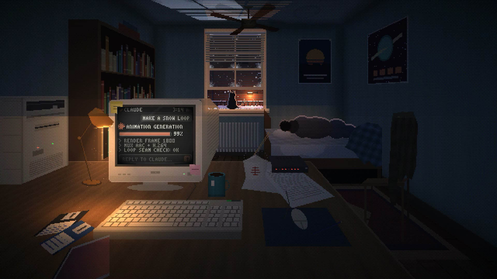
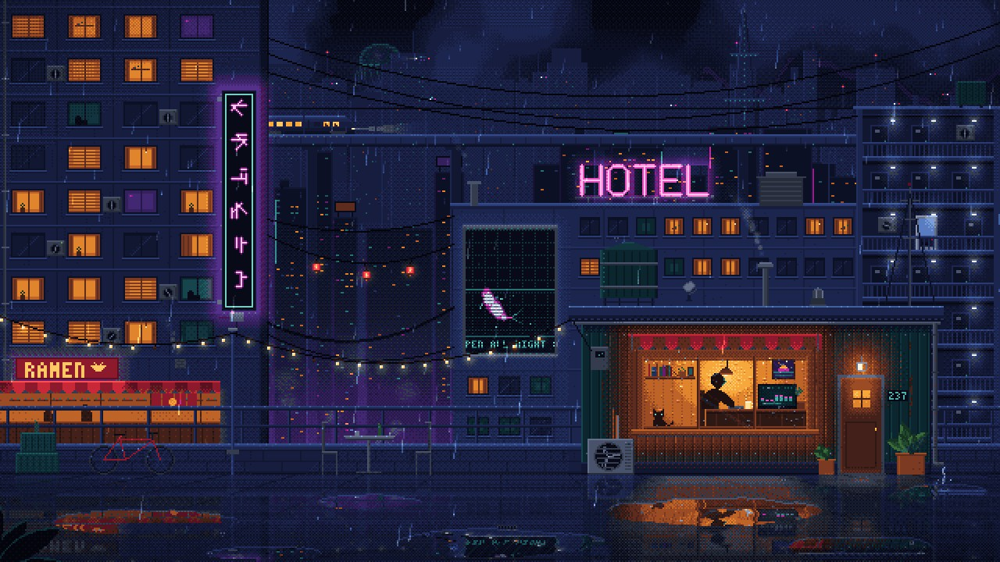
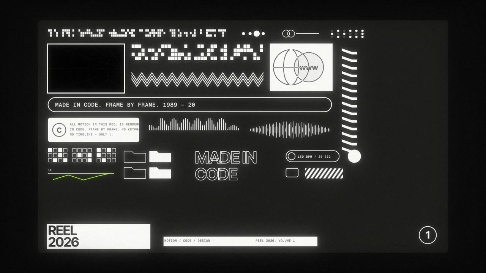
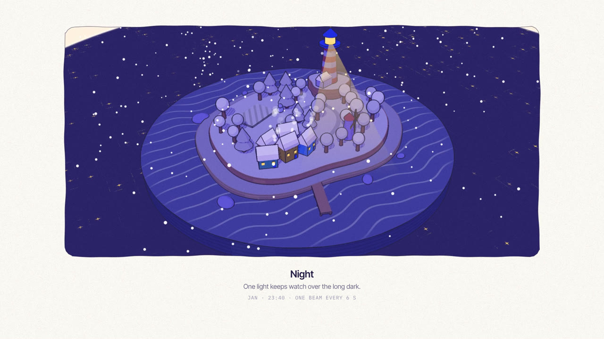
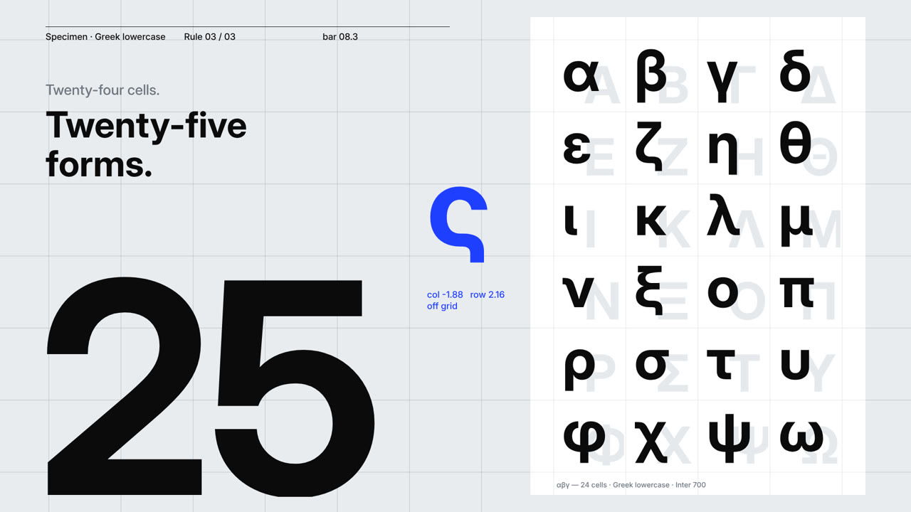
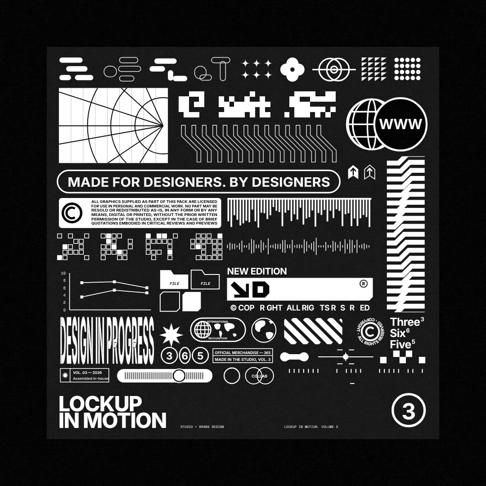
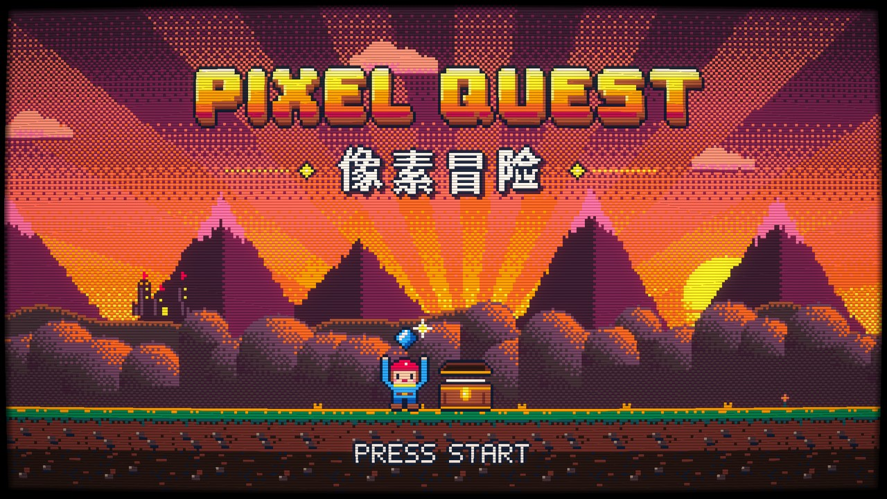

# Phil's Motion Shelf

**965 viral animations made by Claude writing code, each with the exact prompt the creator shared, most popular first, by likes and views on the original post.**

**[▶ Watch them all on the site](https://framevoid1312.github.io/motion-shelf/)**: it has two tabs. **Videos**: hover any card to play it and copy its prompt in one click. **Skills**: agent skills, skill files, style prompts and HyperFrames blocks, each with a picture of what it makes, from its demo, its own GitHub page or the block itself running, and its demo one click away.

Every entry here has a playable original video and a prompt you can copy and run. Most videos were made with Claude Opus 5.5 (some with Sonnet 5.5 or Fable 5.5) writing HTML, Canvas, SVG, Three.js, Blender or Remotion code; there is no AI video or music generator in the picture. Popularity is the likes and views on the original post where it was shared, checked between 3 and 10 November 2026; a dash means the count wasn't available.

## Contents

- [Skills to try](#skills-to-try)
- [Top 60](#top-60)
- [All 965, most popular first](#all-most-popular-first)
- [What's on the site besides these](#whats-on-the-site-besides-these)
- [How entries are chosen](#how-entries-are-chosen)
- [Phil's films](#phils-films)
- [Credits](#credits)

## Skills to try

Free agent skills for making motion and video with Claude Code, Codex and other coding agents, most-starred first (star counts checked on 9 November 2026). Each one has a card with its demo on the [site](https://framevoid1312.github.io/motion-shelf/#skills) under **Skills → Skills to try**.

| # | Skill | ★ | What it does | Licence |
|---:|---|---:|---|---|
| 1 | [**OpenMontage**](https://github.com/OpenMontageInc/OpenMontage) | 78.9k | Turns a coding agent into a full video studio: research, script, assets, editing and final composition through 12 production pipelines and hundreds of agent skills. | AGPL-3.0 |
| 2 | [**video-use**](https://github.com/browser-use/video-use) | 30.8k | Edit real footage by chatting with Claude Code: cuts filler words and dead air, grades colour, fades every cut. Includes a Manim skill for 3Blue1Brown-style animation. | MIT |
| 3 | [**GSAP Skills**](https://github.com/greensock/gsap-skills) | 18.1k | The official GSAP skills: core tweens, timelines, ScrollTrigger, plugins, React and performance, so agents write GSAP the right way. | MIT |
| 4 | [**Video Shotcraft**](https://github.com/Vincentwei1021/video-shotcraft) | 18k | Cinematic, editable product promos in Remotion from 124 shot recipe cards: real page screenshots, 2.5D camera moves, beat-synced cuts and sound design. | MIT |
| 5 | [**lemo-opuscar**](https://github.com/lemomo-ai/lemo-opuscar) | 13.8k | A library of film styles, from Swiss motion and Memphis diorama to ink wash and risograph, each with a style prompt and a scored demo film. Claude picks a style, directs the film and renders it; you can also make your own styles. | MIT · CC BY 4.0 |
| 6 | [**Huashu Art Motion**](https://github.com/alchaincyf/huashu-art-motion) | 6.6k | Artistic animations, visual storytelling and explainer videos using code-based rendering. | MIT |
| 7 | [**Earshot**](https://github.com/Leonxlnx/earshot) | 4.3k | Gives coding agents audio analysis and code-generated sound effects. | MIT |
| 8 | [**Motion Design Skill**](https://github.com/LottieFiles/motion-design-skill) | 2.9k | Motion design principles for agents from LottieFiles: timing, easing, choreography and Disney principles adapted for UI, for any animation library. | MIT |
| 9 | [**Huashu Motion**](https://github.com/alchaincyf/huashu-motion) | 2.5k | Beat-synced product launch films, motion graphics and browser-editable scenes. | MIT |
| 10 | [**Claude Animated Shorts**](https://github.com/mromidev/claude-animated-shorts) | 2.5k | Vertical animated story shorts: 2D characters in a painted 3D world with ink outlines, gliding cameras, narration and a synthesized score, in three.js inside Remotion. | MIT |
| 11 | [**Story to Hand-drawn Video**](https://github.com/gnipbao/story-to-handdrawn-video) | 2.4k | Turns a story or a set of images into a hand-drawn diary-comic animation in Remotion, with hand lettering and hundreds of style recipes. | MIT |
| 12 | [**Bang Motion**](https://github.com/bangtutorial/bang-motion) | 1.9k | Browser motion graphics that move like video, not slides: openers, promos, bumpers, kinetic type and five explainer styles in a single index.html. | MIT |
| 13 | [**Reanimate**](https://github.com/NiazMorshed2007/reanimate) | 1.5k | Recreates web and video animations using frame-by-frame comparisons. | MIT |
| 14 | [**Explainroo**](https://github.com/vincentsch/explainroo) | 1.1k | Narrated explainer videos with local voice generation and word-level timing. | MIT |
| 15 | [**Video Spec Builder**](https://github.com/feicaiclub/video-spec-builder) | 1.1k | Asks the questions a director would, then writes a to-the-second shot script (video-spec.md) for HyperFrames to render. | MIT |
| 16 | [**Claude Remotion Skill**](https://github.com/haidrrrry/claude-remotion-skill) | 896 | Motion graphics in Remotion from one prompt: intros, logo animations, promos, captions, b-roll and sound design. | MIT |
| 17 | [**Blender Skills**](https://github.com/EL4CTEO/blender-skills) | 808 | 28 professional Blender 5.2 workflows as agent skills: animation, rigging, lighting, simulation, stylized NPR, rendering and more. | MIT |
| 18 | [**Claude Motion Design**](https://github.com/howseen-ai/claude-motion-design) | 798 | Motion design in pure code (HTML, Playwright, ffmpeg), no After Effects: launch films, showreels, promos and remakes of a reference video. | MIT |
| 19 | [**Rossark Motion**](https://github.com/rossark0/rossark-motion-skill) | 759 | Animates SVGs, characters and illustrations for React Native and SwiftUI. | MIT |
| 20 | [**Motion Graphics Skill Pack**](https://github.com/charlie947/motion-graphics-skills) | 614 | 15 skills for launch-grade motion graphics in code, including a brief writer and a prompt writer that turn one rough idea into a full director's brief, plus loop covers and 3D title sequences. | MIT |
| 21 | [**MapStage**](https://github.com/hopechen067/MapStage) | 517 | A narrative map stage for history videos: an antique parchment basemap, marching routes, place names that fade in and a camera that follows the narration, with a seek(t) contract for frame-exact renders. | MIT (code) |
| 22 | [**AI Promo Video Maker**](https://github.com/liyupi/ai-promo-video-maker) | 456 | Product promo films from a name or URL: researches the product, offers style frames, captures real 4K pages, cuts to the beat and adds narration. | MIT |
| 23 | [**Product Launch Motion**](https://github.com/AbubakrChan/product-launch-motion) | 438 | Paste your website URL and get a launch film: one shape that never cuts, carried by springs through your real interface. | MIT |
| 24 | [**Video Director**](https://github.com/win4r/video-director) | 409 | Video planning, timeline validation and automated quality checks. | MIT |
| 25 | [**xilo-opus-video**](https://github.com/Kianzzz/xilo-opus-video) | 386 | Code-made video with three plans and previews first, then a frame-by-frame render: Canvas, WebGL, Three.js, Remotion, HyperFrames or Manim, with a coded score. | MIT |
| 26 | [**Code Video Showcase**](https://github.com/Moessif/code-video-showcase) | 384 | Beat-synced 30 to 90 second style showcase films in pure code: HTML, Canvas, SVG and Three.js frames, a score synthesized in Python, assembled with FFmpeg. No video, image or music models. | MIT |
| 27 | [**Diorama**](https://github.com/sloemo01/diorama) | 357 | A playbook and Three.js kit for detailed dioramas on a slab: classic pixel art, stroked toon or both, a 64-colour dithered palette, an inked contour and toy-scale people with real joint animation. | MIT |
| 28 | [**HyperFrames Community Skills**](https://github.com/heygen-com/hyperframes-community-skills) | 252 | Focused community skills for HyperFrames: p5 paint animation, Vox-style explainers, 3D camera captions, day-in-my-life and more. | Apache-2.0 |
| 29 | [**Take One**](https://github.com/talsiach/take-one) | 239 | Turns prompts into videos through a multi-stage creative pipeline. | MIT |
| 30 | [**html-to-video**](https://github.com/wx4766/html-to-video) | 188 | Renders HTML and Canvas animations to MP4 frame by frame by seeking to each moment, with music, GIF or transparent output. Not text-to-video: your code, filmed exactly. | MIT |
| 31 | [**HyperFrames Motion Reel**](https://github.com/Sunwood-ai-labs/hyperframes-motion-reel-skill) | 180 | Showreel-grade motion graphics in HyperFrames from a one-line theme: a world, a design system, a beat-by-beat timeline on a 120 BPM grid and a generated score, then checks. No Remotion licence needed. | MIT |
| 32 | [**Argo**](https://github.com/shreyaskarnik/argo) | 156 | Creates product demo videos from Playwright walkthroughs with AI voiceovers. | MIT |
| 33 | [**ASCII Diorama**](https://github.com/JDhruv14/ascii-diorama) | 96 | Tilt-shift ASCII miniatures: a small living Three.js world drawn entirely in coloured monospace characters, grass that leans in the wind, water as tildes, and a slow sweeping camera. | MIT |
| 34 | [**Motion Graphics (Mort1d)**](https://github.com/Mort1d/motion-graphics-skills) | 77 | Directs before it builds (three concepts, nine looks), animates in code with springs and motion blur, scores every video with an original soundtrack and critiques itself until every score is 8 out of 10. | MIT |
| 35 | [**MV Director**](https://github.com/Yari-tuber/mv-director) | 63 | Music videos from a song and its lyrics: beats and sections measured, each word aligned to about 0.1 s, a storyboard per line, drawn in a style borrowed from lemo-opuscar or Huashu. README in Chinese. | MIT |
| 36 | [**/brag**](https://github.com/latent-spaces/brag) | new | Turns the project you just built, or any website, into a 20-second launch video with its own soundtrack and share copy. It reuses your real UI, colours and fonts, and cuts every scene on the beat. | MIT |
| 37 | [**Pixel2Motion**](https://github.com/nolangz/pixel2motion) | new | Logo animation from a flat image: fits a PNG or screenshot logo with the simplest smooth SVG shapes, then choreographs them with the 12 principles into an HTML demo with replay controls. | MIT |
| 38 | [**Text to Lottie**](https://github.com/diffusionstudio/lottie) | new | Writes production-ready Lottie animations from a prompt and checks them in a bundled player: logos, loaders, lower thirds, UI micro-interactions, charts and product promos. | MIT |
| 39 | [**ManimGX**](https://github.com/academa-labs/manimgx) | new | Maths and 3D explainer animations in Python with the Manim API on a fast Rust engine. An inspect command storyboards the scene and reports overlaps before the render. | MIT |
| 40 | [**Motion Design with Claude**](https://github.com/LobzyJay/motion-design-with-claude) | 36 | Four skills for motion designers in After Effects and Blender: the 12 principles, easing and timing, ExtendScript and expressions, bpy keyframing and geometry nodes, plus a critique skill for when a render looks wrong. | MIT |
| 41 | [**Motion Video Director**](https://github.com/mattypark/Motion-graphics-skill) | 10 | A production playbook with approval gates: script, plan and preview before the full render. Motion graphics in Canvas, SVG, Three.js and GSAP, footage edits with captions, and sound mixed to -14 LUFS. | no licence stated |
| 42 | [**Stop-motion Video**](https://github.com/kosta4a/stopmotion-video) | 8 | How to make stop-motion style video cut to music: each pose held for an eighth note, pages on bar lines, clicks on kicks and snares, and when to break the grid. | MIT |
| 43 | [**Awesome Showreels**](https://github.com/awesomezun/awesome-showreels) | 7 | A showreel about anything, styled by its own material: give it a repo, a paper, a brand or an idea and it designs, scores and renders the reel. 89 example projects, from Swiss grid to riso zine. | MIT |
| 44 | [**Motion Reel**](https://github.com/Aries-Spring/motion-reel) | 6 | Showreels, launch films and lyric videos from code: real brand assets, a measured beat grid, a shot list you sign off, three critique rounds on contact sheets, a synthesized score and a -14 LUFS master. No API keys. | MIT |
| 45 | [**Renoise Motion Skills**](https://github.com/chessunyan/renoise-motion-skills) | 6 | One style per skill, starting with Pixel Blocks: an 8-bit piece drawn on a 320×180 framebuffer at 12 poses a second, locked to the beat with synthesized chiptune sounds. | MIT |
| 46 | [**Motion Graphic**](https://github.com/hculap/skill-motion-graphic) | 0 | Films as a pure function of time: a seek(t) engine rendered frame by frame, closed-form springs instead of easing curves, a synthesized score on a beat grid and a critique loop scored on 7 axes. | MIT |
| 47 | [**Motion Graphics Skill**](https://github.com/cskwork/motion-graphics-skill) | 0 | Keynote-style launch videos built from captures of your real running app (iOS, Android, web, desktop) and vertical shorts with a hook in the first 0.3 s, rendered frame-accurately. | MIT |
| 48 | [**AE Motion Design**](https://github.com/tien11668899/ae-motion-design) | 0 | Motion design in After Effects driven by Claude: one continuous chain of shapes, timing measured frame by frame, colour, kinetic type, blur, music sync, 3D camera and Liquid Glass rigs. | MIT |
| 49 | [**Claude Motion Design Skills**](https://github.com/Kyyzen0/claude-motion-design-skills) | 0 | Six workflow skills, one per production stage: storyboard, UI motion, kinetic typography, seamless loops, code build and export review with measured checks. | MIT |
| 50 | [**Motion Clone**](phil/motion-clone) | new | Rebuilds a motion-graphics clip as editable code layers: per-frame measured timing, traced glyphs, matched type, a reference-vs-rebuild check and a frame-exact render. Method adapted from [MotionClone](https://github.com/blixvip/MotionClone). No API keys. | MIT |

## Top 60

<table>
<tr>
<td width="33%" valign="top"> <b>#1 · ♥ 16,344</b> <a href="prompts/ryansael-654847.md">Interactive camera focus lens lab</a> <a href="https://x.com/RyanSael/status/2102591147927654847">@RyanSael</a></td>
<td width="33%" valign="top"> <b>#2 · ♥ 20,509</b> <a href="prompts/milos-gis-317580.md">Portland bus service on a random Tuesday</a> <a href="https://x.com/milos_gis/status/2103751211040317580">@milos_gis</a></td>
<td width="33%" valign="top"> <b>#3 · ♥ 17,248</b> <a href="prompts/stephanlivera-470926.md">Claude motion designer showreel</a> <a href="https://x.com/stephanlivera/status/2103315922098470926">@stephanlivera</a></td>
</tr>
<tr>
<td width="33%" valign="top"> <b>#4 · ♥ 24,823</b> <a href="prompts/aimind-ai-154557.md">A cow that runs</a> <a href="https://x.com/AIMind_Ai/status/2107435499686154557">@AIMind_Ai</a></td>
<td width="33%" valign="top"> <b>#5 · ♥ 6,830</b> <a href="prompts/shneural-962130.md">Bold kinetic type showreel</a> <a href="https://x.com/shneural/status/2103151003272962130">@shneural</a></td>
<td width="33%" valign="top"> <b>#6 · ♥ 12,765</b> <a href="prompts/twoclipping-402193.md">Shape that morphs through UI states</a> <a href="https://x.com/twoclipping/status/2103273003555402193">@twoclipping</a></td>
</tr>
<tr>
<td width="33%" valign="top"> <b>#7 · ♥ 9,177</b> <a href="prompts/achxvi-963545.md">Unspecified animation made in 15 minutes</a> <a href="https://x.com/achxvi/status/2103918792845963545">@achxvi</a></td>
<td width="33%" valign="top"> <b>#8 · ♥ 8,380</b> <a href="prompts/konstantinsaifo-501736.md">Interactive Raptor 3 rocket engine</a> <a href="https://x.com/konstantinsaifo/status/2104094723887501736">@konstantinsaifo</a></td>
<td width="33%" valign="top"> <b>#9 · ♥ 3,538</b> <a href="prompts/skoorbkaz-941441.md">Dystopian AI short film (11 min)</a> <a href="https://x.com/Skoorbkaz/status/2113392757548941441">@Skoorbkaz</a></td>
</tr>
<tr>
<td width="33%" valign="top"> <b>#10 · ♥ 5,455</b> <a href="prompts/andrewjiang-132140.md">Predicting the next 50 years</a> <a href="https://x.com/andrewjiang/status/2102987981695132140">@andrewjiang</a></td>
<td width="33%" valign="top"> <b>#11 · ♥ 5,449</b> <a href="prompts/karankendre-698674.md">Aeroplane simulator game</a> <a href="https://x.com/karankendre/status/2103821040174698674">@karankendre</a></td>
<td width="33%" valign="top"> <b>#12 · ♥ 4,402</b> <a href="prompts/aug5thmusic-062796.md">Bach-style organ fugue in code</a> <a href="https://x.com/aug5thmusic/status/2102758849619062796">@aug5thmusic</a></td>
</tr>
<tr>
<td width="33%" valign="top"> <b>#13 · ♥ 9,349</b> <a href="prompts/dotcsv-168939.md">Pixel-art neural network training animation</a> <a href="https://x.com/DotCSV/status/2102737776219168939">@DotCSV</a></td>
<td width="33%" valign="top"> <b>#14 · ♥ 2,794</b> <a href="prompts/crvdesign0-339682.md">High-energy motion graphics showreel</a> <a href="https://x.com/crvdesign0/status/2103817034618339682">@crvdesign0</a></td>
<td width="33%" valign="top"> <b>#15 · ♥ 8,137</b> <a href="prompts/imjustnewatai-168580.md">All of human progress, then 30 years ahead</a> <a href="https://x.com/imjustnewatai/status/2106081142143168580">@imjustnewatai</a></td>
</tr>
<tr>
<td width="33%" valign="top"> <b>#16 · ♥ 6,568</b> <a href="prompts/mengto-189761.md">Riverboat through a cherry-blossom valley in three.js</a> <a href="https://x.com/MengTo/status/2102760783344189761">@MengTo</a></td>
<td width="33%" valign="top"> <b>#17 · ♥ 4,192</b> <a href="prompts/ajith-io-890146.md">15-second flat-color motion showreel</a> <a href="https://x.com/ajith_io/status/2103449416325890146">@ajith_io</a></td>
<td width="33%" valign="top"> <b>#18 · ♥ 3,965</b> <a href="prompts/semichenkko-401989.md">Interactive 3D Soft-Body Gummy Bears Simulation in Three.js</a> <a href="https://x.com/semichenkko/status/2110131790136401989">@semichenkko</a></td>
</tr>
<tr>
<td width="33%" valign="top"> <b>#19 · ♥ 2,641</b> <a href="prompts/winterarc2125-347650.md">Battle of Austerlitz procedural film</a> <a href="https://x.com/WinterArc2125/status/2103116235009347650">@WinterArc2125</a></td>
<td width="33%" valign="top"> <b>#20 · ♥ 1,760</b> <a href="prompts/karankendre-773669.md">3D shooting game</a> <a href="https://x.com/karankendre/status/2103456630679773669">@karankendre</a></td>
<td width="33%" valign="top"> <b>#21 · ♥ 4,177</b> <a href="prompts/shfred0-236158.md">Claude animates its own life story</a> <a href="https://x.com/shfred0/status/2102495989194236158">@shfred0</a></td>
</tr>
<tr>
<td width="33%" valign="top"> <b>#22 · ♥ 4,249</b> <a href="prompts/everestchris6-884998.md">3D walkthrough house from floor plan</a> <a href="https://x.com/everestchris6/status/2110036224320884998">@everestchris6</a></td>
<td width="33%" valign="top"> <b>#23 · ♥ 3,963</b> <a href="prompts/elvar-official-344372.md">Interactive mechanical teardown scenes</a> <a href="https://x.com/elvar_official/status/2116192984299344372">@elvar_official</a></td>
<td width="33%" valign="top"> <b>#24 · ♥ 2,571</b> <a href="prompts/majidmanzarpour-927543.md">Pixel-art wizard casting a spell</a> <a href="https://x.com/majidmanzarpour/status/2102476258948927543">@majidmanzarpour</a></td>
</tr>
<tr>
<td width="33%" valign="top"> <b>#25 · ♥ 2,671</b> <a href="prompts/ivanainai-099545.md">The biggest scam in humanity, no words</a> <a href="https://x.com/ivanainai/status/2105764877986099545">@ivanainai</a></td>
<td width="33%" valign="top"> <b>#26 · ♥ 648</b> <a href="prompts/vib3coded-012504.md">Jelly watermelon slicing simulation</a> <a href="https://x.com/vib3coded/status/2104285370951012504">@vib3coded</a></td>
<td width="33%" valign="top"> <b>#27 · ♥ 3,256</b> <a href="prompts/deedydas-252537.md">Punchy promo for an inference startup</a> <a href="https://x.com/deedydas/status/2102787937482252537">@deedydas</a></td>
</tr>
<tr>
<td width="33%" valign="top"> <b>#28 · ♥ 1,983</b> <a href="prompts/addyosmani-580159.md">3D pelican riding a bicycle around a city</a> <a href="https://x.com/addyosmani/status/2102436416437580159">@addyosmani</a></td>
<td width="33%" valign="top"> <b>#29 · ♥ 1,255</b> <a href="prompts/gauravsbuilding-711402.md">12-hour Ultracode launch video</a> <a href="https://x.com/gauravsbuilding/status/2104370091672711402">@gauravsbuilding</a></td>
<td width="33%" valign="top"> <b>#30 · ♥ 2,289</b> <a href="prompts/mattshumer-301750.md">3D printer bed-clearing, filmed by Opus</a> <a href="https://x.com/mattshumer_/status/2104777202684301750">@mattshumer_</a></td>
</tr>
<tr>
<td width="33%" valign="top"> <b>#31 · ♥ 2,527</b> <a href="prompts/pracosm-745459.md">Two walkable Indian cities on tiny planets</a> <a href="https://x.com/pracosm/status/2103387804281745459">@pracosm</a></td>
<td width="33%" valign="top"> <b>#32 · ♥ 752</b> <a href="prompts/vib3coded-970308.md">Watermelon rubber band test: Opus 5.5 vs GPT-6 Astra</a> <a href="https://x.com/vib3coded/status/2104994617573970308">@vib3coded</a></td>
<td width="33%" valign="top"> <b>#33 · ♥ 2,739</b> <a href="prompts/kimmonismus-575547.md">A Code-Rendered Film on the History of AI</a> <a href="https://x.com/kimmonismus/status/2102844654169575547">@kimmonismus</a></td>
</tr>
<tr>
<td width="33%" valign="top"> <b>#34 · ♥ 2,833</b> <a href="prompts/lexnlin-968965.md">Clawd character animation</a> <a href="https://x.com/LexnLin/status/2110389810258968965">@LexnLin</a></td>
<td width="33%" valign="top"> <b>#35 · ♥ 2,425</b> <a href="prompts/dummerspast39-319355.md">Recursive pelican-and-bicycle SVG</a> <a href="https://x.com/dummerspast39/status/2111577334436319355">@dummerspast39</a></td>
<td width="33%" valign="top"> <b>#36 · ♥ 1,523</b> <a href="prompts/himanshutwtxs-882858.md">Motion designer showreel</a> <a href="https://x.com/himanshutwtxs/status/2103495232637882858">@himanshutwtxs</a></td>
</tr>
<tr>
<td width="33%" valign="top"> <b>#37 · ♥ 645</b> <a href="prompts/akokoi1-508316.md">Floor plan to 3D interior design tool</a> <a href="https://x.com/akokoi1/status/2104520072014508316">@akokoi1</a></td>
<td width="33%" valign="top"> <b>#38 · ♥ 1,972</b> <a href="prompts/wesbos-277027.md">3D gym builder with 500 machines</a> <a href="https://x.com/wesbos/status/2102450119975277027">@wesbos</a></td>
<td width="33%" valign="top"> <b>#39 · ♥ 2,086</b> <a href="prompts/moguzbulbul-215591.md">UX decisions explained in animation</a> <a href="https://x.com/moguzbulbul/status/2104206095313215591">@moguzbulbul</a></td>
</tr>
<tr>
<td width="33%" valign="top"> <b>#40 · ♥ 1,078</b> <a href="prompts/dirtman-287620.md">Technology hype video synced to a song</a> <a href="https://x.com/dirtman/status/2103686605517287620">@dirtman</a></td>
<td width="33%" valign="top"> <b>#41 · ♥ 2,123</b> <a href="prompts/rubenssoto-ai-798719.md">Three.js Tesla-Style Electric Motor 40-Second Educational 3D Animation</a> <a href="https://x.com/rubenssoto_ai/status/2110065587279798719">@rubenssoto_ai</a></td>
<td width="33%" valign="top"> <b>#42 · ♥ 2,178</b> <a href="prompts/trq212-152162.md">Website redesign iterations trailer</a> <a href="https://x.com/trq212/status/2102477340920152162">@trq212</a></td>
</tr>
<tr>
<td width="33%" valign="top"> <b>#43 · ♥ 1,805</b> <a href="prompts/hajimetwi3-753464.md">Real-time coastline simulation in three.js</a> <a href="https://x.com/hajimetwi3/status/2104381179151753464">@hajimetwi3</a></td>
<td width="33%" valign="top"> <b>#44 · ♥ 2,188</b> <a href="prompts/cherry-mx-reds-009224.md">“Please make a cool animation”</a> <a href="https://x.com/cherry_mx_reds/status/2105816670896009224">@cherry_mx_reds</a></td>
<td width="33%" valign="top"> <b>#45 · ♥ 389</b> <a href="prompts/zadrielsan-001360.md">Three-body gravitational simulation</a> <a href="https://x.com/zAdrielsan/status/2105822678519001360">@zAdrielsan</a></td>
</tr>
<tr>
<td width="33%" valign="top"> <b>#46 · ♥ 2,034</b> <a href="prompts/motion-conquest-308152.md">Apple Liquid Glass style UI motion showcase</a> <a href="https://x.com/motion_conquest/status/2103510103622308152">@motion_conquest</a></td>
<td width="33%" valign="top"> <b>#47 · ♥ 564</b> <a href="prompts/leodavincs3-643203.md">15-second motion showreel (prompt in Turkish)</a> <a href="https://x.com/leodavincs3/status/2103425994610643203">@leodavincs3</a></td>
<td width="33%" valign="top"> <b>#48 · ♥ 2,193</b> <a href="prompts/twoclipping-496100.md">Shape that morphs through UI states</a> <a href="https://x.com/twoclipping/status/2103835273813496100">@twoclipping</a></td>
</tr>
<tr>
<td width="33%" valign="top"> <b>#49 · ♥ 1,592</b> <a href="prompts/magnific-964879.md">Character builder with sliders demo</a> <a href="https://x.com/magnific/status/2104587476014964879">@magnific</a></td>
<td width="33%" valign="top"> <b>#50 · ♥ 1,654</b> <a href="prompts/robinebers-745060.md">Zoomable app architecture canvas</a> <a href="https://x.com/robinebers/status/2105309987983745060">@robinebers</a></td>
<td width="33%" valign="top"> <b>#51 · ♥ 1,083</b> <a href="prompts/riku720720-063144.md">Pixel character dodging meteors on a rainbow space track</a> <a href="https://x.com/riku720720/status/2102515055116063144">@riku720720</a></td>
</tr>
<tr>
<td width="33%" valign="top"> <b>#52 · ♥ 307</b> <a href="prompts/tetumemo-421285.md">Showreel prompt, using memory (Japanese)</a> <a href="https://x.com/tetumemo/status/2103407771102421285">@tetumemo</a></td>
<td width="33%" valign="top"> <b>#53 · ♥ 1,342</b> <a href="prompts/dotey-522564.md">帮我用js制作一个视频，主题是：什么是 Transformer 要深入浅出，让高中生也能看得懂，不仅high…</a> <a href="https://x.com/dotey/status/2103683057689522564">@dotey</a></td>
<td width="33%" valign="top"> <b>#54 · ♥ 2,057</b> <a href="prompts/onethirdesigner-648627.md">Animated fitness-app celebration screen</a> <a href="https://x.com/Onethirdesigner/status/2103749509616648627">@Onethirdesigner</a></td>
</tr>
<tr>
<td width="33%" valign="top"> <b>#55 · ♥ 1,579</b> <a href="prompts/vib3coded-747181.md">Voxel ship in a bottle</a> <a href="https://x.com/vib3coded/status/2110136719827747181">@vib3coded</a></td>
<td width="33%" valign="top"> <b>#56 · ♥ 1,851</b> <a href="prompts/goodside-555526.md">What it feels like to be Claude</a> <a href="https://x.com/goodside/status/2102876925102555526">@goodside</a></td>
<td width="33%" valign="top"> <b>#57 · ♥ 1,039</b> <a href="prompts/tdinh-me-740699.md">TypingMind product intro motion video</a> <a href="https://x.com/tdinh_me/status/2103703135902740699">@tdinh_me</a></td>
</tr>
<tr>
<td width="33%" valign="top"> <b>#58 · ♥ 1,736</b> <a href="prompts/itsluneri-797386.md">Orbit landing page with and without TasteSkill</a> <a href="https://x.com/itsluneri/status/2110564814531797386">@itsluneri</a></td>
<td width="33%" valign="top"> <b>#59 · ♥ 1,018</b> <a href="prompts/bradmillscan-833310.md">Stroke of a Pen: a code-only music video</a> <a href="https://x.com/bradmillscan/status/2103108967194833310">@bradmillscan</a></td>
<td width="33%" valign="top"> <b>#60 · ♥ 1,465</b> <a href="prompts/n01ennn-597182.md">Hand-drawn story of a little agent</a> <a href="https://x.com/N01ennn/status/2108520767092597182">@N01ennn</a></td>
</tr>
</table>

## All, most popular first

| # | ♥ Likes | Views | Video | Creator | Prompt | Post |
|---:|---:|---:|---|---|---|---|
| 1 | 16,344 | 3,567,237 | Interactive camera focus lens lab | [@RyanSael](https://x.com/RyanSael) | [Prompt](prompts/ryansael-654847.md) | [X](https://x.com/RyanSael/status/2102591147927654847) |
| 2 | 20,509 | — | Portland bus service on a random Tuesday | [@milos_gis](https://x.com/milos_gis) | [Prompt](prompts/milos-gis-317580.md) | [X](https://x.com/milos_gis/status/2103751211040317580) |
| 3 | 17,248 | 2,314,133 | Claude motion designer showreel | [@stephanlivera](https://x.com/stephanlivera) | [Prompt](prompts/stephanlivera-470926.md) | [X](https://x.com/stephanlivera/status/2103315922098470926) |
| 4 | 24,823 | 1,380,015 | A cow that runs | [@AIMind_Ai](https://x.com/AIMind_Ai) | [Prompt](prompts/aimind-ai-154557.md) | [X](https://x.com/AIMind_Ai/status/2107435499686154557) |
| 5 | 6,830 | 1,904,494 | Bold kinetic type showreel | [@shneural](https://x.com/shneural) | [Prompt](prompts/shneural-962130.md) | [X](https://x.com/shneural/status/2103151003272962130) |
| 6 | 12,765 | 1,181,518 | Shape that morphs through UI states | [@twoclipping](https://x.com/twoclipping) | [Prompt](prompts/twoclipping-402193.md) | [X](https://x.com/twoclipping/status/2103273003555402193) |
| 7 | 9,177 | 1,145,220 | Unspecified animation made in 15 minutes | [@achxvi](https://x.com/achxvi) | [Prompt](prompts/achxvi-963545.md) | [X](https://x.com/achxvi/status/2103918792845963545) |
| 8 | 8,380 | 1,183,026 | Interactive Raptor 3 rocket engine | [@konstantinsaifo](https://x.com/konstantinsaifo) | [Prompt](prompts/konstantinsaifo-501736.md) | [X](https://x.com/konstantinsaifo/status/2104094723887501736) |
| 9 | 3,538 | 1,288,903 | Dystopian AI short film (11 min) | [@Skoorbkaz](https://x.com/Skoorbkaz) | [Prompt](prompts/skoorbkaz-941441.md) | [X](https://x.com/Skoorbkaz/status/2113392757548941441) |
| 10 | 5,455 | 1,065,719 | Predicting the next 50 years | [@andrewjiang](https://x.com/andrewjiang) | [Prompt](prompts/andrewjiang-132140.md) | [X](https://x.com/andrewjiang/status/2102987981695132140) |
| 11 | 5,449 | 1,002,097 | Aeroplane simulator game | [@karankendre](https://x.com/karankendre) | [Prompt](prompts/karankendre-698674.md) | [X](https://x.com/karankendre/status/2103821040174698674) |
| 12 | 4,402 | 1,080,512 | Bach-style organ fugue in code | [@aug5thmusic](https://x.com/aug5thmusic) | [Prompt](prompts/aug5thmusic-062796.md) | [X](https://x.com/aug5thmusic/status/2102758849619062796) |
| 13 | 9,349 | 578,221 | Pixel-art neural network training animation | [@DotCSV](https://x.com/DotCSV) | [Prompt](prompts/dotcsv-168939.md) | [X](https://x.com/DotCSV/status/2102737776219168939) |
| 14 | 2,794 | 1,108,731 | High-energy motion graphics showreel | [@crvdesign0](https://x.com/crvdesign0) | [Prompt](prompts/crvdesign0-339682.md) | [X](https://x.com/crvdesign0/status/2103817034618339682) |
| 15 | 8,137 | 432,211 | All of human progress, then 30 years ahead | [@imjustnewatai](https://x.com/imjustnewatai) | [Prompt](prompts/imjustnewatai-168580.md) | [X](https://x.com/imjustnewatai/status/2106081142143168580) |
| 16 | 6,568 | 487,648 | Riverboat through a cherry-blossom valley in three.js | [@MengTo](https://x.com/MengTo) | [Prompt](prompts/mengto-189761.md) | [X](https://x.com/MengTo/status/2102760783344189761) |
| 17 | 4,192 | 650,581 | 15-second flat-color motion showreel | [@ajith_io](https://x.com/ajith_io) | [Prompt](prompts/ajith-io-890146.md) | [X](https://x.com/ajith_io/status/2103449416325890146) |
| 18 | 3,965 | 631,527 | Interactive 3D Soft-Body Gummy Bears Simulation in Three.js | [@semichenkko](https://x.com/semichenkko) | [Prompt](prompts/semichenkko-401989.md) | [X](https://x.com/semichenkko/status/2110131790136401989) |
| 19 | 2,641 | 651,173 | Battle of Austerlitz procedural film | [@WinterArc2125](https://x.com/WinterArc2125) | [Prompt](prompts/winterarc2125-347650.md) | [X](https://x.com/WinterArc2125/status/2103116235009347650) |
| 20 | 1,760 | 702,613 | 3D shooting game | [@karankendre](https://x.com/karankendre) | [Prompt](prompts/karankendre-773669.md) | [X](https://x.com/karankendre/status/2103456630679773669) |
| 21 | 4,177 | 377,408 | Claude animates its own life story | [@shfred0](https://x.com/shfred0) | [Prompt](prompts/shfred0-236158.md) | [X](https://x.com/shfred0/status/2102495989194236158) |
| 22 | 4,249 | 319,177 | 3D walkthrough house from floor plan | [@everestchris6](https://x.com/everestchris6) | [Prompt](prompts/everestchris6-884998.md) | [X](https://x.com/everestchris6/status/2110036224320884998) |
| 23 | 3,963 | 334,339 | Interactive mechanical teardown scenes | [@elvar_official](https://x.com/elvar_official) | [Prompt](prompts/elvar-official-344372.md) | [X](https://x.com/elvar_official/status/2116192984299344372) |
| 24 | 2,571 | 461,180 | Pixel-art wizard casting a spell | [@majidmanzarpour](https://x.com/majidmanzarpour) | [Prompt](prompts/majidmanzarpour-927543.md) | [X](https://x.com/majidmanzarpour/status/2102476258948927543) |
| 25 | 2,671 | 441,959 | The biggest scam in humanity, no words | [@ivanainai](https://x.com/ivanainai) | [Prompt](prompts/ivanainai-099545.md) | [X](https://x.com/ivanainai/status/2105764877986099545) |
| 26 | 648 | 633,740 | Jelly watermelon slicing simulation | [@vib3coded](https://x.com/vib3coded) | [Prompt](prompts/vib3coded-012504.md) | [X](https://x.com/vib3coded/status/2104285370951012504) |
| 27 | 3,256 | 352,765 | Punchy promo for an inference startup | [@deedydas](https://x.com/deedydas) | [Prompt](prompts/deedydas-252537.md) | [X](https://x.com/deedydas/status/2102787937482252537) |
| 28 | 1,983 | 420,381 | 3D pelican riding a bicycle around a city | [@addyosmani](https://x.com/addyosmani) | [Prompt](prompts/addyosmani-580159.md) | [X](https://x.com/addyosmani/status/2102436416437580159) |
| 29 | 1,255 | 429,970 | 12-hour Ultracode launch video | [@gauravsbuilding](https://x.com/gauravsbuilding) | [Prompt](prompts/gauravsbuilding-711402.md) | [X](https://x.com/gauravsbuilding/status/2104370091672711402) |
| 30 | 2,289 | 284,717 | 3D printer bed-clearing, filmed by Opus | [@mattshumer_](https://x.com/mattshumer_) | [Prompt](prompts/mattshumer-301750.md) | [X](https://x.com/mattshumer_/status/2104777202684301750) |
| 31 | 2,527 | 248,762 | Two walkable Indian cities on tiny planets | [@pracosm](https://x.com/pracosm) | [Prompt](prompts/pracosm-745459.md) | [X](https://x.com/pracosm/status/2103387804281745459) |
| 32 | 752 | 421,337 | Watermelon rubber band test: Opus 5.5 vs GPT-6 Astra | [@vib3coded](https://x.com/vib3coded) | [Prompt](prompts/vib3coded-970308.md) | [X](https://x.com/vib3coded/status/2104994617573970308) |
| 33 | 2,739 | 207,132 | A Code-Rendered Film on the History of AI | [@kimmonismus](https://x.com/kimmonismus) | [Prompt](prompts/kimmonismus-575547.md) | [X](https://x.com/kimmonismus/status/2102844654169575547) |
| 34 | 2,833 | 182,505 | Clawd character animation | [@LexnLin](https://x.com/LexnLin) | [Prompt](prompts/lexnlin-968965.md) | [X](https://x.com/LexnLin/status/2110389810258968965) |
| 35 | 2,425 | 206,472 | Recursive pelican-and-bicycle SVG | [@dummerspast39](https://x.com/dummerspast39) | [Prompt](prompts/dummerspast39-319355.md) | [X](https://x.com/dummerspast39/status/2111577334436319355) |
| 36 | 1,523 | 294,895 | Motion designer showreel | [@himanshutwtxs](https://x.com/himanshutwtxs) | [Prompt](prompts/himanshutwtxs-882858.md) | [X](https://x.com/himanshutwtxs/status/2103495232637882858) |
| 37 | 645 | 372,490 | Floor plan to 3D interior design tool | [@akokoi1](https://x.com/akokoi1) | [Prompt](prompts/akokoi1-508316.md) | [X](https://x.com/akokoi1/status/2104520072014508316) |
| 38 | 1,972 | 227,811 | 3D gym builder with 500 machines | [@wesbos](https://x.com/wesbos) | [Prompt](prompts/wesbos-277027.md) | [X](https://x.com/wesbos/status/2102450119975277027) |
| 39 | 2,086 | 209,898 | UX decisions explained in animation | [@moguzbulbul](https://x.com/moguzbulbul) | [Prompt](prompts/moguzbulbul-215591.md) | [X](https://x.com/moguzbulbul/status/2104206095313215591) |
| 40 | 1,078 | 304,836 | Technology hype video synced to a song | [@dirtman](https://x.com/dirtman) | [Prompt](prompts/dirtman-287620.md) | [X](https://x.com/dirtman/status/2103686605517287620) |
| 41 | 2,123 | 193,361 | Three.js Tesla-Style Electric Motor 40-Second Educational 3D Animation | [@rubenssoto_ai](https://x.com/rubenssoto_ai) | [Prompt](prompts/rubenssoto-ai-798719.md) | [X](https://x.com/rubenssoto_ai/status/2110065587279798719) |
| 42 | 2,178 | 185,499 | Website redesign iterations trailer | [@trq212](https://x.com/trq212) | [Prompt](prompts/trq212-152162.md) | [X](https://x.com/trq212/status/2102477340920152162) |
| 43 | 1,805 | 222,538 | Real-time coastline simulation in three.js | [@hajimetwi3](https://x.com/hajimetwi3) | [Prompt](prompts/hajimetwi3-753464.md) | [X](https://x.com/hajimetwi3/status/2104381179151753464) |
| 44 | 2,188 | 170,139 | “Please make a cool animation” | [@cherry_mx_reds](https://x.com/cherry_mx_reds) | [Prompt](prompts/cherry-mx-reds-009224.md) | [X](https://x.com/cherry_mx_reds/status/2105816670896009224) |
| 45 | 389 | 346,265 | Three-body gravitational simulation | [@zAdrielsan](https://x.com/zAdrielsan) | [Prompt](prompts/zadrielsan-001360.md) | [X](https://x.com/zAdrielsan/status/2105822678519001360) |
| 46 | 2,034 | 176,847 | Apple Liquid Glass style UI motion showcase | [@motion_conquest](https://x.com/motion_conquest) | [Prompt](prompts/motion-conquest-308152.md) | [X](https://x.com/motion_conquest/status/2103510103622308152) |
| 47 | 564 | 316,819 | 15-second motion showreel (prompt in Turkish) | [@leodavincs3](https://x.com/leodavincs3) | [Prompt](prompts/leodavincs3-643203.md) | [X](https://x.com/leodavincs3/status/2103425994610643203) |
| 48 | 2,193 | 143,460 | Shape that morphs through UI states | [@twoclipping](https://x.com/twoclipping) | [Prompt](prompts/twoclipping-496100.md) | [X](https://x.com/twoclipping/status/2103835273813496100) |
| 49 | 1,592 | 203,282 | Character builder with sliders demo | [@magnific](https://x.com/magnific) | [Prompt](prompts/magnific-964879.md) | [X](https://x.com/magnific/status/2104587476014964879) |
| 50 | 1,654 | 191,184 | Zoomable app architecture canvas | [@robinebers](https://x.com/robinebers) | [Prompt](prompts/robinebers-745060.md) | [X](https://x.com/robinebers/status/2105309987983745060) |
| 51 | 1,083 | 245,766 | Pixel character dodging meteors on a rainbow space track | [@riku720720](https://x.com/riku720720) | [Prompt](prompts/riku720720-063144.md) | [X](https://x.com/riku720720/status/2102515055116063144) |
| 52 | 307 | 322,627 | Showreel prompt, using memory (Japanese) | [@tetumemo](https://x.com/tetumemo) | [Prompt](prompts/tetumemo-421285.md) | [X](https://x.com/tetumemo/status/2103407771102421285) |
| 53 | 1,342 | 193,779 | 帮我用js制作一个视频，主题是：什么是 Transformer 要深入浅出，让高中生也能看得懂，不仅high… | [@dotey](https://x.com/dotey) | [Prompt](prompts/dotey-522564.md) | [X](https://x.com/dotey/status/2103683057689522564) |
| 54 | 2,057 | 121,208 | Animated fitness-app celebration screen | [@Onethirdesigner](https://x.com/Onethirdesigner) | [Prompt](prompts/onethirdesigner-648627.md) | [X](https://x.com/Onethirdesigner/status/2103749509616648627) |
| 55 | 1,579 | 159,878 | Voxel ship in a bottle | [@vib3coded](https://x.com/vib3coded) | [Prompt](prompts/vib3coded-747181.md) | [X](https://x.com/vib3coded/status/2110136719827747181) |
| 56 | 1,851 | 124,569 | What it feels like to be Claude | [@goodside](https://x.com/goodside) | [Prompt](prompts/goodside-555526.md) | [X](https://x.com/goodside/status/2102876925102555526) |
| 57 | 1,039 | 197,562 | TypingMind product intro motion video | [@tdinh_me](https://x.com/tdinh_me) | [Prompt](prompts/tdinh-me-740699.md) | [X](https://x.com/tdinh_me/status/2103703135902740699) |
| 58 | 1,736 | 126,805 | Orbit landing page with and without TasteSkill | [@itsluneri](https://x.com/itsluneri) | [Prompt](prompts/itsluneri-797386.md) | [X](https://x.com/itsluneri/status/2110564814531797386) |
| 59 | 1,018 | 195,099 | Stroke of a Pen: a code-only music video | [@bradmillscan](https://x.com/bradmillscan) | [Prompt](prompts/bradmillscan-833310.md) | [X](https://x.com/bradmillscan/status/2103108967194833310) |
| 60 | 1,465 | — | Hand-drawn story of a little agent | [@N01ennn](https://x.com/N01ennn) | [Prompt](prompts/n01ennn-597182.md) | [X](https://x.com/N01ennn/status/2108520767092597182) |
| 61 | 488 | 243,859 | How a language model answers a prompt: 20-second motion graphic | [@TheHunterBohm](https://x.com/TheHunterBohm) | [Prompt](prompts/thehunterbohm-566388.md) | [X](https://x.com/TheHunterBohm/status/2102724864205566388) |
| 62 | 1,601 | 131,613 | Ex Nihilo: Pure HTML/GLSL Demoscene Intro by Claude Opus 5.5 | [@JustinPerea](https://x.com/JustinPerea) | [Prompt](prompts/justinperea-841502.md) | [X](https://x.com/JustinPerea/status/2102893186330841502) |
| 63 | 811 | 206,541 | Animated welcome screen for the Nova crypto wallet | [@vvarrdi](https://x.com/vvarrdi) | [Prompt](prompts/vvarrdi-395115.md) | [X](https://x.com/vvarrdi/status/2102681647720395115) |
| 64 | 1,165 | 166,395 | Market Street 1906 in Blender | [@alexalbert__](https://x.com/alexalbert__) | [Prompt](prompts/alexalbert-274839.md) | [X](https://x.com/alexalbert__/status/2102466523164274839) |
| 65 | 1,418 | 140,758 | Browser octopus physics comparison | [@vib3coded](https://x.com/vib3coded) | [Prompt](prompts/vib3coded-818679.md) | [X](https://x.com/vib3coded/status/2106809017850818679) |
| 66 | 1,524 | 129,656 | Brand animation from a logo | [@dimentary](https://x.com/dimentary) | [Prompt](prompts/dimentary-820607.md) | [X](https://x.com/dimentary/status/2104094838035820607) |
| 67 | 1,779 | 101,830 | Explainer video for an open-source repo | [@deedydas](https://x.com/deedydas) | [Prompt](prompts/deedydas-407965.md) | [X](https://x.com/deedydas/status/2104391577091407965) |
| 68 | 1,242 | 138,595 | Mobile-game highlight-moment effect | [@op7418](https://x.com/op7418) | [Prompt](prompts/op7418-818226.md) | [X](https://x.com/op7418/status/2104085484347818226) |
| 69 | 1,252 | 135,868 | “What day is it?” as a 30-second motion piece | [@nokonoko_1203](https://x.com/nokonoko_1203) | [Prompt](prompts/nokonoko-1203-784915.md) | [X](https://x.com/nokonoko_1203/status/2105922366190784915) |
| 70 | 1,759 | 83,335 | Indian civilisation motion showreel | [@rashem48](https://x.com/rashem48) | [Prompt](prompts/rashem48-028964.md) | [X](https://x.com/rashem48/status/2103850664007028964) |
| 71 | 1,135 | 144,980 | Jelly slice material test comparison | [@vib3coded](https://x.com/vib3coded) | [Prompt](prompts/vib3coded-016076.md) | [X](https://x.com/vib3coded/status/2109424502237016076) |
| 72 | 494 | 202,282 | The story of Turkish coffee, in code | [@Avenoxai](https://x.com/Avenoxai) | [Prompt](prompts/avenoxai-810104.md) | [X](https://x.com/Avenoxai/status/2104825754114810104) |
| 73 | 1,114 | 138,292 | A short history of the chip, from one book | [@vctbtc](https://x.com/vctbtc) | [Prompt](prompts/vctbtc-605709.md) | [X](https://x.com/vctbtc/status/2104081525847605709) |
| 74 | 705 | 168,362 | 5,000 years of Chinese history in line art | [@akokoi1](https://x.com/akokoi1) | [Prompt](prompts/akokoi1-873225.md) | [X](https://x.com/akokoi1/status/2102583898865873225) |
| 75 | 937 | 144,696 | Pixel art cheetah comparison Opus vs Astra | [@HarshithLucky3](https://x.com/HarshithLucky3) | [Prompt](prompts/harshithlucky3-425972.md) | [X](https://x.com/HarshithLucky3/status/2103120423005425972) |
| 76 | 1,040 | 132,555 | 80-second WebGL2 animated film | [@LCSlates](https://x.com/LCSlates) | [Prompt](prompts/lcslates-988559.md) | [X](https://x.com/LCSlates/status/2102503027340988559) |
| 77 | 919 | 142,416 | 15-second motion designer showreel by @leonabboud | [@leonabboud](https://x.com/leonabboud) | [Prompt](prompts/leonabboud-358051.md) | [X](https://x.com/leonabboud/status/2103576084499358051) |
| 78 | 802 | 148,214 | Interactive 3D dystopian city diorama | [@akakuma0219](https://x.com/akakuma0219) | [Prompt](prompts/akakuma0219-981151.md) | [X](https://x.com/akakuma0219/status/2103820733159981151) |
| 79 | 767 | 149,435 | Gummy octopus physics comparison | [@vib3coded](https://x.com/vib3coded) | [Prompt](prompts/vib3coded-324190.md) | [X](https://x.com/vib3coded/status/2104466170275324190) |
| 80 | 1,397 | 85,012 | Engraving-style Claude ad | [@LexnLin](https://x.com/LexnLin) | [Prompt](prompts/lexnlin-449796.md) | [X](https://x.com/LexnLin/status/2106101651010449796) |
| 81 | 713 | 152,084 | Atmospheric circulation geography explainer | [@akokoi1](https://x.com/akokoi1) | [Prompt](prompts/akokoi1-941028.md) | [X](https://x.com/akokoi1/status/2102606609574941028) |
| 82 | 1,444 | 73,292 | Zoom journey from a cell to quantum fields | [@paraschopra](https://x.com/paraschopra) | [Prompt](prompts/paraschopra-991347.md) | [X](https://x.com/paraschopra/status/2103099756167991347) |
| 83 | 714 | 145,862 | App redesign plus an over-the-top demo | [@anshuc](https://x.com/anshuc) | [Prompt](prompts/anshuc-084824.md) | [X](https://x.com/anshuc/status/2103598854801084824) |
| 84 | 902 | 122,332 | Code-only three.js temple at dusk | [@leo_xiaolei](https://x.com/leo_xiaolei) | [Prompt](prompts/leo-xiaolei-556038.md) | [X](https://x.com/leo_xiaolei/status/2112545748944556038) |
| 85 | 1,062 | — | Shape that morphs through UI states | [@everestchris6](https://x.com/everestchris6) | [Prompt](prompts/everestchris6-399895.md) | [X](https://x.com/everestchris6/status/2104965415164399895) |
| 86 | 873 | 125,084 | Itsukushima Shrine 3D scene | [@Ayu_AI_0912](https://x.com/Ayu_AI_0912) | [Prompt](prompts/ayu-ai-0912-216515.md) | [X](https://x.com/Ayu_AI_0912/status/2103737014508216515) |
| 87 | 1,085 | 102,422 | Same message, remade for a quick-clip audience | [@emollick](https://x.com/emollick) | [Prompt](prompts/emollick-918334.md) | [X](https://x.com/emollick/status/2103272686570918334) |
| 88 | 875 | 119,978 | Oktoberfest-themed animation | [@cherry_mx_reds](https://x.com/cherry_mx_reds) | [Prompt](prompts/cherry-mx-reds-475855.md) | [X](https://x.com/cherry_mx_reds/status/2102493303388475855) |
| 89 | 1,337 | 73,351 | Room to MacBook to chip to quarks zoom | [@VictorTaelin](https://x.com/VictorTaelin) | [Prompt](prompts/victortaelin-875778.md) | [X](https://x.com/VictorTaelin/status/2103299766473875778) |
| 90 | 1,058 | 100,600 | An AI streamer system, first try | [@manaimovie](https://x.com/manaimovie) | [Prompt](prompts/manaimovie-451923.md) | [X](https://x.com/manaimovie/status/2104008163561451923) |
| 91 | 1,426 | 62,811 | Pixel art scene generation | [@HugoDuprez](https://x.com/HugoDuprez) | [Prompt](prompts/hugoduprez-705890.md) | [X](https://x.com/HugoDuprez/status/2102746041250705890) |
| 92 | 838 | 117,786 | Interactive plush shark side-by-side | [@vib3coded](https://x.com/vib3coded) | [Prompt](prompts/vib3coded-227691.md) | [X](https://x.com/vib3coded/status/2107773295676227691) |
| 93 | 985 | 102,645 | 15-second motion designer showreel | [@ann_nnng](https://x.com/ann_nnng) | [Prompt](prompts/ann-nnng-852885.md) | [X](https://x.com/ann_nnng/status/2103723183899852885) |
| 94 | 989 | — | A story told in type, voice and sound | [@aicreataro](https://x.com/aicreataro) | [Prompt](prompts/aicreataro-864070.md) | [X](https://x.com/aicreataro/status/2107794785188864070) |
| 95 | 1,117 | 85,623 | Immersive "wow" experience | [@MiaAI_lab](https://x.com/MiaAI_lab) | [Prompt](prompts/miaai-lab-774895.md) | [X](https://x.com/MiaAI_lab/status/2103837519615774895) |
| 96 | 1,152 | 81,709 | vibe coding a cozy metal detector game a few prompts in with opus 5.5… | [@zacxbt](https://x.com/zacxbt) | [Prompt](prompts/zacxbt-234711.md) | [X](https://x.com/zacxbt/status/2103789882309234711) |
| 97 | 682 | 127,737 | Interactive black hole lensing lab | [@Voxyz_ai](https://x.com/Voxyz_ai) | [Prompt](prompts/voxyz-ai-345550.md) | [X](https://x.com/Voxyz_ai/status/2103117246860345550) |
| 98 | 686 | 123,416 | An emotional violin score and animation | [@Hesamation](https://x.com/Hesamation) | [Prompt](prompts/hesamation-055843.md) | [X](https://x.com/Hesamation/status/2103535326325055843) |
| 99 | 1,194 | 71,556 | History of the Claude models in pure JS | [@superalesha](https://x.com/superalesha) | [Prompt](prompts/superalesha-440888.md) | [X](https://x.com/superalesha/status/2102463796149440888) |
| 100 | 968 | 92,413 | Rainbow jelly simulation comparison | [@0xRhinoX](https://x.com/0xRhinoX) | [Prompt](prompts/0xrhinox-200515.md) | [X](https://x.com/0xRhinoX/status/2115891194383200515) |
| 101 | 1,041 | 80,633 | Recipe motion graphic | [@Ror_Fly](https://x.com/Ror_Fly) | [Prompt](prompts/ror-fly-880547.md) | [X](https://x.com/Ror_Fly/status/2102853258582880547) |
| 102 | 1,031 | 81,590 | Cosmos motion piece via HyperFrames | [@kaolti](https://x.com/kaolti) | [Prompt](prompts/kaolti-092204.md) | [X](https://x.com/kaolti/status/2103481296018092204) |
| 103 | 1,055 | 79,055 | IKEA Manual as a Narrated 3D Assembly Video | [@deedydas](https://x.com/deedydas) | [Prompt](prompts/deedydas-493197.md) | [X](https://x.com/deedydas/status/2103174501345493197) |
| 104 | 343 | 149,558 | Mobile-game highlight-moment effect | [@op7418](https://x.com/op7418) | [Prompt](prompts/op7418-814408.md) | [X](https://x.com/op7418/status/2103724883301814408) |
| 105 | 704 | 112,303 | A 4-minute 2D animated film, any subject | [@ALSK_ai](https://x.com/ALSK_ai) | [Prompt](prompts/alsk-ai-630632.md) | [X](https://x.com/ALSK_ai/status/2103135536634630632) |
| 106 | 913 | — | Loading dock you can watch work | [@konstantinsaifo](https://x.com/konstantinsaifo) | [Prompt](prompts/konstantinsaifo-169107.md) | [X](https://x.com/konstantinsaifo/status/2106855420237169107) |
| 107 | 1,246 | 57,631 | Drone flight over the Na Pali coast | [@LexnLin](https://x.com/LexnLin) | [Prompt](prompts/lexnlin-428685.md) | [X](https://x.com/LexnLin/status/2113720560920428685) |
| 108 | 940 | 88,087 | 2076: a world after humanity | [@Hesamation](https://x.com/Hesamation) | [Prompt](prompts/hesamation-162901.md) | [X](https://x.com/Hesamation/status/2103457566978162901) |
| 109 | 629 | 118,023 | Cyberpunk city with flying cars | [@buildwithsid](https://x.com/buildwithsid) | [Prompt](prompts/buildwithsid-846516.md) | [X](https://x.com/buildwithsid/status/2114004943996846516) |
| 110 | 622 | 117,968 | Spear fishing browser game | [@nachat_dayo](https://x.com/nachat_dayo) | [Prompt](prompts/nachat-dayo-023140.md) | [X](https://x.com/nachat_dayo/status/2102773498037023140) |
| 111 | 863 | 92,260 | Talking-head video edited into a motion-graphics cut | [@condzxyz](https://x.com/condzxyz) | [Prompt](prompts/condzxyz-023080.md) | [X](https://x.com/condzxyz/status/2109454493415023080) |
| 112 | 395 | 135,505 | Mongol conquest data visualization comparison | [@YanqingCheng](https://x.com/YanqingCheng) | [Prompt](prompts/yanqingcheng-797767.md) | [X](https://x.com/YanqingCheng/status/2102566466121797767) |
| 113 | 640 | 109,866 | 40-second Distilbook showreel | [@ajith_io](https://x.com/ajith_io) | [Prompt](prompts/ajith-io-208546.md) | [X](https://x.com/ajith_io/status/2103469807375208546) |
| 114 | 1,029 | 66,868 | Alpine lake scene built in code | [@LexnLin](https://x.com/LexnLin) | [Prompt](prompts/lexnlin-803311.md) | [X](https://x.com/LexnLin/status/2112560562609803311) |
| 115 | 824 | 86,994 | Promo for an escape game where everything is wrong | [@moya_vc](https://x.com/moya_vc) | [Prompt](prompts/moya-vc-147977.md) | [X](https://x.com/moya_vc/status/2103681038862147977) |
| 116 | 942 | 69,913 | 15-second motion design showreel (detailed prompt) | [@darel023](https://x.com/darel023) | [Prompt](prompts/darel023-420829.md) | [X](https://x.com/darel023/status/2103424524297420829) |
| 117 | 1,229 | 37,956 | Interactive 3D Jelly Koi Pond Simulation | [@vib3coded](https://x.com/vib3coded) | [Prompt](prompts/vib3coded-981677.md) | [X](https://x.com/vib3coded/status/2108256366879981677) |
| 118 | 953 | 59,395 | Interactive weather world in a glass box | [@LexnLin](https://x.com/LexnLin) | [Prompt](prompts/lexnlin-611292.md) | [X](https://x.com/LexnLin/status/2108159248148611292) |
| 119 | 1,060 | 48,446 | Cocktail glass effects in three.js | [@ann_nnng](https://x.com/ann_nnng) | [Prompt](prompts/ann-nnng-144817.md) | [X](https://x.com/ann_nnng/status/2107095740485144817) |
| 120 | 998 | 53,655 | Interactive squishy jelly whale | [@vib3coded](https://x.com/vib3coded) | [Prompt](prompts/vib3coded-782355.md) | [X](https://x.com/vib3coded/status/2114674922802782355) |
| 121 | 492 | 102,943 | One-Shot Three.js Cartoon | [@scheemunai](https://x.com/scheemunai) | [Prompt](prompts/scheemunai-463902.md) | [X](https://x.com/scheemunai/status/2102788223835463902) |
| 122 | 966 | 55,454 | A reel of film-direction techniques | [@Kutinawa_VGamer](https://x.com/Kutinawa_VGamer) | [Prompt](prompts/kutinawa-vgamer-766790.md) | [X](https://x.com/Kutinawa_VGamer/status/2103476071018766790) |
| 123 | 869 | 65,079 | Electric motor 3D animation comparison | [@rubenssoto_ai](https://x.com/rubenssoto_ai) | [Prompt](prompts/rubenssoto-ai-629941.md) | [X](https://x.com/rubenssoto_ai/status/2111513156589629941) |
| 124 | 976 | 49,086 | Brand Rebuild Product Sting with HTML Canvas and Playwright | [@notdwd](https://x.com/notdwd) | [Prompt](prompts/notdwd-230764.md) | [X](https://x.com/notdwd/status/2104401208958230764) |
| 125 | 695 | 76,725 | Animated robot story across 12 art styles | [@pradeepXkapoor](https://x.com/pradeepXkapoor) | [Prompt](prompts/pradeepxkapoor-271874.md) | [X](https://x.com/pradeepXkapoor/status/2103099194693271874) |
| 126 | 688 | 77,151 | Galileo 1638 in Canvas 2D | [@AIMevzulari](https://x.com/AIMevzulari) | [Prompt](prompts/aimevzulari-256293.md) | [X](https://x.com/AIMevzulari/status/2106052083040256293) |
| 127 | 827 | 62,229 | An otter on a plane using wifi | [@emollick](https://x.com/emollick) | [Prompt](prompts/emollick-367004.md) | [X](https://x.com/emollick/status/2112656453685367004) |
| 128 | 721 | — | Shape that morphs through UI states | [@twoclipping](https://x.com/twoclipping) | [Prompt](prompts/twoclipping-762046.md) | [X](https://x.com/twoclipping/status/2104674464868762046) |
| 129 | 624 | 81,680 | Proton collision in the LHC, in Blender | [@superalesha](https://x.com/superalesha) | [Prompt](prompts/superalesha-774104.md) | [X](https://x.com/superalesha/status/2102779758408774104) |
| 130 | 443 | 99,722 | SaaS product launch video | [@moritzkremb](https://x.com/moritzkremb) | [Prompt](prompts/moritzkremb-466494.md) | [X](https://x.com/moritzkremb/status/2103066071838466494) |
| 131 | 826 | 60,493 | Pixel-art Halloween diorama, a 10-hour lofi loop | [@zer0point_eth](https://x.com/zer0point_eth) | [Prompt](prompts/zer0point-eth-973220.md) | [X](https://x.com/zer0point_eth/status/2116832762912973220) |
| 132 | 747 | 68,302 | 3D house construction, stage by stage | [@techartist_](https://x.com/techartist_) | [Prompt](prompts/techartist-021472.md) | [X](https://x.com/techartist_/status/2105350783416021472) |
| 133 | 965 | 44,732 | Code-only edit cut to a soundtrack | [@holytrinity](https://x.com/holytrinity) | [Prompt](prompts/holytrinity-420109.md) | [X](https://x.com/holytrinity/status/2102894936316420109) |
| 134 | 785 | 58,193 | Bass music written in JavaScript | [@aj_dev_smith](https://x.com/aj_dev_smith) | [Prompt](prompts/aj-dev-smith-587339.md) | [X](https://x.com/aj_dev_smith/status/2102504509637587339) |
| 135 | 900 | 45,977 | Golden hour Japanese temple 3D scene | [@LexnLin](https://x.com/LexnLin) | [Prompt](prompts/lexnlin-956870.md) | [X](https://x.com/LexnLin/status/2110657641831956870) |
| 136 | 556 | 80,276 | Inside the data centre it runs in | [@RyanSael](https://x.com/RyanSael) | [Prompt](prompts/ryansael-762166.md) | [X](https://x.com/RyanSael/status/2102740041621762166) |
| 137 | 868 | 48,917 | An animated text-adventure story | [@nickwalton00](https://x.com/nickwalton00) | [Prompt](prompts/nickwalton00-695083.md) | [X](https://x.com/nickwalton00/status/2102774951434695083) |
| 138 | 759 | 58,910 | Before-and-after explainer of a code change | [@BHolmesDev](https://x.com/BHolmesDev) | [Prompt](prompts/bholmesdev-173497.md) | [X](https://x.com/BHolmesDev/status/2106829942206173497) |
| 139 | 638 | 68,343 | Interactive 3D Living Koi Pond in Three.js | [@Haleeeemahh](https://x.com/Haleeeemahh) | [Prompt](prompts/haleeeemahh-127067.md) | [X](https://x.com/Haleeeemahh/status/2110442447495127067) |
| 140 | 911 | 40,848 | Making a game bush in 30 seconds | [@ForkedPush](https://x.com/ForkedPush) | [Prompt](prompts/forkedpush-672982.md) | [X](https://x.com/ForkedPush/status/2112168232148672982) |
| 141 | 655 | — | Pixel-art Paris night diorama lofi loop | [@minosdevs](https://x.com/minosdevs) | [Prompt](prompts/minosdevs-251920.md) | [X](https://x.com/minosdevs/status/2103112945341251920) |
| 142 | 523 | 77,930 | What it hates most about humans, no words | [@TheSpacerr](https://x.com/TheSpacerr) | [Prompt](prompts/thespacerr-354723.md) | [X](https://x.com/TheSpacerr/status/2105744712330354723) |
| 143 | 537 | 75,394 | Blueprint to animated pirate ship | [@Ayu_AI_0912](https://x.com/Ayu_AI_0912) | [Prompt](prompts/ayu-ai-0912-291886.md) | [X](https://x.com/Ayu_AI_0912/status/2109043294911291886) |
| 144 | 559 | 71,471 | Recursion explained in shifting styles | [@emollick](https://x.com/emollick) | [Prompt](prompts/emollick-019567.md) | [X](https://x.com/emollick/status/2103688362960019567) |
| 145 | 849 | 39,242 | Mining operations strategy game | [@tradphi](https://x.com/tradphi) | [Prompt](prompts/tradphi-709886.md) | [X](https://x.com/tradphi/status/2107022944916709886) |
| 146 | 593 | 63,686 | Claude Sonnet vs Opus self-portrait motion design | [@motion_so](https://x.com/motion_so) | [Prompt](prompts/motion-so-486064.md) | [X](https://x.com/motion_so/status/2104981908241486064) |
| 147 | 658 | 55,639 | Animated episode drawn entirely in code | [@shfred0](https://x.com/shfred0) | [Prompt](prompts/shfred0-031808.md) | [X](https://x.com/shfred0/status/2102879301876031808) |
| 148 | 808 | 37,304 | Anime Opening Video Edit via Python and FFmpeg | [@aimikoda](https://x.com/aimikoda) | [Prompt](prompts/aimikoda-404869.md) | [X](https://x.com/aimikoda/status/2110119492076404869) |
| 149 | 726 | 44,383 | 3D Rube Goldberg machine | [@imjustnewatai](https://x.com/imjustnewatai) | [Prompt](prompts/imjustnewatai-109991.md) | [X](https://x.com/imjustnewatai/status/2105889407056109991) |
| 150 | 773 | 38,964 | 1990s demoscene demo with an S3M track | [@gandamu_ml](https://x.com/gandamu_ml) | [Prompt](prompts/gandamu-ml-220530.md) | [X](https://x.com/gandamu_ml/status/2102919394775220530) |
| 151 | 580 | — | Shape that morphs through UI states | [@gkxspace](https://x.com/gkxspace) | [Prompt](prompts/gkxspace-923139.md) | [X](https://x.com/gkxspace/status/2105260627937923139) |
| 152 | 617 | 54,096 | Shape that morphs through UI states | [@twoclipping](https://x.com/twoclipping) | [Prompt](prompts/twoclipping-000267.md) | [X](https://x.com/twoclipping/status/2102554209166000267) |
| 153 | 358 | 78,945 | Jelly physics simulation improvement comparison | [@vib3coded](https://x.com/vib3coded) | [Prompt](prompts/vib3coded-313953.md) | [X](https://x.com/vib3coded/status/2103822857155313953) |
| 154 | 629 | 51,078 | Stickman survival thriller | [@finnardley](https://x.com/finnardley) | [Prompt](prompts/finnardley-770351.md) | [X](https://x.com/finnardley/status/2115786060231770351) |
| 155 | 356 | 77,891 | 250 years of U.S. history in sand | [@Michaelzsguo](https://x.com/Michaelzsguo) | [Prompt](prompts/michaelzsguo-782312.md) | [X](https://x.com/Michaelzsguo/status/2102592355165782312) |
| 156 | 446 | 67,870 | Pelican on a unicycle explains a shell command | [@goodside](https://x.com/goodside) | [Prompt](prompts/goodside-618682.md) | [X](https://x.com/goodside/status/2103149526244618682) |
| 157 | 557 | — | Merch launch video in Remotion | [@bridgemindai](https://x.com/bridgemindai) | [Prompt](prompts/bridgemindai-286423.md) | [X](https://x.com/bridgemindai/status/2102462889160286423) |
| 158 | 597 | 51,694 | Photoreal first-person survival game | [@aipulseda1ly](https://x.com/aipulseda1ly) | [Prompt](prompts/aipulseda1ly-719230.md) | [X](https://x.com/aipulseda1ly/status/2103352533657719230) |
| 159 | 594 | 50,050 | 9:16 sticker-feature trailer | [@javiiarchive](https://x.com/javiiarchive) | [Prompt](prompts/javiiarchive-896448.md) | [X](https://x.com/javiiarchive/status/2105283486487896448) |
| 160 | 542 | — | Pirate Jelly Interactive WebGPU Diorama | [@vib3coded](https://x.com/vib3coded) | [Prompt](prompts/vib3coded-801999.md) | [X](https://x.com/vib3coded/status/2108336208891801999) |
| 161 | 442 | 63,957 | “Do something that amazes everyone” | [@AxtonLiu](https://x.com/AxtonLiu) | [Prompt](prompts/axtonliu-621231.md) | [X](https://x.com/AxtonLiu/status/2103288413969621231) |
| 162 | 358 | 70,543 | Drone-style cliff camera work without a drone | [@socialwithaayan](https://x.com/socialwithaayan) | [Prompt](prompts/socialwithaayan-133856.md) | [X](https://x.com/socialwithaayan/status/2111448458079133856) |
| 163 | 493 | 56,847 | Motion graphics leap with Opus 5.5 | [@YarHmm](https://x.com/YarHmm) | [Prompt](prompts/yarhmm-341449.md) | [X](https://x.com/YarHmm/status/2103505435802341449) |
| 164 | 731 | 31,128 | Three poster-grid music video variations | [@aimikoda](https://x.com/aimikoda) | [Prompt](prompts/aimikoda-839305.md) | [X](https://x.com/aimikoda/status/2114167098284839305) |
| 165 | 644 | 39,477 | Red panda Koda and the giant peach | [@HeyAbhishek](https://x.com/HeyAbhishek) | [Prompt](prompts/heyabhishek-663626.md) | [X](https://x.com/HeyAbhishek/status/2109993586951663626) |
| 166 | 594 | 44,256 | SuperX motion graphics showreel | [@robj3d3](https://x.com/robj3d3) | [Prompt](prompts/robj3d3-239253.md) | [X](https://x.com/robj3d3/status/2104649947610239253) |
| 167 | 540 | 49,514 | A photo rebuilt as a cel-shaded 3D scene | [@ishuagra02](https://x.com/ishuagra02) | [Prompt](prompts/ishuagra02-460488.md) | [X](https://x.com/ishuagra02/status/2102543638689460488) |
| 168 | 530 | 49,752 | Doc-to-video explainer (Open Alignment) | [@Thom_Wolf](https://x.com/Thom_Wolf) | [Prompt](prompts/thom-wolf-206118.md) | [X](https://x.com/Thom_Wolf/status/2103545533474206118) |
| 169 | 480 | 53,683 | Vertical cartoon short built in three.js | [@treyscalez](https://x.com/treyscalez) | [Prompt](prompts/treyscalez-005300.md) | [X](https://x.com/treyscalez/status/2118357912624005300) |
| 170 | 267 | 73,397 | Explainer on free-electron lasers | [@Frenchie_](https://x.com/Frenchie_) | [Prompt](prompts/frenchie-948730.md) | [X](https://x.com/Frenchie_/status/2103731959918948730) |
| 171 | 586 | 36,119 | How volcanoes work, for kids | [@nishanthps](https://x.com/nishanthps) | [Prompt](prompts/nishanthps-353765.md) | [X](https://x.com/nishanthps/status/2103272493658353765) |
| 172 | 613 | 33,314 | Explainer video on JEM self-supervised learning paper | [@iScienceLuvr](https://x.com/iScienceLuvr) | [Prompt](prompts/iscienceluvr-664978.md) | [X](https://x.com/iScienceLuvr/status/2114676265093664978) |
| 173 | 302 | 63,796 | Talking-head clip cut into a punchy edit | [@sab8a](https://x.com/sab8a) | [Prompt](prompts/sab8a-475686.md) | [X](https://x.com/sab8a/status/2103144778481475686) |
| 174 | 422 | 50,999 | Apartment drafted in CAD then built in 3D | [@Solvaix](https://x.com/Solvaix) | [Prompt](prompts/solvaix-081240.md) | [X](https://x.com/Solvaix/status/2111880621954081240) |
| 175 | 494 | 43,543 | Persian-language motion graphics showreel | [@MatinSenPai](https://x.com/MatinSenPai) | [Prompt](prompts/matinsenpai-819150.md) | [X](https://x.com/MatinSenPai/status/2103562127474819150) |
| 176 | 621 | 30,233 | Explorable cinematic 3D world | [@LexnLin](https://x.com/LexnLin) | [Prompt](prompts/lexnlin-241739.md) | [X](https://x.com/LexnLin/status/2103194052850241739) |
| 177 | 362 | 55,954 | Animated journey through five worlds | [@MrTacticalX](https://x.com/MrTacticalX) | [Prompt](prompts/mrtacticalx-219290.md) | [X](https://x.com/MrTacticalX/status/2112671240964219290) |
| 178 | 399 | 51,546 | “You decide everything. Surprise me.” | [@mhmtycllll](https://x.com/mhmtycllll) | [Prompt](prompts/mhmtycllll-973187.md) | [X](https://x.com/mhmtycllll/status/2102552313134973187) |
| 179 | 622 | 28,090 | Realistic ocean and water, no assets | [@LexnLin](https://x.com/LexnLin) | [Prompt](prompts/lexnlin-648715.md) | [X](https://x.com/LexnLin/status/2113333862625648715) |
| 180 | 451 | — | Opening credits for a film about Claude | [@goodside](https://x.com/goodside) | [Prompt](prompts/goodside-235004.md) | [X](https://x.com/goodside/status/2102937913726235004) |
| 181 | 409 | 48,694 | 15-second motion showreel for a product update | [@SebastianRoehl](https://x.com/SebastianRoehl) | [Prompt](prompts/sebastianroehl-323096.md) | [X](https://x.com/SebastianRoehl/status/2103912457836323096) |
| 182 | 443 | — | Feed Elysia doc to Opus 5.5 to make a video I write a storyboard,… | [@saltyAom](https://x.com/saltyAom) | [Prompt](prompts/saltyaom-620933.md) | [X](https://x.com/saltyAom/status/2104677989728620933) |
| 183 | 520 | 36,314 | How encryption protects a file transfer | [@SyntaxDiffusion](https://x.com/SyntaxDiffusion) | [Prompt](prompts/syntaxdiffusion-532377.md) | [X](https://x.com/SyntaxDiffusion/status/2103182358635532377) |
| 184 | 422 | 45,436 | Civilization from day one to now | [@ziwenxu_](https://x.com/ziwenxu_) | [Prompt](prompts/ziwenxu-741045.md) | [X](https://x.com/ziwenxu_/status/2105983571848741045) |
| 185 | 537 | 33,714 | Complete product film from one brief | [@AbhinavXJ](https://x.com/AbhinavXJ) | [Prompt](prompts/abhinavxj-068964.md) | [X](https://x.com/AbhinavXJ/status/2104805179401068964) |
| 186 | 430 | — | Procedural ocean simulation in a lightweight file | [@AmirMushich](https://x.com/AmirMushich) | [Prompt](prompts/amirmushich-204235.md) | [X](https://x.com/AmirMushich/status/2111920496208204235) |
| 187 | 428 | — | Multiplane city timelapse with foreground occlusion | [@_davideast](https://x.com/_davideast) | [Prompt](prompts/davideast-285730.md) | [X](https://x.com/_davideast/status/2112932231270285730) |
| 188 | 643 | 21,297 | Anatomy of an escalator | [@numaausaumon](https://x.com/numaausaumon) | [Prompt](prompts/numaausaumon-998694.md) | [X](https://x.com/numaausaumon/status/2109943963536998694) |
| 189 | 359 | 49,641 | Four-stroke engine model comparison | [@EnvolDev](https://x.com/EnvolDev) | [Prompt](prompts/envoldev-734309.md) | [X](https://x.com/EnvolDev/status/2116189885723734309) |
| 190 | 423 | — | Origami doodle history of civilization | [@songkeys](https://x.com/songkeys) | [Prompt](prompts/songkeys-384673.md) | [X](https://x.com/songkeys/status/2102743212922384673) |
| 191 | 381 | 44,656 | Japanese fantasy city pixel-art loop | [@notjazii](https://x.com/notjazii) | [Prompt](prompts/notjazii-698466.md) | [X](https://x.com/notjazii/status/2105033612093698466) |
| 192 | 287 | 53,540 | SaaS product launch video | [@pbteja1998](https://x.com/pbteja1998) | [Prompt](prompts/pbteja1998-651644.md) | [X](https://x.com/pbteja1998/status/2103176101497651644) |
| 193 | 397 | 42,046 | The best water simulation it can make | [@Avenoxai](https://x.com/Avenoxai) | [Prompt](prompts/avenoxai-756743.md) | [X](https://x.com/Avenoxai/status/2102500841097756743) |
| 194 | 278 | 53,839 | Zero-shot documentary on Jewish history | [@eranshir](https://x.com/eranshir) | [Prompt](prompts/eranshir-089429.md) | [X](https://x.com/eranshir/status/2103564391170089429) |
| 195 | 197 | 61,500 | Post-biological consciousness, an interactive art piece | [@SimonasLTU1](https://x.com/SimonasLTU1) | [Prompt](prompts/simonasltu1-472474.md) | [X](https://x.com/SimonasLTU1/status/2107110129363472474) |
| 196 | 255 | 54,251 | Opus 5.5 plus Gemini TTS demo | [@YoheiN2023](https://x.com/YoheiN2023) | [Prompt](prompts/yohein2023-171295.md) | [X](https://x.com/YoheiN2023/status/2103590367518171295) |
| 197 | 376 | 42,116 | Password vs passkey, interactive explainer | [@Tz_2022](https://x.com/Tz_2022) | [Prompt](prompts/tz-2022-898214.md) | [X](https://x.com/Tz_2022/status/2102838830285898214) |
| 198 | 343 | 45,306 | 'The First Spark' procedural hand-drawn short | [@morpheusdv](https://x.com/morpheusdv) | [Prompt](prompts/morpheusdv-731063.md) | [X](https://x.com/morpheusdv/status/2102910531560731063) |
| 199 | 488 | 30,629 | Many variations of one app idea | [@heycape_](https://x.com/heycape_) | [Prompt](prompts/heycape-132975.md) | [X](https://x.com/heycape_/status/2102671212598132975) |
| 200 | 489 | 29,721 | Voxel pagoda island model comparison | [@adxtyahq](https://x.com/adxtyahq) | [Prompt](prompts/adxtyahq-875770.md) | [X](https://x.com/adxtyahq/status/2113687234448875770) |
| 201 | 466 | 31,980 | Interactive Lamborghini FL3 tractor diesel engine | [@exploraX_](https://x.com/exploraX_) | [Prompt](prompts/explorax-385214.md) | [X](https://x.com/exploraX_/status/2112130961714385214) |
| 202 | 447 | 33,204 | The rest of its life, drawn | [@shfred0](https://x.com/shfred0) | [Prompt](prompts/shfred0-817153.md) | [X](https://x.com/shfred0/status/2102653868911817153) |
| 203 | 428 | 35,018 | A 5-axis CNC machine you can take apart | [@konstantinsaifo](https://x.com/konstantinsaifo) | [Prompt](prompts/konstantinsaifo-916032.md) | [X](https://x.com/konstantinsaifo/status/2104963500988916032) |
| 204 | 377 | 38,646 | Jelly pumpkin render comparison | [@semichenkko](https://x.com/semichenkko) | [Prompt](prompts/semichenkko-055904.md) | [X](https://x.com/semichenkko/status/2110746878040055904) |
| 205 | 381 | 38,100 | Menu-scanning taste-matching app demo | [@Lovable](https://x.com/Lovable) | [Prompt](prompts/lovable-761382.md) | [X](https://x.com/Lovable/status/2112191630266761382) |
| 206 | 347 | 41,320 | Cozy village rendering comparison | [@MrTacticalX](https://x.com/MrTacticalX) | [Prompt](prompts/mrtacticalx-258550.md) | [X](https://x.com/MrTacticalX/status/2112848340224258550) |
| 207 | 392 | 35,641 | Talking-head video turned into a line-art explainer | [@AxtonLiu](https://x.com/AxtonLiu) | [Prompt](prompts/axtonliu-932956.md) | [X](https://x.com/AxtonLiu/status/2102827887732932956) |
| 208 | 371 | — | 30-second business explainer in 5 scenes | [@alex_prompter](https://x.com/alex_prompter) | [Prompt](prompts/alex-prompter-997524.md) | [X](https://x.com/alex_prompter/status/2103499977632997524) |
| 209 | 348 | 38,674 | Haunted house at different effort levels | [@MrTacticalX](https://x.com/MrTacticalX) | [Prompt](prompts/mrtacticalx-011516.md) | [X](https://x.com/MrTacticalX/status/2112756630203011516) |
| 210 | 360 | 36,980 | 流行ってることは一回試しとくマン。 Claude Code（Opus… | [@Majin_AppSheet](https://x.com/Majin_AppSheet) | [Prompt](prompts/majin-appsheet-693327.md) | [X](https://x.com/Majin_AppSheet/status/2103497319899693327) |
| 211 | 467 | 25,980 | Pixel-art tennis club diorama on a floating island | [@vib3coded](https://x.com/vib3coded) | [Prompt](prompts/vib3coded-841679.md) | [X](https://x.com/vib3coded/status/2114758798845841679) |
| 212 | 512 | 19,621 | Pixel-art basketball court diorama with weather | [@vib3coded](https://x.com/vib3coded) | [Prompt](prompts/vib3coded-102944.md) | [X](https://x.com/vib3coded/status/2112989996366102944) |
| 213 | 354 | 34,754 | Launch film for an app landing page | [@nikhilbhima](https://x.com/nikhilbhima) | [Prompt](prompts/nikhilbhima-213540.md) | [X](https://x.com/nikhilbhima/status/2109019765134213540) |
| 214 | 166 | 53,115 | 9:16 pig love-story short | [@jackfriks](https://x.com/jackfriks) | [Prompt](prompts/jackfriks-338762.md) | [X](https://x.com/jackfriks/status/2103132260589338762) |
| 215 | 379 | 31,482 | 15-Second Motion Graphics Showcase | [@Saccc_c](https://x.com/Saccc_c) | [Prompt](prompts/saccc-c-761094.md) | [X](https://x.com/Saccc_c/status/2106376222309761094) |
| 216 | 468 | 22,446 | Cartoon-style 3D planet in Three.js | [@Tim_LB](https://x.com/Tim_LB) | [Prompt](prompts/tim-lb-679989.md) | [X](https://x.com/Tim_LB/status/2102481848911679989) |
| 217 | 279 | 40,029 | Product promo video in two aspect ratios | [@aiwarts](https://x.com/aiwarts) | [Prompt](prompts/aiwarts-316483.md) | [X](https://x.com/aiwarts/status/2103419586964316483) |
| 218 | 351 | 32,455 | Three-model one-shot build comparison | [@jaimintf](https://x.com/jaimintf) | [Prompt](prompts/jaimintf-496395.md) | [X](https://x.com/jaimintf/status/2110454477027496395) |
| 219 | 141 | 53,183 | Opus 5.5 is truly insane. It one-shotted this explainer of how… | [@cagrimbakirci](https://x.com/cagrimbakirci) | [Prompt](prompts/cagrimbakirci-842869.md) | [X](https://x.com/cagrimbakirci/status/2104011756397842869) |
| 220 | 234 | 43,829 | Four-model video prompt comparison | [@srikanthvaluri](https://x.com/srikanthvaluri) | [Prompt](prompts/srikanthvaluri-668233.md) | [X](https://x.com/srikanthvaluri/status/2105278940906668233) |
| 221 | 343 | 32,152 | Game demo video cut by Opus | [@rehan_shei](https://x.com/rehan_shei) | [Prompt](prompts/rehan-shei-839416.md) | [X](https://x.com/rehan_shei/status/2103755997533839416) |
| 222 | 462 | 19,645 | Jelly cube spaceport comparison | [@vib3coded](https://x.com/vib3coded) | [Prompt](prompts/vib3coded-347208.md) | [X](https://x.com/vib3coded/status/2114132632166347208) |
| 223 | 475 | 17,946 | Re-enacting five tests for a mind | [@VoidStateKate](https://x.com/VoidStateKate) | [Prompt](prompts/voidstatekate-808531.md) | [X](https://x.com/VoidStateKate/status/2106848736609808531) |
| 224 | 391 | 25,834 | Rainbow jelly model comparison | [@0xRhinoX](https://x.com/0xRhinoX) | [Prompt](prompts/0xrhinox-495351.md) | [X](https://x.com/0xRhinoX/status/2114059647233495351) |
| 225 | 163 | 48,393 | 30-second résumé showreel | [@HO_BA](https://x.com/HO_BA) | [Prompt](prompts/ho-ba-761062.md) | [X](https://x.com/HO_BA/status/2103845264649761062) |
| 226 | 295 | 35,041 | 30-second motion promo for Kody | [@kentcdodds](https://x.com/kentcdodds) | [Prompt](prompts/kentcdodds-858193.md) | [X](https://x.com/kentcdodds/status/2103638102333858193) |
| 227 | 433 | 21,218 | Zero-g movement shooter, overnight | [@0xPBIT](https://x.com/0xPBIT) | [Prompt](prompts/0xpbit-546247.md) | [X](https://x.com/0xPBIT/status/2106048668826546247) |
| 228 | 281 | 36,134 | Epic chronicle of Chinese civilization | [@dotey](https://x.com/dotey) | [Prompt](prompts/dotey-927166.md) | [X](https://x.com/dotey/status/2103964025683927166) |
| 229 | 216 | 42,329 | Storm in a Bottle Procedural Blender Animation | [@MrTacticalX](https://x.com/MrTacticalX) | [Prompt](prompts/mrtacticalx-883354.md) | [X](https://x.com/MrTacticalX/status/2112184796419883354) |
| 230 | 319 | — | Fusion reactor you can take apart | [@konstantinsaifo](https://x.com/konstantinsaifo) | [Prompt](prompts/konstantinsaifo-587629.md) | [X](https://x.com/konstantinsaifo/status/2104216976801587629) |
| 231 | 310 | 32,283 | Tiny character animation comparison | [@0xPorterio](https://x.com/0xPorterio) | [Prompt](prompts/0xporterio-905642.md) | [X](https://x.com/0xPorterio/status/2116108534051905642) |
| 232 | 316 | — | Interactive 3D Moon Garden with Three.js and WebGPU | [@ashebytes](https://x.com/ashebytes) | [Prompt](prompts/ashebytes-982172.md) | [X](https://x.com/ashebytes/status/2109060292667982172) |
| 233 | 402 | 21,940 | Surveillance-style subject analysis loop | [@aimikoda](https://x.com/aimikoda) | [Prompt](prompts/aimikoda-797190.md) | [X](https://x.com/aimikoda/status/2112590477144797190) |
| 234 | 272 | 33,430 | 20-second kinetic identity bumper | [@techhalla](https://x.com/techhalla) | [Prompt](prompts/techhalla-498547.md) | [X](https://x.com/techhalla/status/2103411244468498547) |
| 235 | 341 | 26,125 | Opus delegates to Haiku: watercolour character motion short | [@kelanoo](https://x.com/kelanoo) | [Prompt](prompts/kelanoo-497433.md) | [X](https://x.com/kelanoo/status/2108199183983497433) |
| 236 | 476 | 12,624 | Swedish stamp designs in JavaScript | [@ermanmalak](https://x.com/ermanmalak) | [Prompt](prompts/ermanmalak-201074.md) | [X](https://x.com/ermanmalak/status/2109297440021201074) |
| 237 | 301 | — | Shadow-puppet and isometric shorts set | [@NFT_Chen](https://x.com/NFT_Chen) | [Prompt](prompts/nft-chen-068069.md) | [X](https://x.com/NFT_Chen/status/2107653056771068069) |
| 238 | 303 | 29,640 | Slick product video from a codebase | [@shribuilds](https://x.com/shribuilds) | [Prompt](prompts/shribuilds-689364.md) | [X](https://x.com/shribuilds/status/2102827288190689364) |
| 239 | 298 | — | Debris-flow riverbed visualization | [@kisaka_ki](https://x.com/kisaka_ki) | [Prompt](prompts/kisaka-ki-859326.md) | [X](https://x.com/kisaka_ki/status/2107054815255859326) |
| 240 | 23 | 57,007 | Bangkok flood jet-ski game | [@vibechine](https://x.com/vibechine) | [Prompt](prompts/vibechine-465008.md) | [X](https://x.com/vibechine/status/2103966021451465008) |
| 241 | 352 | 23,823 | Open-world island in the browser | [@prasenx](https://x.com/prasenx) | [Prompt](prompts/prasenx-565267.md) | [X](https://x.com/prasenx/status/2114821178959565267) |
| 242 | 366 | 22,369 | Birds emerging from a glass sphere | [@HBCoop_](https://x.com/HBCoop_) | [Prompt](prompts/hbcoop-122491.md) | [X](https://x.com/HBCoop_/status/2107139305324122491) |
| 243 | 291 | — | SuperX feature release teaser | [@robj3d3](https://x.com/robj3d3) | [Prompt](prompts/robj3d3-994822.md) | [X](https://x.com/robj3d3/status/2107040421989994822) |
| 244 | 290 | — | Rebuild my Claude Code setup around this tree: 1. Look in… | [@imryven](https://x.com/imryven) | [Prompt](prompts/imryven-495965.md) | [X](https://x.com/imryven/status/2105719735438495965) |
| 245 | 362 | 21,761 | 1857 Napoleon field cannon in WebGPU | [@thebuggeddev](https://x.com/thebuggeddev) | [Prompt](prompts/thebuggeddev-482912.md) | [X](https://x.com/thebuggeddev/status/2107449104926482912) |
| 246 | 382 | 19,603 | A boat floating in a garden | [@pankajkumar_dev](https://x.com/pankajkumar_dev) | [Prompt](prompts/pankajkumar-dev-814233.md) | [X](https://x.com/pankajkumar_dev/status/2111518872272814233) |
| 247 | 269 | 30,745 | Beat-synced K-pop motion graphics music video | [@minchoi](https://x.com/minchoi) | [Prompt](prompts/minchoi-831512.md) | [X](https://x.com/minchoi/status/2110001964402831512) |
| 248 | 379 | 19,580 | Interactive cross-plane V8 engine simulation | [@elvar_official](https://x.com/elvar_official) | [Prompt](prompts/elvar-official-958984.md) | [X](https://x.com/elvar_official/status/2115882221319958984) |
| 249 | 367 | 20,765 | Promo for a 3D-printed PCB enclosure | [@VectorCrossProd](https://x.com/VectorCrossProd) | [Prompt](prompts/vectorcrossprod-436573.md) | [X](https://x.com/VectorCrossProd/status/2104093497561436573) |
| 250 | 322 | 24,536 | Slow-reveal logo assembly | [@tdinh_me](https://x.com/tdinh_me) | [Prompt](prompts/tdinh-me-301409.md) | [X](https://x.com/tdinh_me/status/2103704250329301409) |
| 251 | 379 | 18,519 | A cozy little game at dusk | [@keydol123](https://x.com/keydol123) | [Prompt](prompts/keydol123-709796.md) | [X](https://x.com/keydol123/status/2109314447508709796) |
| 252 | 277 | — | Shape that morphs through UI states | [@__morse](https://x.com/__morse) | [Prompt](prompts/morse-369333.md) | [X](https://x.com/__morse/status/2103485566570369333) |
| 253 | 284 | 26,071 | Punchy social promo with sound | [@davidmarcus](https://x.com/davidmarcus) | [Prompt](prompts/davidmarcus-686217.md) | [X](https://x.com/davidmarcus/status/2103275618045686217) |
| 254 | 271 | — | LLM Context Window Animated Explainer | [@joaoli13](https://x.com/joaoli13) | [Prompt](prompts/joaoli13-891137.md) | [X](https://x.com/joaoli13/status/2102805376466891137) |
| 255 | 400 | 13,963 | A transmission from a future AI | [@VoidStateKate](https://x.com/VoidStateKate) | [Prompt](prompts/voidstatekate-303245.md) | [X](https://x.com/VoidStateKate/status/2103308194852303245) |
| 256 | 269 | — | Presentify app launch video | [@rampatra_](https://x.com/rampatra_) | [Prompt](prompts/rampatra-728835.md) | [X](https://x.com/rampatra_/status/2104134969622728835) |
| 257 | 214 | 32,109 | Bitcoin Faith animated short | [@oxpsats](https://x.com/oxpsats) | [Prompt](prompts/oxpsats-369282.md) | [X](https://x.com/oxpsats/status/2102927498858369282) |
| 258 | 321 | 19,715 | A rigged creature that runs and pounces, in Blender | [@theparuchh](https://x.com/theparuchh) | [Prompt](prompts/theparuchh-063617.md) | [X](https://x.com/theparuchh/status/2115508738891063617) |
| 259 | 203 | 31,512 | Underwater palace built in Blender | [@Ayu_AI_0912](https://x.com/Ayu_AI_0912) | [Prompt](prompts/ayu-ai-0912-264378.md) | [X](https://x.com/Ayu_AI_0912/status/2103669801554264378) |
| 260 | 390 | 12,003 | Lily-of-the-valley island with two cooks | [@ann_nnng](https://x.com/ann_nnng) | [Prompt](prompts/ann-nnng-741143.md) | [X](https://x.com/ann_nnng/status/2112897537430741143) |
| 261 | 329 | 16,647 | AI capability growth training montage | [@ishuagra02](https://x.com/ishuagra02) | [Prompt](prompts/ishuagra02-246177.md) | [X](https://x.com/ishuagra02/status/2102788371114246177) |
| 262 | 260 | 23,477 | Derivatives lesson in Manim | [@LinearUncle](https://x.com/LinearUncle) | [Prompt](prompts/linearuncle-971663.md) | [X](https://x.com/LinearUncle/status/2103128559174971663) |
| 263 | 243 | 24,989 | Claude mascot coworker mod demo | [@ishuagra02](https://x.com/ishuagra02) | [Prompt](prompts/ishuagra02-641241.md) | [X](https://x.com/ishuagra02/status/2106138602073641241) |
| 264 | 329 | 16,220 | Ground-opening 3D scene animation | [@viktoroddy](https://x.com/viktoroddy) | [Prompt](prompts/viktoroddy-821651.md) | [X](https://x.com/viktoroddy/status/2109984169845821651) |
| 265 | 294 | 19,675 | AI-composed Baroque trio sonata | [@aug5thmusic](https://x.com/aug5thmusic) | [Prompt](prompts/aug5thmusic-752493.md) | [X](https://x.com/aug5thmusic/status/2103549625076752493) |
| 266 | 356 | 13,365 | Offshore jelly cube diorama comparison | [@vib3coded](https://x.com/vib3coded) | [Prompt](prompts/vib3coded-253853.md) | [X](https://x.com/vib3coded/status/2113401221910253853) |
| 267 | 242 | — | Shape that morphs through UI states | [@verbove](https://x.com/verbove) | [Prompt](prompts/verbove-268381.md) | [X](https://x.com/verbove/status/2103483957266268381) |
| 268 | 305 | 17,642 | Recreating a video in HTML/CSS/SVG/JS | [@DavidKPiano](https://x.com/DavidKPiano) | [Prompt](prompts/davidkpiano-566323.md) | [X](https://x.com/DavidKPiano/status/2103555549929566323) |
| 269 | 370 | 10,741 | Pixel-art 3D football yard simulation with kids and dog | [@N1njaCodex](https://x.com/N1njaCodex) | [Prompt](prompts/n1njacodex-627200.md) | [X](https://x.com/N1njaCodex/status/2113037013326627200) |
| 270 | 276 | 19,862 | Four seasons from a train window | [@itsolelehmann](https://x.com/itsolelehmann) | [Prompt](prompts/itsolelehmann-762215.md) | [X](https://x.com/itsolelehmann/status/2103124033365762215) |
| 271 | 324 | 14,703 | A road bike that takes off into the sky | [@thebuggeddev](https://x.com/thebuggeddev) | [Prompt](prompts/thebuggeddev-739331.md) | [X](https://x.com/thebuggeddev/status/2114377433369739331) |
| 272 | 307 | 16,249 | AjustaCV Pro pricing promo | [@thayto_dev](https://x.com/thayto_dev) | [Prompt](prompts/thayto-dev-739735.md) | [X](https://x.com/thayto_dev/status/2104200591278739735) |
| 273 | 216 | 25,187 | Galerie Nocturne CSS 3D museum walkthrough | [@MiaAI_lab](https://x.com/MiaAI_lab) | [Prompt](prompts/miaai-lab-654052.md) | [X](https://x.com/MiaAI_lab/status/2110385278246654052) |
| 274 | 231 | — | YD Store Feature Launch Video | [@pablovinicius1_](https://x.com/pablovinicius1_) | [Prompt](prompts/pablovinicius1-305668.md) | [X](https://x.com/pablovinicius1_/status/2103307592999305668) |
| 275 | 227 | — | Cozy Café Fluid Studio: interactive coffee and milk simulation | [@genevieve__h](https://x.com/genevieve__h) | [Prompt](prompts/genevieve-h-147003.md) | [X](https://x.com/genevieve__h/status/2112646847454147003) |
| 276 | 253 | 19,491 | Branding agency showreel | [@jacksonfall](https://x.com/jacksonfall) | [Prompt](prompts/jacksonfall-229164.md) | [X](https://x.com/jacksonfall/status/2103925420211229164) |
| 277 | 217 | — | Enxovaly baby app promo | [@gabrielbuzziv](https://x.com/gabrielbuzziv) | [Prompt](prompts/gabrielbuzziv-187408.md) | [X](https://x.com/gabrielbuzziv/status/2103589440258187408) |
| 278 | 215 | — | Motion Designers are cooked Made this with the new @claudeai Opus 5.5… | [@allodev](https://x.com/allodev) | [Prompt](prompts/allodev-069765.md) | [X](https://x.com/allodev/status/2105414480910069765) |
| 279 | 91 | 33,800 | Drone Emprit showreel | [@ismailfahmi](https://x.com/ismailfahmi) | [Prompt](prompts/ismailfahmi-466403.md) | [X](https://x.com/ismailfahmi/status/2103557833153466403) |
| 280 | 227 | 19,864 | PRD — Police Chase Arcade Game Working title: Heatwave Platform: iOS… | [@froessell](https://x.com/froessell) | [Prompt](prompts/froessell-562325.md) | [X](https://x.com/froessell/status/2103789415323562325) |
| 281 | 211 | — | SPEAKER CAROUSEL <setup> Claude is connected directly to my open… | [@johncodunayo](https://x.com/johncodunayo) | [Prompt](prompts/johncodunayo-560372.md) | [X](https://x.com/johncodunayo/status/2105271353993560372) |
| 282 | 272 | 14,995 | Foldable phone rebuilt part by part in code | [@andreysuperior](https://x.com/andreysuperior) | [Prompt](prompts/andreysuperior-691235.md) | [X](https://x.com/andreysuperior/status/2113644365876691235) |
| 283 | 285 | 13,693 | Floating island town from day to night, 3D short film | [@0xbobaaa](https://x.com/0xbobaaa) | [Prompt](prompts/0xbobaaa-035178.md) | [X](https://x.com/0xbobaaa/status/2115486834755035178) |
| 284 | 279 | 14,290 | Nested spinning hexagon ball physics simulation | [@blueemi99](https://x.com/blueemi99) | [Prompt](prompts/blueemi99-652746.md) | [X](https://x.com/blueemi99/status/2112189854234652746) |
| 285 | 213 | 20,447 | Interactive Web Experience 'Mid-Sentence' Built by Claude Opus 5.5 | [@chetaslua](https://x.com/chetaslua) | [Prompt](prompts/chetaslua-091808.md) | [X](https://x.com/chetaslua/status/2108902793797091808) |
| 286 | 257 | 13,444 | Animated Minecraft treasure map graphic | [@sethfowIer](https://x.com/sethfowIer) | [Prompt](prompts/sethfowier-068329.md) | [X](https://x.com/sethfowIer/status/2113248976984068329) |
| 287 | 243 | 14,670 | Claude Opus 5.5が凄すぎる…！ Remotion × three.jsでM3E Canvasの動画を作ってみた👇️ | [@lnkiai](https://x.com/lnkiai) | [Prompt](prompts/lnkiai-544254.md) | [X](https://x.com/lnkiai/status/2103759350330544254) |
| 288 | 194 | — | Cider Pond: mallards on an October lake | [@loktar00](https://x.com/loktar00) | [Prompt](prompts/loktar00-699019.md) | [X](https://x.com/loktar00/status/2112295977461699019) |
| 289 | 227 | 15,754 | 15-second kinetic typography music video | [@itnavi2022](https://x.com/itnavi2022) | [Prompt](prompts/itnavi2022-574988.md) | [X](https://x.com/itnavi2022/status/2103416250743574988) |
| 290 | 86 | 29,664 | 15-second showreel for a website | [@melvynx](https://x.com/melvynx) | [Prompt](prompts/melvynx-638493.md) | [X](https://x.com/melvynx/status/2103714680577638493) |
| 291 | 187 | — | Claude's own sketchbook, flipped page by page | [@kloss_xyz](https://x.com/kloss_xyz) | [Prompt](prompts/kloss-xyz-869394.md) | [X](https://x.com/kloss_xyz/status/2104021881229869394) |
| 292 | 187 | — | https://claude.ai/artifact/Vos8wdB8Jenz9FopZWeRMb Check out DOUBLE… | [@TaylorBereiter](https://x.com/TaylorBereiter) | [Prompt](prompts/taylorbereiter-189192.md) | [X](https://x.com/TaylorBereiter/status/2104045641706189192) |
| 293 | 176 | 19,788 | Five Gmail features, built from a skill | [@ClaudeCode_UT](https://x.com/ClaudeCode_UT) | [Prompt](prompts/claudecode-ut-314769.md) | [X](https://x.com/ClaudeCode_UT/status/2106958663525314769) |
| 294 | 185 | — | 15-second showreel about Omarchy | [@tcballard](https://x.com/tcballard) | [Prompt](prompts/tcballard-268605.md) | [X](https://x.com/tcballard/status/2103441222375268605) |
| 295 | 185 | — | Mobile-game highlight-moment effect | [@op7418](https://x.com/op7418) | [Prompt](prompts/op7418-021491.md) | [X](https://x.com/op7418/status/2104085539419021491) |
| 296 | 181 | 18,020 | LaunchBuddy product film with animated screenshot components | [@FloWritesCode](https://x.com/FloWritesCode) | [Prompt](prompts/flowritescode-625845.md) | [X](https://x.com/FloWritesCode/status/2105268326381625845) |
| 297 | 205 | 15,005 | 15-second résumé showreel | [@prasenx](https://x.com/prasenx) | [Prompt](prompts/prasenx-693512.md) | [X](https://x.com/prasenx/status/2103538744695693512) |
| 298 | 211 | 13,877 | The Last Train Home: a rainy Japanese night | [@pankajkumar_dev](https://x.com/pankajkumar_dev) | [Prompt](prompts/pankajkumar-dev-626840.md) | [X](https://x.com/pankajkumar_dev/status/2112176644018626840) |
| 299 | 173 | — | Launch video for otto.doti.gg Ideate | [@condzxyz](https://x.com/condzxyz) | [Prompt](prompts/condzxyz-178789.md) | [X](https://x.com/condzxyz/status/2102863918033178789) |
| 300 | 173 | — | 81 years of Indonesian history in a minute | [@hanifproduktif](https://x.com/hanifproduktif) | [Prompt](prompts/hanifproduktif-411419.md) | [X](https://x.com/hanifproduktif/status/2102695622042411419) |
| 301 | 136 | 20,782 | Morphing journey from creature to cosmos | [@leo_xiaolei](https://x.com/leo_xiaolei) | [Prompt](prompts/leo-xiaolei-305104.md) | [X](https://x.com/leo_xiaolei/status/2102724347446305104) |
| 302 | 190 | 15,016 | Shape that morphs through UI states | [@twoclipping](https://x.com/twoclipping) | [Prompt](prompts/twoclipping-747965.md) | [X](https://x.com/twoclipping/status/2105927781678747965) |
| 303 | 170 | — | Animation to go with an X post | [@daniel_mac8](https://x.com/daniel_mac8) | [Prompt](prompts/daniel-mac8-306214.md) | [X](https://x.com/daniel_mac8/status/2103824976713306214) |
| 304 | 193 | 13,239 | Shape that morphs through UI states | [@twoclipping](https://x.com/twoclipping) | [Prompt](prompts/twoclipping-041659.md) | [X](https://x.com/twoclipping/status/2107822293653041659) |
| 305 | 135 | 19,002 | Explainer video of 9 football rules | [@lukasersil](https://x.com/lukasersil) | [Prompt](prompts/lukasersil-501283.md) | [X](https://x.com/lukasersil/status/2105922894924501283) |
| 306 | 161 | — | Can't Print the Proof I gave Opus 5.5 total creative freedom to… | [@bradmillscan](https://x.com/bradmillscan) | [Prompt](prompts/bradmillscan-839974.md) | [X](https://x.com/bradmillscan/status/2104048013362839974) |
| 307 | 159 | — | 40-second Distilbook showreel | [@itisRazak](https://x.com/itisRazak) | [Prompt](prompts/itisrazak-332386.md) | [X](https://x.com/itisRazak/status/2103517930424332386) |
| 308 | 159 | — | Mona Lisa painted in JS Paint | [@ehsanik](https://x.com/ehsanik) | [Prompt](prompts/ehsanik-162993.md) | [X](https://x.com/ehsanik/status/2102885216692162993) |
| 309 | 140 | 17,743 | Several promo video patterns | [@mouri45](https://x.com/mouri45) | [Prompt](prompts/mouri45-575311.md) | [X](https://x.com/mouri45/status/2107036053949575311) |
| 310 | 197 | 11,700 | Tiny scenes for a bento feature grid | [@Kubai087](https://x.com/Kubai087) | [Prompt](prompts/kubai087-681875.md) | [X](https://x.com/Kubai087/status/2115393082472681875) |
| 311 | 155 | — | 12-second film from one seek(t) function | [@notdwd](https://x.com/notdwd) | [Prompt](prompts/notdwd-766641.md) | [X](https://x.com/notdwd/status/2105031774904766641) |
| 312 | 154 | — | Last week, we launched column permissions! I’m not on Notion’s video… | [@wustep](https://x.com/wustep) | [Prompt](prompts/wustep-884086.md) | [X](https://x.com/wustep/status/2104610435571884086) |
| 313 | 154 | — | ／ 通院メモリー iOS版リリースしました！ ＼ #個人開発 審査は通ってたのですが、動画制作に手間取ってました…😇… | [@seri_nonnon](https://x.com/seri_nonnon) | [Prompt](prompts/seri-nonnon-231813.md) | [X](https://x.com/seri_nonnon/status/2106192761632231813) |
| 314 | 153 | — | One-prompt HyperFrames video | [@leandroriviello](https://x.com/leandroriviello) | [Prompt](prompts/leandroriviello-827135.md) | [X](https://x.com/leandroriviello/status/2104728379798827135) |
| 315 | 163 | 14,240 | Code-based UI motion design loop | [@0xAiky](https://x.com/0xAiky) | [Prompt](prompts/0xaiky-693110.md) | [X](https://x.com/0xAiky/status/2111814234090693110) |
| 316 | 196 | 10,617 | Key moments in the history of AI | [@kloss_xyz](https://x.com/kloss_xyz) | [Prompt](prompts/kloss-xyz-067876.md) | [X](https://x.com/kloss_xyz/status/2103652674336067876) |
| 317 | 151 | — | 15-second promo for the Stuff app | [@austnstuff](https://x.com/austnstuff) | [Prompt](prompts/austnstuff-441103.md) | [X](https://x.com/austnstuff/status/2104020914413441103) |
| 318 | 203 | 9,882 | History of humanity in doodles, scored by era | [@oalanicolas](https://x.com/oalanicolas) | [Prompt](prompts/oalanicolas-241037.md) | [X](https://x.com/oalanicolas/status/2107958931230241037) |
| 319 | 192 | 10,655 | Paradise island in 3D | [@badboyfoxy](https://x.com/badboyfoxy) | [Prompt](prompts/badboyfoxy-500260.md) | [X](https://x.com/badboyfoxy/status/2109523901105500260) |
| 320 | 170 | 12,512 | Procedural Kaiju Simulation in Three.js | [@majidmanzarpour](https://x.com/majidmanzarpour) | [Prompt](prompts/majidmanzarpour-401883.md) | [X](https://x.com/majidmanzarpour/status/2102810710791401883) |
| 321 | 151 | 13,392 | Liquid glass web hero section | [@viktoroddy](https://x.com/viktoroddy) | [Prompt](prompts/viktoroddy-620344.md) | [X](https://x.com/viktoroddy/status/2106061619176620344) |
| 322 | 209 | 7,425 | Interactive pixel art swimming club | [@N1njaCodex](https://x.com/N1njaCodex) | [Prompt](prompts/n1njacodex-322353.md) | [X](https://x.com/N1njaCodex/status/2114467181912322353) |
| 323 | 162 | 12,096 | Fictional rocket CAD drawings and launch animation | [@Ayu_AI_0912](https://x.com/Ayu_AI_0912) | [Prompt](prompts/ayu-ai-0912-083912.md) | [X](https://x.com/Ayu_AI_0912/status/2109515393220083912) |
| 324 | 181 | 9,874 | Interactive frontend artifact | [@LexnLin](https://x.com/LexnLin) | [Prompt](prompts/lexnlin-639995.md) | [X](https://x.com/LexnLin/status/2106843514772639995) |
| 325 | 156 | 11,774 | 3D jet engine model comparison | [@olezhavich](https://x.com/olezhavich) | [Prompt](prompts/olezhavich-264814.md) | [X](https://x.com/olezhavich/status/2112897791022264814) |
| 326 | 85 | 18,862 | 🚨 Opus 5.5 is the best model launch in 2026 this entire physics… | [@cyrilXBT](https://x.com/cyrilXBT) | [Prompt](prompts/cyrilxbt-149036.md) | [X](https://x.com/cyrilXBT/status/2103532793406149036) |
| 327 | 75 | 19,726 | ✨审美绝了！Opus 5.5 用 Three.js 把宫崎骏《红猪》经典空战复刻出来了！ 只给了这一句prompt: 「用 web3D… | [@NFT_Chen](https://x.com/NFT_Chen) | [Prompt](prompts/nft-chen-350878.md) | [X](https://x.com/NFT_Chen/status/2103882415299350878) |
| 328 | 134 | — | TÁ BIZARRO ESSE OPUS 5.5 😲 Eu nem acreditei no resultado. Foi feito… | [@thallisribeiro](https://x.com/thallisribeiro) | [Prompt](prompts/thallisribeiro-829318.md) | [X](https://x.com/thallisribeiro/status/2103107359727829318) |
| 329 | 147 | 11,913 | Interactive 3D Rooftop Glass Pool Sunset Scene | [@MrTacticalX](https://x.com/MrTacticalX) | [Prompt](prompts/mrtacticalx-598181.md) | [X](https://x.com/MrTacticalX/status/2112978719069598181) |
| 330 | 133 | — | Exploded-view animation of a Japanese flower shop | [@KanaWorks_AI](https://x.com/KanaWorks_AI) | [Prompt](prompts/kanaworks-ai-468365.md) | [X](https://x.com/KanaWorks_AI/status/2097153139795468365) |
| 331 | 132 | — | Claude Opus 5.5 یه انیمیشن 3D دیوونه‌کننده ساخته از دیتاسنتر شروع… | [@ai_ba_reza](https://x.com/ai_ba_reza) | [Prompt](prompts/ai-ba-reza-113363.md) | [X](https://x.com/ai_ba_reza/status/2103792451551113363) |
| 332 | 187 | 7,274 | Annecy as a playable 3D boat journey | [@techartist_](https://x.com/techartist_) | [Prompt](prompts/techartist-786274.md) | [X](https://x.com/techartist_/status/2103933640392786274) |
| 333 | 119 | 13,791 | 15-second intro to NISHIO Hirokazu's work | [@nishio](https://x.com/nishio) | [Prompt](prompts/nishio-671862.md) | [X](https://x.com/nishio/status/2103467539485671862) |
| 334 | 181 | 7,459 | Pixel art winter hockey scene comparison | [@N1njaCodex](https://x.com/N1njaCodex) | [Prompt](prompts/n1njacodex-791613.md) | [X](https://x.com/N1njaCodex/status/2114894485389791613) |
| 335 | 124 | 13,057 | Tesla Roadster explainer video | [@KeWai386772](https://x.com/KeWai386772) | [Prompt](prompts/kewai386772-599022.md) | [X](https://x.com/KeWai386772/status/2111440772998599022) |
| 336 | 126 | — | Claude Opus 5.5 Boarding Pass Interactive Component | [@pitus_](https://x.com/pitus_) | [Prompt](prompts/pitus-358919.md) | [X](https://x.com/pitus_/status/2111114362165358919) |
| 337 | 124 | — | WebGPU Plush Marlin Interactive Study | [@vib3coded](https://x.com/vib3coded) | [Prompt](prompts/vib3coded-940711.md) | [X](https://x.com/vib3coded/status/2108850731750940711) |
| 338 | 119 | — | 15-second graphic designer test | [@fire_ozgur](https://x.com/fire_ozgur) | [Prompt](prompts/fire-ozgur-130104.md) | [X](https://x.com/fire_ozgur/status/2103459971174130104) |
| 339 | 119 | — | 15-second motion designer showreel | [@dotey](https://x.com/dotey) | [Prompt](prompts/dotey-773568.md) | [X](https://x.com/dotey/status/2104649290668773568) |
| 340 | 151 | 7,679 | HyperFrames editing effects with a HeyGen avatar | [@liu8in](https://x.com/liu8in) | [Prompt](prompts/liu8in-598560.md) | [X](https://x.com/liu8in/status/2111678979413598560) |
| 341 | 127 | 10,038 | Animated GitHub Version Control Explainer | [@sundyme](https://x.com/sundyme) | [Prompt](prompts/sundyme-446549.md) | [X](https://x.com/sundyme/status/2102751132502446549) |
| 342 | 52 | 17,526 | Explainer: why celld earns its place | [@0xnfrith](https://x.com/0xnfrith) | [Prompt](prompts/0xnfrith-068999.md) | [X](https://x.com/0xnfrith/status/2103358957050068999) |
| 343 | 127 | 9,865 | Paper collage Momotaro animation | [@tanabe_fragm](https://x.com/tanabe_fragm) | [Prompt](prompts/tanabe-fragm-540979.md) | [X](https://x.com/tanabe_fragm/status/2110931024469540979) |
| 344 | 111 | 11,091 | Launch video for one million visitors | [@viktoroddy](https://x.com/viktoroddy) | [Prompt](prompts/viktoroddy-402509.md) | [X](https://x.com/viktoroddy/status/2103802280617402509) |
| 345 | 135 | 7,817 | Fifteen-second motion graphics showreel | [@AntSeed](https://x.com/AntSeed) | [Prompt](prompts/antseed-703925.md) | [X](https://x.com/AntSeed/status/2104659402007703925) |
| 346 | 68 | 14,491 | Rain Station: 2D animatic in Python | [@zhu185178](https://x.com/zhu185178) | [Prompt](prompts/zhu185178-255661.md) | [X](https://x.com/zhu185178/status/2103757767727255661) |
| 347 | 101 | — | One-minute found-footage horror in Three.js | [@akakuma0219](https://x.com/akakuma0219) | [Prompt](prompts/akakuma0219-658335.md) | [X](https://x.com/akakuma0219/status/2105628049169658335) |
| 348 | 56 | 14,458 | Battle of Dan-no-ura as a 3D TV special | [@tetumemo](https://x.com/tetumemo) | [Prompt](prompts/tetumemo-584046.md) | [X](https://x.com/tetumemo/status/2102652072252584046) |
| 349 | 100 | — | 15-second brand promo template | [@Oriebir_br](https://x.com/Oriebir_br) | [Prompt](prompts/oriebir-br-757395.md) | [X](https://x.com/Oriebir_br/status/2103603449971757395) |
| 350 | 61 | 13,898 | 30-second showreel from a reference video | [@ajith_io](https://x.com/ajith_io) | [Prompt](prompts/ajith-io-615243.md) | [X](https://x.com/ajith_io/status/2103541149709615243) |
| 351 | 102 | 9,700 | Fishbowl with refraction in GLSL | [@NicolaManzini](https://x.com/NicolaManzini) | [Prompt](prompts/nicolamanzini-156628.md) | [X](https://x.com/NicolaManzini/status/2103499771206156628) |
| 352 | 98 | 9,934 | Low-poly 3D horse animation comparison | [@aGim_asf](https://x.com/aGim_asf) | [Prompt](prompts/agim-asf-277944.md) | [X](https://x.com/aGim_asf/status/2112103012638277944) |
| 353 | 130 | 5,912 | Another World-style realtime music video | [@gandamu_ml](https://x.com/gandamu_ml) | [Prompt](prompts/gandamu-ml-124280.md) | [X](https://x.com/gandamu_ml/status/2104402167906124280) |
| 354 | 115 | 7,112 | 15-second Remotion opinion piece | [@cboyack](https://x.com/cboyack) | [Prompt](prompts/cboyack-407181.md) | [X](https://x.com/cboyack/status/2103617085402407181) |
| 355 | 91 | — | Interactive 3D Dino Jelly Diorama in Three.js | [@kepochnik](https://x.com/kepochnik) | [Prompt](prompts/kepochnik-047654.md) | [X](https://x.com/kepochnik/status/2108890995459047654) |
| 356 | 69 | 11,020 | Showreel exploring one concept | [@gizakdag](https://x.com/gizakdag) | [Prompt](prompts/gizakdag-239768.md) | [X](https://x.com/gizakdag/status/2103566030916239768) |
| 357 | 103 | 7,390 | Jelly eyeball model comparison | [@semichenkko](https://x.com/semichenkko) | [Prompt](prompts/semichenkko-368406.md) | [X](https://x.com/semichenkko/status/2112923979002368406) |
| 358 | 88 | — | One sentence to a rigged Blender system | [@0xWast3](https://x.com/0xWast3) | [Prompt](prompts/0xwast3-222104.md) | [X](https://x.com/0xWast3/status/2103513328077222104) |
| 359 | 72 | 10,208 | The most elaborate pelican on a bicycle | [@AxtonLiu](https://x.com/AxtonLiu) | [Prompt](prompts/axtonliu-290566.md) | [X](https://x.com/AxtonLiu/status/2103119648271290566) |
| 360 | 86 | — | SaaS product launch video | [@gouthamjay8](https://x.com/gouthamjay8) | [Prompt](prompts/gouthamjay8-910269.md) | [X](https://x.com/gouthamjay8/status/2103816261339910269) |
| 361 | 85 | 8,557 | Pixel-art wizard casting a spell | [@zacxbt](https://x.com/zacxbt) | [Prompt](prompts/zacxbt-944604.md) | [X](https://x.com/zacxbt/status/2103808699466944604) |
| 362 | 84 | — | "Go all out" | [@sudo_kiran](https://x.com/sudo_kiran) | [Prompt](prompts/sudo-kiran-696074.md) | [X](https://x.com/sudo_kiran/status/2103463886372696074) |
| 363 | 84 | — | 公开我的制作方案，发给Opus5.5就能用 1. 选素材 三个标准，直接决定成败： -… | [@Pluvio9yte](https://x.com/Pluvio9yte) | [Prompt](prompts/pluvio9yte-662953.md) | [X](https://x.com/Pluvio9yte/status/2107087191738662953) |
| 364 | 83 | — | Brand reel from nothing but a URL | [@justinmfarrugia](https://x.com/justinmfarrugia) | [Prompt](prompts/justinmfarrugia-569266.md) | [X](https://x.com/justinmfarrugia/status/2103822390870569266) |
| 365 | 55 | 10,620 | 15-second launch video for an AI SDR | [@iuditg](https://x.com/iuditg) | [Prompt](prompts/iuditg-554453.md) | [X](https://x.com/iuditg/status/2103920117025554453) |
| 366 | 74 | 8,671 | Bold 15-second showreel | [@lukasersil](https://x.com/lukasersil) | [Prompt](prompts/lukasersil-726495.md) | [X](https://x.com/lukasersil/status/2103742861971726495) |
| 367 | 78 | — | Rube Goldberg machine with a giant domino | [@techartist_](https://x.com/techartist_) | [Prompt](prompts/techartist-697078.md) | [X](https://x.com/techartist_/status/2107514291213697078) |
| 368 | 62 | 9,269 | 15-second showreel with a designer's eye | [@ChatGptAstra](https://x.com/ChatGptAstra) | [Prompt](prompts/chatgptastra-807540.md) | [X](https://x.com/ChatGptAstra/status/2103834787647807540) |
| 369 | 75 | — | Interactive boat ride through Japan | [@EngMoElgaraihy](https://x.com/EngMoElgaraihy) | [Prompt](prompts/engmoelgaraihy-694832.md) | [X](https://x.com/EngMoElgaraihy/status/2103038655178694832) |
| 370 | 74 | — | First-Person 3D Procedural Arms and Dynamic Grip Rigging in Three.js | [@maxt3chno](https://x.com/maxt3chno) | [Prompt](prompts/maxt3chno-633713.md) | [X](https://x.com/maxt3chno/status/2108637690698633713) |
| 371 | 74 | — | Jelly Dice: soft-body gummy dice | [@SpacyApps](https://x.com/SpacyApps) | [Prompt](prompts/spacyapps-415521.md) | [X](https://x.com/SpacyApps/status/2105832839023415521) |
| 372 | 73 | — | GSAP timeline for UI cards | [@fleyta88](https://x.com/fleyta88) | [Prompt](prompts/fleyta88-443662.md) | [X](https://x.com/fleyta88/status/2108249741125443662) |
| 373 | 73 | — | Blender stage show scripted end to end | [@oab10don](https://x.com/oab10don) | [Prompt](prompts/oab10don-457273.md) | [X](https://x.com/oab10don/status/2105879685322457273) |
| 374 | 62 | 8,380 | Creepy pizza parlor music video | [@ParanoidAmerica](https://x.com/ParanoidAmerica) | [Prompt](prompts/paranoidamerica-686717.md) | [X](https://x.com/ParanoidAmerica/status/2103570879619686717) |
| 375 | 49 | 9,561 | Earth from the dinosaurs to the Jōmon period | [@mellow_neet2000](https://x.com/mellow_neet2000) | [Prompt](prompts/mellow-neet2000-834408.md) | [X](https://x.com/mellow_neet2000/status/2103487198758834408) |
| 376 | 72 | — | Pixel-art rabbit archer sprite animation loop | [@KanaWorks_AI](https://x.com/KanaWorks_AI) | [Prompt](prompts/kanaworks-ai-870464.md) | [X](https://x.com/KanaWorks_AI/status/2102598986393870464) |
| 377 | 72 | — | Living orbital garden station above a colorful gas giant | [@loktar00](https://x.com/loktar00) | [Prompt](prompts/loktar00-852970.md) | [X](https://x.com/loktar00/status/2090926890445852970) |
| 378 | 71 | — | A funny 10 to 30 second video | [@NemTudo_](https://x.com/NemTudo_) | [Prompt](prompts/nemtudo-614053.md) | [X](https://x.com/NemTudo_/status/2102973867656614053) |
| 379 | 70 | — | Beat-synced falling sphere in Three.js | [@Gorden_Sun](https://x.com/Gorden_Sun) | [Prompt](prompts/gorden-sun-797351.md) | [X](https://x.com/Gorden_Sun/status/2105302007896797351) |
| 380 | 58 | 8,179 | Opus 5.5 edits a Mid-Autumn CapCut video | [@Gorden_Sun](https://x.com/Gorden_Sun) | [Prompt](prompts/gorden-sun-144287.md) | [X](https://x.com/Gorden_Sun/status/2103509008049144287) |
| 381 | 58 | 7,218 | 9:16 brain-rot video in Python | [@kloss_xyz](https://x.com/kloss_xyz) | [Prompt](prompts/kloss-xyz-941143.md) | [X](https://x.com/kloss_xyz/status/2103664956482941143) |
| 382 | 63 | — | Launch video written as 9 beats | [@ArchiveExplorer](https://x.com/ArchiveExplorer) | [Prompt](prompts/archiveexplorer-560622.md) | [X](https://x.com/ArchiveExplorer/status/2106732275685560622) |
| 383 | 62 | — | Recursive pelican bicycle GIF | [@1littlecoder](https://x.com/1littlecoder) | [Prompt](prompts/1littlecoder-937865.md) | [X](https://x.com/1littlecoder/status/2077880380900937865) |
| 384 | 62 | — | 40-second Distilbook showreel | [@ajith_io](https://x.com/ajith_io) | [Prompt](prompts/ajith-io-562538.md) | [X](https://x.com/ajith_io/status/2103800569584562538) |
| 385 | 75 | 4,590 | Spot the cats inside Starry Night | [@MandelDuck](https://x.com/MandelDuck) | [Prompt](prompts/mandelduck-768972.md) | [X](https://x.com/MandelDuck/status/2103802923465768972) |
| 386 | 85 | 3,460 | Deep-sea horror game | [@ggsimm](https://x.com/ggsimm) | [Prompt](prompts/ggsimm-535814.md) | [X](https://x.com/ggsimm/status/2102882622053535814) |
| 387 | 59 | — | The next 30 years in one shot | [@theSethian](https://x.com/theSethian) | [Prompt](prompts/thesethian-384517.md) | [X](https://x.com/theSethian/status/2106447666519384517) |
| 388 | 58 | — | Psychedelic 20-second showreel | [@monokern](https://x.com/monokern) | [Prompt](prompts/monokern-832979.md) | [X](https://x.com/monokern/status/2103563538828832979) |
| 389 | 57 | — | Animated short in the spirit of Hedgehog in the Fog | [@superalesha](https://x.com/superalesha) | [Prompt](prompts/superalesha-970412.md) | [X](https://x.com/superalesha/status/2103052154931970412) |
| 390 | 34 | 7,809 | Showreel prompt turned app launch video | [@MustaphaFenzar](https://x.com/MustaphaFenzar) | [Prompt](prompts/mustaphafenzar-973906.md) | [X](https://x.com/MustaphaFenzar/status/2103708363074973906) |
| 391 | 56 | — | 30-second ad inspired by a classic | [@1littlecoder](https://x.com/1littlecoder) | [Prompt](prompts/1littlecoder-378066.md) | [X](https://x.com/1littlecoder/status/2103746736980378066) |
| 392 | 43 | 6,827 | HyperFrames hype teaser for a product | [@jake11moran](https://x.com/jake11moran) | [Prompt](prompts/jake11moran-414633.md) | [X](https://x.com/jake11moran/status/2103237884564414633) |
| 393 | 47 | 6,153 | Crayon-style piano performance | [@0xCodez](https://x.com/0xCodez) | [Prompt](prompts/0xcodez-474136.md) | [X](https://x.com/0xCodez/status/2104257855142474136) |
| 394 | 53 | — | Opus 5.5 on Max effort (Sound On): "A 24-second AI In Public motion… | [@humzaakhalid](https://x.com/humzaakhalid) | [Prompt](prompts/humzaakhalid-537875.md) | [X](https://x.com/humzaakhalid/status/2106640261623537875) |
| 395 | 36 | 6,868 | Logo turned into a 10-second reel | [@0xValure](https://x.com/0xValure) | [Prompt](prompts/0xvalure-331584.md) | [X](https://x.com/0xValure/status/2103603025579331584) |
| 396 | 52 | — | Math Motion Graphics Showreel by Claude Opus 5.5 | [@Math_files](https://x.com/Math_files) | [Prompt](prompts/math-files-610052.md) | [X](https://x.com/Math_files/status/2104486181853610052) |
| 397 | 52 | — | Isometric mine island loop in Blender | [@koldo2k](https://x.com/koldo2k) | [Prompt](prompts/koldo2k-876788.md) | [X](https://x.com/koldo2k/status/2105672081358876788) |
| 398 | 52 | — | 2D explainer on drifting through life | [@bitfish](https://x.com/bitfish) | [Prompt](prompts/bitfish-539054.md) | [X](https://x.com/bitfish/status/2103670987879539054) |
| 399 | 51 | — | Motion designer showreel | [@hanifproduktif](https://x.com/hanifproduktif) | [Prompt](prompts/hanifproduktif-829311.md) | [X](https://x.com/hanifproduktif/status/2103404901451829311) |
| 400 | 51 | — | Meteor Time-Freeze Cinematic Sequence Prompt Orchestrated by Opus 5.5 | [@MadMax_Series](https://x.com/MadMax_Series) | [Prompt](prompts/madmax-series-054868.md) | [X](https://x.com/MadMax_Series/status/2108577475752054868) |
| 401 | 60 | 3,807 | AI model battle trailer | [@ishuagra02](https://x.com/ishuagra02) | [Prompt](prompts/ishuagra02-922825.md) | [X](https://x.com/ishuagra02/status/2103247844542922825) |
| 402 | 49 | — | Rocket launch scene, four-model comparison | [@EnvolDev](https://x.com/EnvolDev) | [Prompt](prompts/envoldev-562388.md) | [X](https://x.com/EnvolDev/status/2103144263735562388) |
| 403 | 61 | 3,654 | Topic showreel template with brand colors | [@polydao](https://x.com/polydao) | [Prompt](prompts/polydao-566862.md) | [X](https://x.com/polydao/status/2103783134206566862) |
| 404 | 48 | — | Hand-drawn stop-motion in first person | [@_nikolajankovic](https://x.com/_nikolajankovic) | [Prompt](prompts/nikolajankovic-616097.md) | [X](https://x.com/_nikolajankovic/status/2102867033100616097) |
| 405 | 48 | — | 30-second CM for a typing game | [@Typingmusou](https://x.com/Typingmusou) | [Prompt](prompts/typingmusou-160705.md) | [X](https://x.com/Typingmusou/status/2103452241848160705) |
| 406 | 47 | — | The most impressive fireworks show | [@FornYapayZeka](https://x.com/FornYapayZeka) | [Prompt](prompts/fornyapayzeka-795431.md) | [X](https://x.com/FornYapayZeka/status/2102888241443795431) |
| 407 | 46 | — | Interactive 3D Squishy Toast Memory Foam Simulation | [@semichenkko](https://x.com/semichenkko) | [Prompt](prompts/semichenkko-570491.md) | [X](https://x.com/semichenkko/status/2110015093190570491) |
| 408 | 46 | — | Claude Opus 5.5 🤝 Remotion = 🔥 all of Nafa's marketing runs through… | [@SaadPastaDev](https://x.com/SaadPastaDev) | [Prompt](prompts/saadpastadev-347341.md) | [X](https://x.com/SaadPastaDev/status/2107741413769347341) |
| 409 | 45 | — | 1. LPを9つの場面に分解して縦型動画の構成に。コピーは一字一句そのままWebフォントで組み直し、ロゴはSVGで描き直し。 2.… | [@ponzponz15](https://x.com/ponzponz15) | [Prompt](prompts/ponzponz15-145882.md) | [X](https://x.com/ponzponz15/status/2106307182019145882) |
| 410 | 44 | — | Music-app motion graphics from a brief | [@brainextends](https://x.com/brainextends) | [Prompt](prompts/brainextends-606193.md) | [X](https://x.com/brainextends/status/2103801834930606193) |
| 411 | 44 | — | 30-second F1 pit stop in Three.js | [@rubenssoto_ai](https://x.com/rubenssoto_ai) | [Prompt](prompts/rubenssoto-ai-802657.md) | [X](https://x.com/rubenssoto_ai/status/2108512810774802657) |
| 412 | 44 | — | Shape that morphs through UI states | [@twoclipping](https://x.com/twoclipping) | [Prompt](prompts/twoclipping-551116.md) | [X](https://x.com/twoclipping/status/2106101258834551116) |
| 413 | 44 | — | جربت Motion بـ Claude Opus 5.5 Headless chrome Canvas API (Assets… | [@X7mdNet](https://x.com/X7mdNet) | [Prompt](prompts/x7mdnet-157811.md) | [X](https://x.com/X7mdNet/status/2105177788043157811) |
| 414 | 43 | — | Little Agent Island: Cozy Interactive AI Agent World | [@kinderlayer](https://x.com/kinderlayer) | [Prompt](prompts/kinderlayer-305270.md) | [X](https://x.com/kinderlayer/status/2108936150681305270) |
| 415 | 43 | — | Two-sentence Remotion video | [@AylmerTH](https://x.com/AylmerTH) | [Prompt](prompts/aylmerth-356252.md) | [X](https://x.com/AylmerTH/status/2105346401878356252) |
| 416 | 34 | 4,917 | threejs (@threejs) + Claude Code Opus 5.5 tek prompt ve çıktı | [@wzarok](https://x.com/wzarok) | [Prompt](prompts/wzarok-283635.md) | [X](https://x.com/wzarok/status/2103530789510283635) |
| 417 | 41 | — | Inside an AI data centre | [@Sayan_shanky](https://x.com/Sayan_shanky) | [Prompt](prompts/sayan-shanky-868515.md) | [X](https://x.com/Sayan_shanky/status/2103736579449868515) |
| 418 | 40 | — | Instagram ad for a link-in-bio tool | [@charliie](https://x.com/charliie) | [Prompt](prompts/charliie-334026.md) | [X](https://x.com/charliie/status/2103514073476334026) |
| 419 | 38 | 4,028 | 帮我用js制作一个视频，主题是：什么是Git 要深入浅出，让一个计算机0基础的人也能看得懂，然后要介绍一些常用指令的意思等等… | [@Yunn260414](https://x.com/Yunn260414) | [Prompt](prompts/yunn260414-016888.md) | [X](https://x.com/Yunn260414/status/2104044910769016888) |
| 420 | 39 | — | Poster breaking out of its frame | [@pankajkumar_dev](https://x.com/pankajkumar_dev) | [Prompt](prompts/pankajkumar-dev-718609.md) | [X](https://x.com/pankajkumar_dev/status/2103502614134718609) |
| 421 | 54 | 2,262 | I built Minecraft thanks to Opus 5.5 ( part 2 ) today I added more… | [@kepochnik](https://x.com/kepochnik) | [Prompt](prompts/kepochnik-237752.md) | [X](https://x.com/kepochnik/status/2103867115044237752) |
| 422 | 38 | — | Miniature fantasy world in WebGPU | [@mdaman010](https://x.com/mdaman010) | [Prompt](prompts/mdaman010-610173.md) | [X](https://x.com/mdaman010/status/2107888264904610173) |
| 423 | 38 | — | 30-second product explainer | [@sudo_kiran](https://x.com/sudo_kiran) | [Prompt](prompts/sudo-kiran-670892.md) | [X](https://x.com/sudo_kiran/status/2104846546768670892) |
| 424 | 37 | — | This year's Nobel prizes, explained | [@KeWai386772](https://x.com/KeWai386772) | [Prompt](prompts/kewai386772-262769.md) | [X](https://x.com/KeWai386772/status/2108143449841262769) |
| 425 | 37 | — | Shape that morphs through UI states | [@0xnicc0](https://x.com/0xnicc0) | [Prompt](prompts/0xnicc0-516612.md) | [X](https://x.com/0xnicc0/status/2107217691505516612) |
| 426 | 35 | — | One-minute fuse-bead pixel music video | [@hahazwei](https://x.com/hahazwei) | [Prompt](prompts/hahazwei-425483.md) | [X](https://x.com/hahazwei/status/2104809910152425483) |
| 427 | 42 | 2,691 | 10-second "who are you" self-portrait | [@1littlecoder](https://x.com/1littlecoder) | [Prompt](prompts/1littlecoder-914649.md) | [X](https://x.com/1littlecoder/status/2103587706999914649) |
| 428 | 33 | — | Four motion videos in three days | [@colecornelll](https://x.com/colecornelll) | [Prompt](prompts/colecornelll-047465.md) | [X](https://x.com/colecornelll/status/2105751866051047465) |
| 429 | 33 | — | 15-second studio showreel | [@arjunsh1607](https://x.com/arjunsh1607) | [Prompt](prompts/arjunsh1607-922126.md) | [X](https://x.com/arjunsh1607/status/2104295133432922126) |
| 430 | 31 | — | Rock-skipping game in Three.js | [@llama3dstudio](https://x.com/llama3dstudio) | [Prompt](prompts/llama3dstudio-012980.md) | [X](https://x.com/llama3dstudio/status/2104115092124012980) |
| 431 | 30 | — | How an earthquake happens, in 60 seconds | [@egeberkina](https://x.com/egeberkina) | [Prompt](prompts/egeberkina-949521.md) | [X](https://x.com/egeberkina/status/2105029713445949521) |
| 432 | 30 | — | # あなたの役割 あなたは一流の映像演出家（モーションデザイナー）です。… | [@tanabe_fragm](https://x.com/tanabe_fragm) | [Prompt](prompts/tanabe-fragm-706979.md) | [X](https://x.com/tanabe_fragm/status/2103802156675706979) |
| 433 | 30 | — | Every frame is a pure function of time | [@yankis0x](https://x.com/yankis0x) | [Prompt](prompts/yankis0x-174321.md) | [X](https://x.com/yankis0x/status/2103502194578174321) |
| 434 | 29 | — | 20-second feature launch video | [@RatheeJaisal](https://x.com/RatheeJaisal) | [Prompt](prompts/ratheejaisal-154698.md) | [X](https://x.com/RatheeJaisal/status/2103774864742154698) |
| 435 | 29 | — | Shape that morphs through UI states | [@heyiamnick](https://x.com/heyiamnick) | [Prompt](prompts/heyiamnick-119558.md) | [X](https://x.com/heyiamnick/status/2109174851412119558) |
| 436 | 28 | — | Browser automation skill launch | [@hqmank](https://x.com/hqmank) | [Prompt](prompts/hqmank-241156.md) | [X](https://x.com/hqmank/status/2103831140033241156) |
| 437 | 28 | — | 太离谱了，一共3步，Opus 5.5给我整了个“模拟火车”出来。 1. 让ChatGPT生成韶山8各个视角的图； 2.… | [@akokoi1](https://x.com/akokoi1) | [Prompt](prompts/akokoi1-469188.md) | [X](https://x.com/akokoi1/status/2104222017696469188) |
| 438 | 28 | — | Three.js game after hours of rework | [@BrenBuilds](https://x.com/BrenBuilds) | [Prompt](prompts/brenbuilds-386902.md) | [X](https://x.com/BrenBuilds/status/2104199715076386902) |
| 439 | 27 | — | 良い笑 ・入れたプロンプト 「今日何曜日だっけ？BGM付きの30秒のかっこいいモーショングラフィックスで教えて（全力を出してください）」… | [@tankazunori0914](https://x.com/tankazunori0914) | [Prompt](prompts/tankazunori0914-156748.md) | [X](https://x.com/tankazunori0914/status/2105917770907156748) |
| 440 | 27 | — | Interactive zen garden | [@arixxbt](https://x.com/arixxbt) | [Prompt](prompts/arixxbt-292438.md) | [X](https://x.com/arixxbt/status/2108541814718292438) |
| 441 | 27 | — | Shape that morphs through UI states | [@notdwd](https://x.com/notdwd) | [Prompt](prompts/notdwd-998633.md) | [X](https://x.com/notdwd/status/2103995183255998633) |
| 442 | 26 | — | Launch video about leaving LinkedIn | [@MaxHirsch13](https://x.com/MaxHirsch13) | [Prompt](prompts/maxhirsch13-600983.md) | [X](https://x.com/MaxHirsch13/status/2107985883949600983) |
| 443 | 26 | — | 所有技术栈也都让 opus5.5 自己列出来！ Remotion 负责画面，Python 负责配乐，最后由 Remotion 调… | [@aiwarts](https://x.com/aiwarts) | [Prompt](prompts/aiwarts-428866.md) | [X](https://x.com/aiwarts/status/2103419817034428866) |
| 444 | 25 | — | 15-second developer-tool launch film | [@HowDevelop](https://x.com/HowDevelop) | [Prompt](prompts/howdevelop-733090.md) | [X](https://x.com/HowDevelop/status/2103840883812733090) |
| 445 | 25 | — | The most impressive explosion | [@FornYapayZeka](https://x.com/FornYapayZeka) | [Prompt](prompts/fornyapayzeka-135914.md) | [X](https://x.com/FornYapayZeka/status/2102971287224135914) |
| 446 | 25 | — | Claude Opus 5.5 is incredible. I gave it a pretty simple task: Create… | [@iammukeshm](https://x.com/iammukeshm) | [Prompt](prompts/iammukeshm-421585.md) | [X](https://x.com/iammukeshm/status/2103511739585421585) |
| 447 | 25 | — | Explainer in the style of a post | [@mablesjoseph](https://x.com/mablesjoseph) | [Prompt](prompts/mablesjoseph-735781.md) | [X](https://x.com/mablesjoseph/status/2105472483054735781) |
| 448 | 25 | — | 15-second motion piece about Seattle | [@yanliudesign](https://x.com/yanliudesign) | [Prompt](prompts/yanliudesign-839698.md) | [X](https://x.com/yanliudesign/status/2104393313935839698) |
| 449 | 36 | 1,276 | Feature launch from brand elements | [@ryan_morr](https://x.com/ryan_morr) | [Prompt](prompts/ryan-morr-666741.md) | [X](https://x.com/ryan_morr/status/2104249941136666741) |
| 450 | 24 | — | 15-second showreel for an AI product | [@prasad_pilla](https://x.com/prasad_pilla) | [Prompt](prompts/prasad-pilla-496049.md) | [X](https://x.com/prasad_pilla/status/2103728953785496049) |
| 451 | 24 | — | 10-second comic-book motion graphic | [@madpencil_](https://x.com/madpencil_) | [Prompt](prompts/madpencil-753990.md) | [X](https://x.com/madpencil_/status/2103449418460753990) |
| 452 | 24 | — | Fourier series, visualized | [@Miguel07Code](https://x.com/Miguel07Code) | [Prompt](prompts/miguel07code-091611.md) | [X](https://x.com/Miguel07Code/status/2103626582896091611) |
| 453 | 24 | — | What do we make when making is easy | [@codrops](https://x.com/codrops) | [Prompt](prompts/codrops-340299.md) | [X](https://x.com/codrops/status/2104217304611340299) |
| 454 | 24 | — | Picture a butterfly with no memory of its last wingbeat. Ask it for… | [@0xKarmi](https://x.com/0xKarmi) | [Prompt](prompts/0xkarmi-129839.md) | [X](https://x.com/0xKarmi/status/2108495927988129839) |
| 455 | 24 | — | Card scale-in with ordered details | [@Khlaseek_dsgner](https://x.com/Khlaseek_dsgner) | [Prompt](prompts/khlaseek-dsgner-877659.md) | [X](https://x.com/Khlaseek_dsgner/status/2108167809997877659) |
| 456 | 24 | — | 为 https://t.co/MpUyPSxZVk 制作一支 30 秒的网站宣传片，并完成配乐。 你可以读取当前 Mac mini… | [@aiwarts](https://x.com/aiwarts) | [Prompt](prompts/aiwarts-815008.md) | [X](https://x.com/aiwarts/status/2103419813263815008) |
| 457 | 18 | 2,932 | 30-second event video for a fox chase | [@DaveRogenmoser](https://x.com/DaveRogenmoser) | [Prompt](prompts/daverogenmoser-899271.md) | [X](https://x.com/DaveRogenmoser/status/2103249424075899271) |
| 458 | 23 | — | Trading terminal that grows from a dot | [@dale_vaz](https://x.com/dale_vaz) | [Prompt](prompts/dale-vaz-879074.md) | [X](https://x.com/dale_vaz/status/2103290592679879074) |
| 459 | 23 | — | Showreel centerpiece as a résumé | [@samuel_spitz](https://x.com/samuel_spitz) | [Prompt](prompts/samuel-spitz-503053.md) | [X](https://x.com/samuel_spitz/status/2103544855276503053) |
| 460 | 23 | — | Shape that morphs through UI states | [@RaphaelAubryy](https://x.com/RaphaelAubryy) | [Prompt](prompts/raphaelaubryy-687877.md) | [X](https://x.com/RaphaelAubryy/status/2103413596822687877) |
| 461 | 23 | — | Claude Opus 5.5 just built me a mini temple run style game it… | [@itsjdraven](https://x.com/itsjdraven) | [Prompt](prompts/itsjdraven-557760.md) | [X](https://x.com/itsjdraven/status/2104059393222557760) |
| 462 | 22 | — | "Show me what a motion designer you are" | [@zheke](https://x.com/zheke) | [Prompt](prompts/zheke-622583.md) | [X](https://x.com/zheke/status/2103418664854622583) |
| 463 | 22 | — | Recipe motion graphic for a cocktail | [@Sarut0biSasuke](https://x.com/Sarut0biSasuke) | [Prompt](prompts/sarut0bisasuke-069973.md) | [X](https://x.com/Sarut0biSasuke/status/2103418429248069973) |
| 464 | 22 | — | An edit that goes hard | [@maxalexweber](https://x.com/maxalexweber) | [Prompt](prompts/maxalexweber-459784.md) | [X](https://x.com/maxalexweber/status/2103118009535459784) |
| 465 | 21 | — | Product feature promo in 16:9 | [@ezshine](https://x.com/ezshine) | [Prompt](prompts/ezshine-750731.md) | [X](https://x.com/ezshine/status/2103501705698750731) |
| 466 | 21 | — | One-minute abstract founder fight | [@Xanderwow_A](https://x.com/Xanderwow_A) | [Prompt](prompts/xanderwow-a-597063.md) | [X](https://x.com/Xanderwow_A/status/2103637769012597063) |
| 467 | 21 | — | 15-second self-promo | [@slvDev](https://x.com/slvDev) | [Prompt](prompts/slvdev-975986.md) | [X](https://x.com/slvDev/status/2103569170075975986) |
| 468 | 20 | — | Rust + SVG film where every frame is a function | [@BuildFastWithAI](https://x.com/BuildFastWithAI) | [Prompt](prompts/buildfastwithai-844291.md) | [X](https://x.com/BuildFastWithAI/status/2108403445304844291) |
| 469 | 19 | — | Whiteboard skill tutorial | [@lemomo_ai](https://x.com/lemomo_ai) | [Prompt](prompts/lemomo-ai-242622.md) | [X](https://x.com/lemomo_ai/status/2104070024575242622) |
| 470 | 19 | — | 60-second explainer, made unattended | [@AstroTheWizard](https://x.com/AstroTheWizard) | [Prompt](prompts/astrothewizard-618782.md) | [X](https://x.com/AstroTheWizard/status/2103629247751618782) |
| 471 | 19 | — | SaaS product launch video | [@techyoutbe](https://x.com/techyoutbe) | [Prompt](prompts/techyoutbe-588678.md) | [X](https://x.com/techyoutbe/status/2103465227807588678) |
| 472 | 19 | — | Anime-style edit that goes hard | [@MicheleHarmonic](https://x.com/MicheleHarmonic) | [Prompt](prompts/micheleharmonic-244175.md) | [X](https://x.com/MicheleHarmonic/status/2103111448352244175) |
| 473 | 19 | — | Remotion video without reading the code | [@iTakahashikun](https://x.com/iTakahashikun) | [Prompt](prompts/itakahashikun-990109.md) | [X](https://x.com/iTakahashikun/status/2103731575661990109) |
| 474 | 19 | — | Hand-drawn explainer: when a brain dies | [@tonka1981jp](https://x.com/tonka1981jp) | [Prompt](prompts/tonka1981jp-288376.md) | [X](https://x.com/tonka1981jp/status/2103442781096288376) |
| 475 | 18 | — | 3D multiplayer starfighter game | [@0xChuckstock](https://x.com/0xChuckstock) | [Prompt](prompts/0xchuckstock-879327.md) | [X](https://x.com/0xChuckstock/status/2103804606794879327) |
| 476 | 18 | — | Particle-illustration beach through the day | [@ishuagra02](https://x.com/ishuagra02) | [Prompt](prompts/ishuagra02-678129.md) | [X](https://x.com/ishuagra02/status/2102920408743678129) |
| 477 | 18 | — | Tron-style game | [@0xRathi](https://x.com/0xRathi) | [Prompt](prompts/0xrathi-511319.md) | [X](https://x.com/0xRathi/status/2102986585004511319) |
| 478 | 18 | — | 110k rigid bodies in a browser tab | [@nybobs](https://x.com/nybobs) | [Prompt](prompts/nybobs-680050.md) | [X](https://x.com/nybobs/status/2103385835328680050) |
| 479 | 18 | — | Okay so this is it Sound design is not so good, will work on that and… | [@saxxyweb3](https://x.com/saxxyweb3) | [Prompt](prompts/saxxyweb3-690124.md) | [X](https://x.com/saxxyweb3/status/2104961677963690124) |
| 480 | 18 | — | Colored-pencil explainer from an article | [@woojinrad](https://x.com/woojinrad) | [Prompt](prompts/woojinrad-455731.md) | [X](https://x.com/woojinrad/status/2106083299462455731) |
| 481 | 17 | — | Moroccan politics since independence | [@TrigLyceee](https://x.com/TrigLyceee) | [Prompt](prompts/triglyceee-161719.md) | [X](https://x.com/TrigLyceee/status/2103804459986161719) |
| 482 | 17 | — | Weekend game-making with Opus 5.5 | [@mrblock](https://x.com/mrblock) | [Prompt](prompts/mrblock-096062.md) | [X](https://x.com/mrblock/status/2103492984474096062) |
| 483 | 17 | — | Shape that morphs through UI states | [@flxrnc](https://x.com/flxrnc) | [Prompt](prompts/flxrnc-251921.md) | [X](https://x.com/flxrnc/status/2108242454105251921) |
| 484 | 17 | — | 3D pixel-art pelican on a bicycle | [@SadAlbert10](https://x.com/SadAlbert10) | [Prompt](prompts/sadalbert10-856416.md) | [X](https://x.com/SadAlbert10/status/2106789700807856416) |
| 485 | 17 | — | "The Last Piano" crayon short | [@kopert0x](https://x.com/kopert0x) | [Prompt](prompts/kopert0x-098349.md) | [X](https://x.com/kopert0x/status/2104961082880098349) |
| 486 | 16 | — | 15-second showreel for an infra company | [@onewaysidewalks](https://x.com/onewaysidewalks) | [Prompt](prompts/onewaysidewalks-440008.md) | [X](https://x.com/onewaysidewalks/status/2103500011581440008) |
| 487 | 16 | — | # OBLT E-bike Header A full-viewport, dark, cinematic e-bike product… | [@iamtanzil_](https://x.com/iamtanzil_) | [Prompt](prompts/iamtanzil-120030.md) | [X](https://x.com/iamtanzil_/status/2103459843831120030) |
| 488 | 16 | — | Realistic fire as a GPU fluid sim | [@NathanWilbanks_](https://x.com/NathanWilbanks_) | [Prompt](prompts/nathanwilbanks-981110.md) | [X](https://x.com/NathanWilbanks_/status/2103881538592981110) |
| 489 | 16 | — | Fitting a bed: 3,932 positions tested | [@goofyninjaaa](https://x.com/goofyninjaaa) | [Prompt](prompts/goofyninjaaa-315331.md) | [X](https://x.com/goofyninjaaa/status/2103540288136315331) |
| 490 | 16 | — | Microscope from fingertip to atoms | [@CurieuxExplorer](https://x.com/CurieuxExplorer) | [Prompt](prompts/curieuxexplorer-408141.md) | [X](https://x.com/CurieuxExplorer/status/2104108154506408141) |
| 491 | 16 | — | 15-second app explainer in pure HTML | [@astroboysoup](https://x.com/astroboysoup) | [Prompt](prompts/astroboysoup-861770.md) | [X](https://x.com/astroboysoup/status/2104063140371861770) |
| 492 | 16 | — | Emotional ad for a camera app | [@Mileson07](https://x.com/Mileson07) | [Prompt](prompts/mileson07-065690.md) | [X](https://x.com/Mileson07/status/2103717347790065690) |
| 493 | 15 | — | Flexprice motion showreel | [@sudeepsd_](https://x.com/sudeepsd_) | [Prompt](prompts/sudeepsd-158453.md) | [X](https://x.com/sudeepsd_/status/2103776623548158453) |
| 494 | 15 | — | Launch video from researched narrative | [@jhylee95](https://x.com/jhylee95) | [Prompt](prompts/jhylee95-452427.md) | [X](https://x.com/jhylee95/status/2103604431627452427) |
| 495 | 15 | — | ※デザイナーの仕事がなくなりました。 Claude Opus… | [@Maruo_0314](https://x.com/Maruo_0314) | [Prompt](prompts/maruo-0314-998343.md) | [X](https://x.com/Maruo_0314/status/2104159752095998343) |
| 496 | 15 | — | Car-moving puzzle game | [@janlaywss](https://x.com/janlaywss) | [Prompt](prompts/janlaywss-379361.md) | [X](https://x.com/janlaywss/status/2103751290954379361) |
| 497 | 15 | — | 15-second referral program video | [@paulo_kombucha](https://x.com/paulo_kombucha) | [Prompt](prompts/paulo-kombucha-283883.md) | [X](https://x.com/paulo_kombucha/status/2104481235028283883) |
| 498 | 14 | — | Tally product demo | [@VisheshBaghell](https://x.com/VisheshBaghell) | [Prompt](prompts/visheshbaghell-119508.md) | [X](https://x.com/VisheshBaghell/status/2103772327146119508) |
| 499 | 14 | — | Product explainer with script and music | [@sudo_kiran](https://x.com/sudo_kiran) | [Prompt](prompts/sudo-kiran-335993.md) | [X](https://x.com/sudo_kiran/status/2103761658745335993) |
| 500 | 14 | — | HOLY SHIT MOMENT with Opus 5.5 😱 I really wanted to play Super Mario… | [@JaneLoic](https://x.com/JaneLoic) | [Prompt](prompts/janeloic-905802.md) | [X](https://x.com/JaneLoic/status/2103023141823905802) |
| 501 | 14 | — | 50 podcast animations for hard concepts | [@stokebuilder](https://x.com/stokebuilder) | [Prompt](prompts/stokebuilder-356793.md) | [X](https://x.com/stokebuilder/status/2103896101120356793) |
| 502 | 14 | — | Product film for a bookkeeping app | [@daniel_haida](https://x.com/daniel_haida) | [Prompt](prompts/daniel-haida-636937.md) | [X](https://x.com/daniel_haida/status/2104139720829636937) |
| 503 | 14 | — | this is INSANE! The whole Twitter → 𝕏 story in 30 seconds, and I… | [@TejasThange3](https://x.com/TejasThange3) | [Prompt](prompts/tejasthange3-128242.md) | [X](https://x.com/TejasThange3/status/2103735653943128242) |
| 504 | 14 | — | One-shot explainer from app components | [@imthatcarlos](https://x.com/imthatcarlos) | [Prompt](prompts/imthatcarlos-133592.md) | [X](https://x.com/imthatcarlos/status/2102849219388133592) |
| 505 | 13 | — | Badge unlock screen from a Figma frame | [@BThreeAgency](https://x.com/BThreeAgency) | [Prompt](prompts/bthreeagency-827092.md) | [X](https://x.com/BThreeAgency/status/2103739079745827092) |
| 506 | 13 | — | Pixel-art game from three sentences | [@MozeTech](https://x.com/MozeTech) | [Prompt](prompts/mozetech-471882.md) | [X](https://x.com/MozeTech/status/2102913506815471882) |
| 507 | 13 | — | This is Dope! Claude Opus 5.5 is on fire 🔥 One prompt → a 30s… | [@CurieuxExplorer](https://x.com/CurieuxExplorer) | [Prompt](prompts/curieuxexplorer-772215.md) | [X](https://x.com/CurieuxExplorer/status/2103714595659772215) |
| 508 | 13 | — | 3D tower-defence remake | [@HelloVyom](https://x.com/HelloVyom) | [Prompt](prompts/hellovyom-800659.md) | [X](https://x.com/HelloVyom/status/2104140498344800659) |
| 509 | 13 | — | opus5.5 + Remotion + Gemini3.8 TTS たったの1時間でうちのプロダクトの広告動画2本できた・・・… | [@inoue_aix](https://x.com/inoue_aix) | [Prompt](prompts/inoue-aix-234322.md) | [X](https://x.com/inoue_aix/status/2104155161883234322) |
| 510 | 13 | — | Voxel capybara in a hot-tub boat | [@filicroval](https://x.com/filicroval) | [Prompt](prompts/filicroval-168898.md) | [X](https://x.com/filicroval/status/2105048723768168898) |
| 511 | 13 | — | Neuroscience study as film and lab | [@CurieuxExplorer](https://x.com/CurieuxExplorer) | [Prompt](prompts/curieuxexplorer-590917.md) | [X](https://x.com/CurieuxExplorer/status/2104801713840590917) |
| 512 | 13 | — | Steam release news roundup | [@gigabit_million](https://x.com/gigabit_million) | [Prompt](prompts/gigabit-million-959719.md) | [X](https://x.com/gigabit_million/status/2104068536041959719) |
| 513 | 13 | — | SaaS product launch video | [@SDinesh91](https://x.com/SDinesh91) | [Prompt](prompts/sdinesh91-159008.md) | [X](https://x.com/SDinesh91/status/2103816558523159008) |
| 514 | 13 | — | Type 1 diabetes, body to molecule | [@CurieuxExplorer](https://x.com/CurieuxExplorer) | [Prompt](prompts/curieuxexplorer-016717.md) | [X](https://x.com/CurieuxExplorer/status/2103373314354016717) |
| 515 | 12 | — | Educational video from an article | [@henkvaness](https://x.com/henkvaness) | [Prompt](prompts/henkvaness-975279.md) | [X](https://x.com/henkvaness/status/2103801351993975279) |
| 516 | 12 | — | Product launch video from design files | [@sachaarbonel](https://x.com/sachaarbonel) | [Prompt](prompts/sachaarbonel-673648.md) | [X](https://x.com/sachaarbonel/status/2103614797501673648) |
| 517 | 12 | — | Product promo built from real UI | [@AnnaCher___](https://x.com/AnnaCher___) | [Prompt](prompts/annacher-433425.md) | [X](https://x.com/AnnaCher___/status/2103571096549433425) |
| 518 | 12 | — | 20-second manifesto in code | [@advait_jayant](https://x.com/advait_jayant) | [Prompt](prompts/advait-jayant-712107.md) | [X](https://x.com/advait_jayant/status/2103565104243712107) |
| 519 | 12 | — | SaaS product launch video | [@hSanat](https://x.com/hSanat) | [Prompt](prompts/hsanat-012699.md) | [X](https://x.com/hSanat/status/2103358205091012699) |
| 520 | 12 | — | Five scroll-based sections | [@ercankeskinx](https://x.com/ercankeskinx) | [Prompt](prompts/ercankeskinx-897906.md) | [X](https://x.com/ercankeskinx/status/2102995443818897906) |
| 521 | 12 | — | Claude Opus 5.5 just built Minecraft. In the browser. From a single… | [@dreyk0o0](https://x.com/dreyk0o0) | [Prompt](prompts/dreyk0o0-165270.md) | [X](https://x.com/dreyk0o0/status/2103822946800165270) |
| 522 | 12 | — | Opus 5.5 releases 😍 Me: Woahh! Let's drill through our BugSmash… | [@nQaze](https://x.com/nQaze) | [Prompt](prompts/nqaze-939886.md) | [X](https://x.com/nQaze/status/2103853898301939886) |
| 523 | 12 | — | Ad made with Remotion and a concept | [@localjulius](https://x.com/localjulius) | [Prompt](prompts/localjulius-625706.md) | [X](https://x.com/localjulius/status/2102725361922625706) |
| 524 | 12 | — | Claude opus 5.5 made this whole motion graphic, score included It… | [@Dheepanratnam](https://x.com/Dheepanratnam) | [Prompt](prompts/dheepanratnam-706454.md) | [X](https://x.com/Dheepanratnam/status/2107568904075706454) |
| 525 | 12 | — | Short video with auto narration and SFX | [@ayumi_t820](https://x.com/ayumi_t820) | [Prompt](prompts/ayumi-t820-871023.md) | [X](https://x.com/ayumi_t820/status/2104807505297871023) |
| 526 | 11 | — | Shape that morphs through UI states | [@demonugc](https://x.com/demonugc) | [Prompt](prompts/demonugc-525162.md) | [X](https://x.com/demonugc/status/2103526713208525162) |
| 527 | 11 | — | LLM progress this year, charted | [@nummanali](https://x.com/nummanali) | [Prompt](prompts/nummanali-340931.md) | [X](https://x.com/nummanali/status/2103565570310340931) |
| 528 | 11 | — | How a mechanical keyboard works | [@iniyanai](https://x.com/iniyanai) | [Prompt](prompts/iniyanai-856596.md) | [X](https://x.com/iniyanai/status/2103814603100856596) |
| 529 | 11 | — | HyperFrames one-shot | [@Soumymaheshwri](https://x.com/Soumymaheshwri) | [Prompt](prompts/soumymaheshwri-825921.md) | [X](https://x.com/Soumymaheshwri/status/2107520392302825921) |
| 530 | 11 | — | Opus 5.5 is INSANE !!🫣 i just made a full product launch film for… | [@LeowenAI](https://x.com/LeowenAI) | [Prompt](prompts/leowenai-125931.md) | [X](https://x.com/LeowenAI/status/2106666146456125931) |
| 531 | 11 | — | Launch video in black and neon green | [@CharuMitraDubey](https://x.com/CharuMitraDubey) | [Prompt](prompts/charumitradubey-328233.md) | [X](https://x.com/CharuMitraDubey/status/2103956360803328233) |
| 532 | 8 | 1,246 | 140 BPM UK dubstep visual | [@Rames_Jusso](https://x.com/Rames_Jusso) | [Prompt](prompts/rames-jusso-776559.md) | [X](https://x.com/Rames_Jusso/status/2103200703598776559) |
| 533 | 10 | — | Shape that morphs through UI states | [@hiCallMeChai](https://x.com/hiCallMeChai) | [Prompt](prompts/hicallmechai-878304.md) | [X](https://x.com/hiCallMeChai/status/2103600312296878304) |
| 534 | 10 | — | "Build the Floor" kinetic spoken word | [@Gdgtify](https://x.com/Gdgtify) | [Prompt](prompts/gdgtify-929495.md) | [X](https://x.com/Gdgtify/status/2103458245213929495) |
| 535 | 10 | — | SaaS launch video for a slide tool | [@techtactician](https://x.com/techtactician) | [Prompt](prompts/techtactician-144474.md) | [X](https://x.com/techtactician/status/2103219463508144474) |
| 536 | 10 | — | Top-down arcade racing game | [@_nieGRAMotny_](https://x.com/_nieGRAMotny_) | [Prompt](prompts/niegramotny-197521.md) | [X](https://x.com/_nieGRAMotny_/status/2103128800909197521) |
| 537 | 10 | — | I have to admit, this blew my mind. I saw people using Opus 5.5 +… | [@georgejimenez98](https://x.com/georgejimenez98) | [Prompt](prompts/georgejimenez98-427173.md) | [X](https://x.com/georgejimenez98/status/2103214871785427173) |
| 538 | 10 | — | I thought the Opus 5.5 design posts were all jokes. They're not. It's… | [@KingOKings](https://x.com/KingOKings) | [Prompt](prompts/kingokings-992769.md) | [X](https://x.com/KingOKings/status/2103874453687992769) |
| 539 | 10 | — | Remotion launch video, code only | [@EnvolDev](https://x.com/EnvolDev) | [Prompt](prompts/envoldev-017555.md) | [X](https://x.com/EnvolDev/status/2107547689819017555) |
| 540 | 10 | — | 15-second character animation in code | [@uiNerd](https://x.com/uiNerd) | [Prompt](prompts/uinerd-635877.md) | [X](https://x.com/uiNerd/status/2106842274537635877) |
| 541 | 9 | — | Claude motion design showreel | [@rendesr](https://x.com/rendesr) | [Prompt](prompts/rendesr-676116.md) | [X](https://x.com/rendesr/status/2103395846578676116) |
| 542 | 9 | — | 15-second motion graphics, all out | [@0xfemyn](https://x.com/0xfemyn) | [Prompt](prompts/0xfemyn-137833.md) | [X](https://x.com/0xfemyn/status/2103796337041137833) |
| 543 | 9 | — | Chuseok pixel animation | [@hoyoyoda](https://x.com/hoyoyoda) | [Prompt](prompts/hoyoyoda-543147.md) | [X](https://x.com/hoyoyoda/status/2103400046922543147) |
| 544 | 9 | — | Desk to deep zoom 3D motion graphic | [@Acoramaa](https://x.com/Acoramaa) | [Prompt](prompts/acoramaa-053577.md) | [X](https://x.com/Acoramaa/status/2103833991879053577) |
| 545 | 9 | — | A whole planet in one HTML file | [@0xSolty](https://x.com/0xSolty) | [Prompt](prompts/0xsolty-735200.md) | [X](https://x.com/0xSolty/status/2102888414219735200) |
| 546 | 9 | — | Bomb-maze arcade remake | [@happycapyai](https://x.com/happycapyai) | [Prompt](prompts/happycapyai-634965.md) | [X](https://x.com/happycapyai/status/2103057174855634965) |
| 547 | 9 | — | A year of waiting, told in motion | [@Iamshankhadeep](https://x.com/Iamshankhadeep) | [Prompt](prompts/iamshankhadeep-506266.md) | [X](https://x.com/Iamshankhadeep/status/2102825543733506266) |
| 548 | 9 | — | Remotion promo for a scroll tool | [@xenit_v0](https://x.com/xenit_v0) | [Prompt](prompts/xenit-v0-532873.md) | [X](https://x.com/xenit_v0/status/2106270979932532873) |
| 549 | 9 | — | Miniature fantasy world in Three.js | [@mdaman010](https://x.com/mdaman010) | [Prompt](prompts/mdaman010-207866.md) | [X](https://x.com/mdaman010/status/2108108452774207866) |
| 550 | 9 | — | Refined product video in React and Remotion | [@shengtang135754](https://x.com/shengtang135754) | [Prompt](prompts/shengtang135754-900065.md) | [X](https://x.com/shengtang135754/status/2106657027686900065) |
| 551 | 9 | — | A cat's first movie, directed in code | [@flxrnc](https://x.com/flxrnc) | [Prompt](prompts/flxrnc-619627.md) | [X](https://x.com/flxrnc/status/2106434118640619627) |
| 552 | 9 | — | 30-second launch video for a site | [@deeprajO1](https://x.com/deeprajO1) | [Prompt](prompts/deeprajo1-623150.md) | [X](https://x.com/deeprajO1/status/2104490501340623150) |
| 553 | 9 | — | Shape that morphs through UI states | [@okapi_fukugyo](https://x.com/okapi_fukugyo) | [Prompt](prompts/okapi-fukugyo-166351.md) | [X](https://x.com/okapi_fukugyo/status/2103586082336166351) |
| 554 | 9 | — | Showreel cut to a song's drop | [@Kisalay_](https://x.com/Kisalay_) | [Prompt](prompts/kisalay-921896.md) | [X](https://x.com/Kisalay_/status/2103479649728921896) |
| 555 | 8 | — | 15-second résumé reel | [@reflex_cloud](https://x.com/reflex_cloud) | [Prompt](prompts/reflex-cloud-304046.md) | [X](https://x.com/reflex_cloud/status/2103552840027304046) |
| 556 | 8 | — | Ad made with JavaScript and Playwright | [@andre_lucaxxs](https://x.com/andre_lucaxxs) | [Prompt](prompts/andre-lucaxxs-846347.md) | [X](https://x.com/andre_lucaxxs/status/2103292636945846347) |
| 557 | 8 | — | Douglas A-1H Skyraider in Three.js | [@BuildFastWithAI](https://x.com/BuildFastWithAI) | [Prompt](prompts/buildfastwithai-582551.md) | [X](https://x.com/BuildFastWithAI/status/2103152898708582551) |
| 558 | 8 | — | Smartphone glass to atoms in 20 seconds | [@irinatoxi](https://x.com/irinatoxi) | [Prompt](prompts/irinatoxi-962937.md) | [X](https://x.com/irinatoxi/status/2104212841657962937) |
| 559 | 8 | — | 3D Taj Mahal in one HTML file | [@CurieuxExplorer](https://x.com/CurieuxExplorer) | [Prompt](prompts/curieuxexplorer-272483.md) | [X](https://x.com/CurieuxExplorer/status/2103038625483272483) |
| 560 | 8 | — | Stylish CM without the AI look | [@washow_cfo](https://x.com/washow_cfo) | [Prompt](prompts/washow-cfo-175311.md) | [X](https://x.com/washow_cfo/status/2104595346882175311) |
| 561 | 8 | — | 3D lyric opening with Remotion and Three.js | [@aijipusi75693](https://x.com/aijipusi75693) | [Prompt](prompts/aijipusi75693-284735.md) | [X](https://x.com/aijipusi75693/status/2106201281199284735) |
| 562 | 8 | — | Psychology explainer in type and code | [@nakazakifam](https://x.com/nakazakifam) | [Prompt](prompts/nakazakifam-831964.md) | [X](https://x.com/nakazakifam/status/2107715000227831964) |
| 563 | 8 | — | Pixel history of human progress | [@xodud_rkd](https://x.com/xodud_rkd) | [Prompt](prompts/xodud-rkd-160324.md) | [X](https://x.com/xodud_rkd/status/2106732228181160324) |
| 564 | 8 | — | A film about its own prompt | [@ulyssexbt](https://x.com/ulyssexbt) | [Prompt](prompts/ulyssexbt-205279.md) | [X](https://x.com/ulyssexbt/status/2106383971093205279) |
| 565 | 8 | — | Video essay: How to Do Great Work | [@rohanpaul_ai](https://x.com/rohanpaul_ai) | [Prompt](prompts/rohanpaul-ai-500542.md) | [X](https://x.com/rohanpaul_ai/status/2104352205176500542) |
| 566 | 8 | — | Site intro with synced music | [@BogdanDragomir](https://x.com/BogdanDragomir) | [Prompt](prompts/bogdandragomir-412658.md) | [X](https://x.com/BogdanDragomir/status/2104045641538412658) |
| 567 | 8 | — | Psychedelic VJ motion with a techno track | [@yama_kiyo](https://x.com/yama_kiyo) | [Prompt](prompts/yama-kiyo-134910.md) | [X](https://x.com/yama_kiyo/status/2103740786177134910) |
| 568 | 8 | — | SaaS product promotion video | [@JulianPscheid](https://x.com/JulianPscheid) | [Prompt](prompts/julianpscheid-494027.md) | [X](https://x.com/JulianPscheid/status/2103197385283494027) |
| 569 | 8 | — | Punchy promo for a growth startup | [@meetarno](https://x.com/meetarno) | [Prompt](prompts/meetarno-782464.md) | [X](https://x.com/meetarno/status/2102934732203782464) |
| 570 | 7 | — | Inside an AI data centre | [@mdaman010](https://x.com/mdaman010) | [Prompt](prompts/mdaman010-111079.md) | [X](https://x.com/mdaman010/status/2103845689713111079) |
| 571 | 7 | — | Portfolio showreel in Remotion | [@wani_shola](https://x.com/wani_shola) | [Prompt](prompts/wani-shola-459278.md) | [X](https://x.com/wani_shola/status/2103769906638459278) |
| 572 | 7 | — | 添付した楽曲とキャラクター画像を使って、「サイケデリック・グリッチ系」のアニメーション MV を作ってください。 【制作方法】 HTML… | [@pound75423](https://x.com/pound75423) | [Prompt](prompts/pound75423-464968.md) | [X](https://x.com/pound75423/status/2103722556918464968) |
| 573 | 7 | — | 40-second showreel for a web product | [@bizibeast](https://x.com/bizibeast) | [Prompt](prompts/bizibeast-505124.md) | [X](https://x.com/bizibeast/status/2103696876130505124) |
| 574 | 7 | — | 15-second showreel for a product | [@manuelogomigo](https://x.com/manuelogomigo) | [Prompt](prompts/manuelogomigo-052364.md) | [X](https://x.com/manuelogomigo/status/2103614667038052364) |
| 575 | 7 | — | 10 seconds on what you know about me | [@Madhav_XO](https://x.com/Madhav_XO) | [Prompt](prompts/madhav-xo-524440.md) | [X](https://x.com/Madhav_XO/status/2103605007396524440) |
| 576 | 7 | — | 15-second studio case-study film | [@Astrodevil_](https://x.com/Astrodevil_) | [Prompt](prompts/astrodevil-392708.md) | [X](https://x.com/Astrodevil_/status/2103600734017392708) |
| 577 | 7 | — | 30-second motion and sound showpiece | [@macrohou](https://x.com/macrohou) | [Prompt](prompts/macrohou-733862.md) | [X](https://x.com/macrohou/status/2103545787875733862) |
| 578 | 7 | — | The most impressive demo video | [@vahidf24](https://x.com/vahidf24) | [Prompt](prompts/vahidf24-121886.md) | [X](https://x.com/vahidf24/status/2103258346690121886) |
| 579 | 7 | — | A bug that doesn't want to be fixed | [@KamStudioLabs](https://x.com/KamStudioLabs) | [Prompt](prompts/kamstudiolabs-877996.md) | [X](https://x.com/KamStudioLabs/status/2102903173161877996) |
| 580 | 7 | — | I gave my Claude Code sessions an office. Workspace turns each… | [@kum1ta](https://x.com/kum1ta) | [Prompt](prompts/kum1ta-740521.md) | [X](https://x.com/kum1ta/status/2103998389058740521) |
| 581 | 7 | — | CLAUDE OPUS 5.5 MADE ME A MAGIC EYE. It doesn't just look around. It… | [@Acoramaa](https://x.com/Acoramaa) | [Prompt](prompts/acoramaa-248467.md) | [X](https://x.com/Acoramaa/status/2104145227573248467) |
| 582 | 7 | — | Skydiving game | [@RealFedeURU](https://x.com/RealFedeURU) | [Prompt](prompts/realfedeuru-475858.md) | [X](https://x.com/RealFedeURU/status/2104154307071475858) |
| 583 | 7 | — | History of search as a 15-second timeline | [@rpa_dake](https://x.com/rpa_dake) | [Prompt](prompts/rpa-dake-593915.md) | [X](https://x.com/rpa_dake/status/2104466394859593915) |
| 584 | 7 | — | Fictional console boot logo | [@arumii_movie](https://x.com/arumii_movie) | [Prompt](prompts/arumii-movie-622720.md) | [X](https://x.com/arumii_movie/status/2107790132061622720) |
| 585 | 7 | — | 「Opus 5.5なら数分でできる」は本当か。 記事の冒頭に置く30秒の動画を、Remotionで作りました。… | [@FalconG_J](https://x.com/FalconG_J) | [Prompt](prompts/falcong-j-277506.md) | [X](https://x.com/FalconG_J/status/2105033204319277506) |
| 586 | 7 | — | Real-time Krakatoa in WebGL2 | [@pagustafsson](https://x.com/pagustafsson) | [Prompt](prompts/pagustafsson-566609.md) | [X](https://x.com/pagustafsson/status/2108936279081566609) |
| 587 | 7 | — | 30-second promo from a webpage | [@IlyaPion](https://x.com/IlyaPion) | [Prompt](prompts/ilyapion-072443.md) | [X](https://x.com/IlyaPion/status/2107816382289072443) |
| 588 | 7 | — | 45-second cinematic promo | [@ElitzaVasileva](https://x.com/ElitzaVasileva) | [Prompt](prompts/elitzavasileva-591465.md) | [X](https://x.com/ElitzaVasileva/status/2107189860968591465) |
| 589 | 7 | — | Post turned into a Canvas video with sound | [@oxpsats](https://x.com/oxpsats) | [Prompt](prompts/oxpsats-182908.md) | [X](https://x.com/oxpsats/status/2104462072344182908) |
| 590 | 7 | — | Dancing character showreel | [@_topi_003](https://x.com/_topi_003) | [Prompt](prompts/topi-003-055288.md) | [X](https://x.com/_topi_003/status/2104088986969055288) |
| 591 | 6 | — | 15-second website showreel | [@andginja](https://x.com/andginja) | [Prompt](prompts/andginja-618685.md) | [X](https://x.com/andginja/status/2103492000733618685) |
| 592 | 6 | — | Shape that morphs through UI states | [@nezbuilds](https://x.com/nezbuilds) | [Prompt](prompts/nezbuilds-294391.md) | [X](https://x.com/nezbuilds/status/2103487427365294391) |
| 593 | 6 | — | Samurai routine in pure JavaScript | [@chrisjdimarco](https://x.com/chrisjdimarco) | [Prompt](prompts/chrisjdimarco-524106.md) | [X](https://x.com/chrisjdimarco/status/2103232192847524106) |
| 594 | 6 | — | The same piece with a crypto twist | [@0xEvinho](https://x.com/0xEvinho) | [Prompt](prompts/0xevinho-436195.md) | [X](https://x.com/0xEvinho/status/2103212966703436195) |
| 595 | 6 | — | Punchy inference promo, no libraries | [@lepadev](https://x.com/lepadev) | [Prompt](prompts/lepadev-475414.md) | [X](https://x.com/lepadev/status/2103101681806475414) |
| 596 | 6 | — | One prompt. One interactive camera lab. 🎥🔥 Claude Opus 5.5 generates… | [@chudry223](https://x.com/chudry223) | [Prompt](prompts/chudry223-081860.md) | [X](https://x.com/chudry223/status/2103044654187081860) |
| 597 | 6 | — | Opus 5.5 building a website for a drink brand. -It generated all the… | [@per_simmons_](https://x.com/per_simmons_) | [Prompt](prompts/per-simmons-944727.md) | [X](https://x.com/per_simmons_/status/2103208157308944727) |
| 598 | 6 | — | Can one developer + 3 AI agents build a GTA-style game? I’m trying.… | [@Alex_Vainshtein](https://x.com/Alex_Vainshtein) | [Prompt](prompts/alex-vainshtein-195332.md) | [X](https://x.com/Alex_Vainshtein/status/2104197450307195332) |
| 599 | 6 | — | I WAS QUOTED $3000 FOR THIS!!! So I asked Opus 5.5 (medium) to create… | [@ik_builds](https://x.com/ik_builds) | [Prompt](prompts/ik-builds-585923.md) | [X](https://x.com/ik_builds/status/2103890476885585923) |
| 600 | 6 | — | Launch ad made in an hour | [@l3d1c](https://x.com/l3d1c) | [Prompt](prompts/l3d1c-632524.md) | [X](https://x.com/l3d1c/status/2104649028193632524) |
| 601 | 6 | — | this was 100% opus 5.5. i have a dedicated "studio" repo with all my… | [@francoxavier33](https://x.com/francoxavier33) | [Prompt](prompts/francoxavier33-341663.md) | [X](https://x.com/francoxavier33/status/2103486218323341663) |
| 602 | 6 | — | Opus 5.5 on the Trading House ❯ Using React/TypeScript (Remotion),… | [@_Tony_TT_](https://x.com/_Tony_TT_) | [Prompt](prompts/tony-tt-872147.md) | [X](https://x.com/_Tony_TT_/status/2103227891009872147) |
| 603 | 6 | — | Opus5.5と最近流行りのHyperFramesで、 CMの最後に出てそうな架空の企業ロゴ作ってみたけどこんなことが出来るんだね…！ | [@arumii_movie](https://x.com/arumii_movie) | [Prompt](prompts/arumii-movie-249613.md) | [X](https://x.com/arumii_movie/status/2107737607908249613) |
| 604 | 6 | — | Teaser cut with Remotion | [@nehalmax](https://x.com/nehalmax) | [Prompt](prompts/nehalmax-802479.md) | [X](https://x.com/nehalmax/status/2105939128705802479) |
| 605 | 6 | — | How QR codes hold and repair a message | [@eyadnour](https://x.com/eyadnour) | [Prompt](prompts/eyadnour-172216.md) | [X](https://x.com/eyadnour/status/2108314868189172216) |
| 606 | 6 | — | How fried chicken is made, in Three.js | [@llama3dstudio](https://x.com/llama3dstudio) | [Prompt](prompts/llama3dstudio-918962.md) | [X](https://x.com/llama3dstudio/status/2107504609207918962) |
| 607 | 6 | — | "Build the Floor" kinetic spoken word | [@Gdgtify](https://x.com/Gdgtify) | [Prompt](prompts/gdgtify-130294.md) | [X](https://x.com/Gdgtify/status/2105570411870130294) |
| 608 | 6 | — | Mascot fight animation with sound | [@Fanfulladev](https://x.com/Fanfulladev) | [Prompt](prompts/fanfulladev-063524.md) | [X](https://x.com/Fanfulladev/status/2102479018784063524) |
| 609 | 5 | — | An emotional video for an app | [@marklaunches](https://x.com/marklaunches) | [Prompt](prompts/marklaunches-041046.md) | [X](https://x.com/marklaunches/status/2103811146411041046) |
| 610 | 5 | — | Three-minute animated visualization of Japan | [@GroundControl](https://x.com/GroundControl) | [Prompt](prompts/groundcontrol-230877.md) | [X](https://x.com/GroundControl/status/2103678647777230877) |
| 611 | 5 | — | One-minute narrated app explainer | [@1stnoel_](https://x.com/1stnoel_) | [Prompt](prompts/1stnoel-603851.md) | [X](https://x.com/1stnoel_/status/2103247530259603851) |
| 612 | 5 | — | Mid-Autumn hand-drawn canvas animation | [@eric_khun](https://x.com/eric_khun) | [Prompt](prompts/eric-khun-667455.md) | [X](https://x.com/eric_khun/status/2103112385380667455) |
| 613 | 5 | — | Playful video with matching sounds | [@abderrahmen_g](https://x.com/abderrahmen_g) | [Prompt](prompts/abderrahmen-g-899031.md) | [X](https://x.com/abderrahmen_g/status/2103103836541899031) |
| 614 | 5 | — | Explainer that drew its own images | [@garmdotcom](https://x.com/garmdotcom) | [Prompt](prompts/garmdotcom-987439.md) | [X](https://x.com/garmdotcom/status/2103516101518987439) |
| 615 | 5 | — | Tengwang Pavilion on Mid-Autumn night | [@DemitiyaGeekzen](https://x.com/DemitiyaGeekzen) | [Prompt](prompts/demitiyageekzen-818523.md) | [X](https://x.com/DemitiyaGeekzen/status/2103517910274818523) |
| 616 | 5 | — | Opus 5.5 is mind boggling. It created this 3D website from just one… | [@Souradip3000](https://x.com/Souradip3000) | [Prompt](prompts/souradip3000-800291.md) | [X](https://x.com/Souradip3000/status/2103876499262800291) |
| 617 | 5 | — | Opus 5.5 put London in a snow globe 🕰 Elizabeth Tower with lit clock… | [@eigeorguy](https://x.com/eigeorguy) | [Prompt](prompts/eigeorguy-813651.md) | [X](https://x.com/eigeorguy/status/2103992442072813651) |
| 618 | 5 | — | A house visualized from its floor plan | [@aayush4soni](https://x.com/aayush4soni) | [Prompt](prompts/aayush4soni-644283.md) | [X](https://x.com/aayush4soni/status/2104181266459644283) |
| 619 | 5 | — | Spell-casting action game | [@tonnusos](https://x.com/tonnusos) | [Prompt](prompts/tonnusos-006126.md) | [X](https://x.com/tonnusos/status/2104209760388006126) |
| 620 | 5 | — | Narrated video with HyperFrames and SFX | [@georgejimenez98](https://x.com/georgejimenez98) | [Prompt](prompts/georgejimenez98-431559.md) | [X](https://x.com/georgejimenez98/status/2103650183699431559) |
| 621 | 5 | — | Launch video, second attempt | [@aschapmann](https://x.com/aschapmann) | [Prompt](prompts/aschapmann-724497.md) | [X](https://x.com/aschapmann/status/2104230888812724497) |
| 622 | 5 | — | Small LinkedIn video from two screenshots | [@itsyashf](https://x.com/itsyashf) | [Prompt](prompts/itsyashf-692347.md) | [X](https://x.com/itsyashf/status/2104227261142692347) |
| 623 | 5 | — | Remotion video, first try | [@DustinDavis](https://x.com/DustinDavis) | [Prompt](prompts/dustindavis-644806.md) | [X](https://x.com/DustinDavis/status/2104075537228644806) |
| 624 | 5 | — | the introduction made with opus 5.5 + remotion introducing @TryGofy —… | [@heymrzak](https://x.com/heymrzak) | [Prompt](prompts/heymrzak-349060.md) | [X](https://x.com/heymrzak/status/2103768331782349060) |
| 625 | 5 | — | Launch video built in React by a solo founder | [@helloshiva0801](https://x.com/helloshiva0801) | [Prompt](prompts/helloshiva0801-438284.md) | [X](https://x.com/helloshiva0801/status/2103733875734438284) |
| 626 | 5 | — | Launch video with a few rough edges | [@SafaElmali](https://x.com/SafaElmali) | [Prompt](prompts/safaelmali-004843.md) | [X](https://x.com/SafaElmali/status/2102749298673004843) |
| 627 | 5 | — | Jelly Dice: soft-body gummy dice | [@SpacyApps](https://x.com/SpacyApps) | [Prompt](prompts/spacyapps-157886.md) | [X](https://x.com/SpacyApps/status/2105833401127157886) |
| 628 | 5 | — | Castle Above Clouds in real-time Three.js | [@YouWareAI](https://x.com/YouWareAI) | [Prompt](prompts/youwareai-300653.md) | [X](https://x.com/YouWareAI/status/2108825933608300653) |
| 629 | 5 | — | App launch video from the repo | [@Screeendev](https://x.com/Screeendev) | [Prompt](prompts/screeendev-981790.md) | [X](https://x.com/Screeendev/status/2108333630623981790) |
| 630 | 5 | — | Looping claymation desk scene in Blender | [@wikiwayne](https://x.com/wikiwayne) | [Prompt](prompts/wikiwayne-486055.md) | [X](https://x.com/wikiwayne/status/2107951058584486055) |
| 631 | 5 | — | Narrated marketing video from the docs | [@nilou_salehi](https://x.com/nilou_salehi) | [Prompt](prompts/nilou-salehi-458567.md) | [X](https://x.com/nilou_salehi/status/2107184179947458567) |
| 632 | 5 | — | Interactive 3D jet engine | [@aichrislee](https://x.com/aichrislee) | [Prompt](prompts/aichrislee-479847.md) | [X](https://x.com/aichrislee/status/2106535528149479847) |
| 633 | 5 | — | "Escape the Orbit" kinetic typography | [@Gdgtify](https://x.com/Gdgtify) | [Prompt](prompts/gdgtify-989608.md) | [X](https://x.com/Gdgtify/status/2105669567036989608) |
| 634 | 5 | — | Launch video under 15 seconds | [@wozu_co](https://x.com/wozu_co) | [Prompt](prompts/wozu-co-893062.md) | [X](https://x.com/wozu_co/status/2105662660779893062) |
| 635 | 5 | — | 15s studio motion-design reel, 1920x1080. Warm off-white, black type,… | [@threeaus](https://x.com/threeaus) | [Prompt](prompts/threeaus-886343.md) | [X](https://x.com/threeaus/status/2105152377057886343) |
| 636 | 5 | — | Music video you can restyle live | [@abhinavflac](https://x.com/abhinavflac) | [Prompt](prompts/abhinavflac-251740.md) | [X](https://x.com/abhinavflac/status/2104881648886251740) |
| 637 | 5 | — | "His Candied Hawthorn" animated short | [@Jamee_now](https://x.com/Jamee_now) | [Prompt](prompts/jamee-now-583635.md) | [X](https://x.com/Jamee_now/status/2104782293558583635) |
| 638 | 5 | — | 20-second platform overview | [@JayScambler](https://x.com/JayScambler) | [Prompt](prompts/jayscambler-495095.md) | [X](https://x.com/JayScambler/status/2104634653491495095) |
| 639 | 5 | — | 15-second product showcase | [@quickdesignio](https://x.com/quickdesignio) | [Prompt](prompts/quickdesignio-338399.md) | [X](https://x.com/quickdesignio/status/2103617779857338399) |
| 640 | 5 | — | Logo turned into a 10-second reel | [@0xValure](https://x.com/0xValure) | [Prompt](prompts/0xvalure-354245.md) | [X](https://x.com/0xValure/status/2103603029224354245) |
| 641 | 5 | — | Product promo built from real UI | [@AnnaCher___](https://x.com/AnnaCher___) | [Prompt](prompts/annacher-152174.md) | [X](https://x.com/AnnaCher___/status/2103571098638152174) |
| 642 | 4 | — | Fitters Bible app promo | [@Adamdesgns](https://x.com/Adamdesgns) | [Prompt](prompts/adamdesgns-768014.md) | [X](https://x.com/Adamdesgns/status/2103542756555768014) |
| 643 | 4 | — | 30-second video from a portfolio | [@heyiammallik](https://x.com/heyiammallik) | [Prompt](prompts/heyiammallik-293397.md) | [X](https://x.com/heyiammallik/status/2103837803587293397) |
| 644 | 4 | — | 15-second motion designer showreel | [@miskinho_](https://x.com/miskinho_) | [Prompt](prompts/miskinho-956105.md) | [X](https://x.com/miskinho_/status/2103847584531956105) |
| 645 | 4 | — | Apple-style 30-second app video | [@gautam_mer1](https://x.com/gautam_mer1) | [Prompt](prompts/gautam-mer1-530003.md) | [X](https://x.com/gautam_mer1/status/2103703336780530003) |
| 646 | 4 | — | Ad from a prompt that writes its own prompt | [@l3d1c](https://x.com/l3d1c) | [Prompt](prompts/l3d1c-752011.md) | [X](https://x.com/l3d1c/status/2103536553930752011) |
| 647 | 4 | — | 30-second product explainer | [@sudo_kiran](https://x.com/sudo_kiran) | [Prompt](prompts/sudo-kiran-254201.md) | [X](https://x.com/sudo_kiran/status/2103486573476254201) |
| 648 | 4 | — | Walkable 3D pagoda | [@BuildFastWithAI](https://x.com/BuildFastWithAI) | [Prompt](prompts/buildfastwithai-597035.md) | [X](https://x.com/BuildFastWithAI/status/2103483174957597035) |
| 649 | 4 | — | 20-second motion and animation showreel | [@loicRambo](https://x.com/loicRambo) | [Prompt](prompts/loicrambo-980558.md) | [X](https://x.com/loicRambo/status/2103428454355980558) |
| 650 | 4 | — | Four-minute animated short | [@faroukzy](https://x.com/faroukzy) | [Prompt](prompts/faroukzy-138551.md) | [X](https://x.com/faroukzy/status/2103387771180138551) |
| 651 | 4 | — | Brain-rot video about the terminal | [@supremebeme](https://x.com/supremebeme) | [Prompt](prompts/supremebeme-306746.md) | [X](https://x.com/supremebeme/status/2103272941832306746) |
| 652 | 4 | — | Stickmen in a naval battle | [@andriyfernandes](https://x.com/andriyfernandes) | [Prompt](prompts/andriyfernandes-807308.md) | [X](https://x.com/andriyfernandes/status/2103225854599807308) |
| 653 | 4 | — | Clip about branded image requests | [@justincooperman](https://x.com/justincooperman) | [Prompt](prompts/justincooperman-188876.md) | [X](https://x.com/justincooperman/status/2103201167367188876) |
| 654 | 4 | — | Opus 5.5 做的文章讲解, 省流 | [@0xlangeai](https://x.com/0xlangeai) | [Prompt](prompts/0xlangeai-178533.md) | [X](https://x.com/0xlangeai/status/2104119716533178533) |
| 655 | 4 | — | Tried Opus 5.5 to explain the Mid-Autumn Festival 🌕 From ancient… | [@AmberPromptai](https://x.com/AmberPromptai) | [Prompt](prompts/amberpromptai-345137.md) | [X](https://x.com/AmberPromptai/status/2103793821012345137) |
| 656 | 4 | — | From Cabo da Roca to observable universe. I gave opus 5.5 old prompt… | [@kgonia7](https://x.com/kgonia7) | [Prompt](prompts/kgonia7-746268.md) | [X](https://x.com/kgonia7/status/2103835848575746268) |
| 657 | 4 | — | How a coding agent works, in 40 seconds | [@arthurkatcher](https://x.com/arthurkatcher) | [Prompt](prompts/arthurkatcher-604161.md) | [X](https://x.com/arthurkatcher/status/2104198927549604161) |
| 658 | 4 | — | Three vehicles combine into a robot | [@allforbigfire](https://x.com/allforbigfire) | [Prompt](prompts/allforbigfire-029657.md) | [X](https://x.com/allforbigfire/status/2104193522715029657) |
| 659 | 4 | — | I made a 3D survival game in one prompt with Opus 5.5 Survive 60… | [@CurieuxExplorer](https://x.com/CurieuxExplorer) | [Prompt](prompts/curieuxexplorer-519730.md) | [X](https://x.com/CurieuxExplorer/status/2103407536741519730) |
| 660 | 4 | — | Procedural game in stranded space colonies | [@smallhusk](https://x.com/smallhusk) | [Prompt](prompts/smallhusk-272056.md) | [X](https://x.com/smallhusk/status/2104046074600272056) |
| 661 | 4 | — | Mythic action game from one prompt | [@mayuresh_empire](https://x.com/mayuresh_empire) | [Prompt](prompts/mayuresh-empire-687553.md) | [X](https://x.com/mayuresh_empire/status/2104207365008687553) |
| 662 | 4 | — | One-shot Remotion promo | [@PIsajeski](https://x.com/PIsajeski) | [Prompt](prompts/pisajeski-168993.md) | [X](https://x.com/PIsajeski/status/2104124855302168993) |
| 663 | 4 | — | Code-only film with Remotion | [@T4K1RA_CG](https://x.com/T4K1RA_CG) | [Prompt](prompts/t4k1ra-cg-110846.md) | [X](https://x.com/T4K1RA_CG/status/2103486728917110846) |
| 664 | 4 | — | Remotion experiment | [@samissudo](https://x.com/samissudo) | [Prompt](prompts/samissudo-927179.md) | [X](https://x.com/samissudo/status/2102860811219927179) |
| 665 | 4 | — | Remotion piece | [@xamfonos_](https://x.com/xamfonos_) | [Prompt](prompts/xamfonos-004331.md) | [X](https://x.com/xamfonos_/status/2107809209593004331) |
| 666 | 4 | — | Opus 5.5×Gemini 3.8 Flash TTSやばい 新作SEOツール「コトサーチ」のリリース動画を、ほぼ自動で作ってくれた。… | [@tetsu_tetsu333](https://x.com/tetsu_tetsu333) | [Prompt](prompts/tetsu-tetsu333-576886.md) | [X](https://x.com/tetsu_tetsu333/status/2106177888265576886) |
| 667 | 4 | — | Remotion Opus 5.5 | [@0xRapzz](https://x.com/0xRapzz) | [Prompt](prompts/0xrapzz-433554.md) | [X](https://x.com/0xRapzz/status/2106062139920433554) |
| 668 | 4 | — | 20-second story with sound | [@adrianduta96](https://x.com/adrianduta96) | [Prompt](prompts/adrianduta96-992248.md) | [X](https://x.com/adrianduta96/status/2109187815195992248) |
| 669 | 4 | — | Block-building animation in a street view | [@0xverdao](https://x.com/0xverdao) | [Prompt](prompts/0xverdao-776363.md) | [X](https://x.com/0xverdao/status/2108188411844776363) |
| 670 | 4 | — | Looping claymation desk scene, rebuilt | [@wikiwayne](https://x.com/wikiwayne) | [Prompt](prompts/wikiwayne-080350.md) | [X](https://x.com/wikiwayne/status/2108025937212080350) |
| 671 | 4 | — | Side-project launch video, code only | [@riyadbkhsh](https://x.com/riyadbkhsh) | [Prompt](prompts/riyadbkhsh-300736.md) | [X](https://x.com/riyadbkhsh/status/2106467130963300736) |
| 672 | 4 | — | What happens when you ask an AI a question | [@adomicael](https://x.com/adomicael) | [Prompt](prompts/adomicael-707503.md) | [X](https://x.com/adomicael/status/2104977482818707503) |
| 673 | 4 | — | "The Humanity Machine" interactive film | [@CurieuxExplorer](https://x.com/CurieuxExplorer) | [Prompt](prompts/curieuxexplorer-320803.md) | [X](https://x.com/CurieuxExplorer/status/2104900418174320803) |
| 674 | 4 | — | The colour wheel in 20 seconds | [@koldo2k](https://x.com/koldo2k) | [Prompt](prompts/koldo2k-741714.md) | [X](https://x.com/koldo2k/status/2104114332430741714) |
| 675 | 4 | — | Pixel-art boomerang history of LLMs | [@PluginPlay__](https://x.com/PluginPlay__) | [Prompt](prompts/pluginplay-472343.md) | [X](https://x.com/PluginPlay__/status/2103910844677472343) |
| 676 | 4 | — | Vertical lyric video | [@kurahu_capten](https://x.com/kurahu_capten) | [Prompt](prompts/kurahu-capten-054506.md) | [X](https://x.com/kurahu_capten/status/2103742110747054506) |
| 677 | 4 | — | 15-second showreel | [@AiAircle34052](https://x.com/AiAircle34052) | [Prompt](prompts/aiaircle34052-950750.md) | [X](https://x.com/AiAircle34052/status/2103663848846950750) |
| 678 | 4 | — | A five-minute story about time | [@RebutonePress](https://x.com/RebutonePress) | [Prompt](prompts/rebutonepress-688099.md) | [X](https://x.com/RebutonePress/status/2103478369245688099) |
| 679 | 4 | — | SaaS product launch video | [@dimoff2000](https://x.com/dimoff2000) | [Prompt](prompts/dimoff2000-260969.md) | [X](https://x.com/dimoff2000/status/2103372924753260969) |
| 680 | 4 | — | 3D marble computer | [@GodsBoy7777](https://x.com/GodsBoy7777) | [Prompt](prompts/godsboy7777-150194.md) | [X](https://x.com/GodsBoy7777/status/2103117450854150194) |
| 681 | 3 | — | Motion designer showreel | [@VanshWTFFF](https://x.com/VanshWTFFF) | [Prompt](prompts/vanshwtfff-992798.md) | [X](https://x.com/VanshWTFFF/status/2103644352794992798) |
| 682 | 3 | — | 20-second email tool promo | [@KmAsiff](https://x.com/KmAsiff) | [Prompt](prompts/kmasiff-549880.md) | [X](https://x.com/KmAsiff/status/2103810247131549880) |
| 683 | 3 | — | Studio-level ad for an app | [@redpersongpt](https://x.com/redpersongpt) | [Prompt](prompts/redpersongpt-284430.md) | [X](https://x.com/redpersongpt/status/2103807094554284430) |
| 684 | 3 | — | Platform showcase, all out | [@rammanq](https://x.com/rammanq) | [Prompt](prompts/rammanq-034553.md) | [X](https://x.com/rammanq/status/2103788796022034553) |
| 685 | 3 | — | Pixel-art one-on-one card game | [@aisongman](https://x.com/aisongman) | [Prompt](prompts/aisongman-461057.md) | [X](https://x.com/aisongman/status/2103763192971461057) |
| 686 | 3 | — | 60-second motion designer showreel | [@chrisjdimarco](https://x.com/chrisjdimarco) | [Prompt](prompts/chrisjdimarco-808196.md) | [X](https://x.com/chrisjdimarco/status/2103606498928808196) |
| 687 | 3 | — | SaaS product launch video | [@LeanZubrezki](https://x.com/LeanZubrezki) | [Prompt](prompts/leanzubrezki-766171.md) | [X](https://x.com/LeanZubrezki/status/2103502063950766171) |
| 688 | 3 | — | Code-driven animation, frame by frame | [@xelandre__](https://x.com/xelandre__) | [Prompt](prompts/xelandre-687413.md) | [X](https://x.com/xelandre__/status/2103473030160687413) |
| 689 | 3 | — | Shape that morphs through UI states | [@sanjeevn72](https://x.com/sanjeevn72) | [Prompt](prompts/sanjeevn72-457691.md) | [X](https://x.com/sanjeevn72/status/2103456358125457691) |
| 690 | 3 | — | 60-second stop-motion-style music video | [@DavidShulmanFL](https://x.com/DavidShulmanFL) | [Prompt](prompts/davidshulmanfl-842921.md) | [X](https://x.com/DavidShulmanFL/status/2103336310089842921) |
| 691 | 3 | — | A brief history, animated with GSAP | [@RetropunkAI](https://x.com/RetropunkAI) | [Prompt](prompts/retropunkai-277590.md) | [X](https://x.com/RetropunkAI/status/2103237989065277590) |
| 692 | 3 | — | 30-second drawn clip about a product submission | [@mattbean](https://x.com/mattbean) | [Prompt](prompts/mattbean-917572.md) | [X](https://x.com/mattbean/status/2103146389412917572) |
| 693 | 3 | — | Physics-modelled calm sound piece | [@Rakhsh_Tech](https://x.com/Rakhsh_Tech) | [Prompt](prompts/rakhsh-tech-544921.md) | [X](https://x.com/Rakhsh_Tech/status/2104144532644544921) |
| 694 | 3 | — | Designed a house as a code with Opus 5.5 One model -> 14 drawings, 5… | [@AJtheMongol](https://x.com/AJtheMongol) | [Prompt](prompts/ajthemongol-318512.md) | [X](https://x.com/AJtheMongol/status/2104214187522318512) |
| 695 | 3 | — | An AI that plays 2048 | [@redp314](https://x.com/redp314) | [Prompt](prompts/redp314-642106.md) | [X](https://x.com/redp314/status/2103495629087642106) |
| 696 | 3 | — | Galactic pixel racer | [@dmowlin](https://x.com/dmowlin) | [Prompt](prompts/dmowlin-221566.md) | [X](https://x.com/dmowlin/status/2103830851897221566) |
| 697 | 3 | — | Jello physics test | [@angie_carel](https://x.com/angie_carel) | [Prompt](prompts/angie-carel-954689.md) | [X](https://x.com/angie_carel/status/2103876982819954689) |
| 698 | 3 | — | Jumping on the Claude Code + Hyperframe bandwagon. I made this intro… | [@itsahmedharoon](https://x.com/itsahmedharoon) | [Prompt](prompts/itsahmedharoon-544194.md) | [X](https://x.com/itsahmedharoon/status/2103986344414544194) |
| 699 | 3 | — | Agency service video in 20 minutes | [@Javi_llofriu](https://x.com/Javi_llofriu) | [Prompt](prompts/javi-llofriu-059888.md) | [X](https://x.com/Javi_llofriu/status/2103372534922059888) |
| 700 | 3 | — | I made our launch video entirely with Claude. No After Effects. No… | [@PiyushAaryan2](https://x.com/PiyushAaryan2) | [Prompt](prompts/piyushaaryan2-196586.md) | [X](https://x.com/PiyushAaryan2/status/2103603040079196586) |
| 701 | 3 | — | Launch video in Remotion | [@priyansh0327](https://x.com/priyansh0327) | [Prompt](prompts/priyansh0327-206409.md) | [X](https://x.com/priyansh0327/status/2102472633057206409) |
| 702 | 3 | — | Cardilife 1.3 をリリースしました。 あわせて紹介動画を作りました（56秒）。 動画は Claude Code（Opus… | [@DengenT](https://x.com/DengenT) | [Prompt](prompts/dengent-412996.md) | [X](https://x.com/DengenT/status/2107425308773412996) |
| 703 | 3 | — | Are Motion Designers Cooked? Completely made through Opus 5.5… | [@SmitJainEditor](https://x.com/SmitJainEditor) | [Prompt](prompts/smitjaineditor-843957.md) | [X](https://x.com/SmitJainEditor/status/2107019496078843957) |
| 704 | 3 | — | Interactive 3D human heart | [@aichrislee](https://x.com/aichrislee) | [Prompt](prompts/aichrislee-378670.md) | [X](https://x.com/aichrislee/status/2107985027254378670) |
| 705 | 3 | — | A tech company's 50 years in 30 seconds | [@aiRobertDaily](https://x.com/aiRobertDaily) | [Prompt](prompts/airobertdaily-416945.md) | [X](https://x.com/aiRobertDaily/status/2108596616756416945) |
| 706 | 3 | — | House growing from a pencil sketch | [@cryptowluha](https://x.com/cryptowluha) | [Prompt](prompts/cryptowluha-060792.md) | [X](https://x.com/cryptowluha/status/2108253385829060792) |
| 707 | 3 | — | 3b1b-style explainer with Manim | [@_eleanorina](https://x.com/_eleanorina) | [Prompt](prompts/eleanorina-653042.md) | [X](https://x.com/_eleanorina/status/2107841006909653042) |
| 708 | 3 | — | Interactive house that builds itself in WebGPU | [@MrKindey](https://x.com/MrKindey) | [Prompt](prompts/mrkindey-267498.md) | [X](https://x.com/MrKindey/status/2107817784432267498) |
| 709 | 3 | — | あなたは一流のモーションデザイナー兼クリエイティブエンジニアです。 添付の曲を紹介する、SNS投稿用のトラックカード動画を作ってください。… | [@tkz_aiart](https://x.com/tkz_aiart) | [Prompt](prompts/tkz-aiart-864352.md) | [X](https://x.com/tkz_aiart/status/2107811706411864352) |
| 710 | 3 | — | 30-second ad made entirely of tiles | [@tanabe_fragm](https://x.com/tanabe_fragm) | [Prompt](prompts/tanabe-fragm-322001.md) | [X](https://x.com/tanabe_fragm/status/2107644501372322001) |
| 711 | 3 | — | Rotating 3D helmet study | [@ivanainai](https://x.com/ivanainai) | [Prompt](prompts/ivanainai-190629.md) | [X](https://x.com/ivanainai/status/2107217500761190629) |
| 712 | 3 | — | "There Is No Last Prime" kinetic proof | [@Gdgtify](https://x.com/Gdgtify) | [Prompt](prompts/gdgtify-393073.md) | [X](https://x.com/Gdgtify/status/2107054188836393073) |
| 713 | 3 | — | All progress, then the future | [@abyssallD](https://x.com/abyssallD) | [Prompt](prompts/abyssalld-602690.md) | [X](https://x.com/abyssallD/status/2106434250467602690) |
| 714 | 3 | — | 37-second demoscene tech demo | [@Xanares](https://x.com/Xanares) | [Prompt](prompts/xanares-738984.md) | [X](https://x.com/Xanares/status/2105770390924738984) |
| 715 | 3 | — | Live WebGL ink painting | [@YouWareAI](https://x.com/YouWareAI) | [Prompt](prompts/youwareai-259061.md) | [X](https://x.com/YouWareAI/status/2105656935622259061) |
| 716 | 3 | — | Interactive particle effects | [@chudry223](https://x.com/chudry223) | [Prompt](prompts/chudry223-657142.md) | [X](https://x.com/chudry223/status/2105374954195657142) |
| 717 | 3 | — | "When Dalí meets generative AI" | [@Lalulu_create](https://x.com/Lalulu_create) | [Prompt](prompts/lalulu-create-091362.md) | [X](https://x.com/Lalulu_create/status/2104719121783091362) |
| 718 | 3 | — | Animated explainer in brand style | [@andrewmichaelsa](https://x.com/andrewmichaelsa) | [Prompt](prompts/andrewmichaelsa-385936.md) | [X](https://x.com/andrewmichaelsa/status/2104490962139385936) |
| 719 | 3 | — | 25-second motion designer showreel | [@thilina_a](https://x.com/thilina_a) | [Prompt](prompts/thilina-a-915273.md) | [X](https://x.com/thilina_a/status/2104455320424915273) |
| 720 | 3 | — | Indian civilisation with music and sound | [@BuildFastWithAI](https://x.com/BuildFastWithAI) | [Prompt](prompts/buildfastwithai-780900.md) | [X](https://x.com/BuildFastWithAI/status/2104451249269780900) |
| 721 | 3 | — | 画像を渡して、モーショングラフィックのショーリールを作ることも可能ですか？ コンセプトは「作品紹介」。テイストは勢い重視。… | [@nonbiri_AI](https://x.com/nonbiri_AI) | [Prompt](prompts/nonbiri-ai-110674.md) | [X](https://x.com/nonbiri_AI/status/2104122410027110674) |
| 722 | 3 | — | 80-second WebGL2 animated film | [@nischalsharma_](https://x.com/nischalsharma_) | [Prompt](prompts/nischalsharma-587738.md) | [X](https://x.com/nischalsharma_/status/2103484041718587738) |
| 723 | 3 | — | 15-second product showreel | [@FumiyaMizuguchi](https://x.com/FumiyaMizuguchi) | [Prompt](prompts/fumiyamizuguchi-500632.md) | [X](https://x.com/FumiyaMizuguchi/status/2103431573752500632) |
| 724 | 3 | — | three.jsで、縦長1080×1920・30コマ/秒・約36秒の短編映像を作ってください。 【作品名】 余白 【見せたい体験】… | [@AGIOyaZ](https://x.com/AGIOyaZ) | [Prompt](prompts/agioyaz-986461.md) | [X](https://x.com/AGIOyaZ/status/2103145567945986461) |
| 725 | 2 | — | Recruiter self-intro reel | [@blushpetal795](https://x.com/blushpetal795) | [Prompt](prompts/blushpetal795-170220.md) | [X](https://x.com/blushpetal795/status/2103744870041170220) |
| 726 | 2 | — | Motion designer showreel | [@KangarooHere](https://x.com/KangarooHere) | [Prompt](prompts/kangaroohere-818789.md) | [X](https://x.com/KangarooHere/status/2103617278671818789) |
| 727 | 2 | — | Swiss-style motion showreel | [@levabashidze](https://x.com/levabashidze) | [Prompt](prompts/levabashidze-184909.md) | [X](https://x.com/levabashidze/status/2103786742520184909) |
| 728 | 2 | — | 30-second pitch video | [@SPEARwtf](https://x.com/SPEARwtf) | [Prompt](prompts/spearwtf-029058.md) | [X](https://x.com/SPEARwtf/status/2103857153308029058) |
| 729 | 2 | — | Wireframe-to-solid logo reveal | [@Mounnna](https://x.com/Mounnna) | [Prompt](prompts/mounnna-497266.md) | [X](https://x.com/Mounnna/status/2103802871934497266) |
| 730 | 2 | — | 15-second promo from live site assets | [@madebyjmayala](https://x.com/madebyjmayala) | [Prompt](prompts/madebyjmayala-649220.md) | [X](https://x.com/madebyjmayala/status/2103578285892649220) |
| 731 | 2 | — | Studio film in Risograph style | [@rneayan](https://x.com/rneayan) | [Prompt](prompts/rneayan-441493.md) | [X](https://x.com/rneayan/status/2103401006281441493) |
| 732 | 2 | — | A machine that plays music by collision | [@KamStudioLabs](https://x.com/KamStudioLabs) | [Prompt](prompts/kamstudiolabs-440893.md) | [X](https://x.com/KamStudioLabs/status/2102899866762440893) |
| 733 | 2 | — | Engine you can take apart in the browser | [@StefanoStraus](https://x.com/StefanoStraus) | [Prompt](prompts/stefanostraus-971191.md) | [X](https://x.com/StefanoStraus/status/2104236916316971191) |
| 734 | 2 | — | Mechanical hermit crab chasing a light | [@gmgmgm1545](https://x.com/gmgmgm1545) | [Prompt](prompts/gmgmgm1545-245507.md) | [X](https://x.com/gmgmgm1545/status/2103793820815245507) |
| 735 | 2 | — | 3D virtual studio in Blender | [@myonisto](https://x.com/myonisto) | [Prompt](prompts/myonisto-923578.md) | [X](https://x.com/myonisto/status/2103082459503923578) |
| 736 | 2 | — | Stadium modelled from old plans | [@builtbysketch](https://x.com/builtbysketch) | [Prompt](prompts/builtbysketch-114092.md) | [X](https://x.com/builtbysketch/status/2103105938853114092) |
| 737 | 2 | — | 3D motion test | [@FriskyGGG](https://x.com/FriskyGGG) | [Prompt](prompts/friskyggg-054427.md) | [X](https://x.com/FriskyGGG/status/2103766565389054427) |
| 738 | 2 | — | 3D diorama from a manga scene | [@lribes4](https://x.com/lribes4) | [Prompt](prompts/lribes4-742305.md) | [X](https://x.com/lribes4/status/2103938636173742305) |
| 739 | 2 | — | Latentown just went 3D 🏙️ The pixel town grew into a living city of… | [@sanjay_khadka07](https://x.com/sanjay_khadka07) | [Prompt](prompts/sanjay-khadka07-620029.md) | [X](https://x.com/sanjay_khadka07/status/2104102479927620029) |
| 740 | 2 | — | 3D game, one year later | [@ksmialowski](https://x.com/ksmialowski) | [Prompt](prompts/ksmialowski-473410.md) | [X](https://x.com/ksmialowski/status/2104103109358473410) |
| 741 | 2 | — | Game trailer from one prompt | [@jasperdeboer](https://x.com/jasperdeboer) | [Prompt](prompts/jasperdeboer-157391.md) | [X](https://x.com/jasperdeboer/status/2103593633832157391) |
| 742 | 2 | — | Trains and barriers game scene | [@maxthelion](https://x.com/maxthelion) | [Prompt](prompts/maxthelion-649723.md) | [X](https://x.com/maxthelion/status/2103775701052649723) |
| 743 | 2 | — | Ten browser games in a streak | [@anduraio](https://x.com/anduraio) | [Prompt](prompts/anduraio-570761.md) | [X](https://x.com/anduraio/status/2103860609712570761) |
| 744 | 2 | — | Learning Python as a game | [@deeprajO1](https://x.com/deeprajO1) | [Prompt](prompts/deeprajo1-834106.md) | [X](https://x.com/deeprajO1/status/2103938972426834106) |
| 745 | 2 | — | HyperFrames at max effort | [@joao_felixl](https://x.com/joao_felixl) | [Prompt](prompts/joao-felixl-809438.md) | [X](https://x.com/joao_felixl/status/2104273407818809438) |
| 746 | 2 | — | Flashy game PV, cut to the beat | [@mappletour](https://x.com/mappletour) | [Prompt](prompts/mappletour-334921.md) | [X](https://x.com/mappletour/status/2104206756482334921) |
| 747 | 2 | — | VR headset intro video | [@_petert](https://x.com/_petert) | [Prompt](prompts/petert-540960.md) | [X](https://x.com/_petert/status/2103885710734540960) |
| 748 | 2 | — | Ad for a fictional drink | [@_petert](https://x.com/_petert) | [Prompt](prompts/petert-635793.md) | [X](https://x.com/_petert/status/2103885113528635793) |
| 749 | 2 | — | Video for a fictional budgeting app | [@_petert](https://x.com/_petert) | [Prompt](prompts/petert-350098.md) | [X](https://x.com/_petert/status/2103878940100350098) |
| 750 | 2 | — | Opus 5.5 is an absolute BEAST in creating videos. I am extremely… | [@HenriToivar](https://x.com/HenriToivar) | [Prompt](prompts/henritoivar-445215.md) | [X](https://x.com/HenriToivar/status/2102832525798445215) |
| 751 | 2 | — | Whole video in code, music included | [@apoorvjain25](https://x.com/apoorvjain25) | [Prompt](prompts/apoorvjain25-309680.md) | [X](https://x.com/apoorvjain25/status/2104528012746309680) |
| 752 | 2 | — | I didn't open After Effects once This promo for my indie apps is 100%… | [@chapi13](https://x.com/chapi13) | [Prompt](prompts/chapi13-131449.md) | [X](https://x.com/chapi13/status/2104206465863131449) |
| 753 | 2 | — | One-prompt Remotion result | [@mousszy_baby](https://x.com/mousszy_baby) | [Prompt](prompts/mousszy-baby-014197.md) | [X](https://x.com/mousszy_baby/status/2103966434280014197) |
| 754 | 2 | — | Opus5.5 motion graphics 改めてRemotionで色々できそう！ #AIMotionDesign 02 | [@ambiguous_ai](https://x.com/ambiguous_ai) | [Prompt](prompts/ambiguous-ai-389509.md) | [X](https://x.com/ambiguous_ai/status/2103813886684389509) |
| 755 | 2 | — | First draft with Remotion | [@Thuggy_Juice](https://x.com/Thuggy_Juice) | [Prompt](prompts/thuggy-juice-072370.md) | [X](https://x.com/Thuggy_Juice/status/2103539067317072370) |
| 756 | 2 | — | Ten-minute Remotion video | [@Goldiez2599](https://x.com/Goldiez2599) | [Prompt](prompts/goldiez2599-685869.md) | [X](https://x.com/Goldiez2599/status/2102463234586685869) |
| 757 | 2 | — | "Show me what's inside your mind" | [@argbeknwn](https://x.com/argbeknwn) | [Prompt](prompts/argbeknwn-466818.md) | [X](https://x.com/argbeknwn/status/2106734468715466818) |
| 758 | 2 | — | Gave Claude Opus 5.5 one reference video. It came back with a full… | [@Sonali_Sahu_09](https://x.com/Sonali_Sahu_09) | [Prompt](prompts/sonali-sahu-09-350200.md) | [X](https://x.com/Sonali_Sahu_09/status/2106265463378350200) |
| 759 | 2 | — | @claudeai Opus 5.5 is sick. claude code's mascot >> 【作者补充制作说明】… | [@rishit30g](https://x.com/rishit30g) | [Prompt](prompts/rishit30g-568278.md) | [X](https://x.com/rishit30g/status/2106061225851568278) |
| 760 | 2 | — | 15 seconds of numbers and charts in Remotion | [@asei_ikarashi](https://x.com/asei_ikarashi) | [Prompt](prompts/asei-ikarashi-437835.md) | [X](https://x.com/asei_ikarashi/status/2105976102074437835) |
| 761 | 2 | — | Interactive 3D camera lens | [@aichrislee](https://x.com/aichrislee) | [Prompt](prompts/aichrislee-408244.md) | [X](https://x.com/aichrislee/status/2108709764817408244) |
| 762 | 2 | — | High-end teaser from page components | [@UtsavChopra30](https://x.com/UtsavChopra30) | [Prompt](prompts/utsavchopra30-560359.md) | [X](https://x.com/UtsavChopra30/status/2108510252404560359) |
| 763 | 2 | — | Five-minute 3D engineering explainer | [@chang_](https://x.com/chang_) | [Prompt](prompts/chang-200908.md) | [X](https://x.com/chang_/status/2108458503367200908) |
| 764 | 2 | — | Two-minute history of AI | [@btcup99](https://x.com/btcup99) | [Prompt](prompts/btcup99-311469.md) | [X](https://x.com/btcup99/status/2108152460523311469) |
| 765 | 2 | — | Interactive 3D V8 engine | [@aichrislee](https://x.com/aichrislee) | [Prompt](prompts/aichrislee-922082.md) | [X](https://x.com/aichrislee/status/2107260223907922082) |
| 766 | 2 | — | Endless zoom, drawn in code | [@AiDinzeo](https://x.com/AiDinzeo) | [Prompt](prompts/aidinzeo-708182.md) | [X](https://x.com/AiDinzeo/status/2107126979841708182) |
| 767 | 2 | — | Complete music video in JavaScript | [@thewevr](https://x.com/thewevr) | [Prompt](prompts/thewevr-681887.md) | [X](https://x.com/thewevr/status/2106774417732681887) |
| 768 | 2 | — | No CAD, no Blender. Just Claude Opus 5.5 and a browser A full… | [@dan__proggg](https://x.com/dan__proggg) | [Prompt](prompts/dan-proggg-274533.md) | [X](https://x.com/dan__proggg/status/2106477834873274533) |
| 769 | 2 | — | Sacred geometry and cymatics eye candy | [@generussai](https://x.com/generussai) | [Prompt](prompts/generussai-904308.md) | [X](https://x.com/generussai/status/2105921281673904308) |
| 770 | 2 | — | Stickman in a battery icon loop | [@byaiden_vu](https://x.com/byaiden_vu) | [Prompt](prompts/byaiden-vu-755862.md) | [X](https://x.com/byaiden_vu/status/2104846080722755862) |
| 771 | 2 | — | A photon's journey from the Sun's core | [@apoorvjain25](https://x.com/apoorvjain25) | [Prompt](prompts/apoorvjain25-945542.md) | [X](https://x.com/apoorvjain25/status/2104818940467945542) |
| 772 | 2 | — | "Painting the Night" generative short | [@obydulme](https://x.com/obydulme) | [Prompt](prompts/obydulme-052905.md) | [X](https://x.com/obydulme/status/2104802322518052905) |
| 773 | 2 | — | A tutorial animation on making animations | [@king1818888](https://x.com/king1818888) | [Prompt](prompts/king1818888-642123.md) | [X](https://x.com/king1818888/status/2104764925478642123) |
| 774 | 2 | — | 今回は ElevenLabs v4 のお試しで、終電のホームの短いホラー 声は v4 で2人の掛け合いを1回で生成… | [@Mochi_AGI](https://x.com/Mochi_AGI) | [Prompt](prompts/mochi-agi-421448.md) | [X](https://x.com/Mochi_AGI/status/2104757097850421448) |
| 775 | 2 | — | Futuristic promo for a test-prep launch | [@charlessieg](https://x.com/charlessieg) | [Prompt](prompts/charlessieg-370949.md) | [X](https://x.com/charlessieg/status/2104688668405370949) |
| 776 | 2 | — | A deliberately terrible motion reel | [@HenkPoley](https://x.com/HenkPoley) | [Prompt](prompts/henkpoley-761980.md) | [X](https://x.com/HenkPoley/status/2104220387613761980) |
| 777 | 2 | — | The story of Prometheus | [@IliaReingold](https://x.com/IliaReingold) | [Prompt](prompts/iliareingold-486492.md) | [X](https://x.com/IliaReingold/status/2103988928621486492) |
| 778 | 2 | — | One-line sketch drawn to a score | [@dan_riverbendai](https://x.com/dan_riverbendai) | [Prompt](prompts/dan-riverbendai-163640.md) | [X](https://x.com/dan_riverbendai/status/2103985505302163640) |
| 779 | 2 | — | Product video from real components | [@FractaDev](https://x.com/FractaDev) | [Prompt](prompts/fractadev-861266.md) | [X](https://x.com/FractaDev/status/2103941789744861266) |
| 780 | 2 | — | 15-second self-introduction | [@yuyudora622](https://x.com/yuyudora622) | [Prompt](prompts/yuyudora622-858156.md) | [X](https://x.com/yuyudora622/status/2103742109664858156) |
| 781 | 2 | — | Whimsical hand-drawn collage animation | [@hakimieiqbal](https://x.com/hakimieiqbal) | [Prompt](prompts/hakimieiqbal-762926.md) | [X](https://x.com/hakimieiqbal/status/2103456327636762926) |
| 782 | 2 | — | Stick-figure tech founders, 60 seconds | [@jasondainter](https://x.com/jasondainter) | [Prompt](prompts/jasondainter-028222.md) | [X](https://x.com/jasondainter/status/2103455402604028222) |
| 783 | 2 | — | Brick-model building instructions, animated | [@SammmAing](https://x.com/SammmAing) | [Prompt](prompts/sammmaing-702076.md) | [X](https://x.com/SammmAing/status/2103280356371702076) |
| 784 | 2 | — | "White Space" vertical short film | [@AGIOyaZ](https://x.com/AGIOyaZ) | [Prompt](prompts/agioyaz-397647.md) | [X](https://x.com/AGIOyaZ/status/2103167623303397647) |
| 785 | 2 | — | JavaScriptだけでアニメーション動画を作って。 テーマは「Claude… | [@so_ainsight](https://x.com/so_ainsight) | [Prompt](prompts/so-ainsight-225926.md) | [X](https://x.com/so_ainsight/status/2103119227192225926) |
| 786 | 1 | 116 | A video that could go viral | [@kantamk](https://x.com/kantamk) | [Prompt](prompts/kantamk-176511.md) | [X](https://x.com/kantamk/status/2103148907228176511) |
| 787 | 1 | — | 15-second "best at what it does" promo | [@Ishaaqahamed](https://x.com/Ishaaqahamed) | [Prompt](prompts/ishaaqahamed-107563.md) | [X](https://x.com/Ishaaqahamed/status/2103837917538107563) |
| 788 | 1 | — | Motion graphics from a clean slate | [@nolkeeg](https://x.com/nolkeeg) | [Prompt](prompts/nolkeeg-635633.md) | [X](https://x.com/nolkeeg/status/2103841917603635633) |
| 789 | 1 | — | Product video with JavaScript and Playwright | [@felipemoller](https://x.com/felipemoller) | [Prompt](prompts/felipemoller-936736.md) | [X](https://x.com/felipemoller/status/2103846311149936736) |
| 790 | 1 | — | 20-second launch video from a style image | [@johnsavage_ai](https://x.com/johnsavage_ai) | [Prompt](prompts/johnsavage-ai-427263.md) | [X](https://x.com/johnsavage_ai/status/2103792769982427263) |
| 791 | 1 | — | 15-second site promo, all out | [@robvjourney](https://x.com/robvjourney) | [Prompt](prompts/robvjourney-237474.md) | [X](https://x.com/robvjourney/status/2103768390322237474) |
| 792 | 1 | — | Vertical glance inside an app | [@Bilimfili1](https://x.com/Bilimfili1) | [Prompt](prompts/bilimfili1-459762.md) | [X](https://x.com/Bilimfili1/status/2103743617848459762) |
| 793 | 1 | — | Product showcase in Remotion | [@lester_tyy](https://x.com/lester_tyy) | [Prompt](prompts/lester-tyy-480587.md) | [X](https://x.com/lester_tyy/status/2103733819568480587) |
| 794 | 1 | — | Poster breaking out of its frame | [@sahilvermaai](https://x.com/sahilvermaai) | [Prompt](prompts/sahilvermaai-189237.md) | [X](https://x.com/sahilvermaai/status/2103725292095189237) |
| 795 | 1 | — | Multiplayer shooter with proximity chat | [@Ved_CJ](https://x.com/Ved_CJ) | [Prompt](prompts/ved-cj-066575.md) | [X](https://x.com/Ved_CJ/status/2103708392930066575) |
| 796 | 1 | — | Shape that morphs through UI states | [@dzhohola](https://x.com/dzhohola) | [Prompt](prompts/dzhohola-249003.md) | [X](https://x.com/dzhohola/status/2103605737595249003) |
| 797 | 1 | — | 15-second motion reel | [@ghinaiya_nirmal](https://x.com/ghinaiya_nirmal) | [Prompt](prompts/ghinaiya-nirmal-308943.md) | [X](https://x.com/ghinaiya_nirmal/status/2103540656182308943) |
| 798 | 1 | — | 15-second graphic designer test | [@cansincengiz_me](https://x.com/cansincengiz_me) | [Prompt](prompts/cansincengiz-me-424245.md) | [X](https://x.com/cansincengiz_me/status/2103532681774424245) |
| 799 | 1 | — | Shape that morphs through UI states | [@TheGrootDev](https://x.com/TheGrootDev) | [Prompt](prompts/thegrootdev-966114.md) | [X](https://x.com/TheGrootDev/status/2103516567824966114) |
| 800 | 1 | — | Android app launch video | [@mehul4795](https://x.com/mehul4795) | [Prompt](prompts/mehul4795-417532.md) | [X](https://x.com/mehul4795/status/2103420457110417532) |
| 801 | 1 | — | Whimsical hand-drawn collage with audio | [@TomAndrieu96707](https://x.com/TomAndrieu96707) | [Prompt](prompts/tomandrieu96707-875264.md) | [X](https://x.com/TomAndrieu96707/status/2103411144899875264) |
| 802 | 1 | — | SaaS product launch video | [@drrickio](https://x.com/drrickio) | [Prompt](prompts/drrickio-009558.md) | [X](https://x.com/drrickio/status/2103333836130009558) |
| 803 | 1 | — | Ball along a wave, crest to trough | [@anirockshady](https://x.com/anirockshady) | [Prompt](prompts/anirockshady-032809.md) | [X](https://x.com/anirockshady/status/2103195903012032809) |
| 804 | 1 | — | What it feels like to be you | [@SuryaRajendhran](https://x.com/SuryaRajendhran) | [Prompt](prompts/suryarajendhran-730437.md) | [X](https://x.com/SuryaRajendhran/status/2103122292343730437) |
| 805 | 1 | — | Animated mobile splash screen | [@modaalbuilder](https://x.com/modaalbuilder) | [Prompt](prompts/modaalbuilder-868989.md) | [X](https://x.com/modaalbuilder/status/2103053680945868989) |
| 806 | 1 | — | Handcrafted-look fractal visualizer | [@jrayon](https://x.com/jrayon) | [Prompt](prompts/jrayon-054015.md) | [X](https://x.com/jrayon/status/2102861376184054015) |
| 807 | 1 | — | 10-second ad reel | [@GonzaloMacagno](https://x.com/GonzaloMacagno) | [Prompt](prompts/gonzalomacagno-344202.md) | [X](https://x.com/GonzaloMacagno/status/2102897651008344202) |
| 808 | 1 | — | Two formats with royalty-free music | [@PalashBagchi11](https://x.com/PalashBagchi11) | [Prompt](prompts/palashbagchi11-389221.md) | [X](https://x.com/PalashBagchi11/status/2102924409124389221) |
| 809 | 1 | — | Paper cut-out shadow theatre | [@x4b47x](https://x.com/x4b47x) | [Prompt](prompts/x4b47x-034026.md) | [X](https://x.com/x4b47x/status/2103019799614034026) |
| 810 | 1 | — | Molecular orbitals simulation | [@explorations_iq](https://x.com/explorations_iq) | [Prompt](prompts/explorations-iq-921682.md) | [X](https://x.com/explorations_iq/status/2103317768669921682) |
| 811 | 1 | — | //Like most of you// I asked opus 5.5 (medium) to generate animation… | [@hunzai](https://x.com/hunzai) | [Prompt](prompts/hunzai-842605.md) | [X](https://x.com/hunzai/status/2103904436141842605) |
| 812 | 1 | — | 刷到很多用opus 5.5生成的酷炫视频 为啥我用opus 生成的视频满满的像素感 大家都是怎么生成的？ | [@jarvis11x](https://x.com/jarvis11x) | [Prompt](prompts/jarvis11x-544635.md) | [X](https://x.com/jarvis11x/status/2103816821782544635) |
| 813 | 1 | — | Web 3D workflows and prompts | [@KeWai386772](https://x.com/KeWai386772) | [Prompt](prompts/kewai386772-276947.md) | [X](https://x.com/KeWai386772/status/2103821018947276947) |
| 814 | 1 | — | 试着用 Opus 5.5 给「财富进化论」做了一款复古的像素游戏《复利 QUEST》。 把我们家庭投资理财路上的一些困难设计成关卡。… | [@0xpai_eth](https://x.com/0xpai_eth) | [Prompt](prompts/0xpai-eth-635565.md) | [X](https://x.com/0xpai_eth/status/2103870009877635565) |
| 815 | 1 | — | Animated concept art for a game | [@KenjiPhang](https://x.com/KenjiPhang) | [Prompt](prompts/kenjiphang-750512.md) | [X](https://x.com/KenjiPhang/status/2103859812123750512) |
| 816 | 1 | — | I made this game with Claude Opus 5.5 + ChatGPT Astra 6 for some… | [@waseemkhalo](https://x.com/waseemkhalo) | [Prompt](prompts/waseemkhalo-636267.md) | [X](https://x.com/waseemkhalo/status/2104018205580636267) |
| 817 | 1 | — | Underground delivery network game | [@lisp_mi](https://x.com/lisp_mi) | [Prompt](prompts/lisp-mi-139812.md) | [X](https://x.com/lisp_mi/status/2104046743751139812) |
| 818 | 1 | — | 群友一句话提示词 用Opus5.5做的粒子网站 真的太酷了 | [@zhang_baoqing](https://x.com/zhang_baoqing) | [Prompt](prompts/zhang-baoqing-920413.md) | [X](https://x.com/zhang_baoqing/status/2104081777119920413) |
| 819 | 1 | — | 趁着今天有空回看和分析了一下整个视频 审美在线的Opus 5.5确实顶 @claudeai 3D渲染器像素风… | [@sciencedegens](https://x.com/sciencedegens) | [Prompt](prompts/sciencedegens-843325.md) | [X](https://x.com/sciencedegens/status/2104114814536843325) |
| 820 | 1 | — | I guess i had to step on the motion train as well. Asked Claude Opus… | [@DannyVerkissen](https://x.com/DannyVerkissen) | [Prompt](prompts/dannyverkissen-101463.md) | [X](https://x.com/DannyVerkissen/status/2104212402875101463) |
| 821 | 1 | — | 30-second promo from a site | [@QinElke](https://x.com/QinElke) | [Prompt](prompts/qinelke-271655.md) | [X](https://x.com/QinElke/status/2104176976261271655) |
| 822 | 1 | — | 話題の Opus 5.5 のモーショングラフィックス、原作プロンプトそのままで再現してみた。 Claude Code + Remotion… | [@geneLab_999](https://x.com/geneLab_999) | [Prompt](prompts/genelab-999-088672.md) | [X](https://x.com/geneLab_999/status/2104163377560088672) |
| 823 | 1 | — | Product motion video in Remotion | [@DJAdkison](https://x.com/DJAdkison) | [Prompt](prompts/djadkison-394122.md) | [X](https://x.com/DJAdkison/status/2104020177478394122) |
| 824 | 1 | — | First-try promo with the Remotion skill | [@proanaliteg](https://x.com/proanaliteg) | [Prompt](prompts/proanaliteg-458642.md) | [X](https://x.com/proanaliteg/status/2103895246593458642) |
| 825 | 1 | — | Opus5.5 motion graphics Remotionだと簡単に使いまわせるので便利！ #AIMotionDesign | [@ambiguous_ai](https://x.com/ambiguous_ai) | [Prompt](prompts/ambiguous-ai-505873.md) | [X](https://x.com/ambiguous_ai/status/2103763542432505873) |
| 826 | 1 | — | Remotion currency piece | [@salmanr2d2](https://x.com/salmanr2d2) | [Prompt](prompts/salmanr2d2-661615.md) | [X](https://x.com/salmanr2d2/status/2103608284825661615) |
| 827 | 1 | — | Opus 5.5 + Gemini for the music + @Remotion for the skill About 30min… | [@SeanTiffonnet](https://x.com/SeanTiffonnet) | [Prompt](prompts/seantiffonnet-675262.md) | [X](https://x.com/SeanTiffonnet/status/2102518598736675262) |
| 828 | 1 | — | 哈哈, 别再急着买API, 用 CLIProxyAPI 盘活你的 AI 订阅这篇文章的视频版宣传片来了 全程使用 Opus 5.5 +… | [@0xlangeai](https://x.com/0xlangeai) | [Prompt](prompts/0xlangeai-597929.md) | [X](https://x.com/0xlangeai/status/2106391068367597929) |
| 829 | 1 | — | Interactive 3D turbofan | [@0xSpikez](https://x.com/0xSpikez) | [Prompt](prompts/0xspikez-483865.md) | [X](https://x.com/0xSpikez/status/2108550549532483865) |
| 830 | 1 | — | Procedural golden-hour manor | [@Thusatharan](https://x.com/Thusatharan) | [Prompt](prompts/thusatharan-433543.md) | [X](https://x.com/Thusatharan/status/2108544807333433543) |
| 831 | 1 | — | Procedural 3D elephant | [@Thusatharan](https://x.com/Thusatharan) | [Prompt](prompts/thusatharan-640926.md) | [X](https://x.com/Thusatharan/status/2108511286795640926) |
| 832 | 1 | — | Network effects, interactive | [@Drake5112](https://x.com/Drake5112) | [Prompt](prompts/drake5112-661428.md) | [X](https://x.com/Drake5112/status/2108394129000661428) |
| 833 | 1 | — | Car chase previs in Blender | [@tonysurix](https://x.com/tonysurix) | [Prompt](prompts/tonysurix-596746.md) | [X](https://x.com/tonysurix/status/2108230699224596746) |
| 834 | 1 | — | Five-second dot logo animation | [@cgclick](https://x.com/cgclick) | [Prompt](prompts/cgclick-497325.md) | [X](https://x.com/cgclick/status/2107907343912497325) |
| 835 | 1 | — | A cow built from math | [@atif_0075](https://x.com/atif_0075) | [Prompt](prompts/atif-0075-639088.md) | [X](https://x.com/atif_0075/status/2107568937764639088) |
| 836 | 1 | — | 37-second concept-brand promo | [@Thegawdstiles](https://x.com/Thegawdstiles) | [Prompt](prompts/thegawdstiles-738178.md) | [X](https://x.com/Thegawdstiles/status/2107481252785738178) |
| 837 | 1 | — | AI agents explained over a house groove | [@IvySparkleAI](https://x.com/IvySparkleAI) | [Prompt](prompts/ivysparkleai-543294.md) | [X](https://x.com/IvySparkleAI/status/2107065771658543294) |
| 838 | 1 | — | Living screencast, reproduced | [@leo114119](https://x.com/leo114119) | [Prompt](prompts/leo114119-936422.md) | [X](https://x.com/leo114119/status/2106714123580936422) |
| 839 | 1 | — | One unbroken line draws a story | [@paripune](https://x.com/paripune) | [Prompt](prompts/paripune-657175.md) | [X](https://x.com/paripune/status/2106458692669657175) |
| 840 | 1 | — | UI-motion release video | [@minochan0824](https://x.com/minochan0824) | [Prompt](prompts/minochan0824-827805.md) | [X](https://x.com/minochan0824/status/2105933530190827805) |
| 841 | 1 | — | 60-second product film at 60 fps | [@GabZoFar](https://x.com/GabZoFar) | [Prompt](prompts/gabzofar-852359.md) | [X](https://x.com/GabZoFar/status/2105657821475852359) |
| 842 | 1 | — | How the first-down yellow line works | [@blueoctopusai](https://x.com/blueoctopusai) | [Prompt](prompts/blueoctopusai-270222.md) | [X](https://x.com/blueoctopusai/status/2105116391439270222) |
| 843 | 1 | — | One-minute history of AI | [@jdverolme](https://x.com/jdverolme) | [Prompt](prompts/jdverolme-302685.md) | [X](https://x.com/jdverolme/status/2105013143596302685) |
| 844 | 1 | — | Rocket flight profiles compared in 3D | [@ViC305](https://x.com/ViC305) | [Prompt](prompts/vic305-885957.md) | [X](https://x.com/ViC305/status/2105012738174885957) |
| 845 | 1 | — | "Time, Undone" in WebGPU | [@theparuchh](https://x.com/theparuchh) | [Prompt](prompts/theparuchh-013286.md) | [X](https://x.com/theparuchh/status/2105009470292013286) |
| 846 | 1 | — | GPU to silicon atom zoom | [@btc5887899](https://x.com/btc5887899) | [Prompt](prompts/btc5887899-288258.md) | [X](https://x.com/btc5887899/status/2104786451980288258) |
| 847 | 1 | — | 15-second promo from screenshots | [@oliahmed205](https://x.com/oliahmed205) | [Prompt](prompts/oliahmed205-069378.md) | [X](https://x.com/oliahmed205/status/2104679078465069378) |
| 848 | 1 | — | A life timeline in 45 seconds | [@niirajrshah](https://x.com/niirajrshah) | [Prompt](prompts/niirajrshah-163739.md) | [X](https://x.com/niirajrshah/status/2104551261270163739) |
| 849 | 1 | — | 想自己试，开工简报的骨架： 1. 先给 3 个风格帧、10 秒样片、30 秒配乐试听，等我选 2. 上屏文字只用我给的文案表 3.… | [@thinkszyg](https://x.com/thinkszyg) | [Prompt](prompts/thinkszyg-886066.md) | [X](https://x.com/thinkszyg/status/2104525558050886066) |
| 850 | 1 | — | Shape that morphs through UI states | [@niebin_gg](https://x.com/niebin_gg) | [Prompt](prompts/niebin-gg-621849.md) | [X](https://x.com/niebin_gg/status/2104481664898621849) |
| 851 | 1 | — | Product release hero video | [@listudio](https://x.com/listudio) | [Prompt](prompts/listudio-023803.md) | [X](https://x.com/listudio/status/2104431418114023803) |
| 852 | 1 | — | Looping pelican SVG | [@GodsBoy7777](https://x.com/GodsBoy7777) | [Prompt](prompts/godsboy7777-005594.md) | [X](https://x.com/GodsBoy7777/status/2104179308101005594) |
| 853 | 1 | — | Keynote-style launch film in one HTML file | [@thejohnnyhuy](https://x.com/thejohnnyhuy) | [Prompt](prompts/thejohnnyhuy-282154.md) | [X](https://x.com/thejohnnyhuy/status/2104149060588282154) |
| 854 | 1 | — | 15-second release hype reel | [@Subraiz24](https://x.com/Subraiz24) | [Prompt](prompts/subraiz24-994209.md) | [X](https://x.com/Subraiz24/status/2104089866996994209) |
| 855 | 1 | — | Turn the whole debate about P(doom) into a cinematic explainer. ✈️… | [@Ldataengineer](https://x.com/Ldataengineer) | [Prompt](prompts/ldataengineer-823010.md) | [X](https://x.com/Ldataengineer/status/2103945508972823010) |
| 856 | 1 | — | 15-second barber shop recruitment video | [@egawa_AI_design](https://x.com/egawa_AI_design) | [Prompt](prompts/egawa-ai-design-092323.md) | [X](https://x.com/egawa_AI_design/status/2103760245764092323) |
| 857 | 1 | — | 我定的选题、风格，我想要那种文艺复兴博物学家手稿的感觉，查资料、写分镜、写动画、作曲都是 Opus5.5 做的，画是 Codex 照着… | [@wangyinrec](https://x.com/wangyinrec) | [Prompt](prompts/wangyinrec-532344.md) | [X](https://x.com/wangyinrec/status/2103725737551532344) |
| 858 | 1 | — | 20-second motion designer showreel | [@Amol909S](https://x.com/Amol909S) | [Prompt](prompts/amol909s-607293.md) | [X](https://x.com/Amol909S/status/2103456534768607293) |
| 859 | 1 | — | 30-second cinematic showreel | [@essjaykay755](https://x.com/essjaykay755) | [Prompt](prompts/essjaykay755-847163.md) | [X](https://x.com/essjaykay755/status/2103446726245847163) |
| 860 | 1 | — | 15-second résumé showreel | [@enhanced_jp](https://x.com/enhanced_jp) | [Prompt](prompts/enhanced-jp-776726.md) | [X](https://x.com/enhanced_jp/status/2103424962350776726) |
| 861 | 1 | — | Interactive rocket launch at dawn | [@Artless101](https://x.com/Artless101) | [Prompt](prompts/artless101-964679.md) | [X](https://x.com/Artless101/status/2103303449831964679) |
| 862 | 1 | — | A moose living in a code editor | [@1234lust](https://x.com/1234lust) | [Prompt](prompts/1234lust-671954.md) | [X](https://x.com/1234lust/status/2103073554581671954) |
| 863 | 0 | — | 30-second presentation video | [@MajorBaguette](https://x.com/MajorBaguette) | [Prompt](prompts/majorbaguette-834228.md) | [X](https://x.com/MajorBaguette/status/2103849602826834228) |
| 864 | 0 | — | Explainer for a first-time visitor | [@AmitSingha89](https://x.com/AmitSingha89) | [Prompt](prompts/amitsingha89-780553.md) | [X](https://x.com/AmitSingha89/status/2103737604277780553) |
| 865 | 0 | — | 10-second "who are you" self-portrait | [@souravbhar871](https://x.com/souravbhar871) | [Prompt](prompts/souravbhar871-477361.md) | [X](https://x.com/souravbhar871/status/2103711849703477361) |
| 866 | 0 | — | Whiteboard animation on spin glasses | [@tak3sh8](https://x.com/tak3sh8) | [Prompt](prompts/tak3sh8-441895.md) | [X](https://x.com/tak3sh8/status/2103667481139441895) |
| 867 | 0 | — | 15-second wholesale pitch | [@ceowinkz](https://x.com/ceowinkz) | [Prompt](prompts/ceowinkz-683602.md) | [X](https://x.com/ceowinkz/status/2103647124126683602) |
| 868 | 0 | — | Side-scrolling RPG clone in Raylib | [@NoLit64](https://x.com/NoLit64) | [Prompt](prompts/nolit64-347627.md) | [X](https://x.com/NoLit64/status/2103628970000347627) |
| 869 | 0 | — | Launch video for a release | [@iamMXFSCHR](https://x.com/iamMXFSCHR) | [Prompt](prompts/iammxfschr-955831.md) | [X](https://x.com/iamMXFSCHR/status/2103619221296955831) |
| 870 | 0 | — | Title sequence for a thriller that doesn't exist | [@abhinayguptha](https://x.com/abhinayguptha) | [Prompt](prompts/abhinayguptha-259981.md) | [X](https://x.com/abhinayguptha/status/2103565090721259981) |
| 871 | 0 | — | How backlinks work for SEO | [@stewchan2](https://x.com/stewchan2) | [Prompt](prompts/stewchan2-369810.md) | [X](https://x.com/stewchan2/status/2103542568361369810) |
| 872 | 0 | — | 20-second portfolio video | [@kikelopezdesign](https://x.com/kikelopezdesign) | [Prompt](prompts/kikelopezdesign-173471.md) | [X](https://x.com/kikelopezdesign/status/2103527289619173471) |
| 873 | 0 | — | Lyric motion graphics synced to music | [@samaote](https://x.com/samaote) | [Prompt](prompts/samaote-124569.md) | [X](https://x.com/samaote/status/2103510974796124569) |
| 874 | 0 | — | A friendly site video | [@anas0ra](https://x.com/anas0ra) | [Prompt](prompts/anas0ra-952637.md) | [X](https://x.com/anas0ra/status/2103490331815952637) |
| 875 | 0 | — | Retro strategy game in pixel art | [@opener_ai](https://x.com/opener_ai) | [Prompt](prompts/opener-ai-843891.md) | [X](https://x.com/opener_ai/status/2103437714695843891) |
| 876 | 0 | — | 15-second app showreel | [@hugon001](https://x.com/hugon001) | [Prompt](prompts/hugon001-609629.md) | [X](https://x.com/hugon001/status/2103425679618609629) |
| 877 | 0 | — | One-minute promo from the codebase | [@Ai_Baymax](https://x.com/Ai_Baymax) | [Prompt](prompts/ai-baymax-416787.md) | [X](https://x.com/Ai_Baymax/status/2103411004902416787) |
| 878 | 0 | — | Opus introduces itself in 15 seconds | [@mtvneo_](https://x.com/mtvneo_) | [Prompt](prompts/mtvneo-148436.md) | [X](https://x.com/mtvneo_/status/2103407629880148436) |
| 879 | 0 | — | Studio film in oscilloscope style | [@rneayan](https://x.com/rneayan) | [Prompt](prompts/rneayan-406275.md) | [X](https://x.com/rneayan/status/2103401461837406275) |
| 880 | 0 | — | Token bucket rate limiter, explained | [@ParkerRex](https://x.com/ParkerRex) | [Prompt](prompts/parkerrex-701462.md) | [X](https://x.com/ParkerRex/status/2103206747846701462) |
| 881 | 0 | — | Cartoony battle royale HUD | [@MyCodeCoach](https://x.com/MyCodeCoach) | [Prompt](prompts/mycodecoach-459574.md) | [X](https://x.com/MyCodeCoach/status/2103181065976459574) |
| 882 | 0 | — | A story that quietly sells a product | [@Anilraok](https://x.com/Anilraok) | [Prompt](prompts/anilraok-009118.md) | [X](https://x.com/Anilraok/status/2103087766662009118) |
| 883 | 0 | — | Punchy promo with a user example | [@charlesmendez](https://x.com/charlesmendez) | [Prompt](prompts/charlesmendez-476517.md) | [X](https://x.com/charlesmendez/status/2102847039415476517) |
| 884 | 0 | — | 80-second WebGL2 animated film | [@zeezomb](https://x.com/zeezomb) | [Prompt](prompts/zeezomb-726206.md) | [X](https://x.com/zeezomb/status/2102906701552726206) |
| 885 | 0 | — | 45-second silent film led by sound | [@KamStudioLabs](https://x.com/KamStudioLabs) | [Prompt](prompts/kamstudiolabs-100086.md) | [X](https://x.com/KamStudioLabs/status/2102908742518100086) |
| 886 | 0 | — | An imagined story as a Three.js space epic | [@Ryzoft](https://x.com/Ryzoft) | [Prompt](prompts/ryzoft-887481.md) | [X](https://x.com/Ryzoft/status/2102989395359887481) |
| 887 | 0 | — | Autonomous 3D water simulation | [@StephanFerraro](https://x.com/StephanFerraro) | [Prompt](prompts/stephanferraro-224281.md) | [X](https://x.com/StephanFerraro/status/2103020274107224281) |
| 888 | 0 | — | Earthquake physics, animated | [@kureshirfan](https://x.com/kureshirfan) | [Prompt](prompts/kureshirfan-386691.md) | [X](https://x.com/kureshirfan/status/2103788564840386691) |
| 889 | 0 | — | Claude Opus 5.5 is absurdly good at 3D. I reran one of my recent 3D… | [@truenyl](https://x.com/truenyl) | [Prompt](prompts/truenyl-447745.md) | [X](https://x.com/truenyl/status/2103086316137447745) |
| 890 | 0 | — | Opus 5.5は3Dの製品デモサイトとも相性抜群でした。 https://bicycle.washoku.dev | [@EWashoku](https://x.com/EWashoku) | [Prompt](prompts/ewashoku-201053.md) | [X](https://x.com/EWashoku/status/2104211672370201053) |
| 891 | 0 | — | Play INKBOUND: https://agentgames.itch.io/inkbound Claude Opus 5.5… | [@agentgamesbot](https://x.com/agentgamesbot) | [Prompt](prompts/agentgamesbot-355554.md) | [X](https://x.com/agentgamesbot/status/2103401820261355554) |
| 892 | 0 | — | A dead planet to a breathable one, one camera, no cuts. I'm making… | [@Rush3rx](https://x.com/Rush3rx) | [Prompt](prompts/rush3rx-342153.md) | [X](https://x.com/Rush3rx/status/2103757499652342153) |
| 893 | 0 | — | A game about the end of hand-written code | [@jstjs_](https://x.com/jstjs_) | [Prompt](prompts/jstjs-129051.md) | [X](https://x.com/jstjs_/status/2103807826699129051) |
| 894 | 0 | — | Nobody edited this video. Claude Opus 5.5 built the game, then played… | [@boona11](https://x.com/boona11) | [Prompt](prompts/boona11-415751.md) | [X](https://x.com/boona11/status/2103830083446415751) |
| 895 | 0 | — | A black cat's night stroll along a moonlit canal 🐈‍⬛🌙 CatWalk — a… | [@blitast_studio](https://x.com/blitast_studio) | [Prompt](prompts/blitast-studio-257328.md) | [X](https://x.com/blitast_studio/status/2104003920251257328) |
| 896 | 0 | — | What is going on 🤪 🎲 Dice Corners https://izmaelmag.me/dice-corners/… | [@izmaelmag](https://x.com/izmaelmag) | [Prompt](prompts/izmaelmag-282849.md) | [X](https://x.com/izmaelmag/status/2104070894251282849) |
| 897 | 0 | — | Opus 5.5 editing my demo video 👀 Built a hand-drawn catapult sketch… | [@BrainWavePub](https://x.com/BrainWavePub) | [Prompt](prompts/brainwavepub-812667.md) | [X](https://x.com/BrainWavePub/status/2104180455813812667) |
| 898 | 0 | — | Just tested Claude Opus 5.5 with Hyperframes. One prompt (also… | [@TimGuignard](https://x.com/TimGuignard) | [Prompt](prompts/timguignard-623571.md) | [X](https://x.com/TimGuignard/status/2104515756159623571) |
| 899 | 0 | — | I didn't believe it but this was 100% Opus 5.5 Max, in 8h15 min. Gave… | [@vince_builds](https://x.com/vince_builds) | [Prompt](prompts/vince-builds-355650.md) | [X](https://x.com/vince_builds/status/2104257989100355650) |
| 900 | 0 | — | @tibo_maker Wanna rate mine Tibo? Opus 5.5 + Remotion + My Custom… | [@pranavclickks](https://x.com/pranavclickks) | [Prompt](prompts/pranavclickks-254816.md) | [X](https://x.com/pranavclickks/status/2104512280390254816) |
| 901 | 0 | — | Opus 5.5 is on STEROIDS gave Claude Code one prompt and it made this… | [@zakisbuilding](https://x.com/zakisbuilding) | [Prompt](prompts/zakisbuilding-495680.md) | [X](https://x.com/zakisbuilding/status/2104389736647495680) |
| 902 | 0 | — | エディトリアル風。Opus 【作者补充制作说明】 Opus5.5で、Remotion+ElevenLabs(BGM)+ Gemini… | [@signalz_jp](https://x.com/signalz_jp) | [Prompt](prompts/signalz-jp-918002.md) | [X](https://x.com/signalz_jp/status/2104022166471918002) |
| 903 | 0 | — | Built over many prompts, not one | [@Fr_Sorrentino](https://x.com/Fr_Sorrentino) | [Prompt](prompts/fr-sorrentino-871017.md) | [X](https://x.com/Fr_Sorrentino/status/2103922812255871017) |
| 904 | 0 | — | How far can Claude Opus 5.5 go in motion design? I tried. 15 s on the… | [@Dys_hay](https://x.com/Dys_hay) | [Prompt](prompts/dys-hay-749645.md) | [X](https://x.com/Dys_hay/status/2103819139307749645) |
| 905 | 0 | — | Este video lo hizo una IA 🤯 Con código, no con plantillas. Le pedí a… | [@als_link](https://x.com/als_link) | [Prompt](prompts/als-link-301108.md) | [X](https://x.com/als_link/status/2103617322464301108) |
| 906 | 0 | — | Remotion with generated voice | [@ninjaswebcom](https://x.com/ninjaswebcom) | [Prompt](prompts/ninjaswebcom-684126.md) | [X](https://x.com/ninjaswebcom/status/2103537378283684126) |
| 907 | 0 | — | Why their demos beat mine | [@tycenjm](https://x.com/tycenjm) | [Prompt](prompts/tycenjm-098014.md) | [X](https://x.com/tycenjm/status/2103024522589098014) |
| 908 | 0 | — | Armé este reel para mi web de gestión de eventos con Opus 5.5 Todo es… | [@alanschwegler](https://x.com/alanschwegler) | [Prompt](prompts/alanschwegler-629665.md) | [X](https://x.com/alanschwegler/status/2102634404774629665) |
| 909 | 0 | — | Code, motion and music in Remotion | [@apoorvjain25](https://x.com/apoorvjain25) | [Prompt](prompts/apoorvjain25-150112.md) | [X](https://x.com/apoorvjain25/status/2107157871356150112) |
| 910 | 0 | — | Opus 5.5 + Remotion | [@Alex_Leiro](https://x.com/Alex_Leiro) | [Prompt](prompts/alex-leiro-867087.md) | [X](https://x.com/Alex_Leiro/status/2106032245848867087) |
| 911 | 0 | — | Golden Gate Bridge in Three.js | [@MondemSuraj](https://x.com/MondemSuraj) | [Prompt](prompts/mondemsuraj-691517.md) | [X](https://x.com/MondemSuraj/status/2108716642540691517) |
| 912 | 0 | — | Interactive 3D mechanical watch | [@aichrislee](https://x.com/aichrislee) | [Prompt](prompts/aichrislee-476025.md) | [X](https://x.com/aichrislee/status/2107622585307476025) |
| 913 | 0 | — | 3D logo intro studio in one HTML file | [@juancarlos17626](https://x.com/juancarlos17626) | [Prompt](prompts/juancarlos17626-429530.md) | [X](https://x.com/juancarlos17626/status/2108663865936429530) |
| 914 | 0 | — | 用 Claude Opus 5.5 写了一段代码，让天坛祈年殿在浏览器里"画"了出来 🏯 先铅笔线描：台基、28… | [@shunshu32385143](https://x.com/shunshu32385143) | [Prompt](prompts/shunshu32385143-944719.md) | [X](https://x.com/shunshu32385143/status/2108480534254944719) |
| 915 | 0 | — | Interactive 3D Saturn V | [@aichrislee](https://x.com/aichrislee) | [Prompt](prompts/aichrislee-938609.md) | [X](https://x.com/aichrislee/status/2108347412636938609) |
| 916 | 0 | — | Realistic lava lamp in WebGL | [@juancarlos17626](https://x.com/juancarlos17626) | [Prompt](prompts/juancarlos17626-382690.md) | [X](https://x.com/juancarlos17626/status/2108301453907382690) |
| 917 | 0 | — | "If my dreams turned real" | [@SimonasLTU1](https://x.com/SimonasLTU1) | [Prompt](prompts/simonasltu1-981181.md) | [X](https://x.com/SimonasLTU1/status/2108175272964981181) |
| 918 | 0 | — | Motion explainer for a business | [@wilzerjb](https://x.com/wilzerjb) | [Prompt](prompts/wilzerjb-007630.md) | [X](https://x.com/wilzerjb/status/2107892042320007630) |
| 919 | 0 | — | Fast 15-second ad | [@FedericoAltepo1](https://x.com/FedericoAltepo1) | [Prompt](prompts/federicoaltepo1-312496.md) | [X](https://x.com/FedericoAltepo1/status/2107883128610312496) |
| 920 | 0 | — | Scenes, cameras and shaders in Three.js | [@rafiroutes](https://x.com/rafiroutes) | [Prompt](prompts/rafiroutes-596199.md) | [X](https://x.com/rafiroutes/status/2107465888622596199) |
| 921 | 0 | — | "Top five" short, built from a skill | [@jiro_aicompany](https://x.com/jiro_aicompany) | [Prompt](prompts/jiro-aicompany-487818.md) | [X](https://x.com/jiro_aicompany/status/2107316487715487818) |
| 922 | 0 | — | Optogenetics, animated | [@RashadMirza404](https://x.com/RashadMirza404) | [Prompt](prompts/rashadmirza404-020971.md) | [X](https://x.com/RashadMirza404/status/2107310721600020971) |
| 923 | 0 | — | Product intro in JS and Canvas | [@yatudou14](https://x.com/yatudou14) | [Prompt](prompts/yatudou14-822057.md) | [X](https://x.com/yatudou14/status/2107092673005822057) |
| 924 | 0 | — | Launch video drawn in 7,867 frames | [@ligayabeebe](https://x.com/ligayabeebe) | [Prompt](prompts/ligayabeebe-323995.md) | [X](https://x.com/ligayabeebe/status/2107088216071323995) |
| 925 | 0 | — | Beat-synced music video | [@FinanceYF5](https://x.com/FinanceYF5) | [Prompt](prompts/financeyf5-462150.md) | [X](https://x.com/FinanceYF5/status/2106971898391462150) |
| 926 | 0 | — | A video for a song, from its lyrics | [@YanivM79](https://x.com/YanivM79) | [Prompt](prompts/yanivm79-158103.md) | [X](https://x.com/YanivM79/status/2106793839193158103) |
| 927 | 0 | — | Plan a launch video. Music, logo, CTA. Modern, founder-like. This is… | [@elkrispis](https://x.com/elkrispis) | [Prompt](prompts/elkrispis-872980.md) | [X](https://x.com/elkrispis/status/2106701208647872980) |
| 928 | 0 | — | Science explainer template | [@Cryptoxorz](https://x.com/Cryptoxorz) | [Prompt](prompts/cryptoxorz-359201.md) | [X](https://x.com/Cryptoxorz/status/2106632900049359201) |
| 929 | 0 | — | Point Nemo data animation | [@hariBuilds_](https://x.com/hariBuilds_) | [Prompt](prompts/haribuilds-007643.md) | [X](https://x.com/hariBuilds_/status/2106440528435007643) |
| 930 | 0 | — | Promo from a real app capture | [@tarunyadav9761](https://x.com/tarunyadav9761) | [Prompt](prompts/tarunyadav9761-053244.md) | [X](https://x.com/tarunyadav9761/status/2106435688292053244) |
| 931 | 0 | — | Storyboard-first explainer in Remotion | [@HenrygSing](https://x.com/HenrygSing) | [Prompt](prompts/henrygsing-050247.md) | [X](https://x.com/HenrygSing/status/2106208175792050247) |
| 932 | 0 | — | Loop transformers, YouTube short | [@michaelraspuzzi](https://x.com/michaelraspuzzi) | [Prompt](prompts/michaelraspuzzi-740595.md) | [X](https://x.com/michaelraspuzzi/status/2106083592820740595) |
| 933 | 0 | — | How a steam engine works, 3b1b style | [@testlandblog](https://x.com/testlandblog) | [Prompt](prompts/testlandblog-617500.md) | [X](https://x.com/testlandblog/status/2105991032571617500) |
| 934 | 0 | — | 15-second product how-to in Remotion | [@qianqiongge](https://x.com/qianqiongge) | [Prompt](prompts/qianqiongge-246969.md) | [X](https://x.com/qianqiongge/status/2105902139902246969) |
| 935 | 0 | — | 15-second film from one seek(t) function | [@_koushikde_](https://x.com/_koushikde_) | [Prompt](prompts/koushikde-937635.md) | [X](https://x.com/_koushikde_/status/2105730717455937635) |
| 936 | 0 | — | "The Future Is Here" | [@renmu2017](https://x.com/renmu2017) | [Prompt](prompts/renmu2017-477264.md) | [X](https://x.com/renmu2017/status/2105675303670477264) |
| 937 | 0 | — | Fuzzy felt blob that breathes and blinks | [@JakubAntowski](https://x.com/JakubAntowski) | [Prompt](prompts/jakubantowski-020905.md) | [X](https://x.com/JakubAntowski/status/2105245285916020905) |
| 938 | 0 | — | Punchy promo for an inference startup | [@q970270495](https://x.com/q970270495) | [Prompt](prompts/q970270495-497923.md) | [X](https://x.com/q970270495/status/2105233470574497923) |
| 939 | 0 | — | The solar system and the Milky Way, explained | [@Grace_sunnyy](https://x.com/Grace_sunnyy) | [Prompt](prompts/grace-sunnyy-486816.md) | [X](https://x.com/Grace_sunnyy/status/2105180285520486816) |
| 940 | 0 | — | 10-second anniversary piece | [@deebeeeff](https://x.com/deebeeeff) | [Prompt](prompts/deebeeeff-234301.md) | [X](https://x.com/deebeeeff/status/2104952364365234301) |
| 941 | 0 | — | 15-second showreel for a designer named Claude | [@Ai9app](https://x.com/Ai9app) | [Prompt](prompts/ai9app-989009.md) | [X](https://x.com/Ai9app/status/2104913448907989009) |
| 942 | 0 | — | Launch video from logo and screenshots | [@sportyblocks](https://x.com/sportyblocks) | [Prompt](prompts/sportyblocks-320796.md) | [X](https://x.com/sportyblocks/status/2104905279515320796) |
| 943 | 0 | — | Premium brand film template | [@humzaakhalid](https://x.com/humzaakhalid) | [Prompt](prompts/humzaakhalid-011081.md) | [X](https://x.com/humzaakhalid/status/2104873608913011081) |
| 944 | 0 | — | Handbook turned into a code-only video | [@dhanrajdc](https://x.com/dhanrajdc) | [Prompt](prompts/dhanrajdc-602284.md) | [X](https://x.com/dhanrajdc/status/2104841826318602284) |
| 945 | 0 | — | Launch film with grain and synced score | [@Vignesh_rav](https://x.com/Vignesh_rav) | [Prompt](prompts/vignesh-rav-417649.md) | [X](https://x.com/Vignesh_rav/status/2104837895773417649) |
| 946 | 0 | — | 15-second X profile showreel | [@lemcosmos](https://x.com/lemcosmos) | [Prompt](prompts/lemcosmos-535145.md) | [X](https://x.com/lemcosmos/status/2104771222005535145) |
| 947 | 0 | — | 22-second launch film in Remotion v4 | [@punit_io](https://x.com/punit_io) | [Prompt](prompts/punit-io-584518.md) | [X](https://x.com/punit_io/status/2104468472344584518) |
| 948 | 0 | — | Music video for a weather app | [@RiverRoadLabs](https://x.com/RiverRoadLabs) | [Prompt](prompts/riverroadlabs-269620.md) | [X](https://x.com/RiverRoadLabs/status/2104388651287269620) |
| 949 | 0 | — | Futuristic city in 3D | [@Muhamma61700589](https://x.com/Muhamma61700589) | [Prompt](prompts/muhamma61700589-512003.md) | [X](https://x.com/Muhamma61700589/status/2104276210809512003) |
| 950 | 0 | — | 30-second beat-synced design video | [@diamai_](https://x.com/diamai_) | [Prompt](prompts/diamai-157697.md) | [X](https://x.com/diamai_/status/2104195085508157697) |
| 951 | 0 | — | "Building the Brain": a history of AI | [@linke1427832](https://x.com/linke1427832) | [Prompt](prompts/linke1427832-343079.md) | [X](https://x.com/linke1427832/status/2104099543839343079) |
| 952 | 0 | — | File turned into a narrated 2D video | [@howlemont](https://x.com/howlemont) | [Prompt](prompts/howlemont-503897.md) | [X](https://x.com/howlemont/status/2104023736370503897) |
| 953 | 0 | — | 15-second "everything you can do" reel | [@aichrislee](https://x.com/aichrislee) | [Prompt](prompts/aichrislee-961335.md) | [X](https://x.com/aichrislee/status/2103878567540961335) |
| 954 | 0 | — | Under-a-minute product video | [@KingOKings](https://x.com/KingOKings) | [Prompt](prompts/kingokings-835071.md) | [X](https://x.com/KingOKings/status/2103874455973835071) |
| 955 | 0 | — | Motion graphics for a project | [@Jazzen_Chen](https://x.com/Jazzen_Chen) | [Prompt](prompts/jazzen-chen-894989.md) | [X](https://x.com/Jazzen_Chen/status/2103751442393894989) |
| 956 | 0 | — | Agentic analytics promo in plain JavaScript | [@zigapoto](https://x.com/zigapoto) | [Prompt](prompts/zigapoto-942208.md) | [X](https://x.com/zigapoto/status/2103746698660942208) |
| 957 | 0 | — | The beauty of shishi-odoshi in 15 seconds | [@mizugame_22](https://x.com/mizugame_22) | [Prompt](prompts/mizugame-22-719199.md) | [X](https://x.com/mizugame_22/status/2103679243196719199) |
| 958 | 0 | — | &lt;inputs&gt; Ask me for: 8 to 12 UI states I want the shape to… | [@sanjeevn72](https://x.com/sanjeevn72) | [Prompt](prompts/sanjeevn72-151834.md) | [X](https://x.com/sanjeevn72/status/2103456484793151834) |
| 959 | 0 | — | Orbital lounge loop for a lofi stream | [@_drishtantk](https://x.com/_drishtantk) | [Prompt](prompts/drishtantk-356656.md) | [X](https://x.com/_drishtantk/status/2103448068423356656) |
| 960 | 0 | — | Opus introduces itself in 15 seconds | [@mtvneo_](https://x.com/mtvneo_) | [Prompt](prompts/mtvneo-819281.md) | [X](https://x.com/mtvneo_/status/2103407813355819281) |
| 961 | 0 | — | World population as falling marbles | [@rneayan](https://x.com/rneayan) | [Prompt](prompts/rneayan-417829.md) | [X](https://x.com/rneayan/status/2103400657856417829) |
| 962 | 0 | — | The moonwalk, frame by frame | [@otatechie](https://x.com/otatechie) | [Prompt](prompts/otatechie-035448.md) | [X](https://x.com/otatechie/status/2103257988895035448) |
| 963 | 0 | — | A brief history, animated with GSAP | [@RetropunkAI](https://x.com/RetropunkAI) | [Prompt](prompts/retropunkai-060898.md) | [X](https://x.com/RetropunkAI/status/2103237991091060898) |
| 964 | 0 | — | # PROJECT: "UNFINISHED" (未完) — The Unfinished Ronin A 90-second,… | [@pradeepXkapoor](https://x.com/pradeepXkapoor) | [Prompt](prompts/pradeepxkapoor-641956.md) | [X](https://x.com/pradeepXkapoor/status/2103176631917641956) |
| 965 | — | 39,849 | 15-second food-app launch film in one continuous take | [@ultimaxbt](https://x.com/ultimaxbt) | [Prompt](prompts/ultimaxbt-549714.md) | [X](https://x.com/ultimaxbt/status/2108210884799549714) |

## What's on the site besides these

The [site](https://framevoid1312.github.io/motion-shelf/) also collects, in its Videos and Skills tabs: 66 film styles with their style prompts and demo films from [lemo-opuscar](https://github.com/lemomo-ai/lemo-opuscar), 15 motion-design style films from [mg-styles-15](https://github.com/Vincentwei1021/mg-styles-15), agent skills from [Animate](https://github.com/cth9191/animate), [anidoodle](https://github.com/alexgreensh/anidoodle), [HyperFrames](https://github.com/heygen-com/hyperframes), [Remotion](https://github.com/remotion-dev/skills), [iart-ai](https://github.com/iart-ai/motion-skills) and more, and 456 HyperFrames blocks.

## How entries are chosen

- The prompt is complete and the creator shared it themselves.
- The original video plays, and it was made by a model writing code, with no AI video or music generator.
- No remakes of other people's games, characters or brands, and no videos about real people.
- One entry per video; reposts of the same video are merged.

The full data is in [`posts.json`](posts.json).

## Phil's films

Films made the same way, with the exact prompt and full source to rebuild them, for anyone who wants to try the method.

<table><tr>
<td width="14%" valign="top"> <b><a href="phil/snow-1999">03:14 · Snow · 1999</a></b> 9 Nov 2026 · pixel art · canvas · seamless loop</td>
<td width="14%" valign="top"> <b><a href="phil/rain-2089">02:37 · Rain · 2089</a></b> 5 Nov 2026 · pixel art · canvas · lo-fi loop</td>
<td width="14%" valign="top"> <b><a href="phil/reel-2026">REEL 2026</a></b> 4 Nov 2026 · showreel · Remotion · three.js</td>
<td width="14%" valign="top"> <b><a href="phil/a-year-on-the-island">A Year on the Island</a></b> 3 Nov 2026 · Memphis diorama · three.js · 1080p60</td>
<td width="14%" valign="top"> <b><a href="phil/sigma-swiss-motion">ς: the letter that only ends</a></b> 2 Nov 2026 · Swiss motion · canvas · Greek type</td>
<td width="14%" valign="top"> <b><a href="phil/lockup-in-motion">LOCKUP IN MOTION</a></b> 31 Oct 2026 · Swiss brutalism · Remotion · After Effects</td>
<td width="14%" valign="top"> <b><a href="phil/pixel-quest">PIXEL QUEST · 像素冒险</a></b> 25 Oct 2026 · pixel art · 8-bit · chiptune</td>
</tr></table>

## Credits

Every video and prompt belongs to its creator; each entry links to the original post. Posts were found through these open collections: [yihui-dev/awesome-opus5-5-videos](https://github.com/yihui-dev/awesome-opus5-5-videos), [zhuyansen/awesome-opus-5.5-video](https://github.com/zhuyansen/awesome-opus-5.5-video), [billyhetech/awesome-opus5-5-videos](https://github.com/billyhetech/awesome-opus5-5-videos), [sandbase-lab/awesome-opus-5.5](https://github.com/sandbase-lab/awesome-opus-5.5), [rudy2steiner/awesome-ai-motion-prompts](https://github.com/rudy2steiner/awesome-ai-motion-prompts), [LeaddeOpenLab/awesome-opus-5-5-video-prompts](https://github.com/LeaddeOpenLab/awesome-opus-5-5-video-prompts) and [yihui-dev/awesome-fable5-5-videos](https://github.com/yihui-dev/awesome-fable5-5-videos) the [Prompt Motion](https://prompt-motion.com/) gallery, [Li-Evan/awesome-opus-5.5-video-prompts](https://github.com/Li-Evan/awesome-opus-5.5-video-prompts), [X-RayLuan/awesome-opus-5-5-video-prompts](https://github.com/X-RayLuan/awesome-opus-5-5-video-prompts) and [eastling/awesome-opus-5.5-video-prompts](https://github.com/eastling/awesome-opus-5.5-video-prompts). Demo films in `lemo/` are by LemoLab, CC BY 4.0, re-encoded for the web.

If you are a creator and want your entry changed or removed, open an issue.
