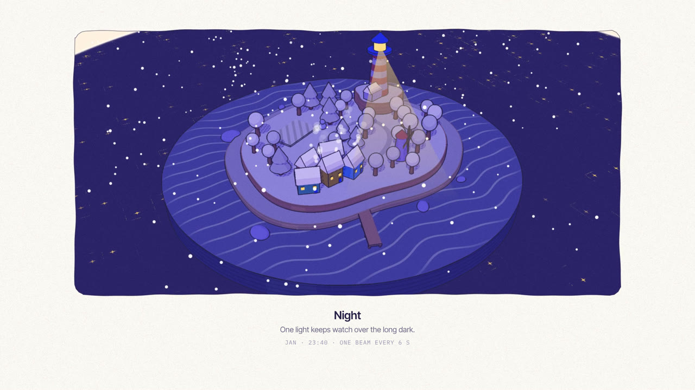

# A Year on the Island

**Made by Phil** ([@framevoid1312](https://github.com/framevoid1312)) with Claude Opus 5.5 writing code · 3 Nov 2026 · Memphis diorama · three.js · 1080p60 · 30 s

A tiny Memphis-style diorama island on one slow orbit. Each season ripples out from the lighthouse as a wave: spring, summer, autumn, winter, night, spring again. Scored and foley-synced in code.

[](a-year-on-the-island.mp4)

**[▶ Watch the video](a-year-on-the-island.mp4)** · [Watch it on the site](https://framevoid1312.github.io/motion-shelf/) · Style: [memphis-diorama style](https://github.com/lemomo-ai/lemo-opuscar/blob/main/styles/memphis-diorama/STYLE.md)

## Prompt

```text
Study this style: https://github.com/lemomo-ai/lemo-opuscar/blob/main/styles/memphis-diorama/STYLE.md
Make a 30-second motion piece "A Year on the Island": a tiny diorama island,
slow orbiting camera, seasons change as a wave rippling out from the lighthouse —
spring → summer → autumn → winter → night → spring again.
English captions under the frame. Music and SFX synced to the action.
Output: MP4 1920×1080, 60 fps.
```

## Rebuild it

The full source is in [`source/`](source/). Serve `source/` with three.js r187 installed at `/node_modules/three` (`npm i three@0.187`), open `index.html` and call `window.seek(t)` to paint frame t. Sound: `python3 score.py` (numpy, scipy) reads `events.json`.

[← Back to the list](../../README.md)
