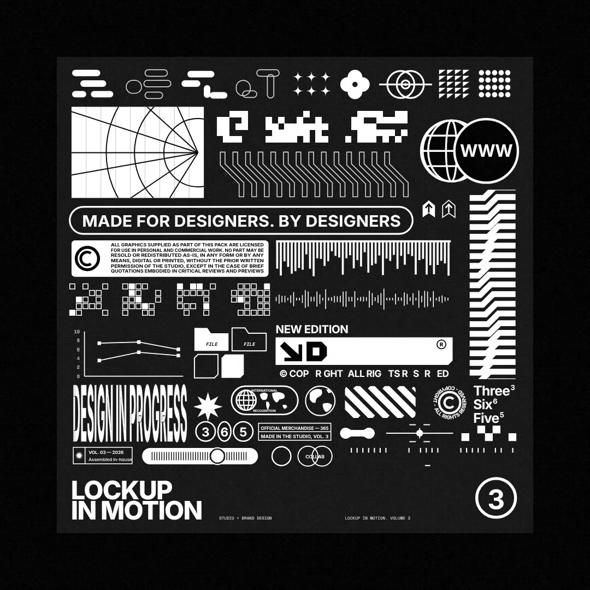

# LOCKUP IN MOTION

Made with Claude Opus 5.5 writing code · 31 Oct 2026 · Swiss brutalism · Remotion · Tone.js · After Effects · 1080×1080 · 30 fps · 20 s

A 20-second, 1:1 brand-asset reel: black frame, white type, grainy footage flashes and data micrographics cut on a 120 BPM grid, building to a dense lockup sheet of about 80 icons, then a clean brand end card. The score is composed in code and every hit lands on a cut.

[](lockup-in-motion.mp4)

**[▶ Watch the video](lockup-in-motion.mp4)** · [Watch it on the site](https://framevoid1312.github.io/motion-shelf/)

It began as a study of a brand-asset reel: after a first build, the reel was compared with the reference frame by frame, re-timed to the measured cuts, and every layout, type size and texture was rebuilt in code. No footage from the reference is used.

## Prompt

The film took four rounds: a first build, a frame-by-frame comparison and fix pass, a soundtrack and an After Effects port. This prompt gets there in one go.

```text
Make a 20-second, 1:1 brand-asset reel in code (Remotion, 1080×1080, 30 fps) for a pack called "LOCKUP IN MOTION — 50 bespoke motion assets", scored to 120 BPM. Every cut lands on the 1/16-note grid (0.125 s); a few land on 1/32.

Look: pure black frame, white elements, lots of empty space, one idea per shot. Inter Medium for the big words (145 px, tight tracking, left-aligned at x≈241), Space Mono for tiny technical labels (10–30 px) set top-left like spec sheets. No colour, no gradients on type, no HUD chrome. Light film grain over everything.

Texture: short flashes of grainy black-and-white "footage" panels behind the type: dark charcoal faceted shapes with bright creases, hard black blotches and heavy photocopy grain, drifting slowly. Make them procedurally (SVG turbulence + polygons), never stock footage.

Type behaviour:
- Headlines type on one letter per ~0.07 s, the newest letter motion-blurred, with a short bar over one letter.
- Labels decode left to right: the unresolved tail cycles random letters, digits and $*^%… for a frame or two, then locks. Fast: most resolve in under 0.15 s.
- The closing URL pops in and out letter by letter in random order, no symbols.

Shot list (seconds):
0–0.5 grey pixel checker flicker · 0.5 a 4-glyph logotype whose letters jump between three heights on 1/16 notes, then settle, over a bright panel · 1.19 thin ring + pixel glyph · 1.38 portrait panel, glyph, hairline · 1.69 light streaks, a lit globe, a white block, then a diagonal hatch · 2.19 LOCKUP · 2.69 IN, then an inverted white block · 3.16 MOTION · 3.56 a beat of black with one dash · 4.0 "50" decodes between two rules · 4.25 "50 BESPOKE   MOTION ASSETS" set, re-set and stacked · 5.13 stepped white blocks · 5.88 a landscape panel, "AE / MOV / GIF" decodes, a square hops · 6.88 a WWW badge with a wireframe globe sliding out from behind · 7.5 bright flash, "SI<" · 7.69 Three³ / Six⁶ / Five⁵ stacked · 8.06 chunky rounded glyphs morph · 8.38 pills, then a line chart · 8.81 two outline pixel grids · 9.13 a thin waveform draws out · 9.38 a mono decoder burst · 9.56 a gooey dumbbell · 10.13 a "NEW EDITION" product strip assembles letter by letter while its arrow mark flips ↗ → ↘ · 10.69 a © ring with counter-clockwise text spins into place · 11.13 a pixel invader stutters · 11.5 a registration crosshair opens · 11.88 a serial number on black · 12.06 a dot matrix on a tall panel.
12.34–15.38 climax: a dense lockup sheet (about 80 icons on an 810-unit grid: rounded-bar glyphs, protractor, pixel words, tube band, WWW badge, a tagline pill typing "MADE FOR DESIGNERS. BY DESIGNERS", a step stack, a copyright block, hanging bars, pixel grids, chart, files, the edition strip, condensed DESIGN IN PROGRESS, badges, a slider, the title block, a circled 3). It assembles in three chunks, keeps ticking and flickering, glitches mid-way (grey corner, inverted window, white blocks), dims, then inverts.
15.38 the sheet is chopped · 15.5 grey pixels collapse to one · 16.0 an hourglass stem becomes a ×, which shrinks · 16.94 "Studio™ × BRAND" slides up into view · 17.69–20 the URL pops in, holds, pops out.

Sound: compose the score in Tone.js and render it offline (no music generators): 120 BPM, syncopated kick, claps, 16th hats, a distorted square-wave bass on the same 16-step syncopation as the cuts, bit-crushed blips and ticks on every on-screen event (each letter, each decode, each block step), impacts at 4.0, 12.34, 16.13 and 16.94 s, a snare roll and riser into the climax, a tape-stop on the dim, pops for the URL letters. Master to −14 LUFS / −1 dBTP and mux it under the video.

Check your work: render contact sheets every 0.1 s, compare them against the shot list, and fix anything off before handing over.
```

## Rebuild it

The full source is in [`source/`](source/). `cd source && npm i && npx remotion studio` to preview, `npm run render` for the 1080 render. Re-score first (see `source/README.md`) to build `public/LockupInMotion_score.wav`. All copy lives in `source/src/brand.ts`.

The After Effects version is the build script in [`after-effects/`](after-effects/): install the fonts in `after-effects/Fonts`, put `LockupInMotion_score.wav` next to the script (pull it out of the film with `ffmpeg -i lockup-in-motion.mp4 -vn -c:a pcm_s24le after-effects/LockupInMotion_score.wav`), then File → Scripts → Run Script File… It builds the whole project as editable layers (34 shot precomps, the sheet as its own precomp, the soundtrack placed); save it as an .aep.

[← Back to the list](../../README.md)
