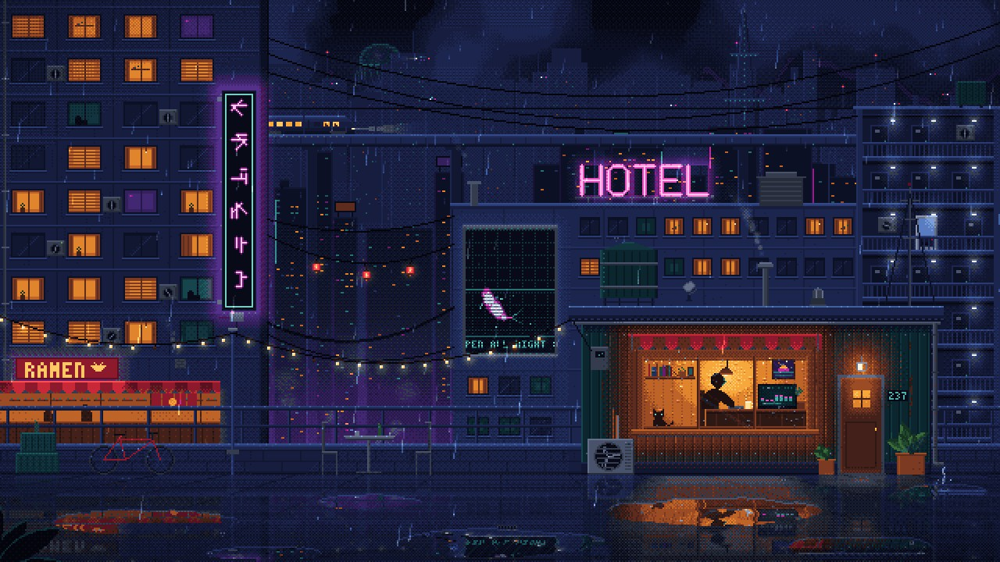

# 02:37 · Rain · 2089

Made with Claude Opus 5.5 writing code · 5 Nov 2026 · pixel art · canvas · 1080p60 · 30 s excerpt of a 4-minute seamless loop

A rooftop hut in the rain at 2:37 AM in 2089, made as the background for a 10-hour lo-fi music video. Inside, someone in headphones works at a desk and now and then turns to watch the rain, while a cat sits on the sill. Outside are a dying HOTEL sign, a koi hologram, sparks from a junction box, a passing elevated train and hover traffic in the sky. Everything is drawn at 640×360 on a 65-colour palette; every glow, fog bank and puddle reflection is snapped back to that palette with a 4×4 Bayer dither, then scaled 3× nearest-neighbour.

[](rain-2089.mp4)

**[▶ Watch the video](rain-2089.mp4)** · [Run it live](https://framevoid1312.github.io/motion-shelf/phil/rain-2089/source/) · [Watch it on the site](https://framevoid1312.github.io/motion-shelf/)

## Prompt

```text
Build a self-contained HTML5 Canvas (or WebGL) pixel art animation serving as a background for a 10-hour looped lo-fi music video. The scene is set in a rainy corner of a futuristic city at 2:37 AM in 2089, with continuous rain, wet streets, and an atmosphere that is melancholic, warm, and mysterious, retaining human warmth despite technology dominance. Use layered composition with narrative focus: foreground features a rooftop hut or apartment (warm interior, silhouettes, small objects); midground includes buildings with AC units, wires, vending machines, and holographic signs; background shows the skyline and elevated trains/flying vehicles. Color palette dominated by deep blue, teal, and indigo cool tones, contrasted strongly with warm amber windows/lights and magenta/violet neon. Wet reflections should be clear; overall dark but not muddy. Animation requires multiple independent loops without jumps: multi-speed/multi-depth rain (including wind drift), drifting fog, rising smoke, dripping water and ripples, irregularly flickering neon and indicator lights, looping screen content, fluctuating indoor lights, occasional sparks, rotating fans, distant vehicle activity and window movements, slight swaying elements, all hypnotic and relaxing. Strict authentic pixel art style, internal resolution 640x360, integer 3x nearest-neighbor scaling, all effects adhere to the pixel grid. Output complete runnable single-file code directly, supporting smooth 60fps, long-term stability, fixed camera, correct scaling, and fullscreen UI-less mode.
```

## Rebuild it

The whole piece is one file with no dependencies: [`source/index.html`](source/index.html). Open it in a browser; F or double-click toggles fullscreen and the cursor hides when idle. Every moving thing is a pure function of time, so the scene repeats exactly every 240 s with nothing building up in memory: record one loop and tile it for a 10-hour video.

URL options: `?loop=240` sets the loop length in seconds, `?t=12.5` freezes a moment, `?scale=3` forces an integer scale. `scene.renderAt(t)` in the console renders an exact frame for frame-by-frame capture; this video was captured that way at 60 fps (t = 8–38 s) and scaled 3× nearest-neighbour.

[← Back to the list](../../README.md)
