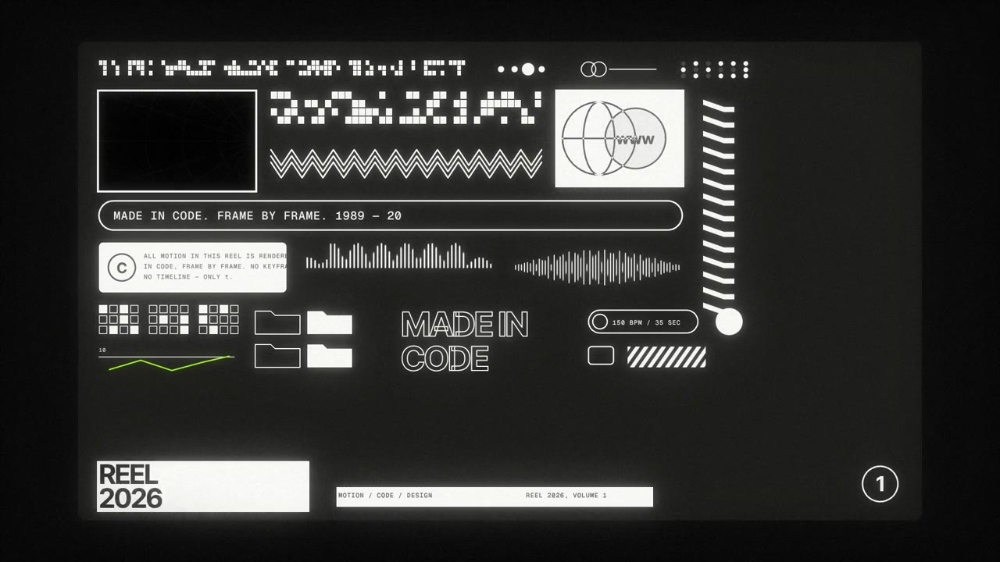

# REEL 2026

Made with Claude Opus 5.5 writing code · 4 Nov 2026 · showreel · Remotion · three.js · Tone.js · 1080p30 · 35 s

A 35-second motion design showreel made in code: a 1989→2026 counter decodes into REEL, then hard-cut micrographics, a 3D point ocean, a poster build and an end card, scored to 150 BPM.

[](reel-2026.mp4)

**[▶ Watch the video](reel-2026.mp4)** · [Watch it on the site](https://framevoid1312.github.io/motion-shelf/) 

## Prompt

The film took ten days of notes. This prompt gets you there in one go: everything those notes settled, written as one brief.

```text
Make me a 35-second, 16:9 motion design showreel, rendered in code (Remotion + three.js, 1920×1080, 30 fps), at senior motion-designer level. No linear, slide-like, "junior" motion: every move has easing with anticipation and overshoot, shots last 4–8 frames, cuts are hard and land on the beat.

Look: black, white, acid lime #9cfa0a and ultramarine #1d0ff7. Small, discreet type (a bold grotesk like Inter Tight for words, a mono like Geist Mono for tiny captions and readouts), never big headline text. Grain, a light vignette, a little chromatic aberration only on cuts. No star shapes, no glass or iridescent effects.

Structure:
- 0–6.5 s: a year counter rolls from 1989 to 2026, slowing as it nears the end and slamming onto 2026. Then 2026 decodes into the word REEL like a type lockup being built: half-drawn glyphs, grey then white, a block cursor, a macron, the tracking snapping tight. Scramble effects only in the tiny mono lines around it, never on the main word.
- 6.5–32.5 s: the actual reel. Rapid sequences of micrographics (grids, rulers, waveforms, icons, dotted fields, data readouts), footage-style cards with studio-lit 3D metal ribbons, a full-frame 3D point-cloud ocean with impacts and a camera fly-through, a poster that builds itself and types a line, a burst of flips, an ASCII-rendered 3D shape, a pixel-dissolve transition and a four-hit recap.
- 32.5–35 s: a quiet end card with REEL 2026, a small odometer and a bar, then dissolve out.

Sound: a 150 BPM score made in code (Tone.js, rendered offline), with a sound on every cut, ticks on the counter, a slam on 2026, hits on each decoded letter, risers into the big moves, mastered to −14 LUFS.

Make every frame a pure function of the frame number. Show me style frames and a 480p preview before the full 1080p render, and check stills from the render before you hand it over.
```

## Rebuild it

The full source is in [`source/`](source/). `cd source && npm i && npx remotion studio` to preview, `./render_full.sh` for the 1080p render. Re-score first (see `source/README.md`) to build `public/mix.wav`. The After Effects version is the script in `after-effects/`.

[← Back to the list](../../README.md)
