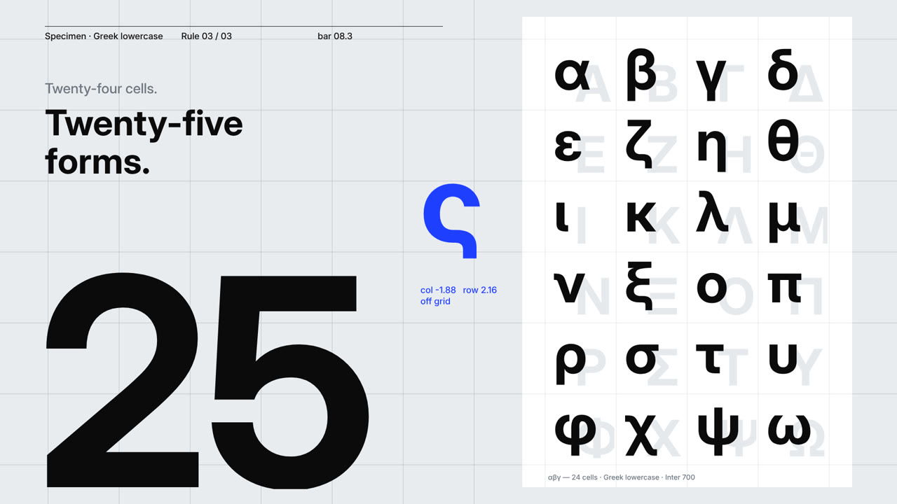

# ς: the letter that only ends

**Made by Phil** ([@framevoid1312](https://github.com/framevoid1312)) with Claude Opus 5.5 writing code · 2 Nov 2026 · Swiss motion · canvas · Greek type · 1080p24 · 31 s

A Swiss-grid type film: 24 Greek letters snap into a specimen sheet, then a blue final sigma breaks every rule, slides off the grid and lands at the end of τέλος.

[](sigma-swiss-motion.mp4)

**[▶ Watch the video](sigma-swiss-motion.mp4)** · [Watch it on the site](https://framevoid1312.github.io/motion-shelf/) · Style: [swiss-motion style](https://github.com/lemomo-ai/lemo-opuscar/blob/main/styles/swiss-motion/STYLE.md)

## Prompt

```text
Learn this style: https://github.com/lemomo-ai/lemo-opuscar/blob/main/styles/swiss-motion/STYLE.md
Then make a test film in it, rendered to MP4.

"ς — the letter that only ends." ~30 s, 16:9 1920×1080, 24 fps, 120 BPM.
Greek-blue #1F3FFF is the one signal colour; Inter for the Greek glyphs.
A single dot appears and the grid grows from it. The 24 Greek lowercase letters
snap into a 4×6 specimen sheet, one per sixteenth, each with a letterpress clack.
A giant 24 climbs in steps. "Correct. A little dull." Then the drums drop and a
blue ς slides out of σ's cell. It moves linearly, off grid, and the 24 turns into
25. "Twenty-four letters. Twenty-five forms." Knife cuts clear the sheet down to
τ ε λ ο, and the ς lands at the end of the word (felt thump). Pull out to a wall
of words that all end in a blue ς. Every other word gets cut away, ending on
"τέλος" flush left in the corner. Music: a marimba and minimal-techno build, plus
a sine tone that follows the ς; no voice-over. Mix to −14 LUFS.
```

## Rebuild it

The full source is in [`source/`](source/). Serve `source/` and open `sigma/index.html` (space = play). Sound: `node export_ev.mjs sigma && python3 sigma/audio/score.py` (numpy, scipy). The style skill written for this film is in `swiss-motion-SKILL.md`; the original LemoLab style is MIT (licence included).

[← Back to the list](../../README.md)
