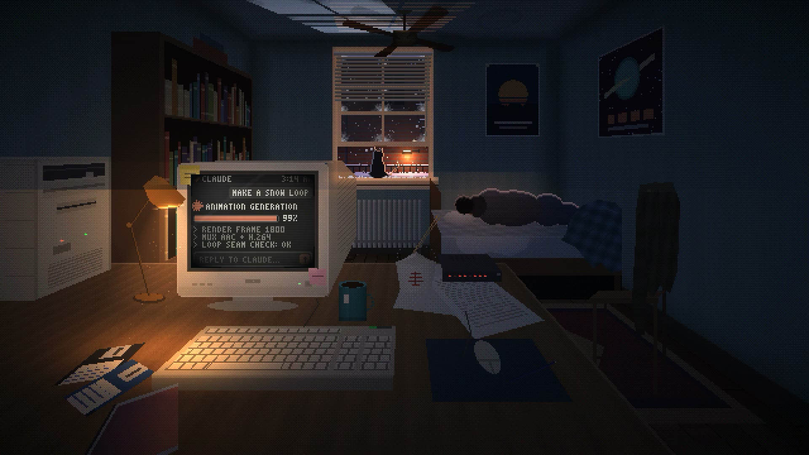

# 03:14 · Snow · 1999

Made with Claude Opus 5.5 writing code · 9 Nov 2026 · pixel art · canvas · 1080p60 · 30 s seamless loop with synced ambience

A lone programmer's apartment at 3:14 AM in the late 1990s, while it snows. He sleeps with his back to the room while a beige CRT finishes an "ANIMATION GENERATION…" job in a dark Claude chat window. The lower sash is raised, so snow drifts onto the sill, where a backlit cat watches the street and turns toward every sound. Car headlights and a snowplow's beacon sweep the ceiling through the blinds, the sodium lamp outside flickers, and a slow ceiling fan casts its shadow overhead. Everything is drawn at 640×360 by a small software renderer with baked light maps and 4×4 Bayer-dithered lighting, then scaled 3× nearest-neighbour.

[](snow-1999.mp4)

**[▶ Watch the video](snow-1999.mp4)** · [Run it live](https://framevoid1312.github.io/motion-shelf/phil/snow-1999/source/) · [Watch it on the site](https://framevoid1312.github.io/motion-shelf/)

## Prompt

```text
Single-file HTML5 Canvas pixel-art loop (640×360, integer nearest-neighbour scale, letterbox, 60fps, no memory growth, click/F = fullscreen, hidden cursor). Fixed camera, one-point-perspective room: lone programmer's apartment, 3:14 AM, late 1990s, snowing.

- Desk (foreground): beige CRT showing a dark Claude chat UI (attached logo, rotating while working; "ANIMATION GENERATION…" + progress bar + streamed log lines + reply box), subtle scanlines/curvature, warm screen spill. Keyboard, floppies, papers, modem LEDs, amber desk lamp with dust in its cone, mug and takeout box scaled true to the monitor, steam wisps, PC tower with blinking HDD LED.
- Midground: man with black hair in a dark hoodie and jeans, sleeping on his side facing the wall (back to us, knees bent), breathing every ~4s; unmade bed; chair with jacket; posters; bookshelf; slow ceiling fan (depth-sorted blades, smooth shading) with a ceiling shadow.
- Window: lower sash raised, open gap with snow drifting onto the sill; frost in the corners; swaying blinds; dark backlit cat on the sill watching the snow (head turns toward events, ear twitches, tail swings). Outside: brick wall, snowy fire escape, flickering sodium street lamp with glittering flakes, 3-depth snowfall with gusts, falling snow clumps, car headlights sweeping the ceiling every 20–60s, rare snowplow beacon.

Palette: near-black blues and teal, warm amber/sodium accents. Calm, melancholic, safe.

Also export a 30s seamless MP4 (1080p60, H.264 + AAC) with street ambience synced to events (wind gusts, muffled city, car tyre hiss panned with the headlights, lamp buzz, PC hum).
```

## Rebuild it

The scene is one file with no dependencies: [`source/index.html`](source/index.html). Open it in a browser. Click or press F to toggle fullscreen; the cursor stays hidden. Every moving thing is a pure function of time, with frequencies quantised to whole cycles per loop, so frame P is identical to frame 0 and nothing builds up in memory.

URL options: `?loop=30` plays the exact 30 s timeline used for the video. The default is a 10-minute loop with headlights every 20–60 s and one snowplow per cycle.

The video comes from [`source/export_mp4.py`](source/export_mp4.py) (`pip install numpy imageio-ffmpeg mini-racer`). It runs the page's renderer in embedded V8 and renders all 1800 frames exactly. The ambience is synthesised from the same event timeline: wind gusts, muffled city, tyre hiss panned with each car, the snowplow, sodium-lamp buzz that crackles when the lamp flickers, PC hum, and HDD clicks timed to the LED. It uses circular FFT filtering, so the audio loops seamlessly too.

[← Back to the list](../../README.md)
