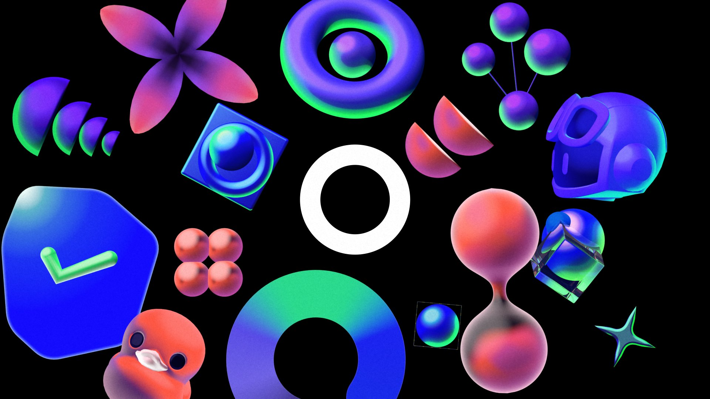

# UNIVERSE 89 → 26

Made with Claude Opus 5.5 writing code · 16 Nov 2026 · motion clone · Blender · Python · After Effects · 1080p30 · 5 s

A frame-by-frame study of the GitHub Universe '23 sting. Fifteen airbrushed 3D objects (a torus, a flower, a metaball "bone", a glass-cube orb, a duck, a shield and more) fly in from off-frame, settle around a ring while the camera pulls back, then collapse into it. A hard cut follows, to a wordmark whose year counts every year from 89 to 26 on a split-flap odometer. Every object's position, size and spin was measured from the reference, not keyed by eye.

[](universe-sting.mp4)

**[▶ Watch the video](universe-sting.mp4)** · [Watch it on the site](https://framevoid1312.github.io/motion-shelf/)

It is a study, not GitHub's film: no footage from the reference is used, and the centre mark is a plain ring instead of their logo. Each object was rebuilt in Blender:
- **Measurements:** per-frame tracks for the camera zoom and each object's centre, size and rotation, taken from the reference.
- **Flower:** traced from the reference petals.
- **Colours:** sampled from the reference, then matched object by object.
- **Grain:** matched to the reference after encoding.

The lockup's scale and the half-digit roll timing are measured too.

## Prompt

The film took many rounds: a measured first build, then passes for motion jitter, colours and shadows, grain, glass, the flower's shape, the ring's end cap and the year counter. This prompt gets there in one go.

```text
Clone this 5-second sting as closely as possible (reference attached). Use the motion-clone method: scan every frame, show me a 4-image storyboard of the beats, wait for my yes, then build.

Measure, don't guess:
- Camera: the zoom curve, from the size of the centre mark in every frame.
- Objects: each object's centre, size and in-plane rotation per frame. Track masks with optical flow, use the inner edge where an object is cut off by the frame, and fit by angle for anything that spins. Position and size are separate curves: objects fly in from further out than the zoom alone explains.
- Colours: the mode colours and luminance quantiles of every object at a settled frame. Use those hex codes, not guesses.
- Grain: measure its strength on mid-tones after encoding and match it. No grain on the black background.
- Typography: lockup scale per frame and when each half of each digit rolls.

Build the objects in Blender as 3D, orthographic camera, emission "matcap" shading that looks airbrushed:
- deep near-black core shadows away from the light;
- broad coloured rims;
- large soft dark patches;
- a pale edge glow.

Shapes come from the reference: trace the flower petal outline from a frame, make the metaball an hourglass (two lobes and a thin smooth neck; it's only cropped by the frame, never cut), half-spheres for the domes and the coral halves, and a flat 2.5D arc for the ring. The ring has a rounded cap and a blue → lavender → dark tail, plus a green highlight that stays at the top of the screen while it spins. The glass cube refracts the sphere behind it, with dispersion.

Motion must be smooth: keys pass through with monotone cubic interpolation (no ease-in/out at every key), and the final position and size tracks are low-passed.

Text section: hard cut, white condensed-black word plus wide light grey digits. Measured scale-down from 128% to 100%. The year counts every year from 89 to 26 like an odometer, each digit split into top and bottom halves that roll slightly out of step, with motion blur.

Deliver the clone, a side-by-side comparison with frame numbers burned in (reference left, clone right), a report of what was measured versus judged by eye, and an After Effects builder script. The builder uses the real 3D models as linked Advanced 3D layers (no pre-rendered plates), measured keys on every frame, and the fonts.
```

## Rebuild it

The source is in [`source/`](source/), plain Python plus Blender's `bpy` module. It needs the measured data that's included and a reference to compare against, which isn't included:
- `sting_scene.py`: the Blender scene. Shapes, materials and per-frame placement come from `spec.json`, `tracks.json` and `tracks2.json`.
- `compose.py`: the compositor for the ring, grain and wordmark, plus the year odometer.
- `colormatch.py`: the per-object colour curves.
- `assemble.py`: encodes the film.
- `export_ae3d.py`: exports every object as a GLB with its look baked in.
- `make_jsx.py`: writes the After Effects builder.

The Copilot and duck models were third-party assets, so they aren't included.

The After Effects version is in [`after-effects/`](after-effects/): install the fonts in `after-effects/fonts`, then File → Scripts → Run Script File… → `Universe_sting_clone.jsx` (After Effects 24.1 or later). It builds the objects as live 3D model layers linked from `models/`, the ring, a grain layer, and the lockup with its odometer, then saves the `.aep`.

[← Back to the list](../../README.md)
